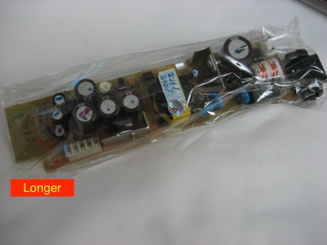
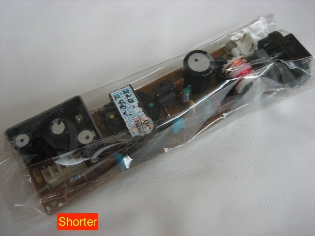

*The longer Saturn power-supply board, one of the different forms Sega used. A matching connector shape isn't proof of electrical compatibility.*
{: .media-caption }

Sega Saturn power supplies are an interesting bunch. As if the different motherboard revisions weren't enough, Sega also managed to use three broad power supply designs, commonly known as Type A, Type B and Type C. So much for swapping them around without a second thought!

**Type B:** Used through roughly VA1 to VA5. This is the long five-pin supply pictured above. Typical pins: `GND, GND, 3.3 V, 5 V, 9 V`.

*And here's the shorter Saturn supply for comparison. Definitely worth checking the rails and pinout before swapping anything!*
{: .media-caption }

**Type C:** Used on later boards. NTSC machines generally have four pins: `GND, GND, 5 V, 5 V`. PAL machines have an additional output, nominally 9 V or 12 V depending on the supply: `GND, GND, 5 V, 5 V, 9 V / 12 V`. Best check the markings rather than assume every PAL machine is the same.

**Type A:** Used on VA0 boards and mounted to the upper casing. Typical connector positions: `GND, GND, 3.3 V, 5 V, NC, 9 V`.

That extra PAL rail is an interesting one. It feeds through to the AV connector for SCART automatic switching, rather than carrying the RGB video signal itself. Composite or bust! ;)

Of course, finding a power supply that physically fits is only part of the problem. The connector pinout and electrical requirements have to match as well, and there's also the local mains voltage to consider. I'd rather not find out I've got the wrong one by watching a Saturn go up in smoke!

These are mains-voltage power supplies, so definitely not something to treat like an ordinary low-voltage console board.

### Sources

- [Sega Saturn PSU swap discussion by Zyrobs](https://segasaturngroup.proboards.com/thread/8097/jpn-pal-psu-swap?page=1)
- [ConsoleMods - Saturn Video Output Notes](https://consolemods.org/wiki/Saturn%3AVideo_Output_Notes)
- [REXUS NEXUS - ReSaturn PSU: Install Guide](https://rexusnexus.com/installation-and-set-up/)
