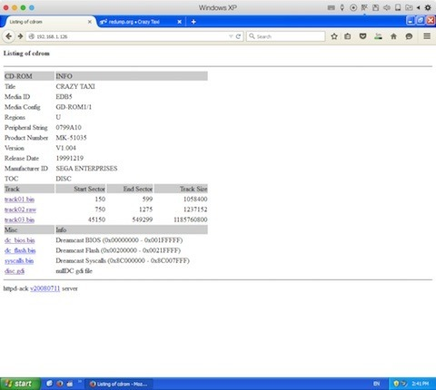
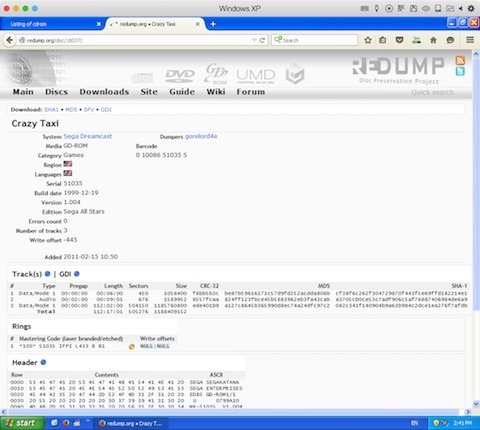
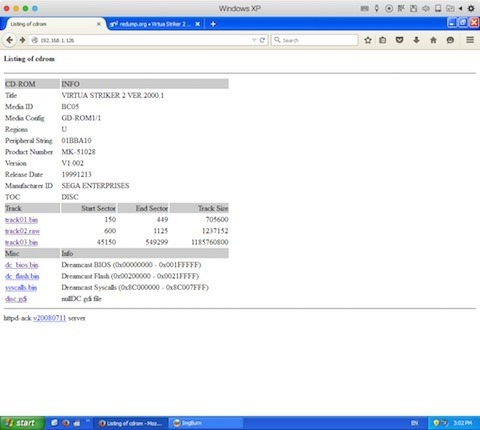
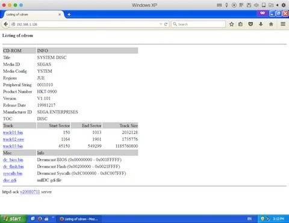

The Dreamcast Broadband Adapter is one of the most awesome pieces of technology you can bolt onto a Dreamcast. With software such as httpd-ack, it's possible to transfer GD-ROM tracks over the network and dump the console's BIOS. Suitable System Disc 2 and disc-swap workflows can also be used for dumping GD-R development media.

I've got four unlabeled pressed Sega discs, or "silvers", all NTSC-U. A very late beta, perhaps? Wouldn't that be interesting!

- ChuChu Rocket!
- Space Channel 5
- Crazy Taxi
- Virtua Striker 2 Ver. 2000.1

There's only one way to find out if these are something special, and that's to start dumping and comparing them. For ChuChu Rocket!, Space Channel 5 and Crazy Taxi, I compared the CRC32 values from my dumps against the retail data represented in Redump. All three matched.

So apparently I had nothing special. Mighty boring! It never hurts to check though, and an unlabeled pressed disc could just as easily be a retail mastering copy as something more interesting.

Virtua Striker 2 Ver. 2000.1 wasn't represented in the database I was checking, so I went hunting through a contemporary scene image instead. Searching for `SEGAKATANA` in a hex editor helped me locate the Dreamcast header inside the CDI file.

That suggests I'm dealing with the retail build, although it's not quite as convincing as a verified byte-for-byte comparison against a known retail dump. Close enough to satisfy my curiosity for now!

I also compared two System Disc 2 copies, S-2XXX and S-3XXX, and the data I dumped from them matched. XDP Browser was useful for getting a static BBA IP address configured before using httpd-ack.

Not a bad result for an afternoon spent rummaging through Dreamcast discs. :)

### Sources

- [dreamcast.wiki - Dumping GD-ROMs](https://dreamcast.wiki/Dumping_GD-ROMs)
- [Redump.org - Disc Preservation Database](http://redump.org)
- [ackmed - httpd-ack README](https://github.com/sega-dreamcast/httpd-ack)
