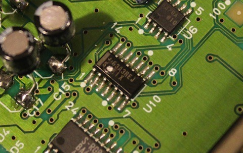
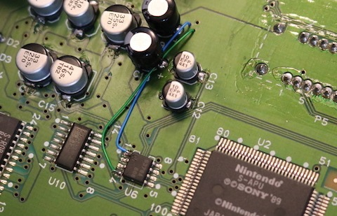

*A close look at the SNES audio circuitry around the small SMD chip and surrounding components. Time for another attempt at getting sound out of it!*
{: .media-caption }

Long-time readers might remember the S-MIX chip with a physical hole blown in it on my old SNSP-CPU-1CHIP-02 Super Nintendo mainboard. That was quite a sight! Now I've got another 1CHIP Super Nintendo with no sound, so perhaps it's time to revisit the idea.

Rather than go hunting for another S-MIX chip, I've been looking at whether I can get audio directly from the UPD6379A DAC at U6. If I can bypass the troublesome part of the circuit, I might at least be able to get the machine making some noise again.

*The added wires on the SNES motherboard show the experimental audio bypass. It worked on this board, though that doesn't prove it's safe as a permanent fix.*
{: .media-caption }

I reversed the polarity! ...I kid, I kid. What I've actually done is run audio from the DAC to the AV output on the underside of the board, bypassing the S-MIX path. Some 30 AWG Kynar wire fits rather nicely through the vias, which makes the whole arrangement a little easier to put together.

And would you believe it? We've got sound! I've been playing Madden and, from what I can tell, all the game audio is there too. That's considerably better than a Super Nintendo sitting around in silence.

Audio issue solved? Fixed? Repaired? Sound for everyone? So it seems! :)

Will it be good for the system in the long term? I have absolutely no idea. Borti raised a good point about the possibility of damaging the DAC by driving a long cable directly from it. Bypassing the S-MIX isn't quite the same as restoring the original audio circuit, so this is a workaround that's working on my particular board rather than something I'd recommend blindly applying to every no-sound SNES.

For now, though, it's nice to have this one making noise again! Big thanks to [Stian](https://web.archive.org/web/20191029031401/http://nintendoage.com/forum/messageview.cfm?catid=8&threadid=156634), [Armando92](https://www.youtube.com/channel/UCpQ4cGZT5ugySL7jiX9LFKA), [Borti](https://web.archive.org/web/20191112060628/https://assemblergames.com/threads/snes-mainboard-repair-no-sound-serial-up17372657.63061/) and [Console5](https://console5.com/wiki/UPD6379) for the information that got me this far.

### Sources

- [Console5 TechWiki - UPD6379](https://console5.com/wiki/UPD6379)
- [NEC - UPD6379, 6379A, 6379L, 6379AL datasheet](https://wiki.console5.com/tw/images/9/98/UPD6379.pdf)
- [NintendoAge - SNES 1chip with no sound (archived)](https://web.archive.org/web/20191029031401/http://nintendoage.com/forum/messageview.cfm?catid=8&threadid=156634)
- [ASSEMblerGames Archive: SNES No-Sound Mainboard Repair (Serial UP17372657)](https://web.archive.org/web/20191112060628/https://assemblergames.com/threads/snes-mainboard-repair-no-sound-serial-up17372657.63061/)

### Related Posts

- [Damaged S-MIX on a SNES SNSP-CPU-1CHIP-02 Mainboard](/damaged-s-mix-on-a-snes-snsp-cpu-1chip-02-mainboard/)
- [Capacitor Order Day](/capacitor-order-day/)
