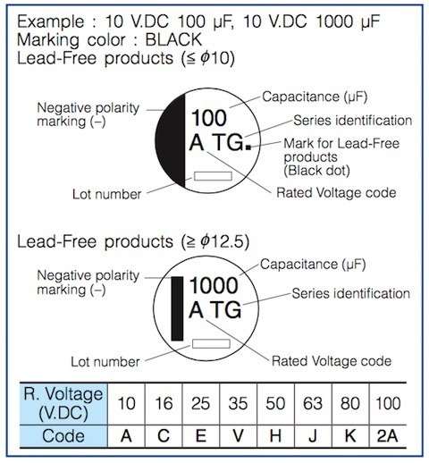

*This marking guide actually illustrates TG-series capacitors. Useful for understanding Panasonic's voltage codes, but the FP series still needs its own datasheet.*
{: .media-caption }

Just a little reminder for myself the next time I'm trying to work out the voltage rating from the markings on Panasonic FP-series SMD capacitors. The saved marking illustration uses a TG-series example; Panasonic's FP datasheet confirms the FP voltage codes below:

- `j` = 6.3 V
- `A` = 10 V
- `C` = 16 V
- `E` = 25 V
- `V` = 35 V

Useful! I should still check the correct manufacturer and series datasheet rather than assuming every SMD electrolytic uses the same letters. Back to replacing capacitors I go. Tra-la-la-la-la-li! :-)

### Sources

- [Panasonic - FP Series Aluminium Electrolytic Capacitors](https://industrial.panasonic.com/cdbs/www-data/pdf/RDE0000/ABA0000C1184.pdf)
