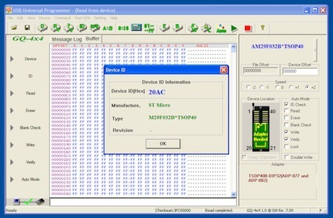
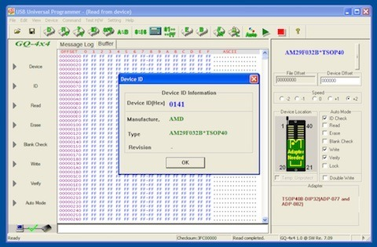

Does the first chip look like an AMD AM29F032B? According to the markings on top, that's exactly what it is. My GQ-4X4 programmer had other ideas, though!

The manufacturer and device identification it reported was consistent with an ST M29F032D, as you can see in the first screenshot. That strongly suggests somebody remarked the chip, although I haven't decapped it or inspected the silicon to prove exactly what's hiding underneath.

For comparison, the second screenshot shows my known-good AMD example. Both devices worked in my SNES flash-cart project using the TSOP-to-Willem adapter, so at least the suspicious one was still useful.

What I can say is that the first chip didn't identify electronically as the AMD part printed on top. I still don't know why somebody decided ST Micro needed an AMD costume. ST isn't *that* bad!

### Related Posts

- [Introducing the GQ-4x4 / GQ-4X v4](/introducing-the-gq-4x4-gq-4x-v4/)
- [Programming AM29F032B on the MiniPro TL866](/programming-am29f032b-on-the-minipro-tl866/)
