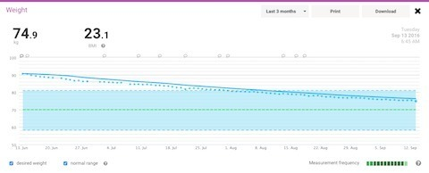
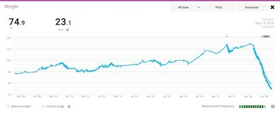
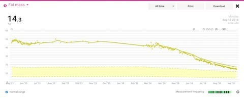
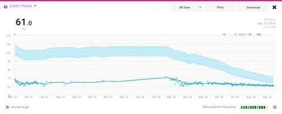

Steady as she goes, captain! Over the past three months I've been averaging around 1.2 kg of weight loss per week. That's still faster than I'd been aiming for, so it's probably time to start putting the brakes on a little.

I've been working towards a series of goals:

1. Under 100 kg
2. 81 kg, entering the BMI category I'd been aiming for
3. 75 kg
4. 70 kg
5. Maintain 70 kg rather than continue losing forever

The scale has gone from 114.7 kg to 74.9 kg, a difference of 39.8 kg. Just a little further and it'll be a nice round 40 kg! That's more than half my current weight. Way past cool!

The body-fat and lean-mass graphs are interesting too. These figures come from a consumer body-composition scale, so they're estimates rather than direct measurements of exactly how much fat and muscle I've got.

I wonder whether the falling lean-mass estimate is partly because my body doesn't have quite as much weight to carry around now. Seems plausible, although the scale alone can't really tell me what's happening there.

As for cholesterol and blood glucose, I suppose eating less carbohydrate and sugar doesn't automatically tell me what those numbers are going to be. I'll need actual blood results for that. Sanitarium Up&Go remains innocent until proven guilty. ;-)

### Sources

- [Bosy-Westphal et al.: Bioelectrical Impedance Consumer Device Accuracy (2008)](https://pubmed.ncbi.nlm.nih.gov/20054195/)
