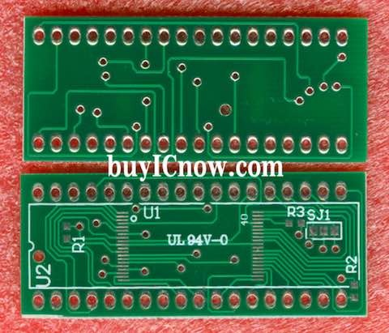

I've found an interesting little workaround on the NESdev forums for programming AM29F032B chips with the MiniPro TL866. The MiniPro software doesn't officially list the AM29F032B, but apparently there's a way around that!

The trick is to select Fujitsu MBM29F033C in the software, disable the device-ID check and program the AMD chip through the appropriate TSOP adapter. A few people have reported getting this working, which sounds promising.

I haven't actually tried it myself yet. I tend to use the Type II boards rather than the Type III boards discussed in the original thread, and I'm still using my GQ-4X4 for this sort of thing. It hasn't exploded yet, which is always encouraging!

I've also had ST M29F032D chips working with my GQ-4X4 setup. Whether they'll behave themselves with the same TL866 workaround is another matter entirely. Just because one programmer gets along with them doesn't mean another one will.

Still, it's a useful trick to know about. I'll have to give it a proper test one day rather than just sitting here wondering whether it'll work! :)

### Sources

- [NESdev - A question about programming AM29F032B chips (archived)](https://web.archive.org/web/20231014225637/https://forums.nesdev.org/viewtopic.php?t=8913)
- [ElOtroLado - Programar diferentes memorias en un TL866CS (2014 community report)](https://www.elotrolado.net/hilo_aporte-programar-diferentes-memorias-en-un-tl866cs_2022489)

### Related Posts

- [TSOP40 Flash Chips - Fakes and Counterfeits](/tsop40-flash-chips-fakes-and-counterfeits/)
