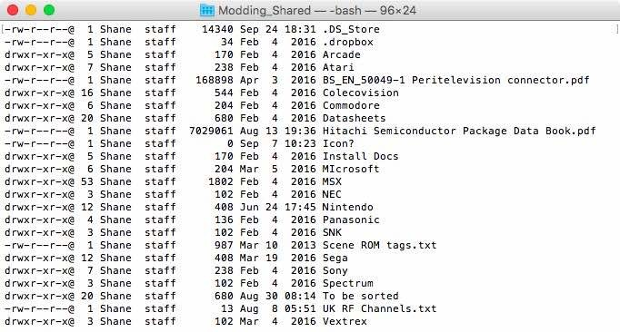

Well, I've managed to get hundreds of posts imported from WordPress into Jekyll. All 566 of them, apparently! Unfortunately, WordPress has left quite a bit of unnecessary rubbish behind in the Markdown files. Lovely.

Rather than work through everything manually, I've been playing around with `find`, `xargs` and `sed` under OS X 10.11.6. Nothing like pointing a command at hundreds of files and hoping you haven't made a terrible mistake!

The first job is getting rid of the `_publicize_twitter_user` metadata from roughly 500 imported posts. Here's the command I've been working with, with the original account name replaced by a placeholder:

`find . -type f -print0 | xargs -0 sed -i '' /" _publicize_twitter_user: '@HISTORICAL_HANDLE'"/d`

The `find` command locates the files, while `xargs` passes them along to `sed`. Using `-print0` and `-0` helps keep filenames containing spaces from causing trouble. Finally, `sed` removes the lines matching the unwanted metadata.

One thing to watch with this command is that `find . -type f` selects every regular file under the current directory. Not just Markdown posts! I'd be much better off restricting it to the `_posts` directory and checking the files before letting it loose on everything.

The `-i ''` part is another important detail. That's the BSD `sed` syntax for editing files in place without keeping backup copies. Very convenient, provided I've already made a backup myself. With 566 posts at stake, I think I'll be doing exactly that!

### Removing HTML Paragraph Tags

Another thing that came across in the WordPress import was a whole lot of HTML paragraph tags. Markdown doesn't need `
` and `
` wrapped around every paragraph, so I'd rather get rid of the unnecessary ones.

A simple example for removing literal opening and closing paragraph tags from Markdown files inside `_posts` would be:

`find _posts -type f -name '*.md' -print0 | xargs -0 sed -i '' -e 's#
##g' -e 's#
##g'`

That'll deal with plain `
` and `
` tags, but not every possible variation of HTML. It also won't magically insert missing paragraph breaks, so I'll still need to check the results rather than assume everything has worked perfectly.

I'd strongly recommend experimenting on a copy first. Accidentally making a mess of one file is annoying. Accidentally making a mess of 566 files? That's a rather different achievement!

At least Markdown is quite pleasant to work with once all the junk is gone. Now to see how long Jekyll lasts before I find something else to break.

**start chant** markdown, markdown, markdown **/end chant**

### Sources

- [Apple Open Source - sed manual](https://raw.githubusercontent.com/apple-oss-distributions/text_cmds/main/sed/sed.1)

### Related Posts

- [McRetro.net Rebooted](/mcretro-net-rebooted/)
- [Markdown and Apache](/markdown-and-apache/)
