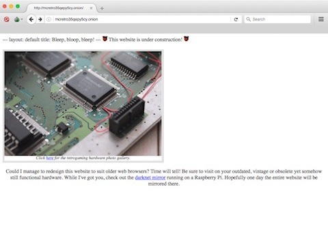

*An early version of McRetro showing the circuit board header and a mention of the darknet mirror. Quite a different look!*
{: .media-caption }

More specifically: Markdown, Apache and the darknet. I've got the old McRetro onion address loading, but Apache is serving up the Markdown files as plain text. Baby steps! At least the site's somewhat functional... right?

I've been wondering whether there's an Apache module, Perl script, Ruby script or PHP script that can translate everything on demand. Of course, serving up a `.md` file isn't going to magically turn it into HTML. Something needs to do the rendering first.

Jekyll might be the answer here. It can build the Markdown into HTML, leaving Apache to serve the finished website rather than trying to translate everything as it's requested. That sounds a bit more sensible than reinventing the whole thing myself!

**Update:** My GitHub Pages / Jekyll setup doesn't support lots of the fancy mods I want... maybe this was a bad idea! :-D

**Update 2026:** The original address was [http://mcretro35qepy5cy.onion](/goodies/), a Tor v2 onion service. That address format was retired in 2021, so the link now leads to the Goodies page instead.

### Sources

- [Jekyll - Command Line Usage](https://jekyllrb.com/docs/usage/)
- [Tor Project - Onion Service version 2 deprecation timeline](https://blog.torproject.org/v2-deprecation-timeline/)
- [GitHub Docs - About GitHub Pages and Jekyll](https://docs.github.com/en/pages/setting-up-a-github-pages-site-with-jekyll/about-github-pages-and-jekyll)

### Related Posts

- [The Birth of Eleventy7.net](/the-birth-of-eleventy7-net/)
- [McRetro.net Rebooted](/mcretro-net-rebooted/)
- [Take Back the Darknet: The Complete 2016 Guide](/take-back-the-darknet/)
