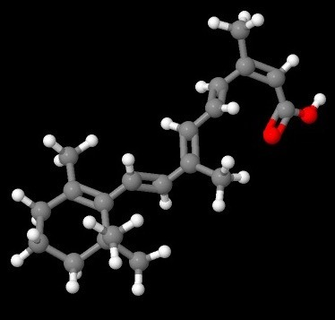

I'm preparing to start isotretinoin, better known as Roaccutane, and naturally I've been looking into the various side effects. Wouldn't it be nice if I could avoid at least some of them? Time to get the spreadsheets out and see what I can find!

There are quite a few things I want to investigate, particularly the possible effects on my joints, skin, hair and blood results. I've been looking at fish oil, glucosamine and a few other supplements, although there's a big difference between hoping something will help and actually knowing that it will.

### Fish Oil and Omega-3

I'm already eating salmon every day. According to the nutritional information I'm using, that's giving me the following:

| EPA | DHA | Total EPA + DHA |
|---|---|---|
| 511 mg | 783 mg | 1294 mg |

The fish-oil capsules I've got contain the following amounts. The columns for two and six capsules show the totals I've been calculating:

| Quantity | 1 capsule | 2 capsules | 6 capsules |
|---|---|---|---|
| EPA | 180 mg | 360 mg | 1080 mg |
| DHA | 120 mg | 240 mg | 720 mg |
| Total EPA + DHA | 300 mg | 600 mg | 1800 mg |

I've been taking two capsules with each meal, making six capsules per day. That's 1800 mg of EPA and DHA from the capsules, plus another 1294 mg from the salmon. Total: **3094 mg of EPA + DHA per day**.

Why all the fish oil? I've found an interesting study in which fish-oil supplementation reduced isotretinoin-associated increases in triglycerides and cholesterol in the patients studied. That's certainly caught my attention!

I'm also wondering whether it might help with any joint or muscle problems. The trouble is that the study doesn't actually establish that, and the arthritis guidance I've been looking at isn't specific to isotretinoin. So there's no guarantee my grand fish-oil experiment will achieve what I'm hoping for.

My latest recorded cholesterol was around 3.4 mmol/L, with triglycerides around 0.5 mmol/L. It'll be interesting to see how those numbers behave as treatment progresses.

### Glucosamine and Other Supplements

I've also added 1500 mg of glucosamine sulfate. Heck, it was on special! Then there's Swisse Ultiboost Hair Skin Nails+, which includes milk thistle.

I'm hoping some of these might help with joint, hair, nail, skin or liver-related problems, but I haven't got evidence that this combination will prevent those effects. They are still supplements with their own possible side effects and interactions. I'll need to be careful about what I'm taking alongside a prescription medicine.

### A Few Things to Keep in Mind

Isotretinoin isn't something to take lightly. There are a few important instructions in the medicine information, including taking it as prescribed, taking standard capsules with food, avoiding vitamin A supplements and not combining it with tetracycline antibiotics.

Blood donation is also off the menu during treatment and for at least one month afterwards. That's particularly important because of the risk the medicine poses during pregnancy.

Dry skin and lips seem almost inevitable, so moisturiser will probably be getting a workout. And then there are the other possible side effects. What could possibly go wrong? Nosebleeds, for example, don't sound fun at all!

I'll have to see how things go. I've certainly done enough spreadsheet work for one day, but whether all these supplements actually help is another matter. None of this is a recipe for somebody else to follow.

### Sources

- [Australian Commission on Safety and Quality in Health Care - Roaccutane](https://www.safetyandquality.gov.au/medicine-finder/roaccutane)
- [PubMed: Fish Oil and Retinoid-Associated Hyperlipidaemia (Isotretinoin/Etretinate)](https://pubmed.ncbi.nlm.nih.gov/2954894/)

### Related Posts

- [Ceasing Minocycline Before Isotretinoin](/ceasing-minocycline-before-isotretinoin/)
