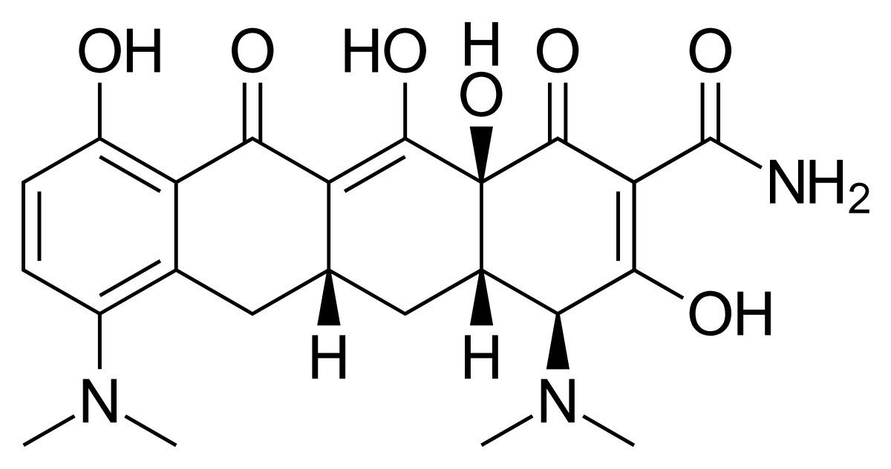

Well, that's four weeks of minocycline out of the way, and I've decided to stop taking it. I can't say I've particularly enjoyed taking an antibiotic just to sort out my skin, even if the results have been rather impressive!

I'm also preparing to start isotretinoin, so the timing between the two medicines is something I need to be careful about. They shouldn't be taken together because of the risk of intracranial hypertension. I've left roughly two weeks between them, although that isn't a general recommendation for how long somebody else should wait. That's something to work out with the prescriber.

I'd also like to squeeze in another blood donation before starting treatment. Minocycline for mild acne or rosacea doesn't necessarily rule somebody out under Lifeblood's guidance, although medication and eligibility still need to be checked with them.

Isotretinoin is another matter. Blood donation isn't permitted during treatment or for at least one month afterwards, so I'd better get that donation organised while I can!

**Update:** It appears that minocycline only works as long as you're taking the pills. After approximately eight days my skin has become a bit spotty again, just like it was before. It was incredible having such good skin for a while. Here's hoping isotretinoin is a long-term solution! :-)

### Sources

- [Australian Commission on Safety and Quality in Health Care - Roaccutane](https://www.safetyandquality.gov.au/medicine-finder/roaccutane)
- [Australian Red Cross Lifeblood - I'm taking antibiotics. Can I donate?](https://www.lifeblood.com.au/faq/eligibility/medications-vaccines-treatments/antibiotics)

### Related Posts

- [Isotretinoin (Roaccutane) Treatment Notes](/isotretinoin-roaccutane-treatment-notes/)
