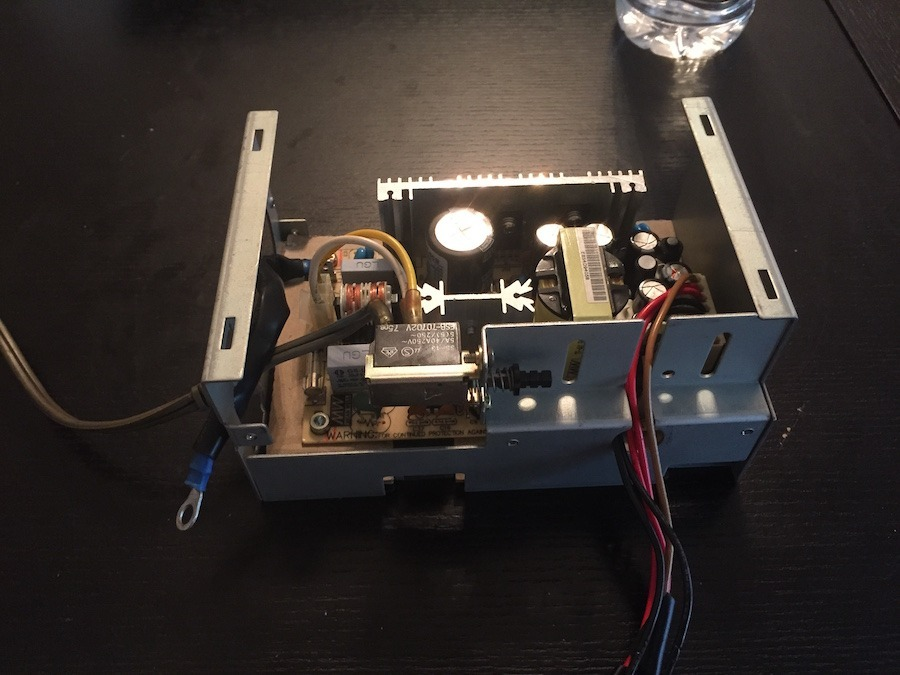
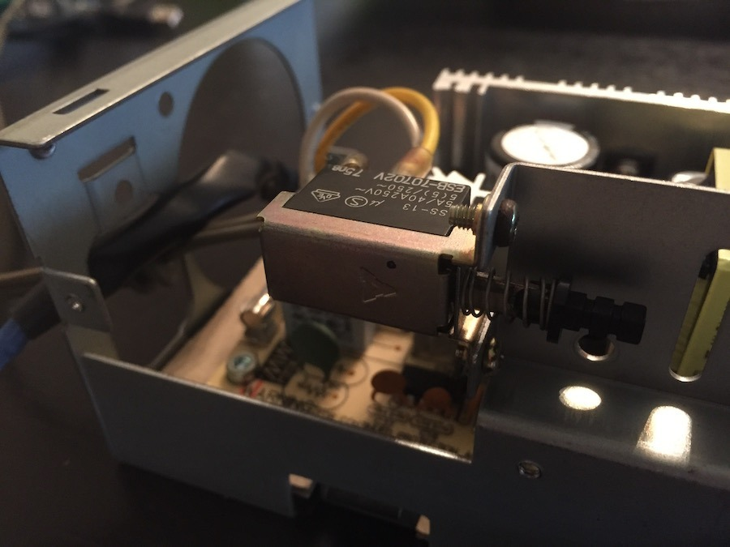
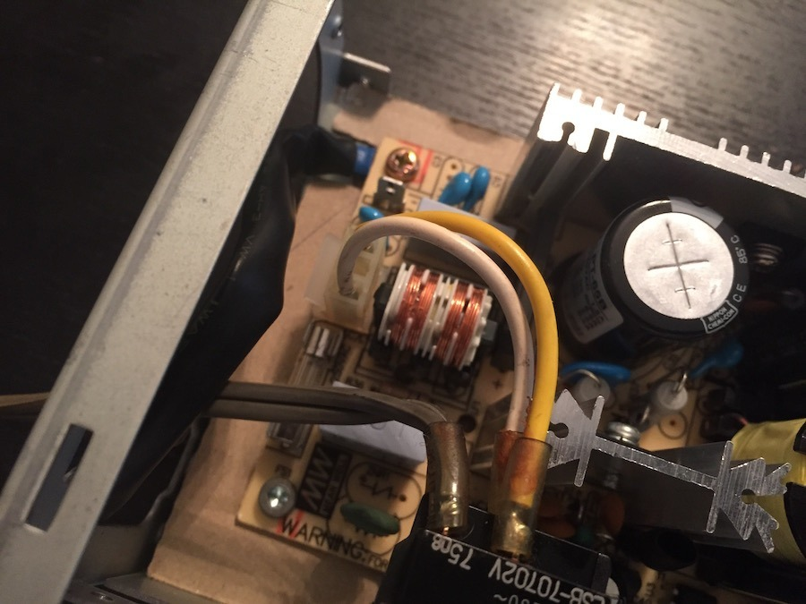
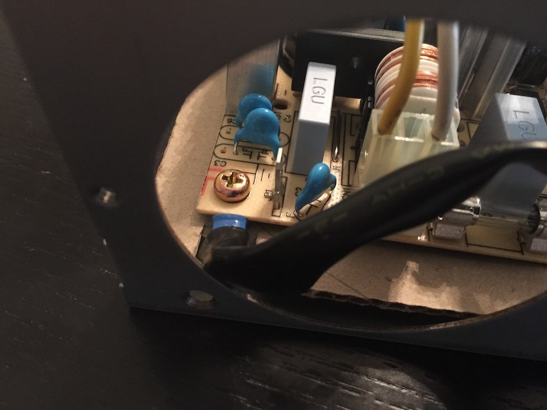
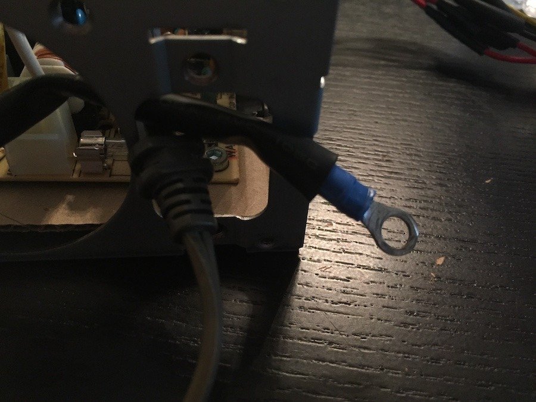
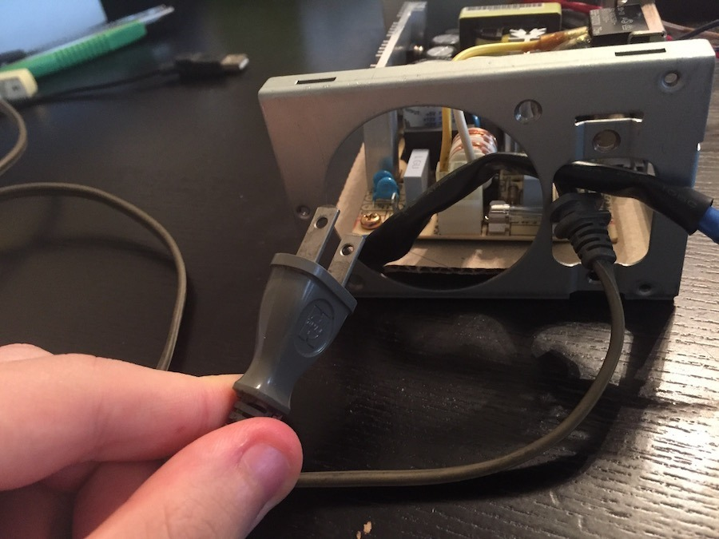
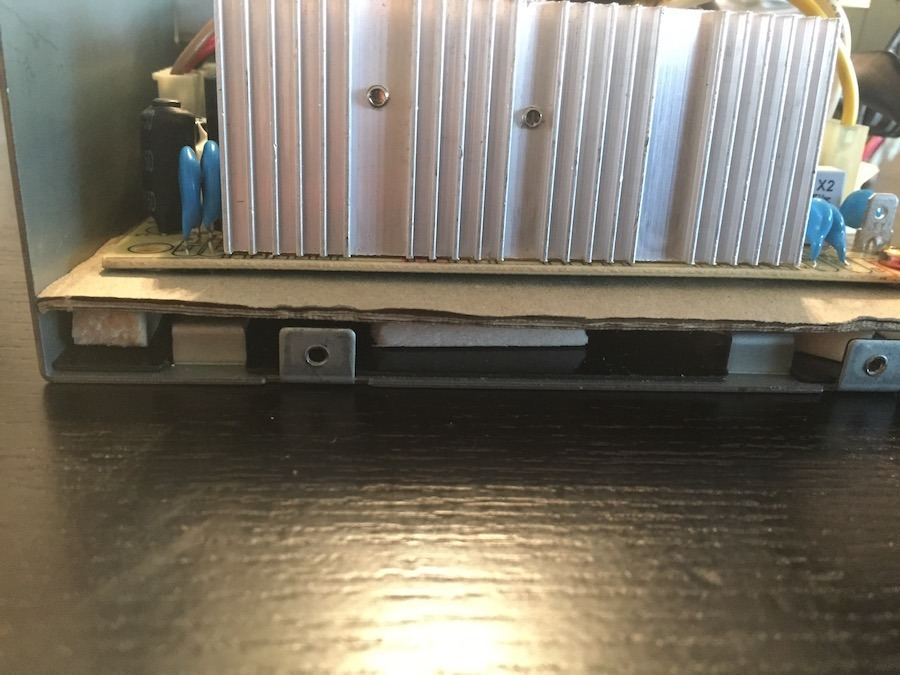
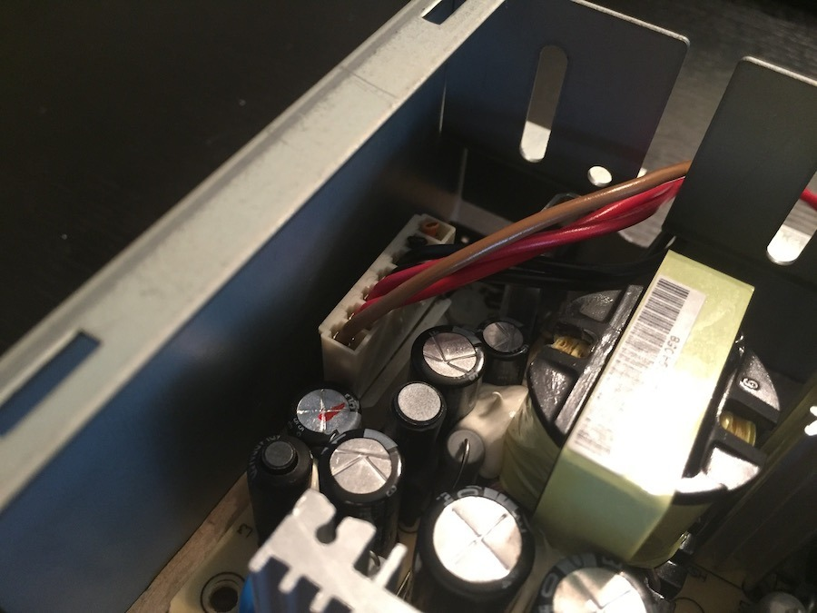
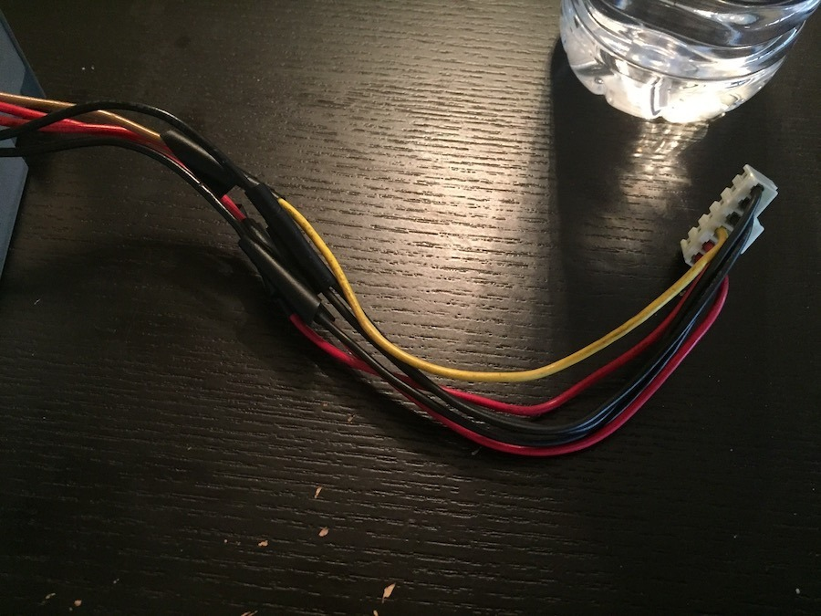

I've been noticing a few people looking for ways to replace failed Sega TeraDrive power supplies. Others are simply trying to get away from having to run a Japanese machine through a large external step-down transformer. I'm firmly in that second group!

DeChief over on ASSEMblerGames has come up with an interesting solution using a Mean Well PT-65B power supply fitted inside the original TeraDrive PSU housing. The photos here are courtesy of DeChief and show his installation rather than one I've carried out myself.

The PT-65B is a 65 W triple-output switching supply, giving us:

- +5 V
- +12 V
- -12 V

It also accepts a universal 90 to 264 V AC input, which is rather convenient when dealing with Japanese computers in Australia. No more enormous transformer just to turn the thing on? Now that sounds appealing!

As you can see, the replacement board fits remarkably well inside the original housing. It's quite a tidy way of approaching the problem, especially if you're trying to keep the TeraDrive looking as original as possible from the outside.

One interesting difference is that the PT-65B has a -12 V output. The stock TeraDrive power arrangement doesn't normally provide that rail, so it raises the possibility of making it available to suitable expansion hardware.

Of course, having -12 V available on the power supply doesn't mean it can simply be connected to an ISA slot without checking the machine's wiring. That's another part of the modification that would need to be worked out properly.

There's one rather important consideration here: the PT-65B is an open-frame mains power supply. The photographs are a useful look at the physical arrangement, but they aren't a complete set of electrical installation instructions. Earthing, fusing, insulation, clearances and mains wiring all need to be dealt with correctly.

Still, it's an interesting alternative to the original supply, and certainly something worth investigating. Thanks again to DeChief for the photographs and for showing what's possible!

### Sources

- [Mean Well: PT-65 Series 65 W Triple-Output PSU Datasheet](https://www.meanwell.com/Upload/PDF/PT-65/PT-65-SPEC.PDF)

### Related Posts

- [Sega TeraDrive Model 3 Power Supply Failure](/sega-teradrive-model-3-power-supply-failure/)
- [Sega TeraDrive Model 3 - Faulty Power Supply (Part 1)](/sega-teradrive-model-3-faulty-power-supply-part-1/)
- [Sega TeraDrive Model 3 - Faulty Power Supply (Part 2)](/sega-teradrive-model-3-faulty-power-supply-part-2/)
- [Sega TeraDrive Power Supply Problems](/sega-teradrive-power-supply-problems/)
