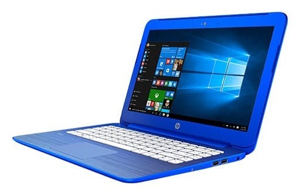

What's this we have here? The HP Stream 11, an ultraportable laptop with a decent keyboard for AU$215. That's US$164 at the time of writing. It's outdated and ultimately not suitable for everything I do day-to-day, but I've been curious about how easily I could migrate from my Mac to a Linux-based machine.

Turns out I couldn't, but now I can!

My main requirements for a computer are:

- A decent-sized keyboard with properly sized keys and no quirky key configurations.
- A 13" or 14" screen with a resolution that doesn't cause "flyscreening".
- Lightweight, at around 1.5 kg.
- No CD drive.
- A 2.5" hard drive.

Well, it's just like Meat Loaf always said, 3 out of 5 ain't bad!

I've compromised on the 13"/14" screen size by getting an 11" machine, and swapped the requirement for a 2.5" hard drive for 32 GB of eMMC storage. In all honesty though, those requirements are really for replacing my MacBook Air with a full-blown PC.

The HP Stream has a great keyboard compared with some of the other offerings on the market. The trackpad isn't too bad either, once you realise you don't have to rest your thumb on it. Thanks Apple for teaching me to do that with your oversized trackpads!

The 11" screen doesn't have any flyscreening because the resolution isn't being stretched out to 14", as it was on some of the other models on display. Windows 10, though? Well, that had to go in the bin. Or rather, onto a recovery drive in case I ever decide to part with this laptop. WIMBoot is a Windows 8.1 deployment feature, so I'm keeping that separate from the recovery image.

Windows 10 on a cold boot was using half of the 2 GB of RAM. Two gigabytes! So tiny! I've tried Lubuntu, Xubuntu, full-blown Ubuntu, Debian and even Arch. The Ubuntu variants are Debian-based, whereas Arch is a separate distribution.

The best compromise I've found between RAM usage and usability is Xubuntu. Lubuntu feels a little too dumbed down with the whole LXDE thing going on, while Xubuntu, using Xfce, feels quite homey.

In my rough cold-boot checks, Xubuntu used something like 270 MB of RAM. Ubuntu used around 1 GB with Unity in full swing, and Debian with GNOME 3 came in around 500 MB. Lubuntu was pretty similar in my notes, although I didn't record a proper comparison. These aren't exactly controlled benchmarks, but they give me a fair idea of what each installation is doing.

Arch was simply too much hassle for me to set up. I must admit I can see the attraction, though. If I had more time I'd probably reinstall the operating system a few dozen times just to get the hang of it!

Xubuntu has my attention because just about everything works out of the box. Next comes the search for equivalent programs to what I use on the Mac, starting with the web browser.

Hmmm... no Safari for Linux, which means my iCloud bookmarks won't sync. In the bin with Safari! I've moved over to Firefox with Firefox Sync, slapped Classic Theme Restorer in, and suddenly it doesn't look so bad. Why use all those curved tabs taking up most of the screen?

Another advantage of Firefox is having the extensions I want: Disconnect, HTTPS Everywhere and uBlock Origin. Finally! That's the browser side of things handled.

I like having a dedicated email client, so I've gone with Mozilla Thunderbird, which also has a calendar. It doesn't delete emails like... ummm... oh! Evolution does! Or at least that was the rumour. I'm not taking that risk.

Coming from OS X, and yes, I'm still on 10.11, I need to make things look a little prettier. Enter Numix. Numix solves that problem rather nicely. Thank you, Numix!

Contact syncing has been fairly straightforward to move from iCloud to Google, and calendars have come across as well. Reminders are still a work in progress. Perhaps this is an opportunity to switch over to Notes on the Mac and merge my long-term to-do list into Notes. Notes seems to be syncing with Google, but I'm not entirely sure where the notes are going. Something else to investigate!

Rhythmbox looks promising as a music player. I've even got AirPlay working through a recompiled version of PulseAudio with RAOP2 support (`pulseaudio-raop2`). The original RAOP implementation doesn't work for me at all. Or rather, it jitters along, giving me a smidgen of a song every few seconds. Lovely.

Encrypted folders are another thing I've started investigating, this time with Cryptkeeper, a GUI for EncFS. It's not the same as opening macOS encrypted sparsebundles, but it gives me a similar encrypted-folder workflow. Whole-disk encryption seems just as straightforward as on a Mac, which is fantastic. The decryption prompt isn't even ugly like Debian or Arch! :)

For backing up my data, all 32 GB of it, I could probably get away with `rsync` or `grsync` onto an encrypted microSD card. Yes, I do still like a GUI! If I eventually move to a machine with a 2.5" drive, I'll be sure to grab an SSD and arrange something more reliable than backing everything up to an SD card.

Taking all of that into account, I'm more ready than ever to switch to Linux when the time comes. That'll probably be when my Mac dies, although it's nearly three years old and still going strong. Chances are I'll replace my phone before my laptop.

On that note, I'm also testing whether Android can handle my current setup. For the most part it can. Gmail, contacts, calendars and Firefox bookmarks are all syncing quite nicely. I reckon I could survive with a hardy 3.5" or 4" phone. Incredible that 4.5-5" is now considered small. Where did we go wrong?

With all that said, here's hoping I don't actually have to switch computers or phones for a while yet. But when I do, I'll be ready to make the move! ;)

### Sources

- [Microsoft - DISM Image Management Command-Line Options](https://learn.microsoft.com/en-us/windows-hardware/manufacture/desktop/dism-image-management-command-line-options-s14)
- [Arch Linux - About](https://archlinux.org/about/)
