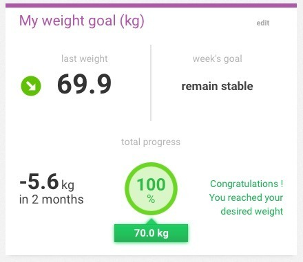
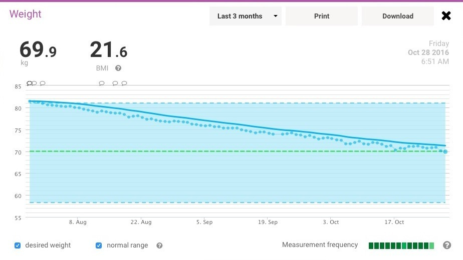
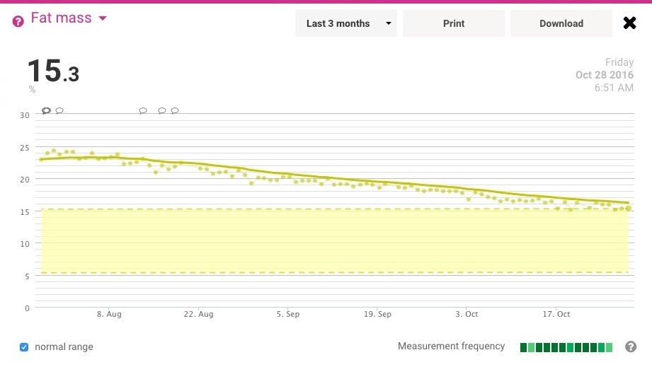
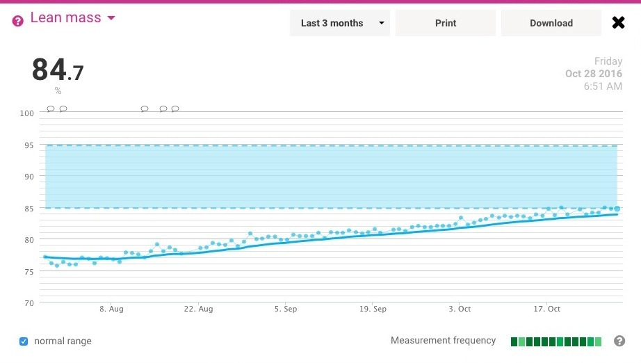

Well, that was a ride! I've made it down to 70 kg, which puts me around the middle of the BMI "healthy weight" range for my height. It's been quite a journey getting here, especially considering where I started earlier in the year!

BMI is only one of the things I've been keeping an eye on, but it's still nice to reach another goal. Now to see what the rest of the numbers have been doing.

Next up I'll head towards 65 kg and see what the scale's estimated body-fat percentage does along the way. I'm getting rather curious about how these figures are going to behave as I get closer to where I want to be.

Of course, what goes down must come up... or at least that's what the scale's percentages seem to be doing! As the estimated body-fat percentage comes down, the estimated lean-mass percentage goes the other way.

That doesn't necessarily mean I'm gaining lean tissue in kilograms, though. These are percentages from a consumer body-composition scale, and it's quite possible for one percentage to rise simply because another is falling. Still, the graphs are interesting to watch!

The future sure is looking bright. University is just around the corner and my life is hopefully coming together. There's plenty to look forward to, and I'm rather excited to see where things go from here.

_**\*stares at pile of unedited YouTube video\***_

Well... mostly coming together... ;-)
