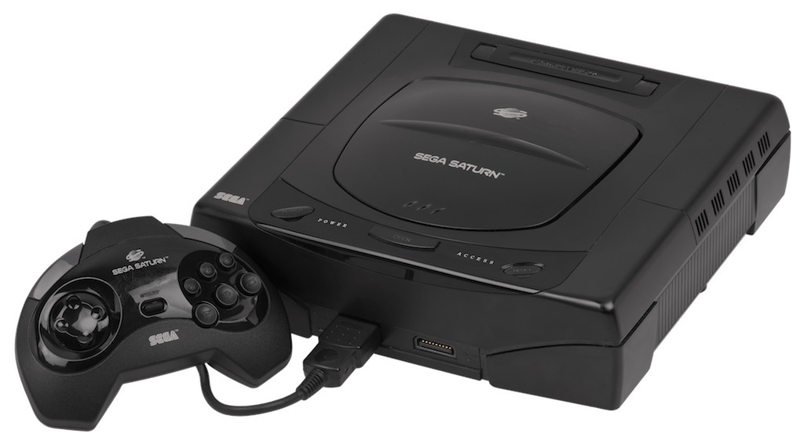

*The Saturn and its controller. A familiar exterior hides quite a few different internal revisions!*
{: .media-caption }

Let's go through some of the different types of Sega Saturns. The eleven internal photographs and original catalogue notes are courtesy of [Zyrobs](https://imgur.com/a/dMbRj). Thank you Zyrobs! And who knew the Sega Saturn had so many revisions. How Sega managed this... well I suppose they didn't... too soon? Ahhh, it's been twenty-something years folks! :-)

* * *

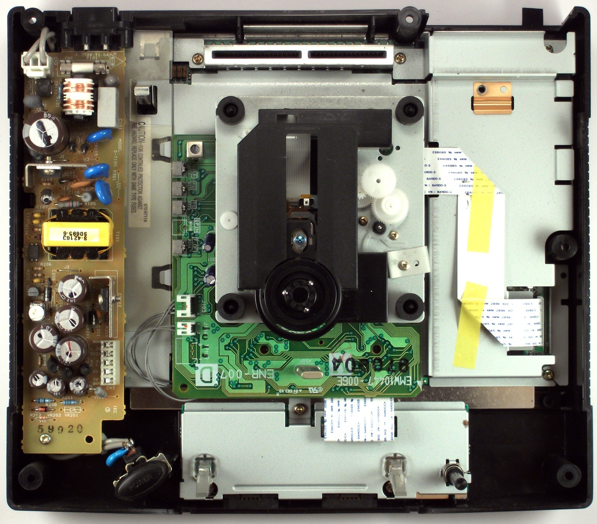

*Zyrobs' PAL Model 1 VA1, with its power supply and CD assembly exposed for comparison.*
{: .media-caption }

**Sega Saturn Model 1, PAL, VA1**

Model number: MK-80200-50  
Serial number: AD51165249  
Motherboard type: VA1 PAL  
CD drive type: JVC ENR-007D (20-pin)  
Power supply: 5-pin Type B (GND, GND, 3.3 V, 5 V, 9 V)

* * *

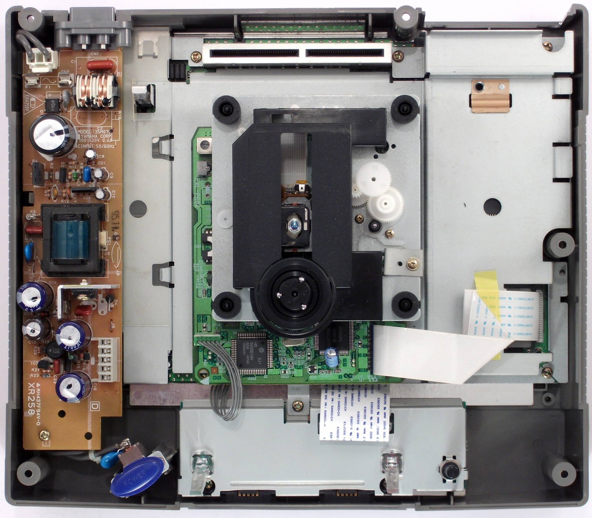

*A Japanese Model 1 VA2 from Zyrobs' catalogue, including the blue power button and a different supply layout.*
{: .media-caption }

**Sega Saturn Model 1, JPN, VA2**

Model number: HST-3210  
Serial number: P52031710  
Motherboard type: VA SG (VA2)  
CD drive type: JVC ENR-011A  
Power supply: 5-pin Type B (GND, GND, 3.3 V, 5 V, 9 V)

* * *

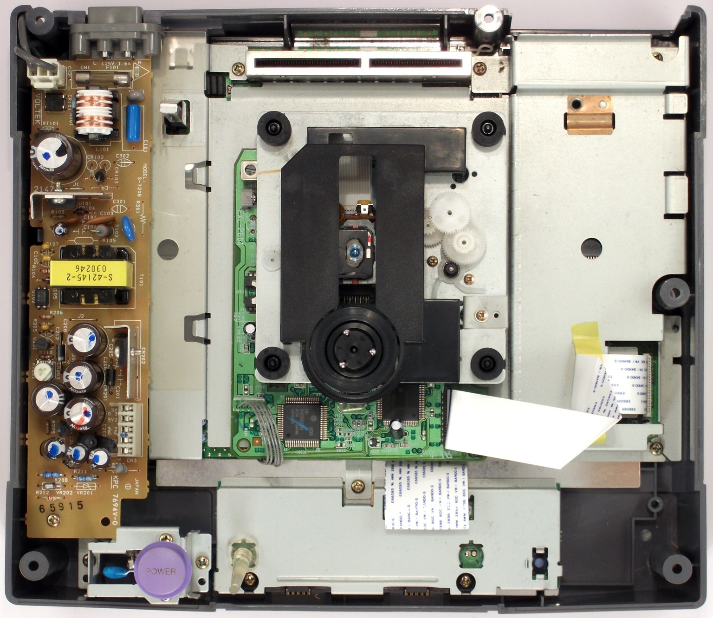

*The Japanese JVC V-Saturn VA4. Yet another variation, this time with the lavender button.*
{: .media-caption }

**JVC V-Saturn Model 2, JPN, VA4**

Model number: RG-JX2(X)  
Serial number: 13127071  
Motherboard type: VA SG (VA4)  
CD drive type: JVC ENR-011A  
Power supply: 5-pin Type B (GND, GND, 3.3 V, 5 V, 9 V)

* * *

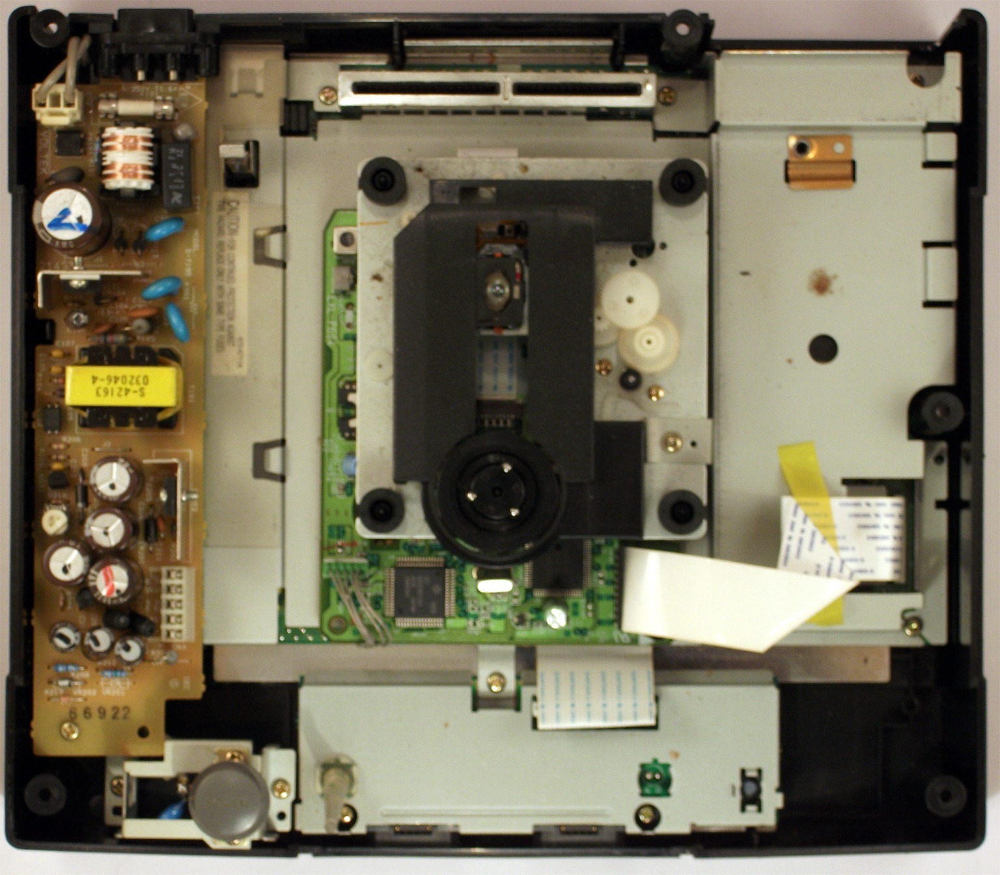

*The PAL Model 2 VA5, looking similar at first glance but with its own board and supply arrangement.*
{: .media-caption }

**Sega Saturn Model 2, PAL, VA5**

Model number: MK-80200A-50  
Serial number: 165046630  
Motherboard type: VA PAL SD (VA5)  
CD drive type: JVC ENR-011A  
Power supply: 5-pin Type B (GND, GND, 3.3 V, 5 V, 9 V)

* * *

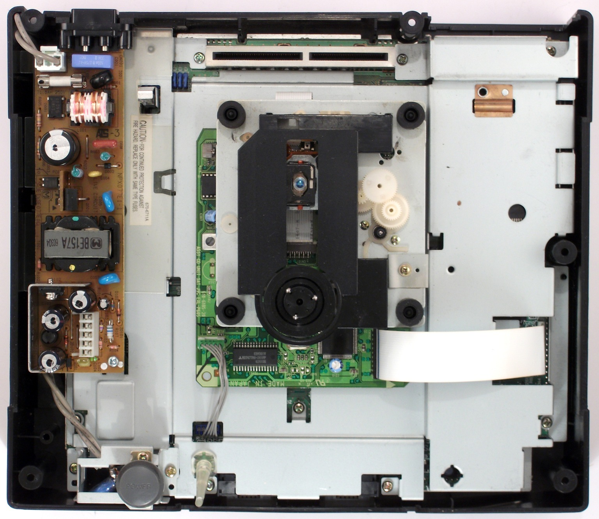

*The PAL VA7 opens another chapter in the Saturn's seemingly endless revisions. Photo courtesy of Zyrobs.*
{: .media-caption }

**Sega Saturn Model 2, PAL, VA7**

Model number: MK-80200A-50  
Serial number: 167015869  
Motherboard type: VA7 PAL  
CD drive type: JVC ENR-013A in the album caption; visible PCB marked SANYO 610-6185-20 (complete assembly identification unresolved)  
Power supply: 5-pin Type C (GND, GND, 5 V, 5 V, 12 V)

* * *

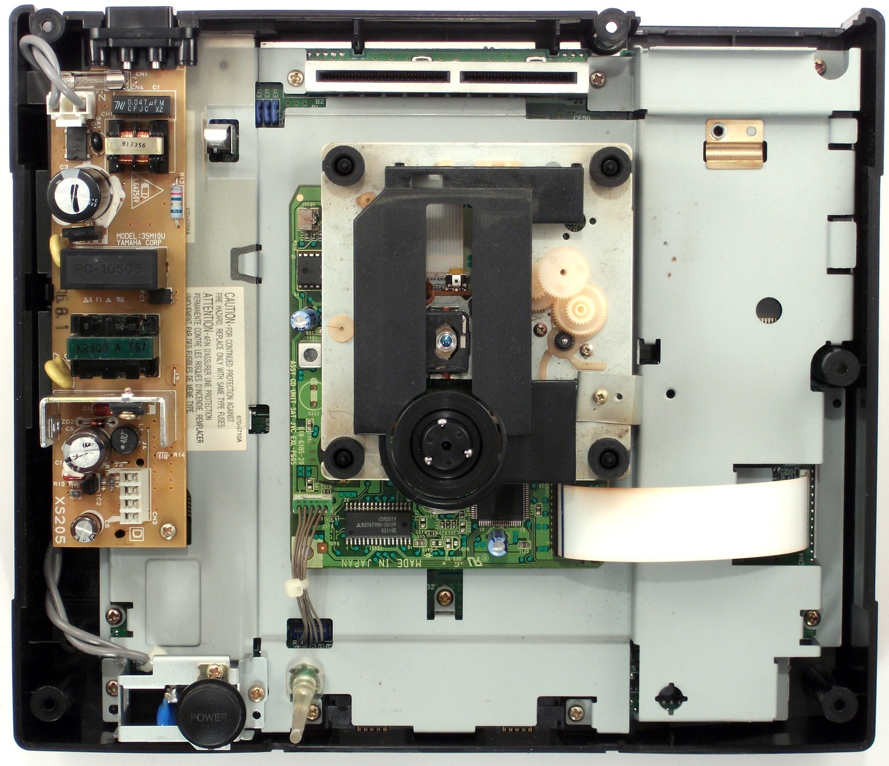

*The US VA7 and its compact-looking power supply arrangement. One more for the comparison table!*
{: .media-caption }

**Sega Saturn Model 2, USA, VA7**

Model number: MK-80000A  
Serial number: AF67091875 (album image filename; not visible in this photograph)  
Motherboard type: VA7 USA SD  
CD drive type: JVC ENR-013A in the album caption; visible PCB marked SANYO 610-6185-20 (complete assembly identification unresolved)  
Power supply: 4-pin Type C (GND, GND, 5 V, 5 V)

* * *

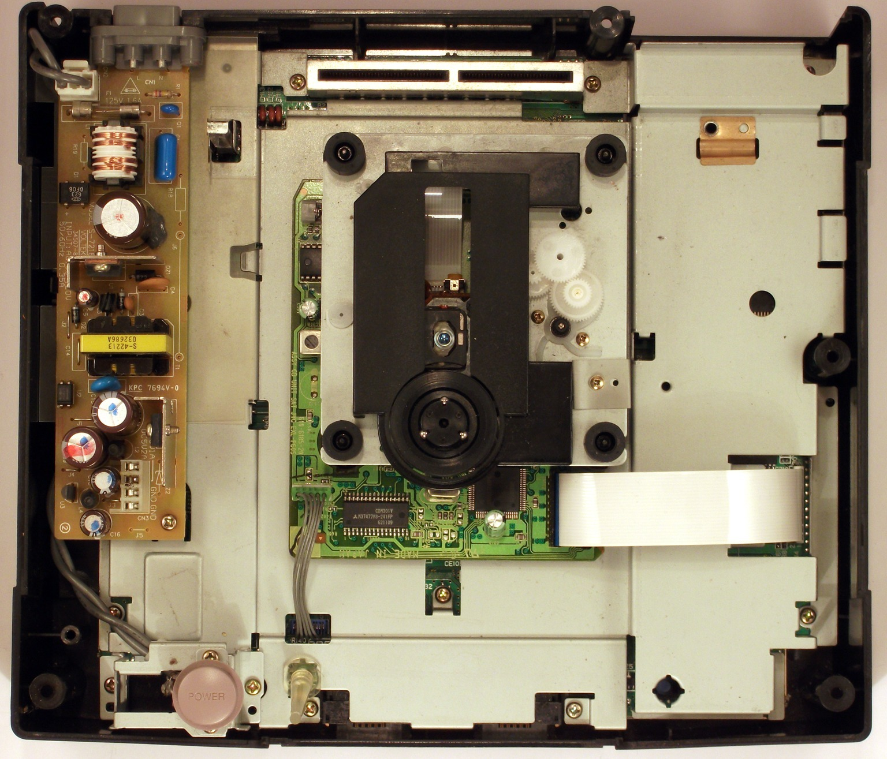

*The Hi-Saturn VA9. Same family of consoles, but with yet another internal combination.*
{: .media-caption }

**Hitachi Hi-Saturn Model 2, JPN, VA9**

Model number: MMP-11  
Serial number: B69006875  
Motherboard type: VA9  
CD drive type: JVC ENR-013A in the album caption; visible PCB marked SANYO 610-6185-20 (complete assembly identification unresolved)  
Power supply: 4-pin Type C (GND, GND, 5 V, 5 V)

* * *

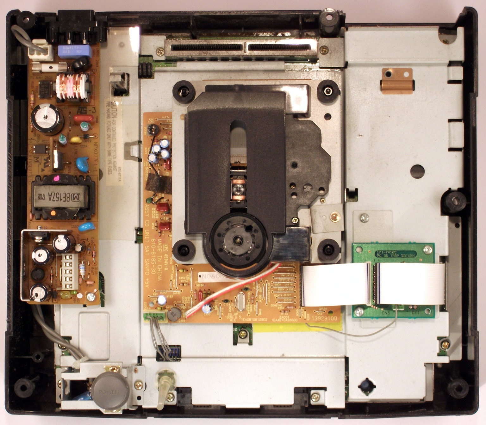

*A PAL VA9 with Sanyo's CD mechanism and its little trap board on the right. Quite a different layout.*
{: .media-caption }

**Sega Saturn Model 2, PAL, VA9 with Sanyo drive**

Model number: MK-80200A-50  
Serial number: 179000021  
Motherboard type: VA9  
CD drive type: Sanyo 610-6185-30 with Trap Board  
Power supply: 5-pin Type C (GND, GND, 5 V, 5 V, 12 V)

* * *

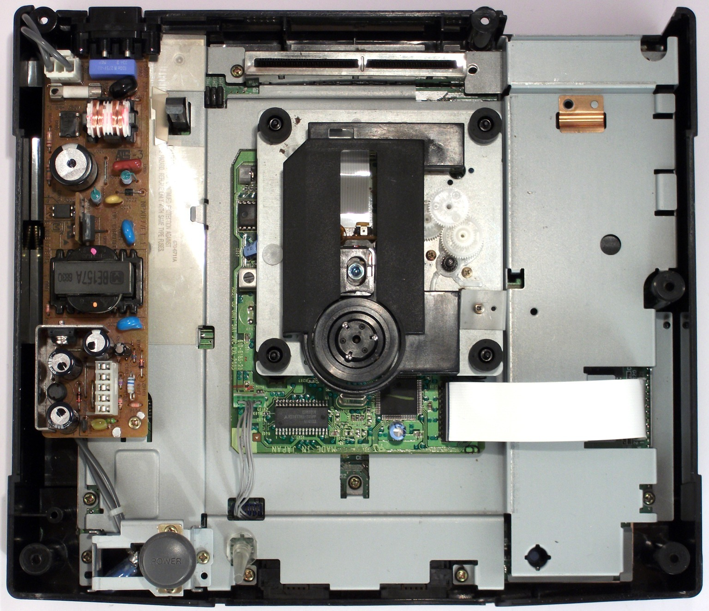

*The other PAL VA9 arrangement, minus the separate Sanyo trap board seen in the preceding photograph.*
{: .media-caption }

**Sega Saturn Model 2, PAL, VA9**

Model number: MK-80200A-50  
Serial number: AD69035903  
Motherboard type: VA9  
CD drive type: JVC ENR-013A in the album caption; visible PCB marked SANYO 610-6185-20 (complete assembly identification unresolved)  
Power supply: 5-pin Type C (GND, GND, 5 V, 5 V, 12 V)

* * *

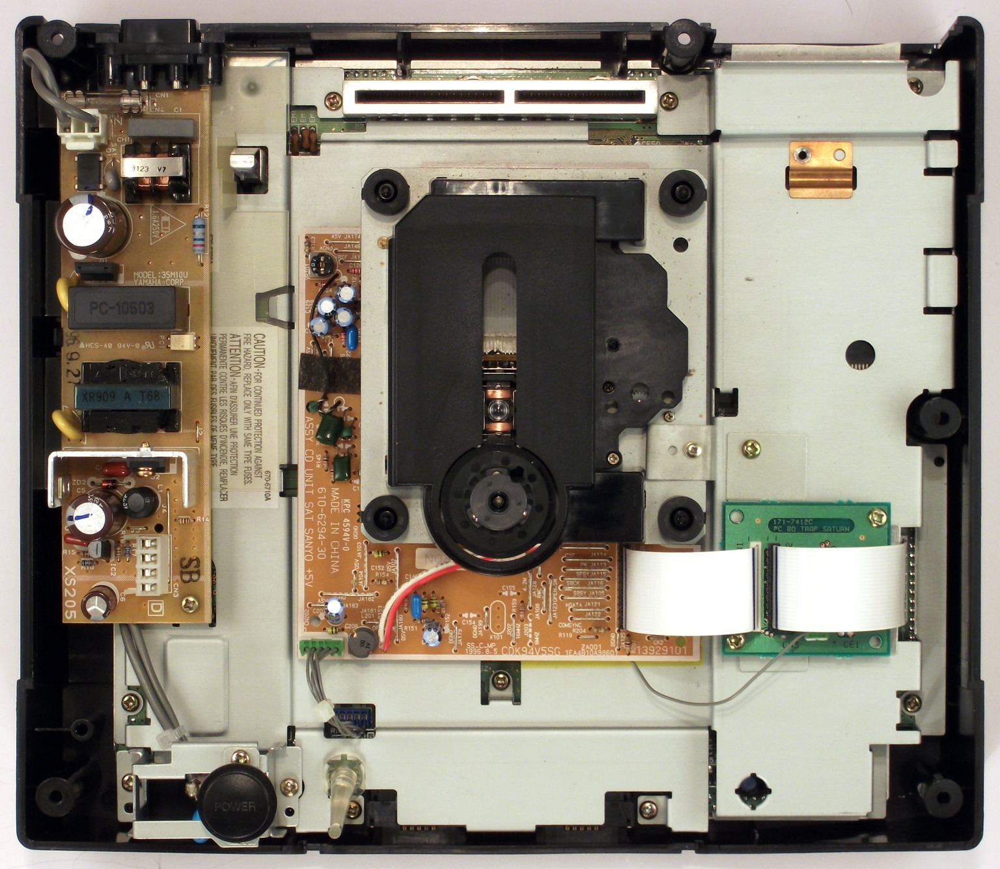

*The American VA10 with Sanyo's drive hardware. There is that little trap board again!*
{: .media-caption }

**Sega Saturn Model 2, USA, VA10 with Sanyo drive**

Model number: MK-80000A  
Serial number: BF7A003080  
Motherboard type: VA10 OCU (USA)  
CD drive type: Sanyo 610-6294-30 with Trap Board  
Power supply: 4-pin Type C (GND, GND, 5 V, 5 V)

* * *

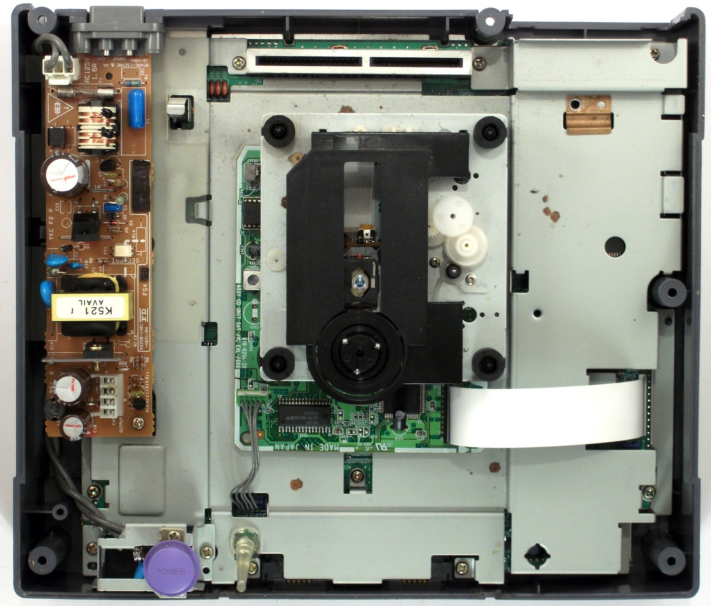

*Last of Zyrobs' eleven internals, the Japanese JVC V-Saturn VA13. Sega certainly kept things interesting!*
{: .media-caption }

**JVC V-Saturn Model 2, JPN, VA13**

Model number: RG-JX2(Z)  
Serial number: 09295551  
Motherboard type: VA13 (JPN)  
CD drive type: JVC HQA-001A  
Power supply: 4-pin Type C (GND, GND, 5 V, 5 V)

### Sources

- [Zyrobs - Sega Saturns Gone Wild](https://imgur.com/a/dMbRj)

### Related Posts

- [Sega Saturn Power Supply Swapping](/sega-saturn-power-supply-swapping/)
