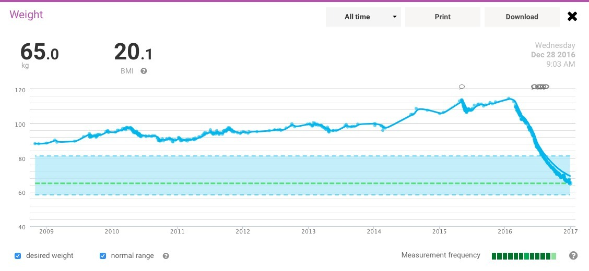
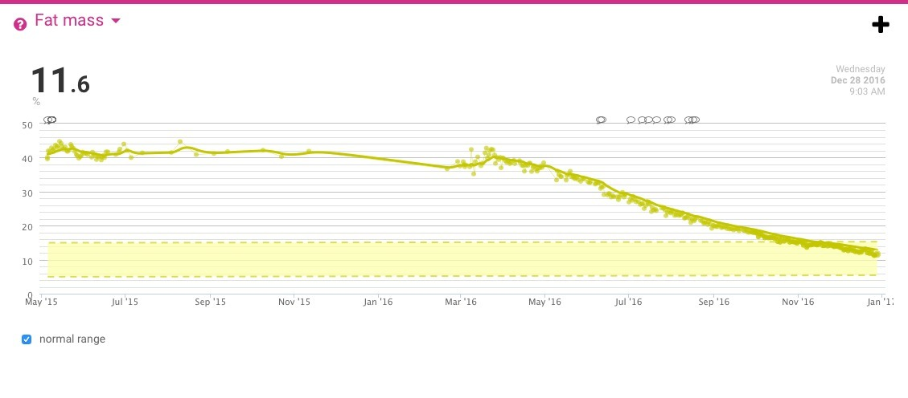
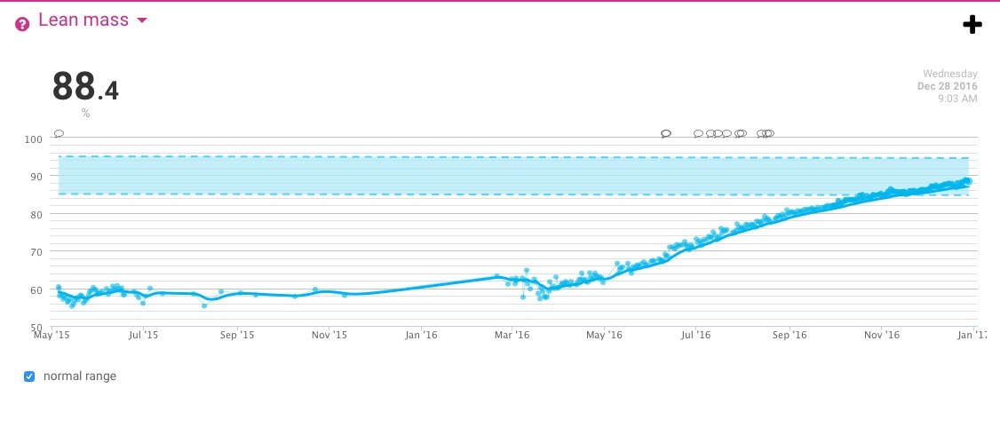
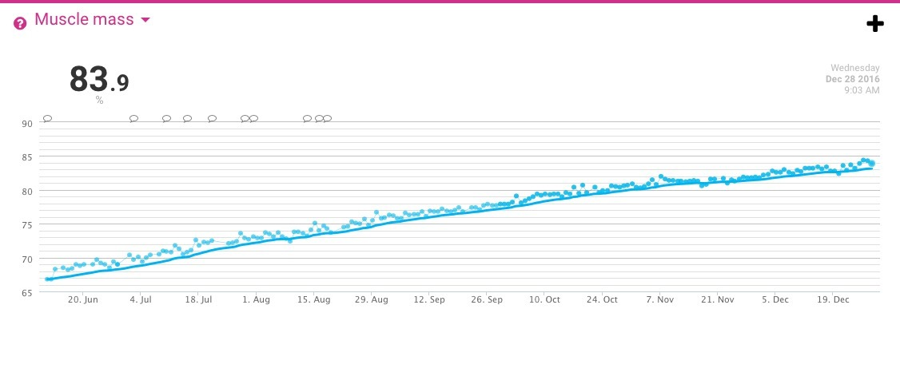
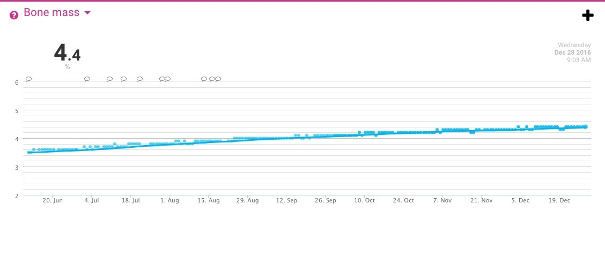

*The all-time graph reaches 65.0 kg on 28th December 2016. The history is certainly dramatic!*
{: .media-caption }

Incredible, isn't it? 50 kg down. That's 43% of my initial mass melted away.

*The scale's estimated fat-mass percentage, recorded at 11.6% in late December 2016.*
{: .media-caption }

Fat mass is down, down, down!

*Estimated lean-mass percentage climbed to 88.4%. That's a proportion, not proof of tissue gained.*
{: .media-caption }

Which means that my estimated lean-mass percentage is up, up, up!

*The scale's estimated muscle-mass percentage reached 83.9%. More numbers for the 2016 archive.*
{: .media-caption }

Lean mass is a combination of muscle mass (as above) and...

*And finally, the bone-mass estimate at 4.4%. Another scale-generated figure to take with a pinch of salt.*
{: .media-caption }

Bone mass!

The real question is... can I maintain this weight in the healthy range long term? Stay tuned to find out as I go on a cake-eating-rampage to test out this theory! :P
