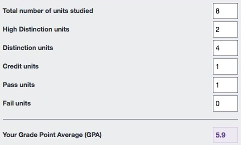
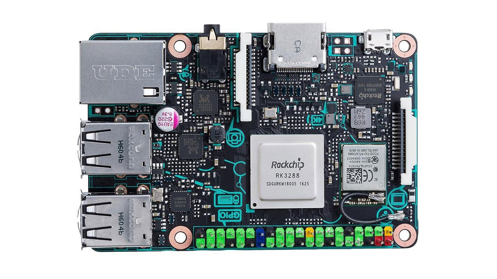

*I'm still alive and still kickin'! Fixing more than 400 broken image links may have done something to my facial expression.*
{: .media-caption }

I'm still alive and still kickin'!

Surprised? That's right, **I fixed all the broken links**. All the images work now. All of them! Over 400 of the blighters! I think I've developed RSI in my face from staring at all the broken Google links! Special thanks to Google for canning [Picasa](https://en.wikipedia.org/wiki/Picasa)...

I've finally finished all my university commitments just in time for a month and a half of kickin' back and relaxing, McRetro style! I'm clearing some hard drive space as we speak to bring over that [250GB of video footage](/youtube-video-blitz/) I kept talking about... a year ago! Has that much time really passed?

*The GPA has slipped to 5.9, but I'll take it after that lot of university assignments. At least there are no fails!*
{: .media-caption }

Anyway, my GPA has dropped a little, from [6.5](/cicadas-in-the-summertime/) to 5.9 for the first year, which I don't think is all that bad given the courses they were throwing at me. Learn every bone in the body and also learn all the muscles and what innervates them? Geez, what a waste of learning. I don't remember much of it at all come to think of it.

With study aside and all the busted up image links restored to their former glory, it's time to get this website and my YouTube channel back in order. At long last I've got decent internet with megabits of upload (as opposed to plenty of kilobits in the past...) so 1080p things no longer scare me. I might even get the FTP server working on the ASUS Tinker Board.

*The ASUS Tinker Board, my new alternative to the Raspberry Pi 3. It looks the part, now to see what I can make it do!*
{: .media-caption }

That's right, the Raspberry Pi 3 has been sidelined while I try out what ASUS has to offer. It's fast alright. Very fast. This website feels like it works properly now - try running a search, the results are generated much quicker than in the old days. It's magnificent! :D
