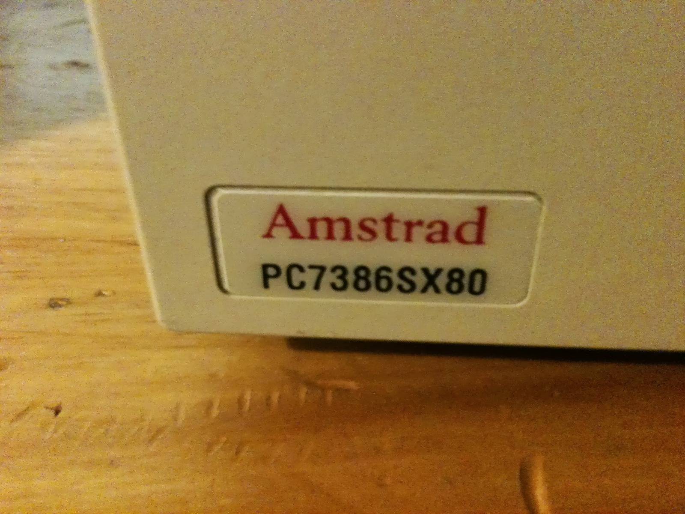
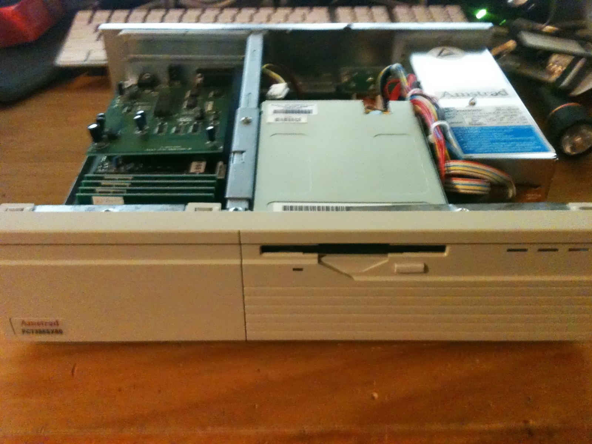
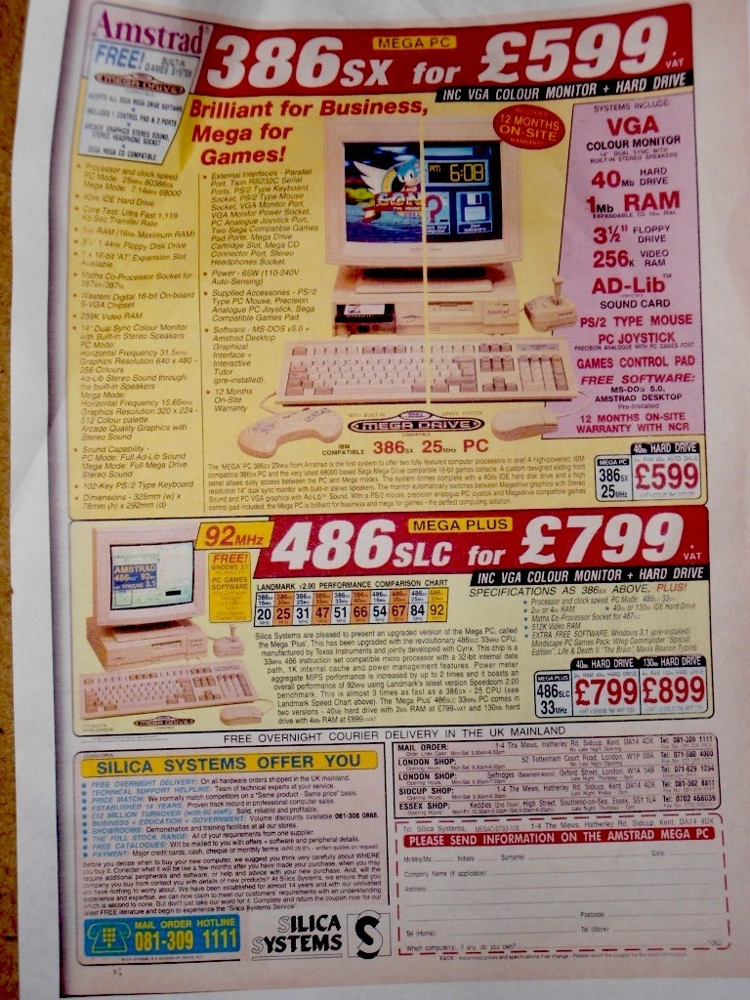
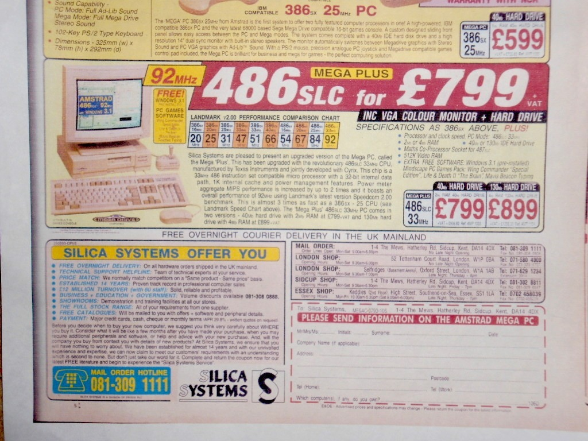



Here we have some video of the Amstrad Mega PC, upgraded into what is effectively Mega PC Plus territory by replacing the PC7386SX 386SX motherboard with a PC7486SLC 486SLC motherboard. That's right, 486-style instructions with the raw processing power of a 386. Maybe that isn't quite selling it right.

This particular machine had been in my collection for quite some time, but when I filmed the overview I'd decided it was time for it to move on. I wanted to give it one final look before selling it. I was also starting to rethink my collection, particularly all the licensed Sega hardware from companies such as Amstrad, JVC and Aiwa. Sticking more closely to first-party machines would certainly make downsizing easier, and perhaps I'd even recover some space in my room!

*The PC7386SX80 badge on the original Amstrad Mega PC. Thanks to WorldOfBrainFreeze for the photograph!*
{: .media-caption }

Image provided by [WorldOfBrainFreeze](https://www.youtube.com/user/WorldOfBrainFreeze)

The motherboard swap is possible because the original PC7386SX and later PC7486SLC systems share the necessary arrangement for connecting to the Mega Drive hardware. There's a ribbon cable near the front of the board that links into the video-switching mechanism. Without that connection, the PC and Mega Drive sides wouldn't cooperate quite so easily.

The front switch selects between the PC and Mega Drive video, with the circuitry beneath the bezel handling the changeover. The Mega Drive card itself occupies much of the available space inside the case. It's a rather neat way of combining two completely different machines in one beige box.

*Lid off, with the Mega Drive card removed. Still an enormous amount of beige PC hardware to look at!*
{: .media-caption }

Image provided by [WorldOfBrainFreeze](https://www.youtube.com/user/WorldOfBrainFreeze)

Above is what the Mega PC looks like without a Mega Drive inside it, a hideous beige box. Also known as the Amstrad PC7386SX80.

The original 386SX motherboard had suffered badly from a leaking NiCad backup battery. The corrosion had reached various tracks and connections, which wasn't something I wanted to experience again. The replacement 486SLC board uses a Dallas RTC arrangement instead, making it a rather more pleasant proposition for keeping the machine alive.

The upgraded PC side now runs at 33 MHz, compared with the original 25 MHz 386SX arrangement. It's fitted with 16 MB of RAM and an XT-IDE compatible CompactFlash adapter, which makes booting DOS considerably more convenient. There's also still a regular hard drive, although the older BIOS has its own limitations.

And here we have the wonderful, just-as-gorgeous-486-version, the Amstrad PC7486SLC. If only more of the Mega PC Plus would have seen the light of day I'm certain the world we live in would be a better place! :)

The Mega Drive side remains much the same as before. You can insert a cartridge, change the front switch and enjoy a little Sega gaming without dragging out a separate console. I tried Pac-Panic during the overview, although the monitor I had connected wasn't particularly happy displaying the Mega Drive signal properly.

The original Amstrad monitor was designed to handle both the PC and console video arrangements, which makes it rather important to the experience. Trying to use a modern display for both modes can be a bit of a nuisance. One moment you've got a readable PC screen, the next you're looking at something rolling across the display.

There's also a volume control on the front for the Mega Drive side, with additional audio and serial connections at the rear. The machine's power supply and internal layout are fairly typical of Amstrad computers from the period, apart from the small matter of having a Sega Mega Drive installed alongside everything else.

*Some period advertising for the 386SX Mega PC and the much swankier 486SLC Mega Plus. Those prices were no joke!*
{: .media-caption }

I gave both sides another test before preparing the machine for sale. DOS started up through the XT-IDE arrangement, and the Mega Drive side was still doing its thing. It's a lovely little computer, even if it takes up rather more space than I can comfortably justify keeping forever.

By the time I wrote this post, the machine had actually been sold nearly two years earlier. It went to a friend in Japan (or back from Japan, depending on where he ended up). I hope it treats him well in the future!

*And here's the Mega Plus getting its own big £799 headline. A 486SLC was serious business in that advert!*
{: .media-caption }

Farewell Amstrad Mega PC! :D

**Related Posts**

- [Amstrad Sega Mega PC 486SLC Upgrade Progress](/amstrad-sega-mega-pc-486slc-upgrade-progress/)
