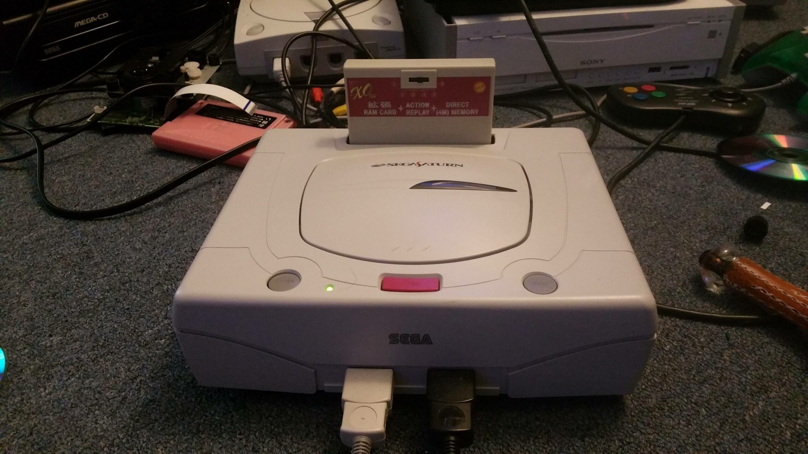
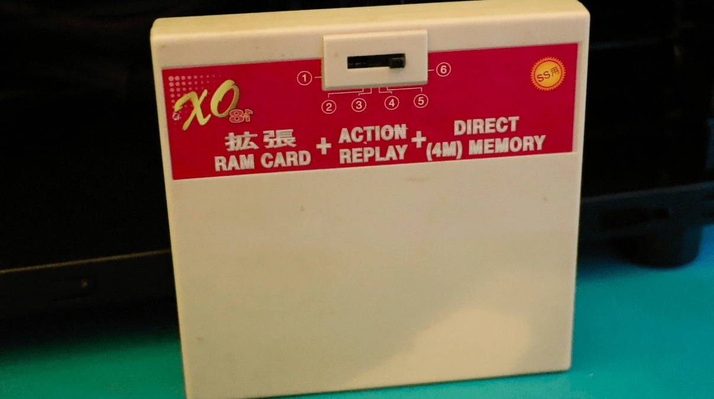
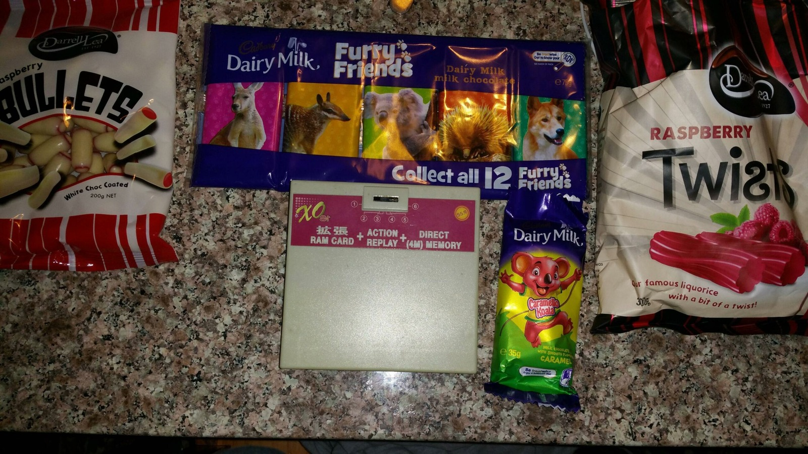
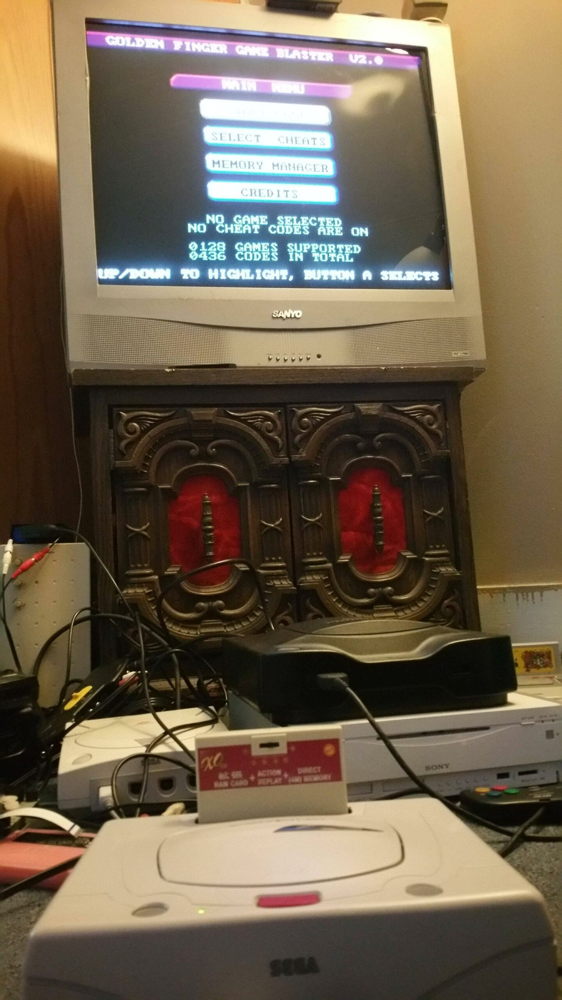

*That rather unusual XO GameShark cartridge sitting in a Saturn. One little switch, quite a few different jobs!*
{: .media-caption }

Back in 2016 I sent across a funky GameShark cartridge for the Sega Saturn that came bundled with something or other. I didn't have much use for it so I sent it on to [Skyway1985](https://web.archive.org/web/20191113034738/https://assemblergames.com/members/skyway1985.87516/) over in the US in exchange for some goodies of my own!

*The six switch positions, all laid out on the cartridge itself. Handy once Skyway1985 had worked out what they do!*
{: .media-caption }

He has since been able to decode the settings (the manual was long lost). Here are Skyway1985's reported settings for the six numbered switch positions on the XO 7-in-1 GameShark for the Sega Saturn. Or is it an 8-in-1 or a 1-in-8 since the 1 is flipped horizontally? Maybe it should be a 6-in-1 since it only has six different modes...

1. 1M RAM
2. 4M RAM
3. Action Replay w/ 1M RAM
4. Action Replay w/ 4M RAM
5. Action Replay
6. Action Replay with direct save-memory access

The "direct memory" wording follows the cartridge label and Skyway's report that its save memory is visible in the Saturn BIOS. It should not be confused with Direct Memory Access (DMA).

*GameShark, chocolate bullets, and a Caramello Koala. A proper assortment of Australian goodies to send overseas!*
{: .media-caption }

Additionally Skyway1985 writes, "This is one of the rarest cheat devices for Sega Saturn, one of the few that have REAL built in power memory. It shows up in the bios. On top of that, it also has an indirect storage ram like every other GS or AR, so you have 2 memory banks to utilize. On direct from bios or indirectly through the cheat browser." 

*There it is on-screen: Golden Finger Game Blaster V2.0. At last, a name to go with the mystery cartridge!*
{: .media-caption }

And now we know that's known as the Golden Finger Game Blaster V2.0 in firmware too! Thanks Skyway! :)

