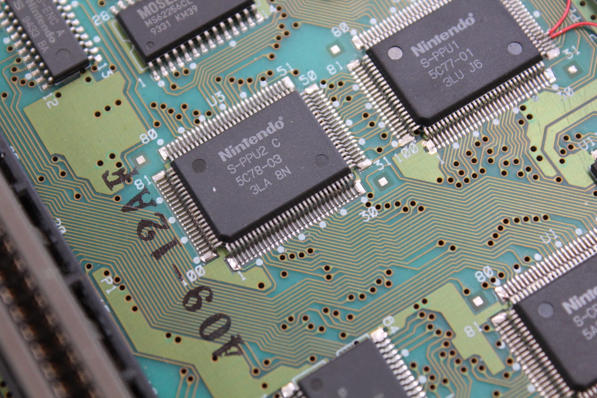
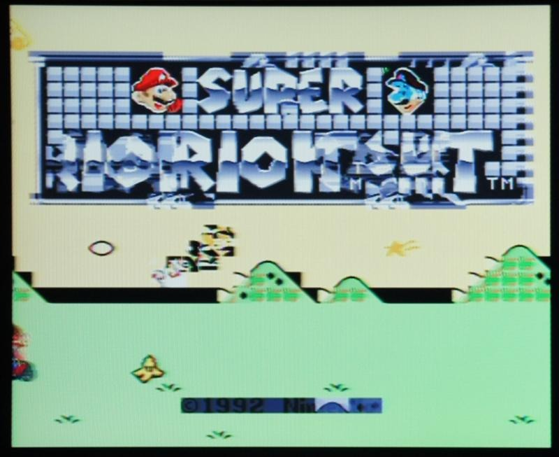

*A close-up of the two SNES picture-processing chips from one of my earlier repairs. Sometimes the problem is the chip, and sometimes it's the traces nearby.*
{: .media-caption }

I've been looking through some rather interesting Super Nintendo repair information today. It all started with a YouTube comment pointing me towards something I'd never even heard of before: the Nintendo Super System!

It's an arcade machine based on Super Nintendo hardware, and naturally it has its own collection of faults to keep people entertained. DogP has been kind enough to document a whole bunch of repairs, complete with photographs showing what happens when various chips decide they've had enough.

*One of DogP's Nintendo Super System repair examples. That is an impressive amount of graphical chaos, but the picture alone doesn't tell us which component has failed.*
{: .media-caption }

Image borrowed from [DogP's Nintendo Super System repair log](https://www.projectvb.com/nss/logs.htm). Thank you to whoever pointed me to this site, and a big thank you to DogP for keeping such a detailed repair log!

What makes the information particularly useful is seeing the different ways a machine can fail. A bad CPU can cause all sorts of strange behaviour, while problems with the PPU chips or video RAM can produce some rather magnificent graphical corruption. Sometimes the game is still running quite happily underneath all those broken pixels!

Of course, a distorted picture doesn't automatically mean it's time to replace a PPU. I've had a Super Nintendo with corroded traces near PPU1 before, and repairing those connections brought the poor thing back to life. Much nicer than replacing a perfectly good chip!

The Nintendo Super System isn't quite the same as an ordinary SNES or Super Famicom, but there's enough shared hardware here to make these repair examples very interesting. There are even examples of faults that behave differently depending on which game is running.

It would certainly be handy having a few more clues the next time one of these consoles turns up with half the graphics missing. Anything that saves hours of staring at an apparently lifeless motherboard is fine by me!

Actually, this might be useful in working out some circuit bending for the SNES... stay tuned ;)

### Sources

- [DogP - Nintendo Super System and SNES Repair Logs](https://www.projectvb.com/nss/logs.htm)

### Related Posts

- [Super Nintendo Serial UP15971140 - Video Distortion](/super-nintendo-serial-up15971140-video-distortion/)
- [Super Nintendo Serial UP15971140 PPU1 Trace Repair](/super-nintendo-serial-up15971140-ppu1-trace-repair/)
