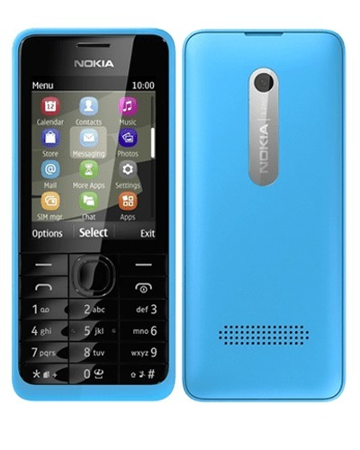



Remember when I decided I'd had enough of smartphones? I wrote about that little experiment in [Death to Smartphones!](/death-to-smartphones/), when the Nokia 301 seemed like a rather appealing alternative to constantly charging an iPhone. Nokia advertised up to 39 days of standby time, which sounded absolutely wonderful. More than a month! What could possibly go wrong?

Well, here's the unboxing. The Nokia 301 turned out to be considerably larger and heavier than I'd expected, and the keypad felt disappointingly spongy. I was also rather suspicious of the packaging and wondered whether the phone might have been refurbished, although I couldn't say for certain.

At least it had a proper 3.5 mm headphone socket and micro USB. That was a welcome change from some of Nokia's older proprietary accessories, but neither feature was particularly exciting by this point. I wanted something simple that would do the job without all the distractions of a smartphone.

Unfortunately, the Nokia 301 didn't quite win me over. I tried and I tried, but everything integrated so nicely with the Apple ecosystem that going backwards turned out to be more trouble than I'd expected. In the end, I sold the Nokia for about half what I'd paid for it. I wonder if somebody is still using it today?

So much for escaping the Apple ecosystem. Guess I'll just keep on paying the Apple tax. *sigh*
