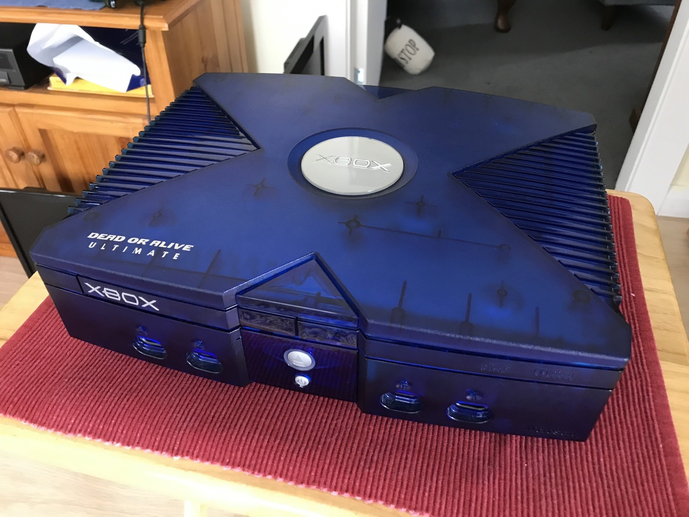
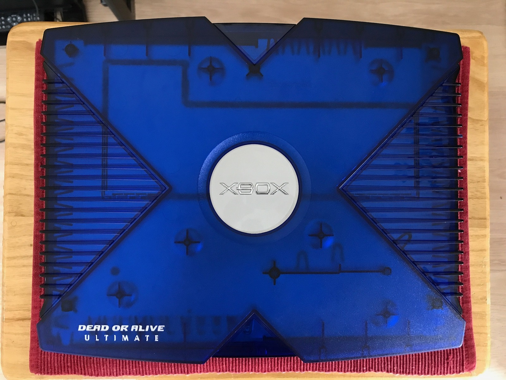
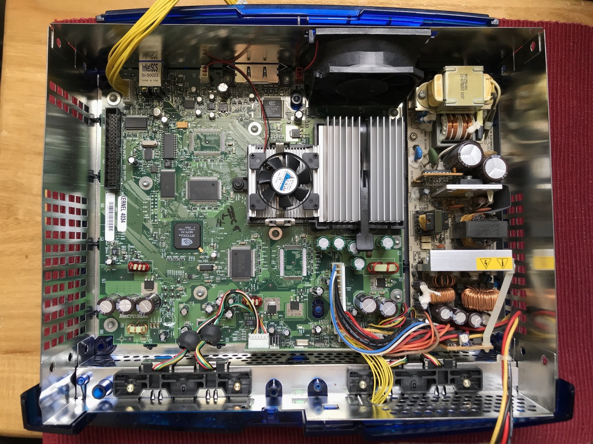

*My Kasumi Blue Xbox looking rather gorgeous. That silver jewel in the middle had been crooked for far too long!*
{: .media-caption }

For the longest time I've had this Kasumi Blue Xbox from a fellow game enthusiast from way down Melbourne way. And for the longest time the darned jewel has been crooked. I got around to straightening it up. I ended up opting for some fishing wire as my floss is cinnamon flavoured. I didn't really want a cinnamon flavoured Xbox jewel, or do I?

*A proper top-down look at the Kasumi Blue lid and its jewel, finally back where it belongs. I should have straightened it ages ago!*
{: .media-caption }

Anyway, it was actually far easier than I thought, and I should have done it a long time ago. Now it's done and it will never have to be done again! Damn that blue is a beautiful colour. Too bad the DVT4 isn't a nice blue. Now I have to choose between one of the two? What would you keep? The better looking blue Xbox or the technologically cooler DVT4? The jury is still out for now.

*Inside the Kasumi Blue Xbox. I reckoned this had a v1.0 motherboard, just like the DVT4, which raised a few interesting questions!*
{: .media-caption }

Interestingly, this Kasumi Blue contains what I identified as a v1.0 motherboard, like the DVT4, even though the Kasumi Blue edition came much later. Was Microsoft burning through old inventory? That was my theory, but somebody could also have swapped the board before I got the console. Plus the date/time supercap didn't do any real damage as far as I can tell to either the DVT4 or the Kasumi Blue. Woohoo!

### Sources

- [UKDave - Removing, Cleaning and Lighting the Xbox Jewel](https://web.archive.org/web/20190206233517/http://www.uk-dave.com/projects/misc/xbox-jewel/)
- [Tweakification - Step-By-Step Xbox Jewel LED Mod](http://tweakification.blogspot.com/2007/01/step-by-step-xbox-jewel-led-mod.html)
