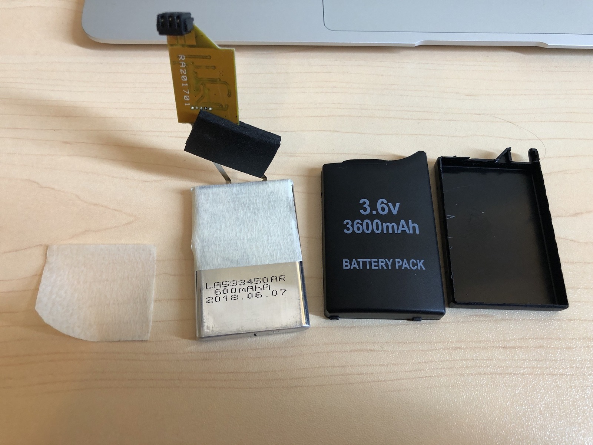



I stumbled onto a PSP-1000 (Phat) and PSP-3000 (Brite) to tinker with. When the owner had last looked at these, Official Firmware was up to 6.60 and his PSP-3000 could not use the permanent-CFW route he wanted at the time. The PSP-1000 had died and a PSP-3000 was purchased. He was saddened to find that it was already running 6.60 and could not be downgraded. The PSP-1000 had been running Custom Firmware (CFW) 5.50 GEN-D (Full).

We're now about five or seven years down the track and they can be messed with in all sorts of ways. On 6.61, PRO-C2 is the custom firmware, while [Infinity](https://web.archive.org/web/20190216234337/https://infinity.lolhax.org/) supplies the permanent patch that can start compatible PRO or ME custom firmware after a reboot.

Both machines are now running firmware 6.61 with Infinity and PRO-C2, and I thought I'd give them a quick demonstration. The PSP-3000 is surprisingly light, especially without a UMD in the drive. It's remarkable how much of the machine's size is taken up by that optical mechanism. I suppose we're far enough into the future now that these things are becoming retro. That's a rather frightening thought!

*Inside one of those questionable replacement PSP batteries. The casing said 3600 mAh, but the little cell inside said 600 mAh. Hmmm!*
{: .media-caption }

I've been experimenting with Memory Stick Pro Duo adapters that let me use ordinary microSD cards. One machine has a 64 GB card, while the other has a smaller one. That's quite a step up from the little Memory Sticks these machines originally shipped with, and it makes playing around with games and homebrew much more convenient.

There's a collection of PlayStation games and homebrew installed, including a Super Nintendo emulator and *Harvest Moon*. I also discovered that one of my *Spyro* games was appearing under a slightly unexpected name. Just another little mystery to investigate!

I ended up purchasing a few new batteries and binning most of them because the cells inside were labelled 3.6 V, 600 mAh, despite the packs claiming 3600 mAh. Did the sellers really think I wouldn't notice? First there was the lack of weight, and then the lack of play time. Opening one of those aftermarket packs was certainly an experience; there was considerably less inside than the label would have you believe.

To be fair though, I still got just short of four hours on a charge in the slimmer PSP-3000. Interestingly, the PSP-1000 battery seems to be still going strong and clocks in a few more hours than those replacement packs. Impressive for the age! The PSP-1000 should have an 1800 mAh battery standard and the PSP-3000 should have a 1200 mAh.

Oh, before I forget, it was fun losing the VSH overlay on the PSP-1000 after changing Memory Sticks and having to work out how to piece everything back together to get it to show again. I really love that "Shutdown" function. The VSH menu is particularly useful for changing settings and shutting the machine down properly, so naturally I had to get it working again!

There's a few little hardware repairs I need to do on the PSP-1000 to do with the DC-in jack and the power switch, but I'll cover that in a future video. For now it's been a lot of fun getting these two machines running again, and there's plenty of older software to play around with.

**Sources**

- [Davee - 6.61 Infinity (February 2019 capture)](https://web.archive.org/web/20190216234337/https://infinity.lolhax.org/)
- [Sony - PSP and PSP go accessory compatibility (Japanese)](https://www.playstation.com/ja-jp/support/hardware/accessories-psp-compatibility/)
