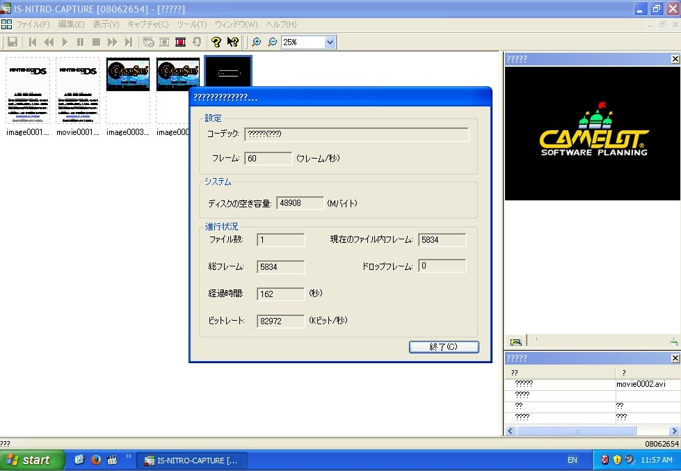

*The IS-NITRO-CAPTURE software with a capture-information window open. This shows the capture program, not the physical DIP switch positions.*
{: .media-caption }

A few videos are coming up on the IS Nitro Capture device, including hardware teardowns and some of the capture results in both AVI and BMP. In the meantime, here are the DIP switch settings for the blue box. Of particular interest to me were the AV output options.

These settings are summarised from the IS-NITRO-CAPTURE Users Manual, version 2005-01-27. Power the unit off before changing the switches.

**DIP switches**

1. Unused. Leave OFF.
2. Unused. Leave OFF.
3. Unused. Leave OFF.
4. Firmware recovery: ON to restore the firmware; otherwise OFF.
5. DS Wireless Communication: OFF for wired communication, ON for wireless. Wireless mode requires the optional wireless hardware.
6. Border colour: OFF for black, ON for grey.
7. AVOUT1: ON combines both DS screens; OFF shows only the upper screen.
8. AVOUT2: ON combines both DS screens; OFF shows only the lower screen.

### Sources

- [Intelligent Systems and Nintendo: IS-NITRO-CAPTURE User Manual (27 January 2005, Sections 2 and 4.2)](https://twlsdk.randommeaninglesscharacters.com/download/IntelligentSystems/IS-NITRO-CAPTURE/IS-NITRO-CAPTURE_Users_20050127.pdf)

### Related Posts

- [IS Nitro Capture DS Lite Internal Overview](/is-nitro-capture-ds-lite-internal-overview/)
