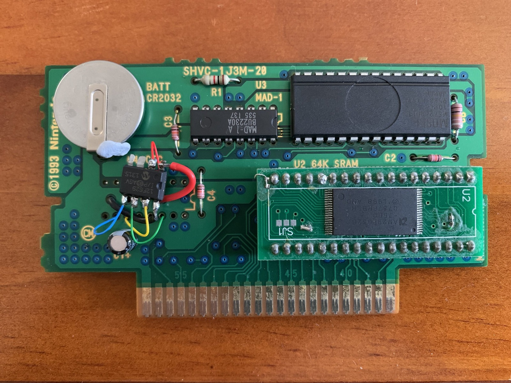
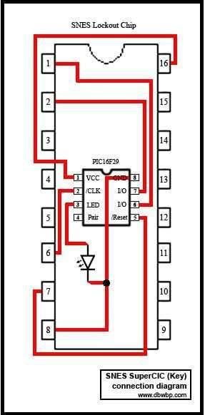
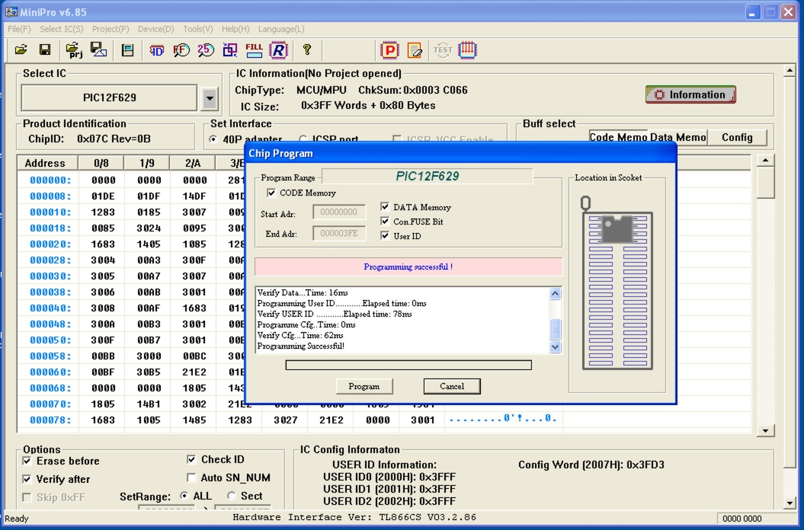
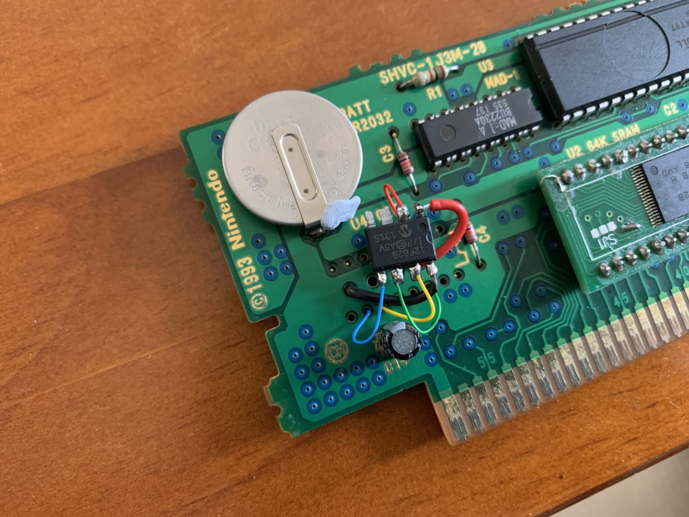
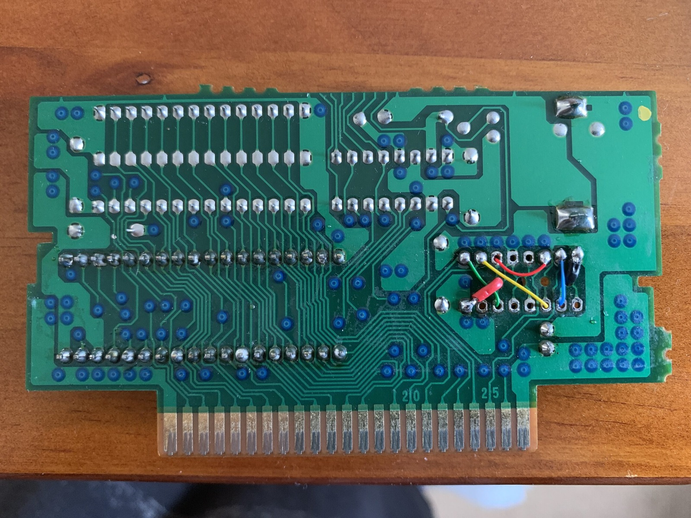
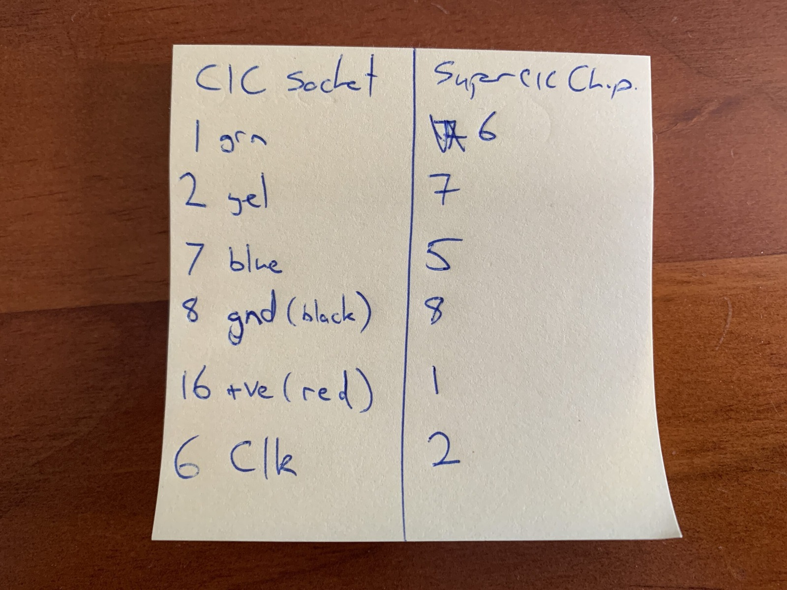
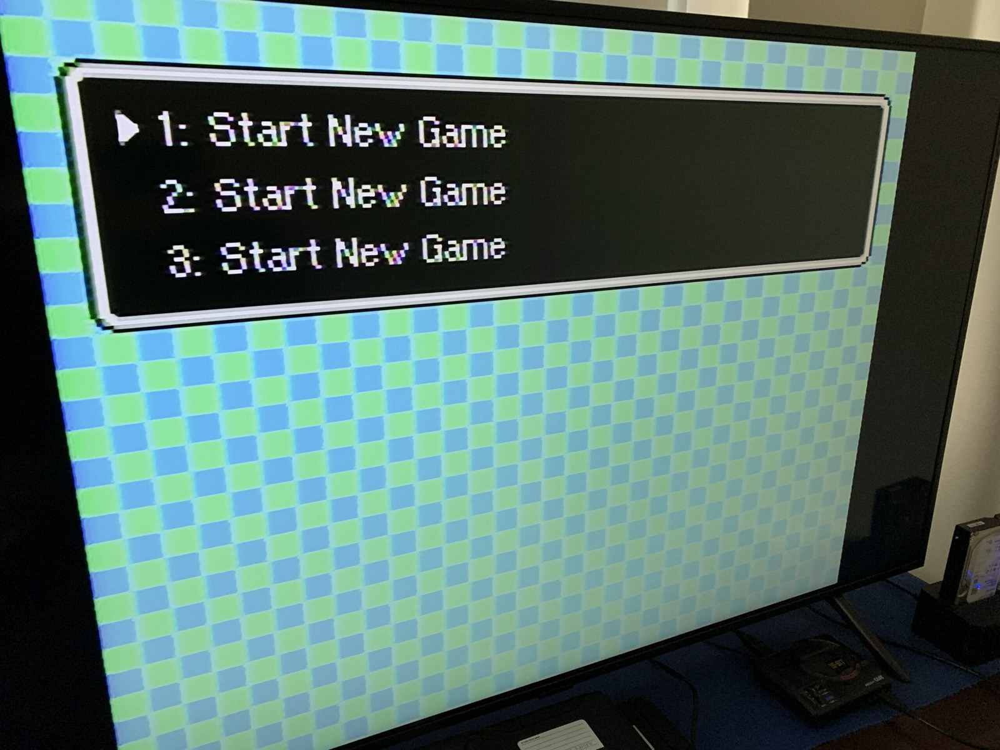

*Inside my EarthBound cartridge, where a small PIC chip and a collection of colourful wires were filling the gap left by the missing CIC.*
{: .media-caption }

Ahh yes, trusty old EarthBound also known as:

**EARTH BOUND NTSC**  
24 Mbit (3 MB) ROM  
64 kbit (8 KB) SRAM  
HiROM / FastROM  
English

**SHVC-1J3M-20**  
1 = one ROM chip  
J = HiROM  
3 = 64 kbit / 8 KB SRAM  
M = MAD-1 family decoder

After realising my CIC chip was missing from my EarthBound cart when trying to play on my non-modded Super Famicom, I knew I wasn’t in for a good time. I'm still not entirely sure what happened to my SuperCIC (lock) modded Super Nintendo.

Anyway the Super Nintendo / Super Famicom uses a lock (console) and key (cartridge) lockout system to make sure you are playing the right game on the right console. Who doesn’t enjoy region locking? Just about every consumer ever!

*The SuperCIC key connection reference. Useful to check the pin mapping before soldering, although I'll still manage to forget something!*
{: .media-caption }

I’d previously used the 14-pin PIC16F630 for the console-side SuperCIC lock, but now it was time to try the opposite: a SuperCIC key in the cartridge. Since my original CIC was missing and I happened to have a spare 8-pin PIC12F629, maybe this was meant to happen five years ago. Who knows! So I went ahead and flashed [supercic-key.hex](https://sd2snes.de/blog/cool-stuff/supercic) to the PIC12F629 with the trusty TL866CS...

*MiniPro reporting a successful PIC12F629 programming operation. One part of the SuperCIC job done!*
{: .media-caption }

and completed the soldering work...

*A closer look at the newly wired PIC12F629 on the EarthBound board. Not exactly factory-original, but quite a tidy little project!*
{: .media-caption }

*The underside of the cartridge, showing the additional coloured wires near the old CIC connection points. Plenty of solder joints to double-check!*
{: .media-caption }

and triple checked the pinout from [DBWBP's SuperCIC key tutorial](https://www.dbwbp.com/index.php/10-electronic-projects/24-snes-cart-region-free-modification-replacing-cic-lockout-chip-with-supercic)... only to forget the CLK line!

*Even my handwritten note included the CLK connection. Guess which one I managed to overlook anyway!*
{: .media-caption }

It was all worth it though as the Super Famicom booted up.

*EarthBound booting to a menu on the Super Famicom. The repeated 'Start New Game' choices certainly caught my attention!*
{: .media-caption }

Will it continue to work through the [copy](https://tcrf.net/EarthBound) [protections](http://media.earthboundcentral.com/2011/05/earthbounds-copy-protection/index.html)? Time will tell, sooner or later. Time will tell.

**Update:** I later found an old note from myself that reminded me I'd removed the donor CIC during my 2013 experiments with this homemade EarthBound cartridge. My guess then was that the PAL donor cart was giving the console's SuperCIC the wrong region for the replacement game. That experiment is documented in [SNES SuperCIC Switchless Modchip - More Testing (Part 3)](/snes-supercic-switchless-modchip-more-testing-part-3/). This time, at least the cartridge has its own SuperCIC key!

### Sources

- [DBWBP: SNES Cartridge Region-Free SuperCIC Modification](https://www.dbwbp.com/index.php/10-electronic-projects/24-snes-cart-region-free-modification-replacing-cic-lockout-chip-with-supercic)
- [SuperCIC - ikari's project page and firmware](https://sd2snes.de/blog/cool-stuff/supercic)
- [HackMii - The weird and wonderful CIC](https://hackmii.com/2010/01/the-weird-and-wonderful-cic/)
- [ROM Laboratory - Example SNES Carts List (DBWBP mirror)](https://romlaboratory.dbwbp.com/romlab/cart_types.htm)
- [NesDev - SNES Cartmodding Information Overview and Questions](https://web.archive.org/web/20231014212226/https://forums.nesdev.org/viewtopic.php?t=8289)
- [SNES Central - SHVC-1J3M-20](https://snescentral.com/pcbboards.php?chip=SHVC-1J3M-20)
- [ROM Laboratory - Modify Cart for Work with 27C040/27C080 EPROMs](https://web.archive.org/web/20130914200141/http://nintendoallstars.w.interia.pl/romlab/cart2epr.htm)
- [SNESDev - Build Your Own SNES Cartridges](https://web.archive.org/web/20120712033436/http://snesdev.romhack.de/game_select.htm)
- [MCUmall - Update the PIC chip OSCCAL value](https://www.mcumall.com/forum/topic.asp?TOPIC_ID=4858)
- [Charles MacDonald - Super Nintendo 1024K HiROM Devcart](https://web.archive.org/web/20161219041616/http://emu-docs.org/Super%20NES/Cartridges/sfcdev2.php)
- [SNES - Help - SuperCIC](https://web.archive.org/web/20190311181602/https://www.cs.umb.edu/~bazz/snes/helpful/SuperCIC.html)
- [NesDev - Supercic 12F629 in SFC cart? (make it play on pal console)](https://web.archive.org/web/20231014233041/https://forums.nesdev.org/viewtopic.php?t=8884)

### Related Posts

- [SNES SuperCIC Switchless Modchip - Installation (Part 1)](/snes-supercic-switchless-modchip-installation-part-1/)
- [SNES SuperCIC Switchless Modchip - The Test (Part 2)](/snes-supercic-switchless-modchip-the-test-part-2/)
- [SNES SuperCIC Switchless Modchip - More Testing (Part 3)](/snes-supercic-switchless-modchip-more-testing-part-3/)