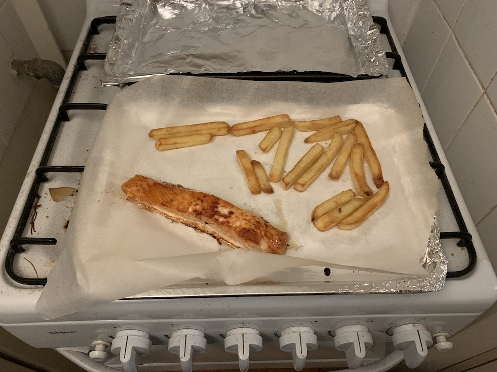
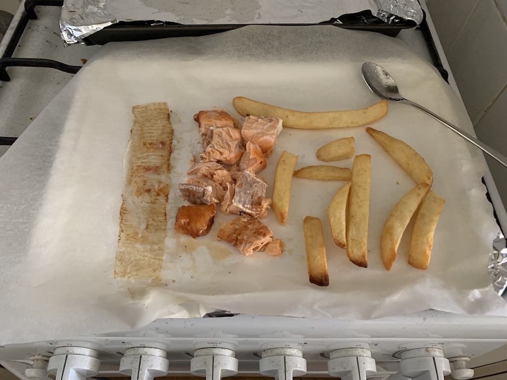
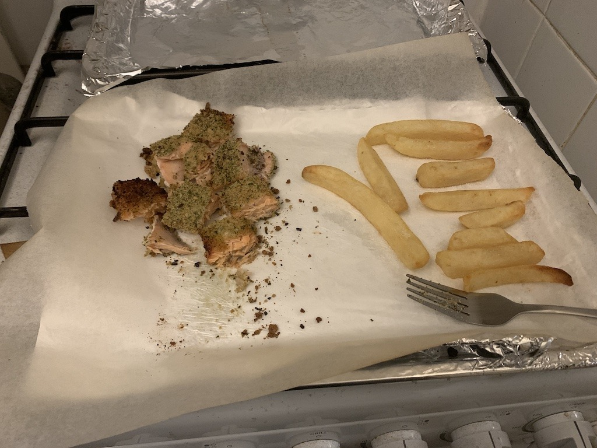

*Salmon and a handful of oven chips, the grand culinary adventure of early 2020. Nothing fancy, but I do like salmon!*
{: .media-caption }

Talk about deja vu! I set a New Year's resolution to lose some weight... again. To do that I've employed my good friend salmon. Don't worry he won't get any kickbacks.

*Another helping of salmon and chips. Behold the spectacular glamour of cooking at home!*
{: .media-caption }

2016 was the year of weight loss where I managed to get my weight way, way down into the BMI "healthy weight" range. BMI was one of the markers I was following, not the entire picture. Unfortunately 2017, 2018 and 2019 were all filled with food, glorious food! With that said, there's no reason I can't do this every fourth year, right? [These blighters](https://web.archive.org/web/20210926004205/https://dlea.com.au/products/minty-crunchy-balls-185g/) are part of the reason I'm overweight! They're delicious!

*Seasoned salmon and chips, ready to tackle with a fork. A photograph of dinner, not a magic weight-loss formula!*
{: .media-caption }

The trends are all facing down, we've got salmon, milk and turkey bread rolls steering me to the path of glory. Not that there's much glory in losing weight. Shouldn't have put it on in the first place really. My biggest issue in the past was being at work and being too stressed to make a proper lunch. This time around, I've solved that issue, so my goal is to be back in my target weight range by late this year. Steady as she goes captain!
