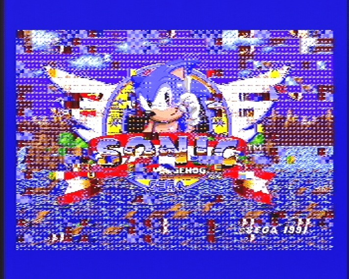
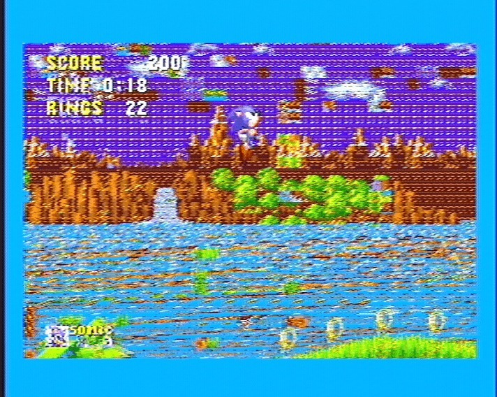
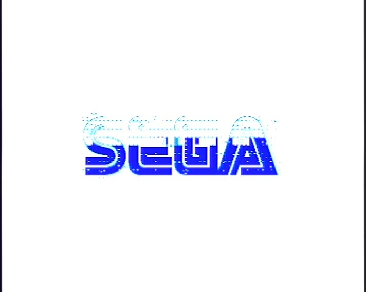
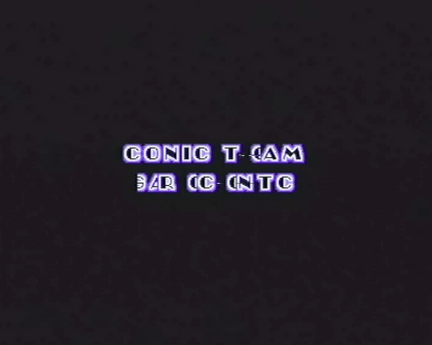
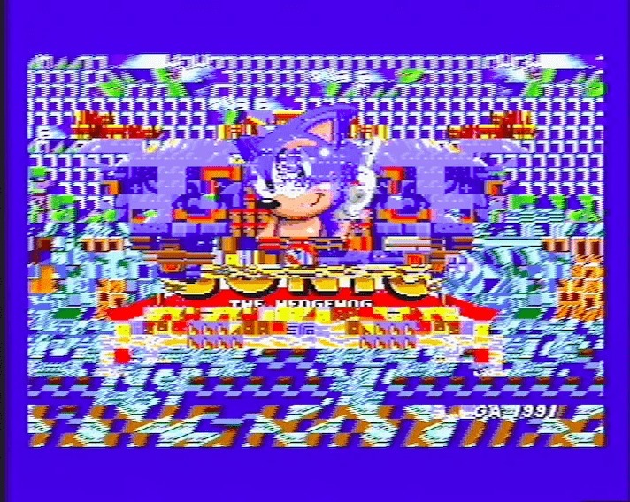
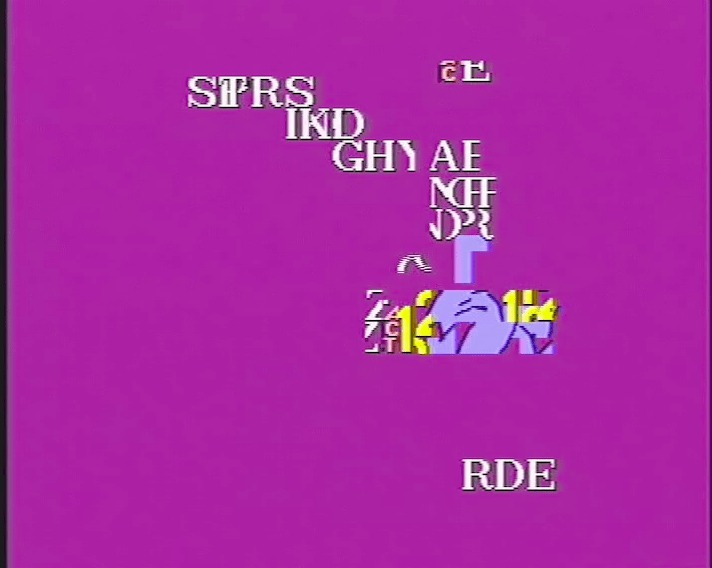
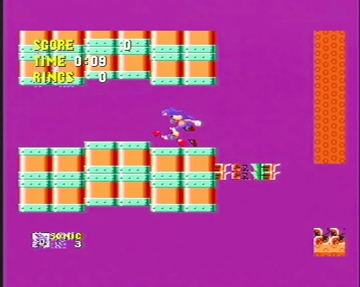

*The Sonic 2 title screen after a spot of circuit bending. I'm not sure this was the effect Sega had in mind!*
{: .media-caption }

Circuit bending.

*Those colours are certainly something. Sonic's world has turned into a rather spectacular mess!*
{: .media-caption }

Don't you just love the colours?

*Even the SEGA logo isn't safe from these glitches. Half of it seems to have gone on holiday!*
{: .media-caption }

Sega!

*CONIC TEOM? GAROC ONTC? The Sonic Team introduction has apparently developed its own language.*
{: .media-caption }

CONIC TEOM, GAROC ONTC!

*A Sonic 2 title screen thoroughly scrambled into checkerboards and coloured tiles. Beautifully broken!*
{: .media-caption }

Blue streak? More like garbled blue smudge!

*Blue streak? More like a lonely little patch of Sonic amid a sea of pink and stray letters!*
{: .media-caption }

Casino Night Zone? More like... I can't even!

*Casino Night Zone has gone decidedly off the rails. At least Sonic is still standing!*
{: .media-caption }

I am pretty sure this was done on a Mega Drive Model 2. However, I don't seem to have labelled my source for what to bend and what not to bend. I'm sure I'll work it out one day.

### Sources

- [Annotated VRAM pinout (40-pin SOJ)](/assets/uploads/2017-05-09-0002-dragged.pdf)
- [Annotated SRAM pinout (28-pin)](/assets/uploads/2017-05-09-0002-dragged-1.pdf)

### Related Posts

- [Circuit Bending on the Mega Drive](/circuit-bending-on-the-mega-drive/)
