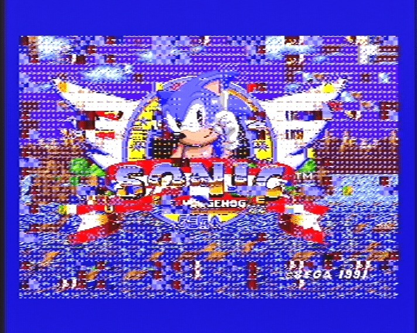
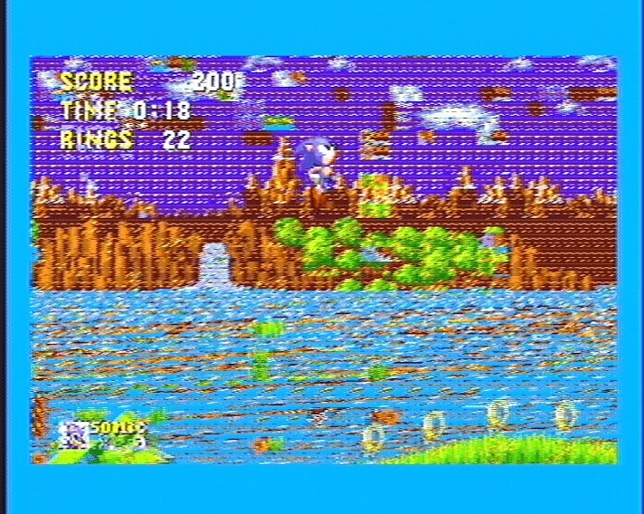
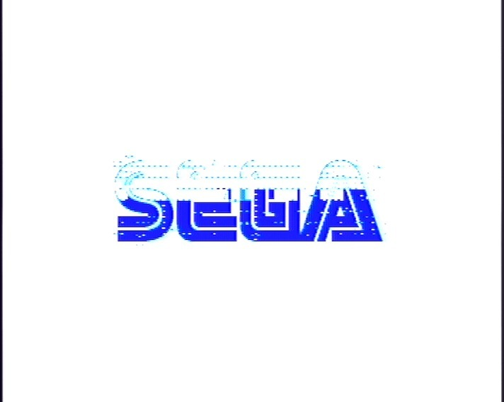
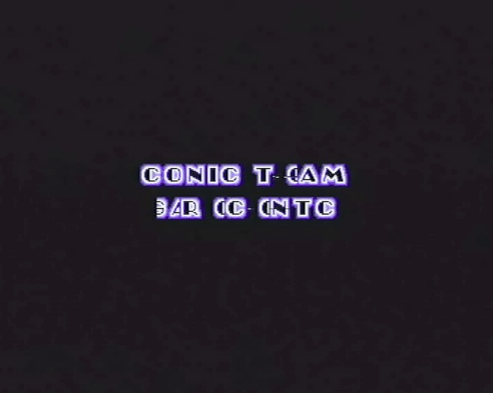
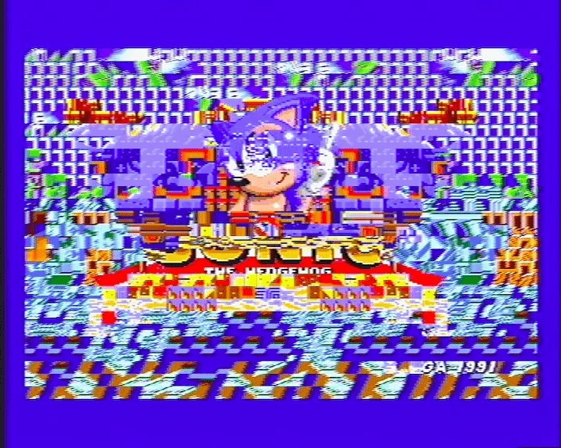
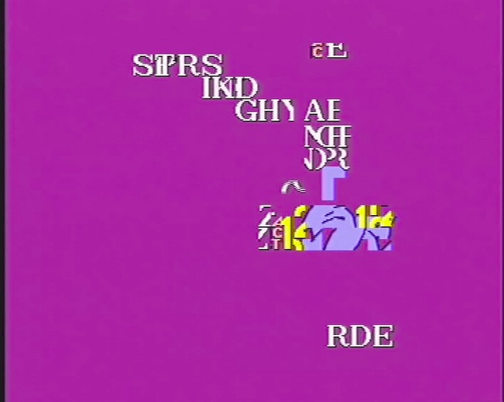
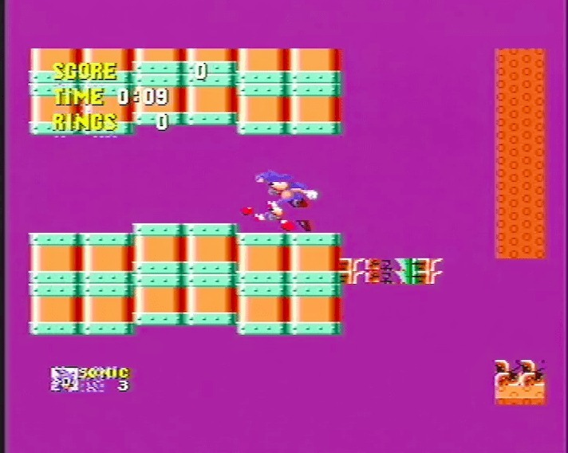

*The Sonic 1 title screen after a spot of circuit bending. I'm not sure this was the effect Sega had in mind!*
{: .media-caption }

Some more circuit bending on the Mega Drive, and Sonic 1 has rather lost the plot. I've got missing letters, broken-up scenery and colours that really have no business being together. It's a mess, and I love it. :)

*Don't you just love the colours? Sonic's world has turned into a spectacular mess of scrambled scenery and cyan stripes.*
{: .media-caption }

*Even the SEGA logo isn't safe from these glitches. Half of it seems to have gone on holiday!*
{: .media-caption }

*CONIC TEOM? GAROC ONTC? The Sonic Team introduction has apparently developed its own language.*
{: .media-caption }

*Blue streak? More like garbled blue smudge! Sonic's face and the title screen are disappearing into checkerboards and coloured tiles.*
{: .media-caption }

*Casino Night Zone? More like... I can't even! A lonely little patch of Sonic amid a sea of pink and stray letters.*
{: .media-caption }

*Casino Night Zone has gone decidedly off the rails. At least Sonic is still standing!*
{: .media-caption }

I'm pretty sure this was all done on a Mega Drive Model 2, but I don't seem to have labelled which points I was bending. Typical. At least I kept the screenshots, because I certainly can't tell you which connection produced which spectacular mess. I'm sure I'll work it out one day. :)

### Sources

- [Annotated VRAM pinout (40-pin SOJ)](/assets/uploads/2017-05-09-0002-dragged.pdf)
- [Annotated SRAM pinout (28-pin)](/assets/uploads/2017-05-09-0002-dragged-1.pdf)

### Related Posts

- [Circuit Bending on the Mega Drive](/circuit-bending-on-the-mega-drive/)
