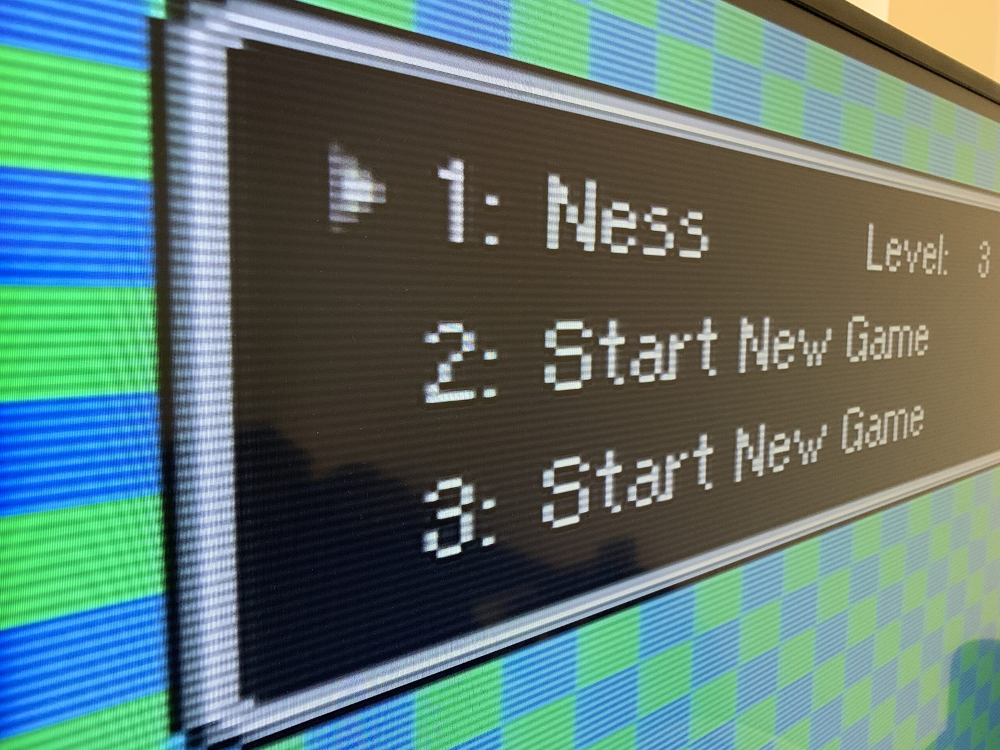
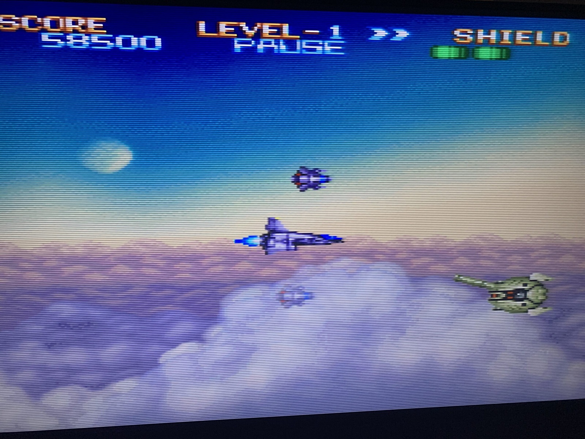
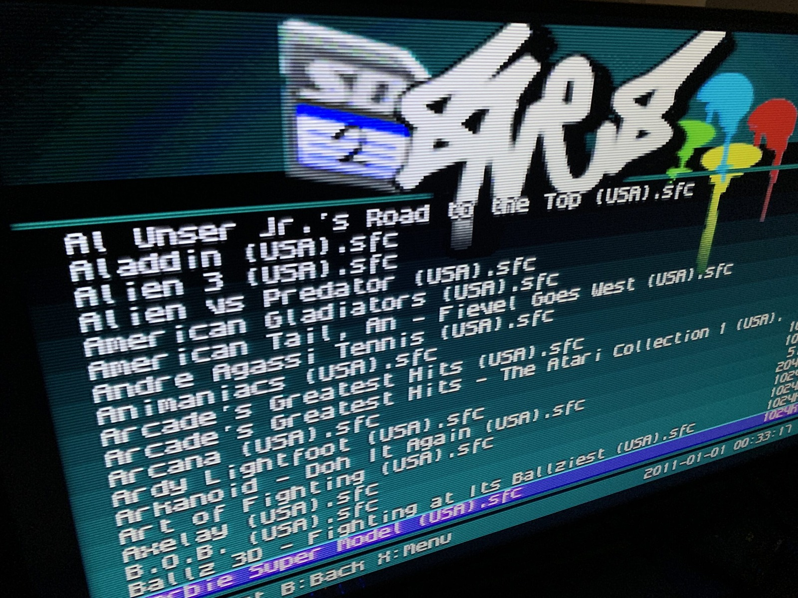
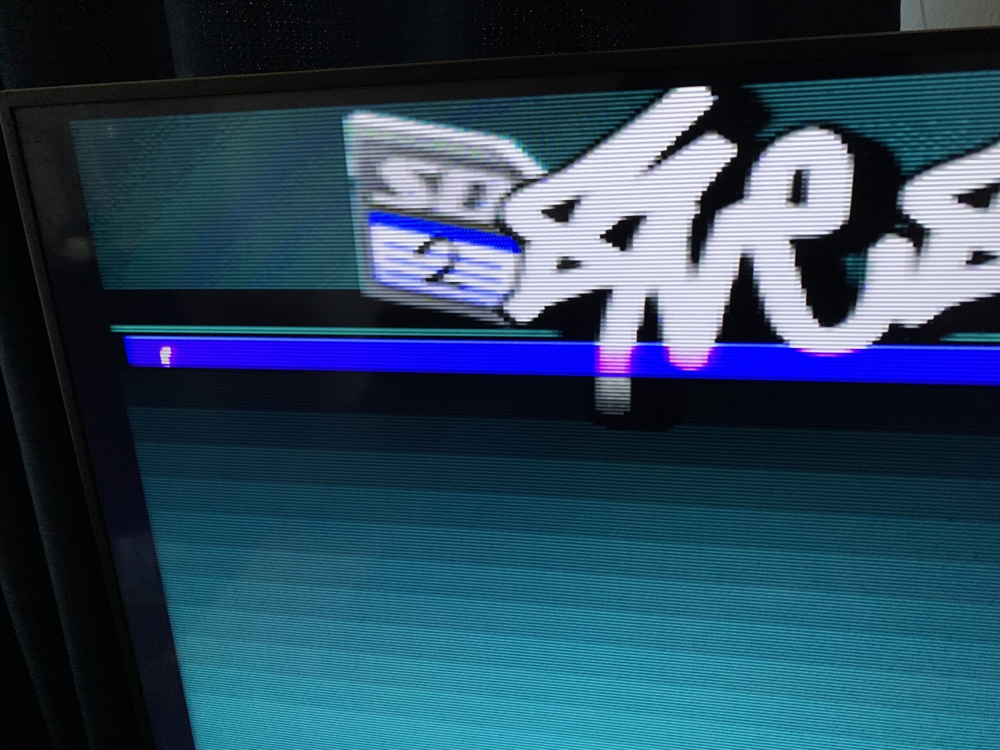
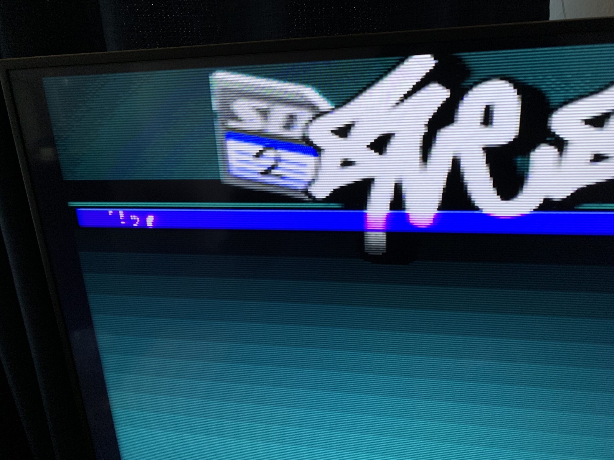

*EarthBound on the SNES, with scanlines across the menu. Still one of my favourite games!*
{: .media-caption }

Here's EarthBound (1995) on the SNES, at the character select screen. Incredible game that I cannot recommend enough.

*Earth Defense Force looking rather lovely with scanlines. Some old games really do suit them.*
{: .media-caption }

Earth Defense Force (1991) SNES. This game is amazing with scanlines.

*The SD2SNES menu behaving itself for once, with the games listed as they should be.*
{: .media-caption }

But nothing good ever seems to last forever. Above is my glorious SD2SNES working as it should, listing the games on the SD card.

*And then the SD2SNES menu forgets the whole game list. Not quite what I was hoping to see!*
{: .media-caption }

Then there's this, which definitely isn't right. The game list has disappeared, leaving a little bit of gibberish. It seems to be intermittent, which makes diagnosing the fault a little more interesting.

*More SD2SNES gibberish. The scanlines are great, but a working game list would be nice too!*
{: .media-caption }

More gibberish! So while my SD2SNES might be dying, the scanlines still look amazing. It had a good run at least. Maybe it's time to move on to another solution for my retro gaming. Farewell SD2SNES... maybe!
