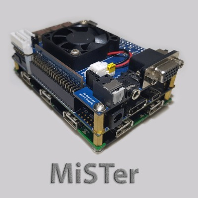

*My open MiSTer FPGA build, complete with the fan and its collection of add-on boards. A case can wait!*
{: .media-caption }

I finally got around to putting together my MiSTer FPGA. Below is a list of all the things I bought to get it into one piece. Sadly, the case I so desire is never in stock, so I've just gone with an open design for the time being. Eventually it would be nice to have it wrapped up neatly, but we can't have nice things these days, can we?

### Hardware

- Terasic DE10-Nano
- Noctua 40 mm NF-A4x10 5 V fan
- 128 MB SDRAM XSD (v2.5)
- I/O board (v6.0)
- PCB bottom plate
- Wi-Fi dongle
- Bluetooth dongle
- USB hub (v1.2)
- USB bridge connector (long)
- solid copper heatsink
- real-time clock board (v1.3)
- audio tape input (v1.1)
- USB bracket connector
- 5 V 4 A power supply
- inline power switch
- power-supply splitter cable

Overall I was very impressed with the hardware, enough that I had started selling off original consoles and related FPGA carts such as my Terraonion gear. Playing Earth Defence Force on the Super Famicom, you really get hit by slowdown when too many sprites are dancing around the screen, which tends to happen in a shmup. On my setup the same slowdown appeared in the same sort of places on MiSTer, which absolutely made my day. Past cool!

### Related Posts

- [SD2SNES Glitching with Added Scanlines](/sd2snes-glitching-with-added-scanlines/)
- [Looking at the SNES 1CHIP](/looking-at-the-snes-1chip/)
