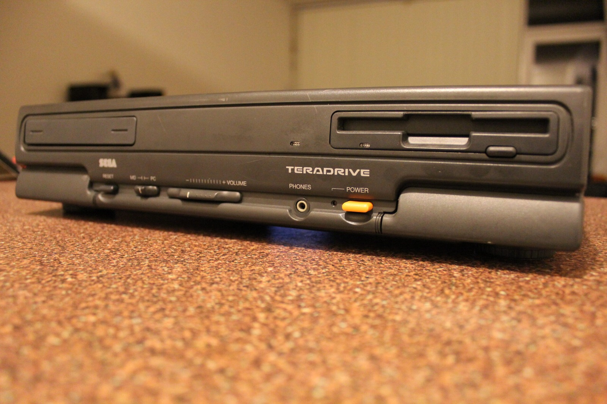

*The TeraDrive itself, photographed from the front. Now for those wonderfully obscure Japanese discussion threads!*
{: .media-caption }

The attached PDF is a rough translation of a [Japanese TeraDrive message-board thread](https://web.archive.org/web/20230801010936/http://hanabi.5ch.net/test/read.cgi/i4004/1008492375/). There are some interesting TeraDrive tidbits scattered through it. The thread begins in 2001 and continued for years, so I would treat this as community-sourced historical material rather than verified TeraDrive documentation.

The PDF is here: [Terra Drive](/assets/uploads/Terra-Drive.pdf)

### Related Posts

- [Miscellaneous TeraDrive Information](/miscellaneous-teradrive-information/)
