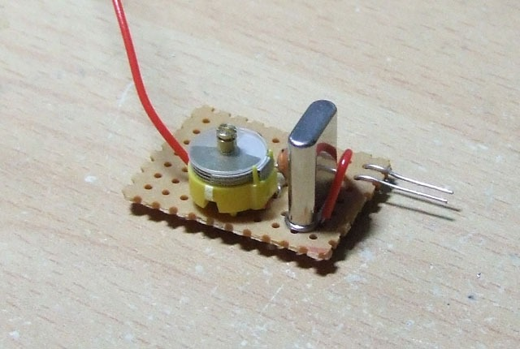

*Zipplet's example PAL colour-mod circuit on a bit of perforated board. Not one of my own completed modifications!*
{: .media-caption }

I've had this page bookmarked for something close to five years now. The site I referenced not only changed its links so much that I couldn't find the darned thing, but then went bust! I really need to be more proactive with linking to things before they disappear off the face of the earth.

I suppose it doesn't really matter since I've mostly moved on to FPGA solutions for the Mega Drive, but for the sake of being complete, here's a 60 Hz full-colour mod I was once pondering. That explains why I found a bag of 4.433619 MHz crystals the other weekend... :P

Zipplet's mod is for a Model 1 Mega Drive using the CXA1145 encoder. It supplies a separate PAL colourburst clock for 60 Hz composite and RF output; RGB already carries colour without this extra circuit. The module in the photo above is Zipplet's example, not a completed mod of mine.

### Sources

- [Zipplet - Sega Megadrive (Version 1) PAL 60hz full colour modification](https://web.archive.org/web/20160712164513/http://zipplet.co.uk:80/index.php/content/electronics_mdpal60)