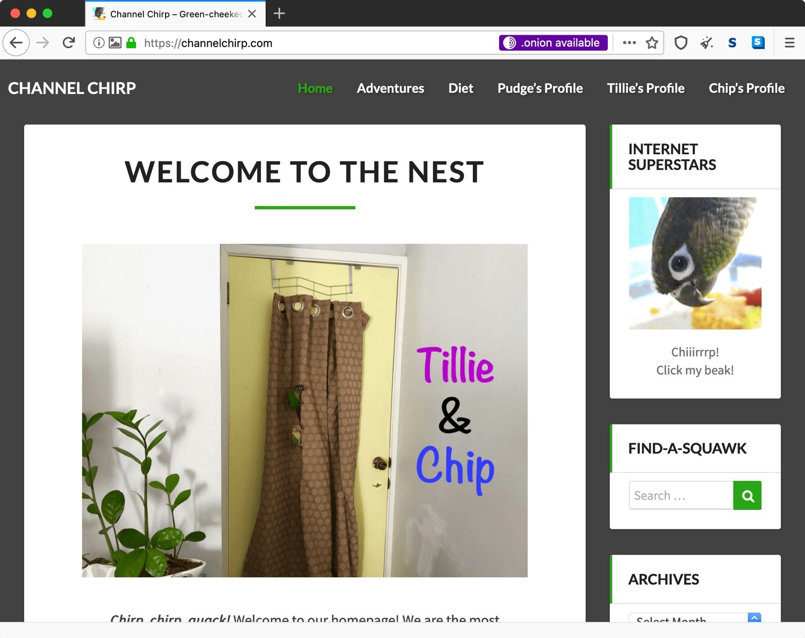
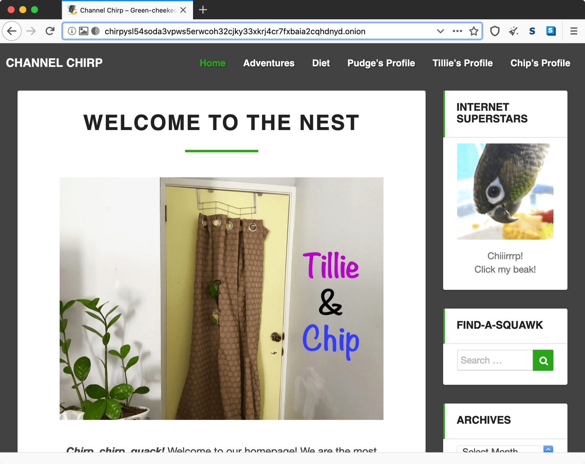

See that little purple ".onion available" note? Thanks to the Tor Project's Onion-Location feature, an HTTPS clearnet site can advertise its .onion counterpart to Tor Browser. The ordinary site is already being accessed through Tor; clicking that purple pill takes you to its onion counterpart. Pretty neat work from the Tor Project!

And... onion activated! One click, or the appropriate preference, and Tor Browser can move you onto the onion counterpart instead. Pretty neat. No more remembering chirpys54 soda something as the address!

I should move all the remaining sites from v2 domains to v3 domains at this stage. It involves editing the header and I'm not sure it supports multiple onion sites. v3 onion domains have their own advantages too of course!

### Sources

- [Tor Project - Onion-Location](https://community.torproject.org/onion-services/advanced/onion-location/)

### Related Posts

- [The Darknet Revisited](/the-darknet-revisited/)
