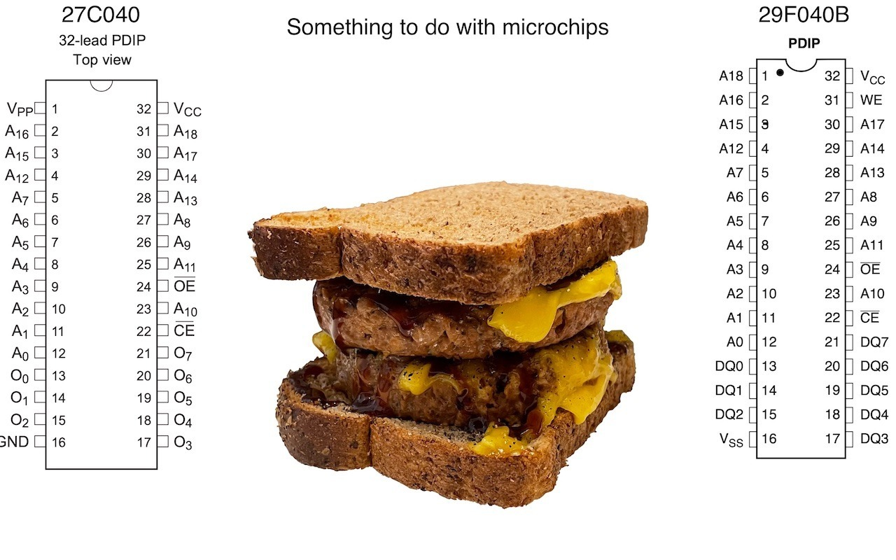
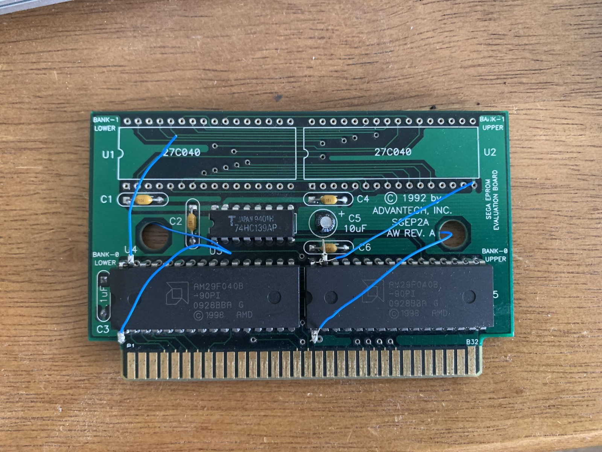
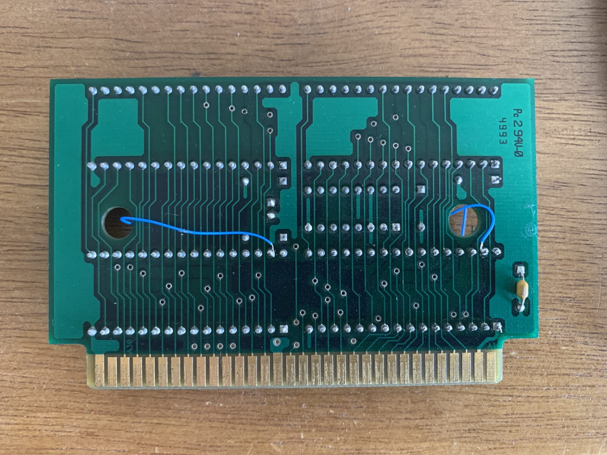
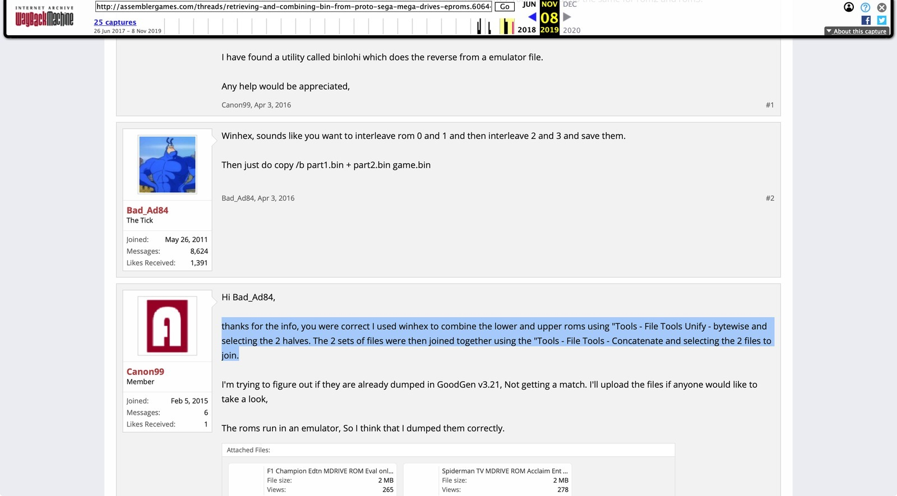

*EPROM pinouts either side of a sandwich. Apparently that was the state of my desktop filing system!*
{: .media-caption }

I found some images of DIP pinouts in my "Desktop" desktop folder. Why does one need a desktop folder on their desktop? It's a dumping ground for things that sit on my desktop too long but I can't bring myself to throw away. This is why I always figured it was important to document things as they happen. Otherwise you end up with what you see below. Good luck! Maybe I'll remember what it was for. Could it have been the Mega Drive Sonic 1 flash cart? Snap! That is what it was for, and I found images to back it up!

*Two AM29F040B flash chips on the Sega cartridge board, with the blue jumper wires making the changes rather obvious.*
{: .media-caption }

*The underside of the same cartridge board, where the blue jumper wires make their appearance again.*
{: .media-caption }

**_From Replacing 27C040 with AM29F040B.rtf_**

The Am29F040B is a 4 Mbit (512K x 8) flash chip using a 5 V supply. The PDIP version has 32 pins.

**Atmel AT27C040**
4 Mbit (512K x 8) OTP EPROM.

The pin mismatch is the important part. On the AT27C040 PDIP, pin 1 is VPP and pin 31 is A18. On the Am29F040B PDIP, pin 1 is A18 and pin 31 is WE#. For read-only use in this cartridge, I wired Am29F040B pin 1 to the board's original pin 31 connection for A18, then tied Am29F040B pin 31 to VCC at pin 32 to hold WE# high. The flash chip's pins 1 and 31 must be isolated from the board's original connections at those positions before being rerouted. Same number of pins, different jobs! This is a cartridge-specific adaptation, not a universal drop-in replacement for every 27C040 application.

*The archived discussion that finally helped explain the old ROM-combining notes. Unify, then Concatenate, not Dissect!*
{: .media-caption }

The surviving file-splitting note below is rough working text, not a paste-ready procedure. The screenshot above is about the reverse job: combining dumps. Bad_Ad84 suggested interleaving each pair, then joining the results; Canon99 reported using WinHex's bytewise Unify operation followed by Concatenate. My scrappy note says Dissect, so it is not a faithful copy of that reply. I've left the old note here as it survived.

**_From SPLITTING FILE.RTF_**

Start with normal text bin or md file byteswap in USBPrg (GQ-4X or similar) Win Hex thanks for the info, you were correct I used winhex to combine the lower and upper roms using "Tools - File Tools Dissect - bytewise and selecting the 2 halves.

(If not byteswapped first, the first one burnt might be the second rom... it doesn't really make a difference just swap the ROM chips around in the sockets)

There was also a SwapEndian.zip included in the folder, so here it is - [SwapEndian.zip](/assets/uploads/SwapEndian.zip) - Mystery solved!

### Sources

- [Atmel - AT27C040 datasheet (Microchip-hosted copy)](https://ww1.microchip.com/downloads/en/DeviceDoc/doc0189.pdf)
- [AMD - Am29F040B datasheet (Futurlec-hosted copy)](https://www.futurlec.com/Datasheet/Memory/29F040.pdf)
- [Sega Master System Development Cartridge (archived wiring reference)](https://web.archive.org/web/20030308205428/http://cgfm2.emuviews.com/devcart.htm)
- [ASSEMblerGames Archive: Retrieving and Combining Mega Drive Prototype EPROM BIN Files](https://web.archive.org/web/20191108232552/http://assemblergames.com/threads/retrieving-and-combining-bin-from-proto-sega-mega-drives-eproms.60644/)
- [SMS Power! - Combining Sega EPROM data to BIN suitable for emulator use](https://www.smspower.org/forums/16018-CombiningSegaEpromDataToBinSuitableForEmulatorUse)
- [C64 Magic Desk 1024K](https://github.com/msolajic/c64-magic-desk-1024k)