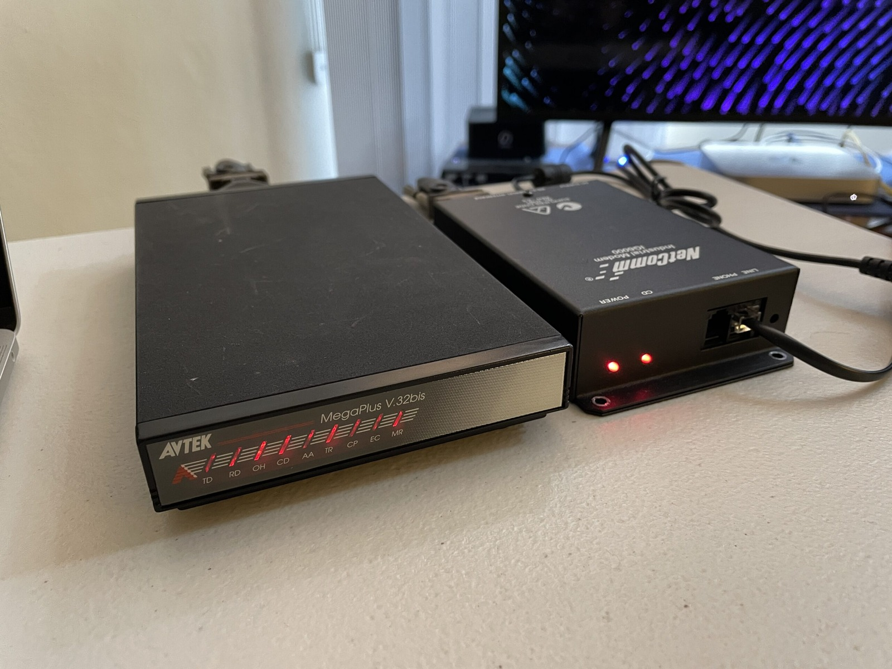
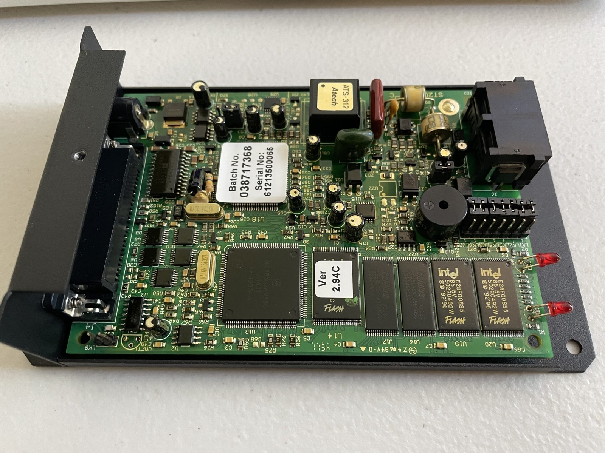
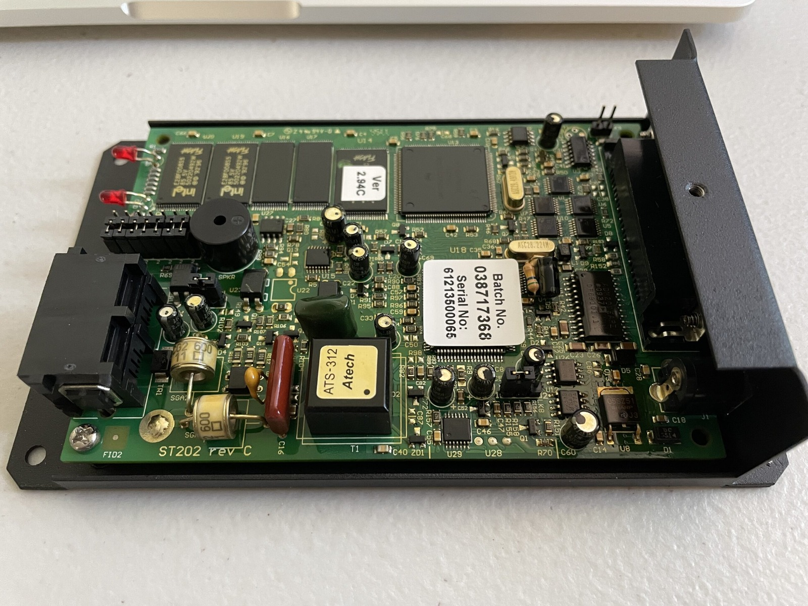
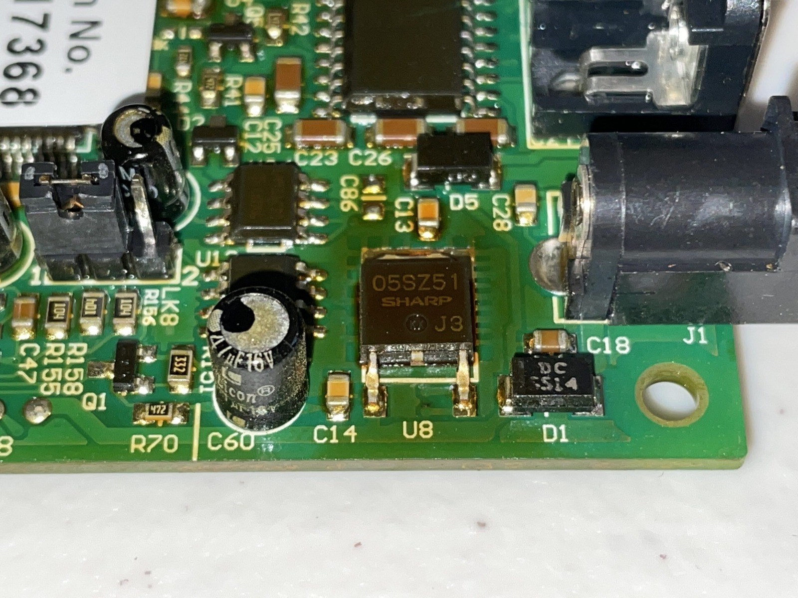
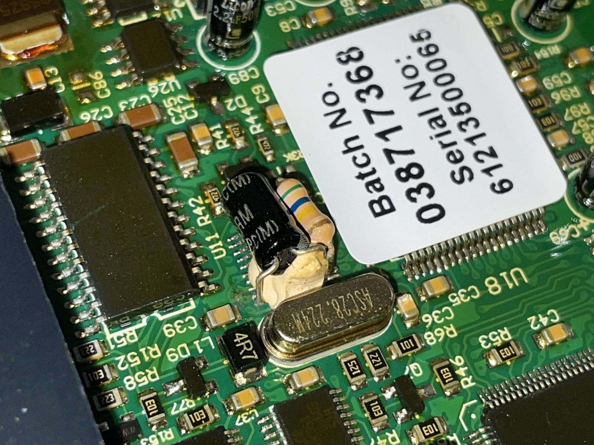
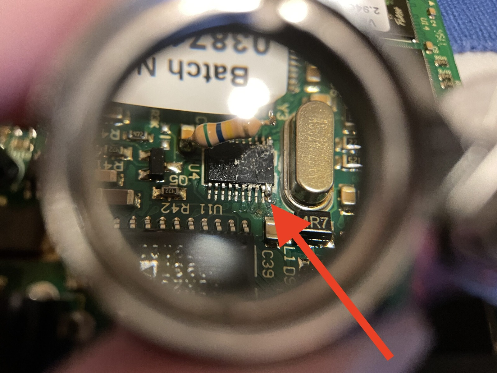
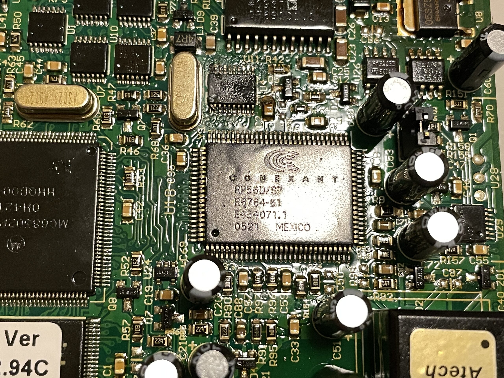
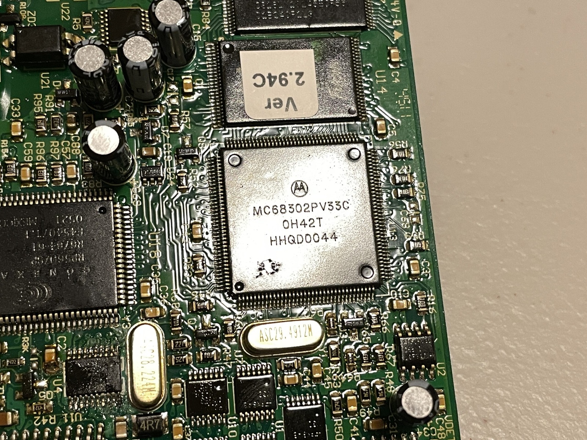
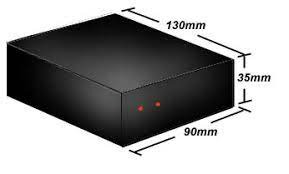

*The modem collection grew: an Avtek MegaPlus alongside the industrial NetComm IG6000. One was about to have a very bad day.*
{: .media-caption }

I stumbled upon the IG6000 modem by mistake. I was actually looking for a regular old dial-up modem for my test dial-up network. I've since learnt that NetComm had been eaten up by Casa Systems in 2019. My little modem pile shows how tangled things had become: Avtek or Banksia on the outside, NetComm on the inside. A peek inside the NetComm IG6000 reveals the inner workings.



*Under the industrial modem's lid: plenty of chips, a scattering of electrolytics and enough maintenance temptation to get me into trouble.*
{: .media-caption }



*Another angle of the IG6000 board before the capacitor swap. It looked straightforward enough at the time.*
{: .media-caption }

Anyhow, I went through and replaced all the electrolytic caps for maintenance, after discovering the board looks to have been manufactured in mid-2012. A bit early for a recap, but it was already mostly done by the time I realised my mistake.



*The Sharp regulator and one of the nearby capacitors. That part of the board had a distinctly well-toasted look.*
{: .media-caption }

To make things extra interesting, everything appears to be covered in a protective film, probably some form of conformal coating. What it's made of, I couldn't tell you. Thankfully, we had _high quality?_ Licon capacitors installed and I didn't mind replacing them. The poor Sharp PQ05SZ51 voltage regulator (above) sure did look toasty.



*An unexpected capacitor-and-resistor patch hiding next to a chip. This was not quite the routine recap I had planned.*
{: .media-caption }

Unfortunately for the IG6000, one of the capacitors I was replacing intercepted a patched-up hack of some sort that wouldn't fit on the PCB (pictured above). A 1 uF 50 V capacitor joined to a resistor, attached to a lifted leg on what appeared to be a Fairchild PG8SB chip with V574 and some obscured letters. It _looked_ to be a 20-pin TSSOP. That's right, past tense - uh oh.



*The damaged connection under magnification, helpfully indicated by a red arrow. I should have called it a night earlier.*
{: .media-caption }

The other side of the capacitor leg lifted the pad from the board and went... missing. A post mortem revealed the solder pad appeared to be connected to ground, albeit underneath the chip. I really should have ceased work on this once the sun disappeared behind clouds as my bench lighting is lacking.



*The Conexant RP56D/SP modem chip at the heart of the IG6000. A closer look at the hardware before its farewell.*
{: .media-caption }



*The Motorola MC68302 processor. Old-school communications hardware, still doing two jobs at once.*
{: .media-caption }

This unit was powered by a Conexant RP56D/SP R6764-61 ACF2 modem IC alongside a Motorola MC68302PV33C integrated multiprotocol processor. The Motorola has an MC68000/MC68008-family core and a separate RISC processor to handle communications. Two jobs in one chip! Going off their datecodes, they were manufactured mid-2005 and late 2000 (if I'm reading that right) respectively.

The list below records the capacitors I was replacing on this particular board, not a universal IG6000 shopping list. My heading says 14 capacitors, but I've only recorded 13 entries. The missing fourteenth will have to remain a mystery for now, especially given what happened to this modem. Save it as plain text and it should format correctly. I still need to fix my formatting to scroll on either code or pre tags.

Interestingly [a reference to the IG6000 was found](https://web.archive.org/web/20001011011937/http://www.avtek.com.au:80/products/ig6000/ig6000_t.gif) on the Avtek website through archive.org in October 2000. It's a very small gif!

```

NetComm Industrial Modem IG6000
14 capacitors
All replacements are 2x taller (What did Licon leave out?)
Completely Broken

Location	Value	Voltage	Height	Width	PCB spacing			Notes    				Element 14 Order Code


C15 		47uF	16V		6 mm	5 mm	2-2.5mm spacing		Silkscreen is full!		8126747 	2x taller, upgraded to 35V
C60			47uF	16V		6 mm	5 mm	2-2.5mm spacing		Silkscreen is full!		As above

Babies (11x)
C34			2.2uF	50V		6 mm 	3-4 mm	2-2.5mm spacing		Silkscreen is ~5mm (w)	2346265		2x taller
C89			2.2uF	50V		6 mm 	3-4 mm	2-2.5mm spacing		Silkscreen is ~5mm (w)	As above
C101		2.2uF	50V		6 mm  	3-4 mm 	2-2.5mm spacing		Silkscreen is ~5mm (w)	As above
C102		2.2uF	50V		6 mm  	3-4 mm 	2-2.5mm spacing		Silkscreen is ~5mm (w)	As above

U4			1uF		50V		6 mm 	3-4 mm 	2-2.5mm spacing		Joined to U4 w/ resistor 234626402 	This broke!

C53			10uF	25V		6 mm  	3-4 mm	2-2.5mm spacing		Silkscreen is ~5mm (w)	114463202 	2x taller, upgraded to 50V
C72			10uF	25V		6 mm  	3-4 mm	2-2.5mm spacing		Silkscreen is ~5mm (w)	As above
C51			10uF	25V		6 mm  	3-4 mm	2-2.5mm spacing		Silkscreen is ~5mm (w)	As above
C69			10uF	25V		6 mm  	3-4 mm	2-2.5mm spacing		Silkscreen is ~5mm (w)	As above
C21			10uF	25V		6 mm  	3-4 mm	2-2.5mm spacing		Silkscreen is ~5mm (w)	As above
C22			10uF	25V		6 mm	3-4 mm	2-2.5mm spacing		Silkscreen is ~5mm (w)	As above

POWER SUPPLY (Mean Well ~7.5V 1.6A 60mV Ripple)
GEM12I07-P1J																			2815709
AC PLUG-AU2																				2816209

```

We wish our modem, the NetComm IG6000, the best of luck. Goodnight and farewell to the dearest black box we knew!



*A tiny archived illustration of the industrial modem's box, complete with dimensions. Not the greatest resolution!*
{: .media-caption }

### Sources

- [NetComm - IG6000 legacy support page](https://support.netcommwireless.com/legacy-products/IG6000)
- [NXP - MC68302 Integrated Multiprotocol Processor](https://www.nxp.com/products/MC68302)
- [Casa Systems - Acquisition of NetComm Wireless](https://www.sec.gov/Archives/edgar/data/1333835/000119312519187381/d13444dex992.htm)
