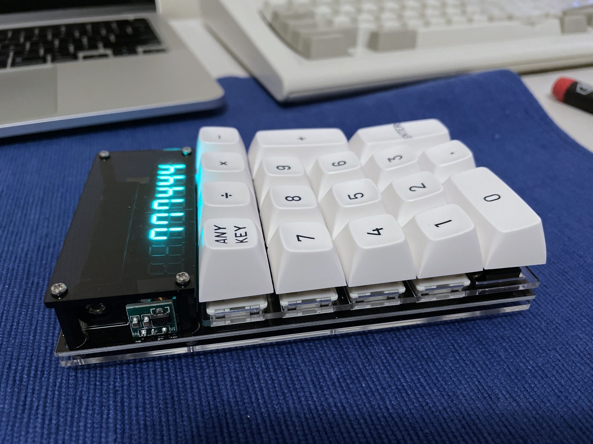
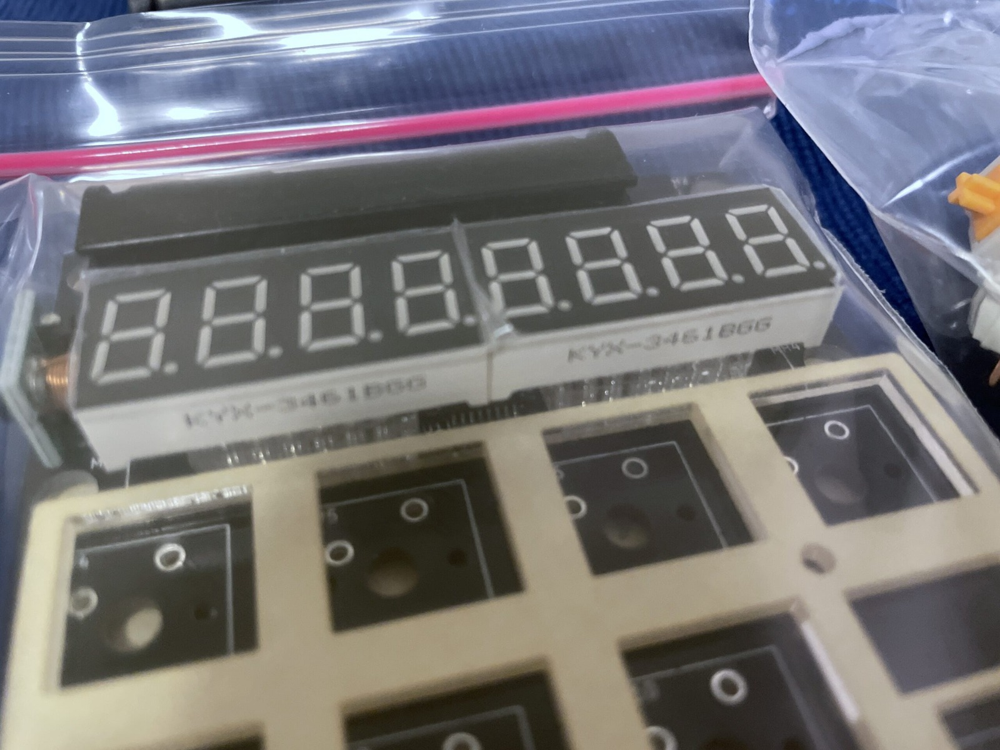
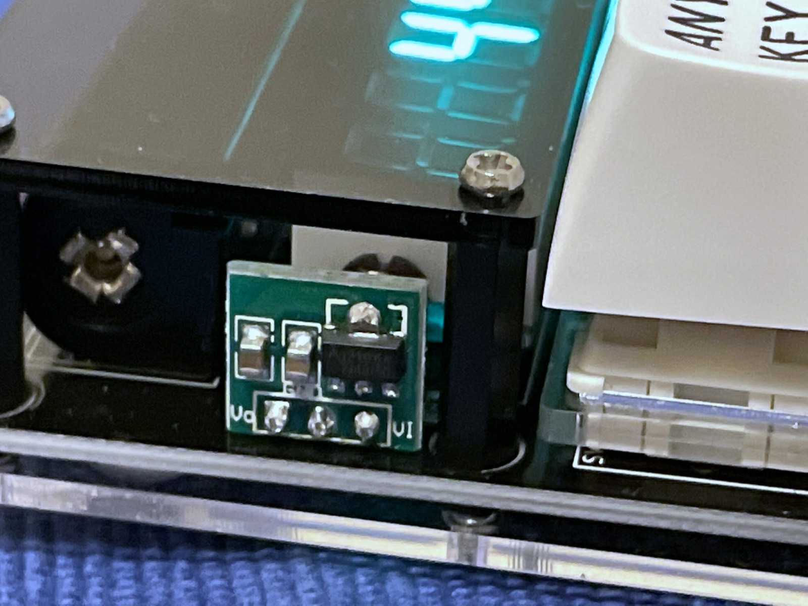
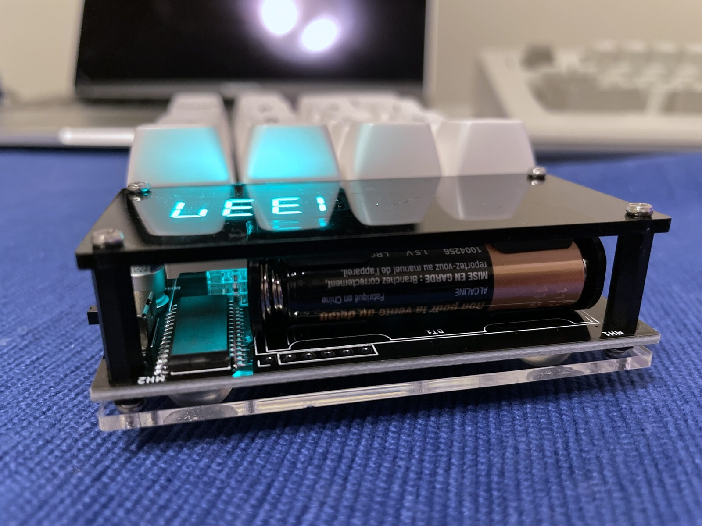
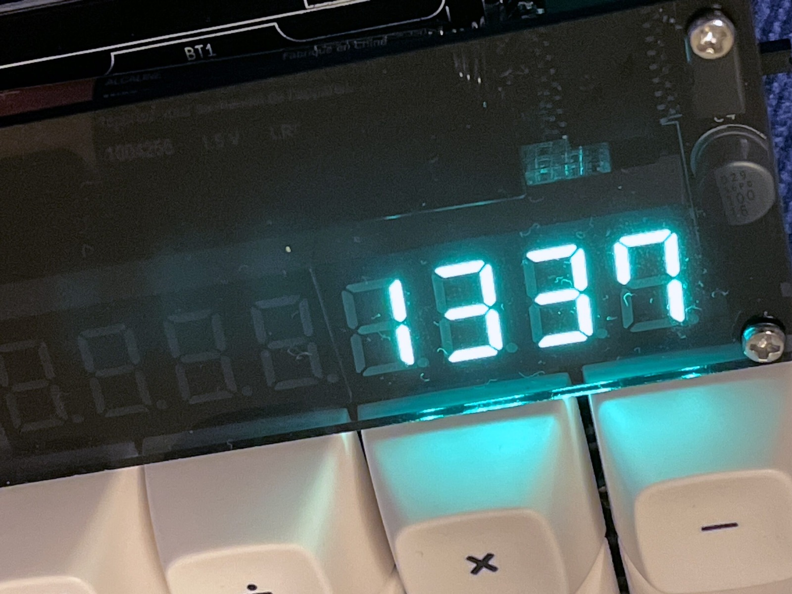
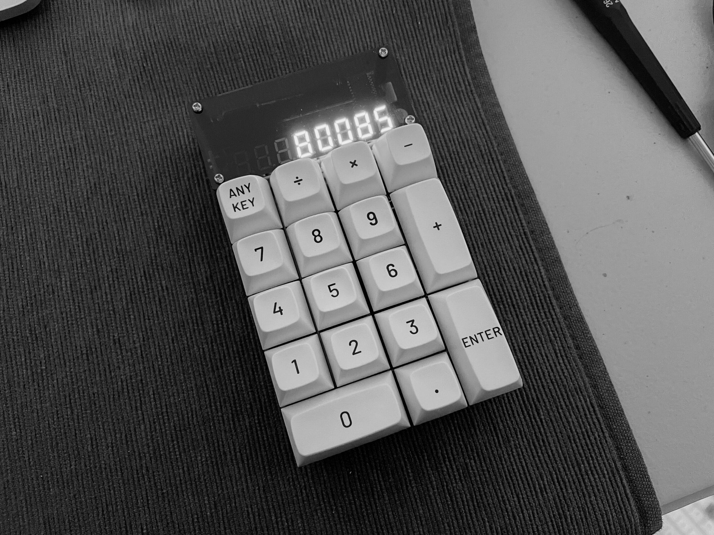
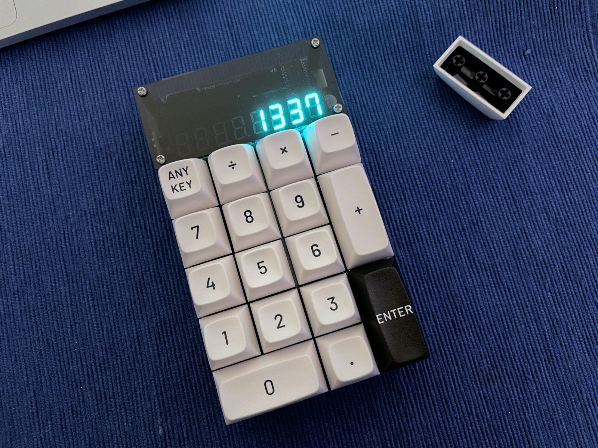

*The finished Tentaku with white keycaps and glowing digits. Mechanical switches do make even arithmetic more satisfying.*
{: .media-caption }

This is [A&N Laboratory's Tentaku Mechanical Calculator DIY Kit](https://anlabo.booth.pm/items/1069765) which I recently picked up from [Switchkeys](https://www.switchkeys.com.au/products/tentaku-mechanical-calculator) in Australia.

*Two enormous seven-segment modules waiting to become a calculator. It's not every day a maths project needs keyboard switches.*
{: .media-caption }

With two beefy seven-segment LED display modules and a tiny bit of circuitry, it makes calculating fun. My build is equipped with Glorious Pandas (non-lubed). I am planning on getting a Glorious PC Gaming Race GMMK Pro 75% Barebone keyboard and wanted to see how well Glorious Pandas thock before getting a full set of key switches.

*A little bit of circuitry tucked underneath the Tentaku's display. Nice and simple, just how I like a kit.*
{: .media-caption }

Here's a bit of circuitry, nice and simple.

*A single AAA keeps the Tentaku going. Best remember to take it out when I'm finished.*
{: .media-caption }

Powered by one AAA battery, just don't forget to remove it when it isn't in use!

*Obligatory 1337. It would have been a terrible waste of a calculator not to try it.*
{: .media-caption }

Obligatory 1337. The calculator has a six-digit display. So while I couldn't fit 8008135 onto it...

*The Tentaku calculator displays `80085`, just another number in a sea of numbers.*
{: .media-caption }

I was able to get 80085 loaded in. It's in black and white to be art. Loaded with class and certainly not tasteless.



Assembly was straightforward. A&N Laboratory's build video above goes through the whole thing.

*1337 returns, this time with the alternate black ENTER key. The keycap obsession was clearly not over.*
{: .media-caption }

1337 with the alternate ENTER key. The keycaps installed are the [Drop MT3 Black-on-White Keycap Set](https://drop.com/buy/drop-mt3-black-on-white-keycap-set). I'll be installing these onto my GMMK Pro. I must admit though the Drop ALT keyboard looks very nice... expensive, but nice. In other news, I've also been working on a device known as the [YamPAD](https://github.com/mattdibi/yampad). More on that in a future post!

### Sources

- [A&N Laboratory - Mechanical Switch Calculator TENTAKU DIY Kit](https://anlabo.booth.pm/items/1069765)

### Related Posts

- [Blood Plasma Donation #13](/blood-plasma-donation-13/)
