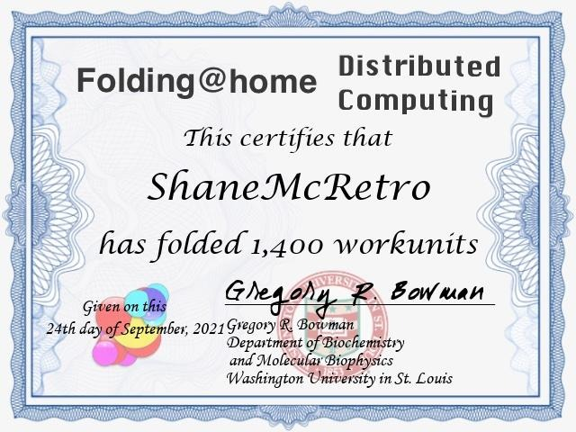
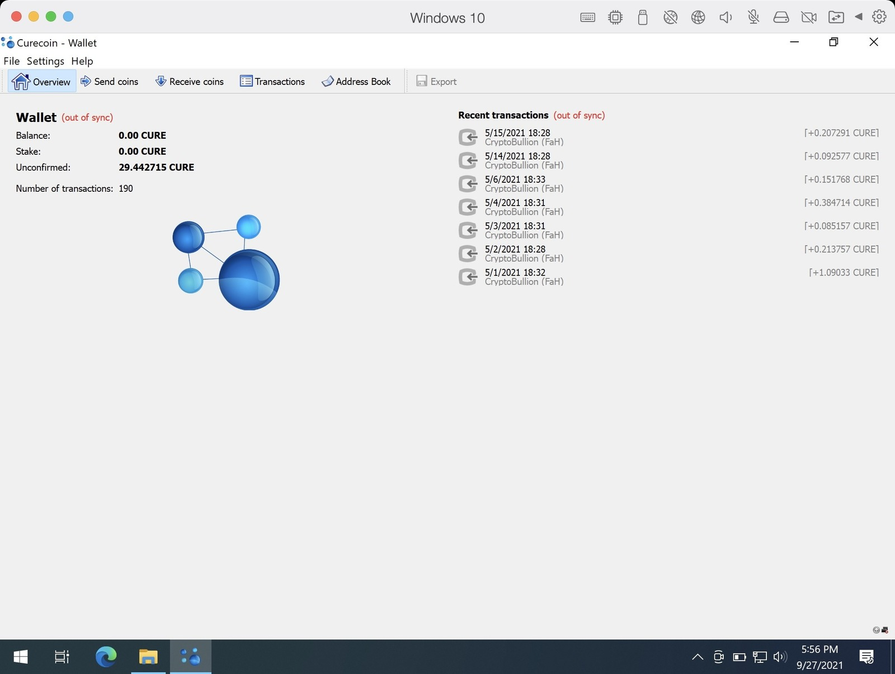
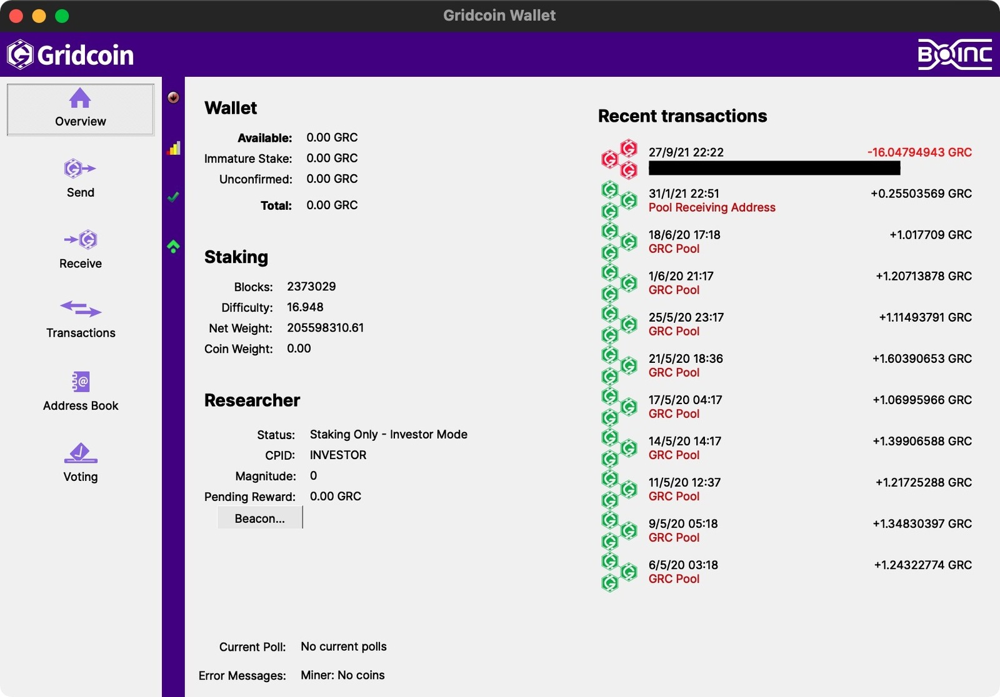
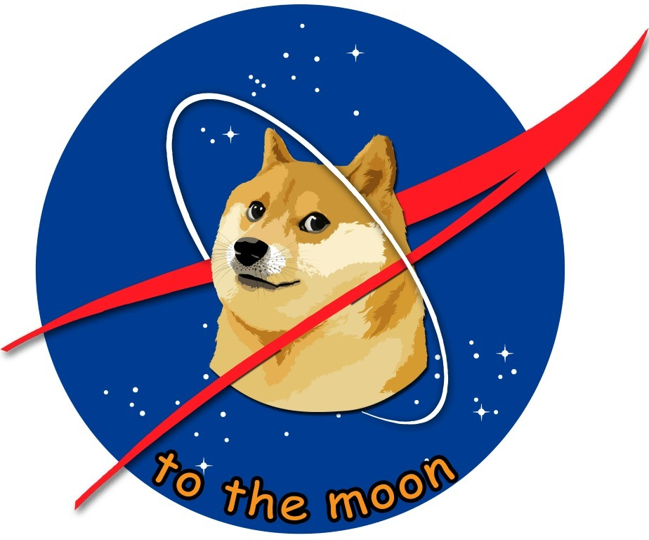

*A certificate for 1,400 work units. By the time I changed teams, the tally had already reached 1,422.*
{: .media-caption }

Today we say farewell to the [NixMcRetro](https://stats.foldingathome.org/donor/66180693) account on [Team Curecoin](https://stats.foldingathome.org/team/224497) at [Folding@home](https://foldingathome.org/). We did well with 1,422 workunits folded counting up a massive 15,692,754 points! Farewell tears aside, we join [Team dogefolders](https://stats.foldingathome.org/team/226715) as [a Dogecoin wallet address](https://stats.foldingathome.org/donor/564207096)!

Why the change? Less wallets, that's why! Plus [DogecoinFah](https://www.dogecoinfah.com) is donation-based relying on generosity of those who have been holding their doge.

*The Curecoin wallet in Windows 10, still out of sync. Not exactly the happiest macOS companion.*
{: .media-caption }

The Curecoin wallet hadn't worked for me for a few years on macOS. I live on macOS, making that rather incompatible with my way of life. The Dogecoin wallet had been working nicely for me, with versions for Windows, macOS and Linux. Even better, I was able to cash out my 67 cure for around 21 doge. Nice!

*The old Gridcoin wallet in investor mode. Not much left in the balance after that last transfer.*
{: .media-caption }

I also had 16-odd [Gridcoins](https://gridcoin.us) but they **_kinda_** got lost on a random exchange. I didn't quite have enough to cover the fees to get them converted to another crypto and back into my wallet. I was quite late to the game for Gridcoin, so the return wasn't spectacular. At least their wallet was functional on macOS.

*Dogecoin's little astronaut moment. If we're folding for fun, we may as well bring the dog.*
{: .media-caption }

None of the above recoups anything though. Thankfully we are not in this for the sweet, sweet cryptocurrency. No, we're here to fold proteins and perhaps have a bit of fun on the side. For the fun part, doge just makes sense! Time's such person of the year in 2014? In meme-land, absolutely.

### Sources

- [DogecoinFah - Dogecoin Folding@home](https://www.dogecoinfah.com/)
- [Dogecoin Core - v1.14.4 release, Windows, macOS and Linux downloads](https://github.com/dogecoin/dogecoin/releases/tag/v1.14.4)
- [TIME - 2014 Person of the Year: The Ebola Fighters](https://time.com/3629595/in-the-latest-issue-16/)