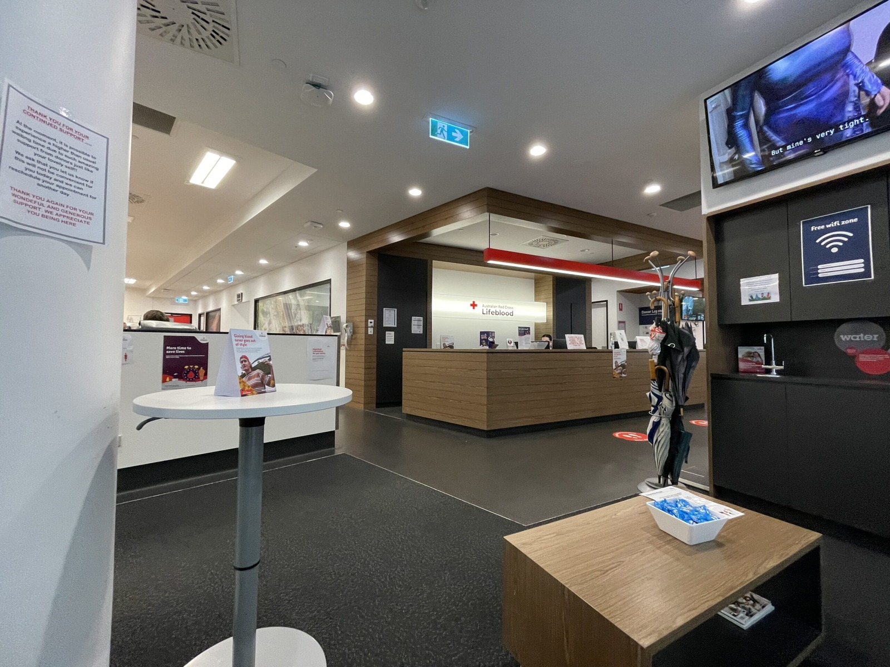
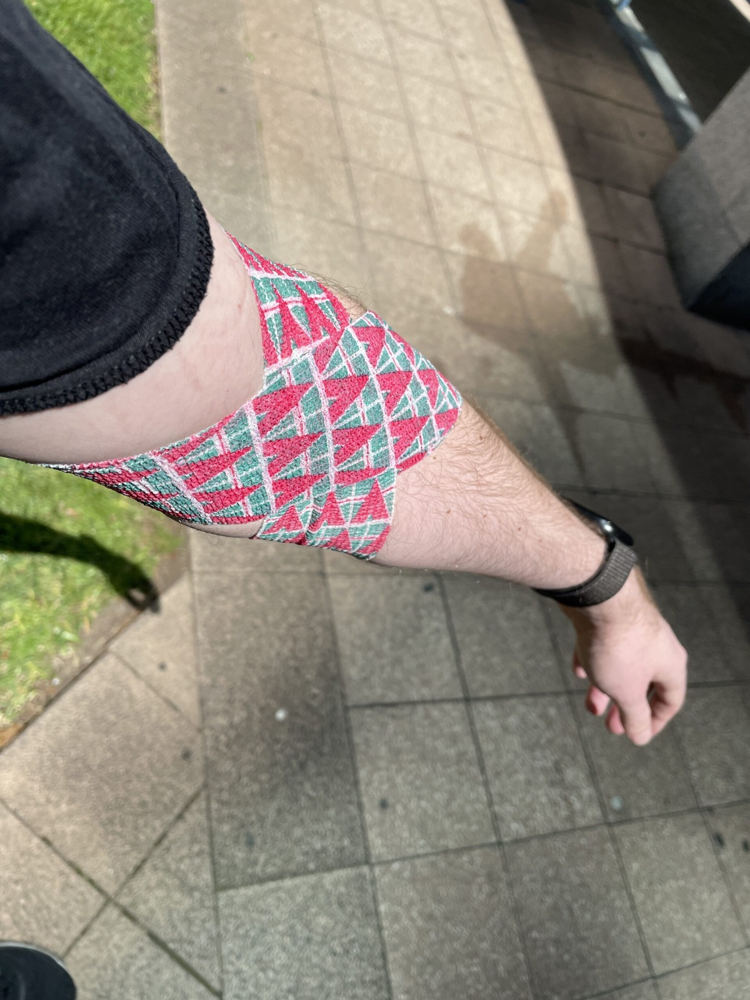
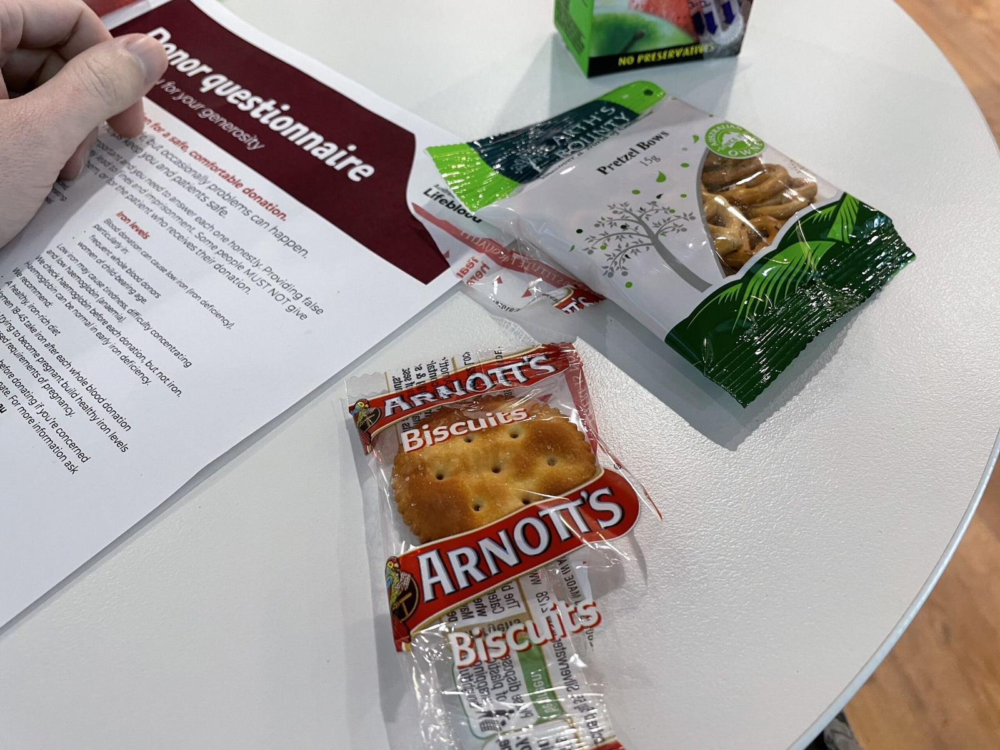
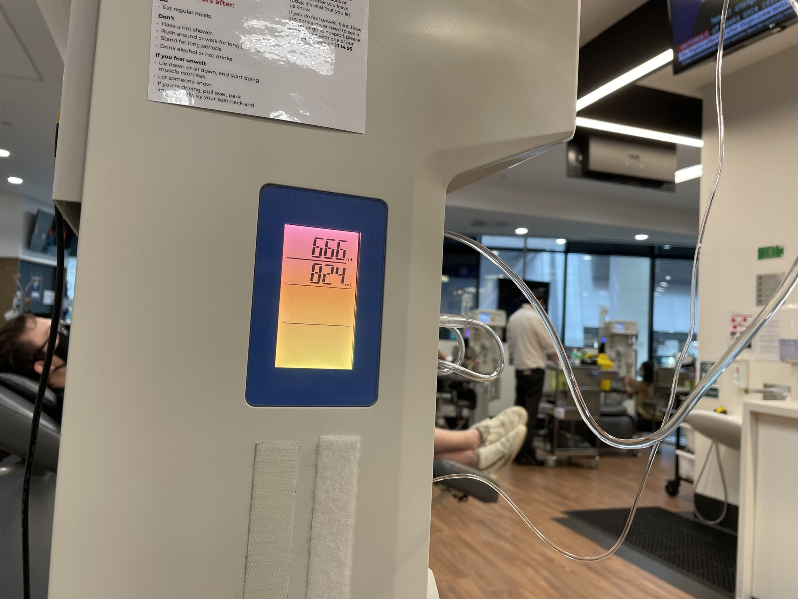
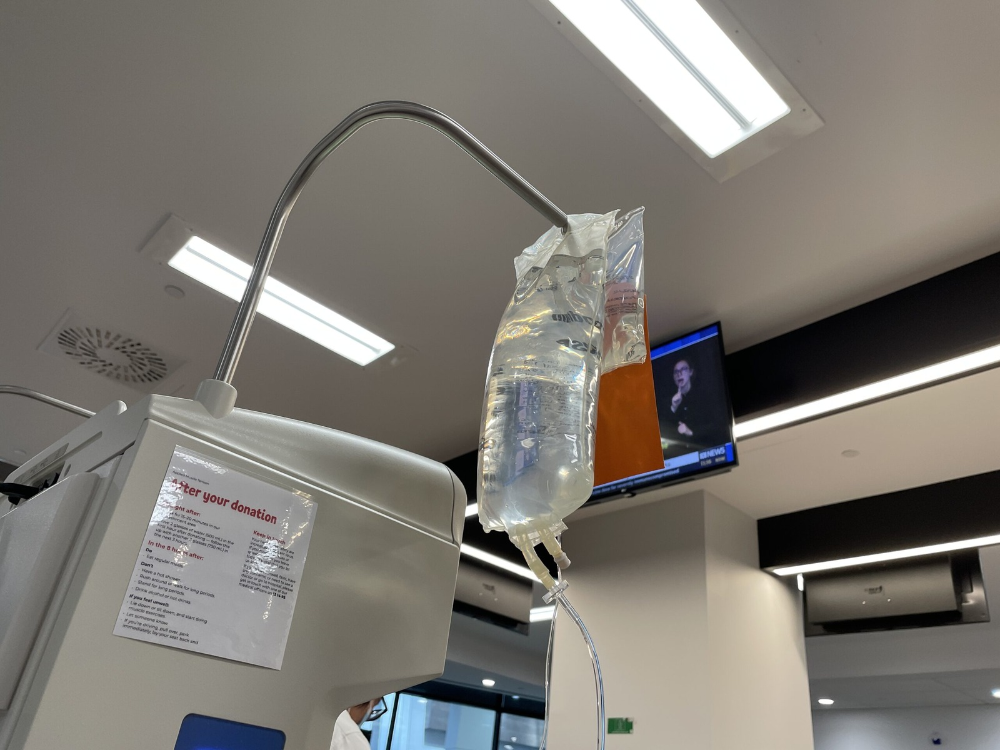
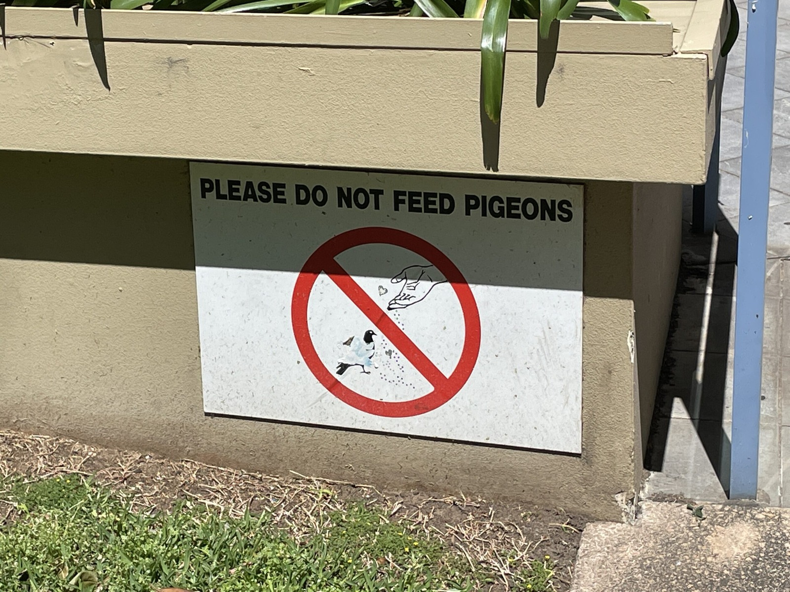
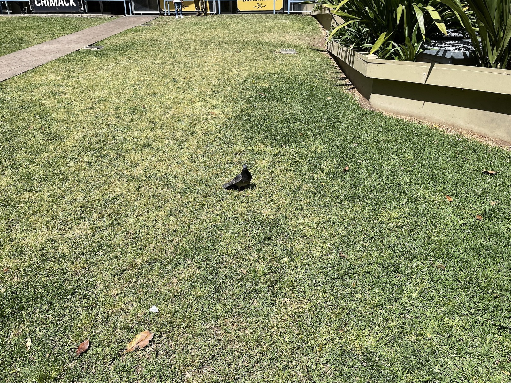
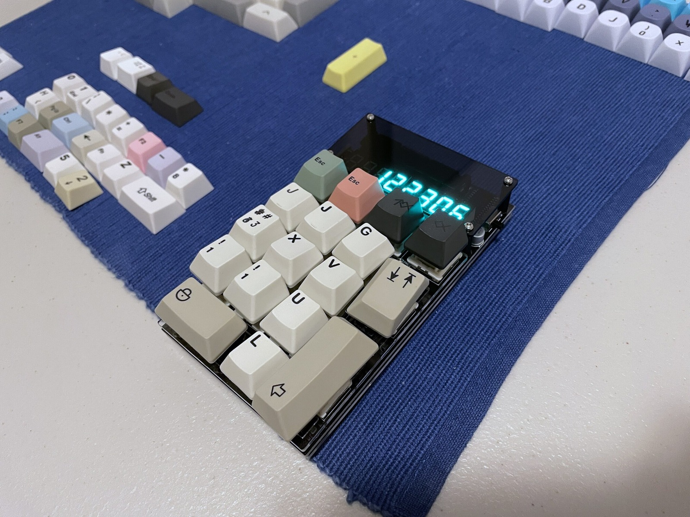
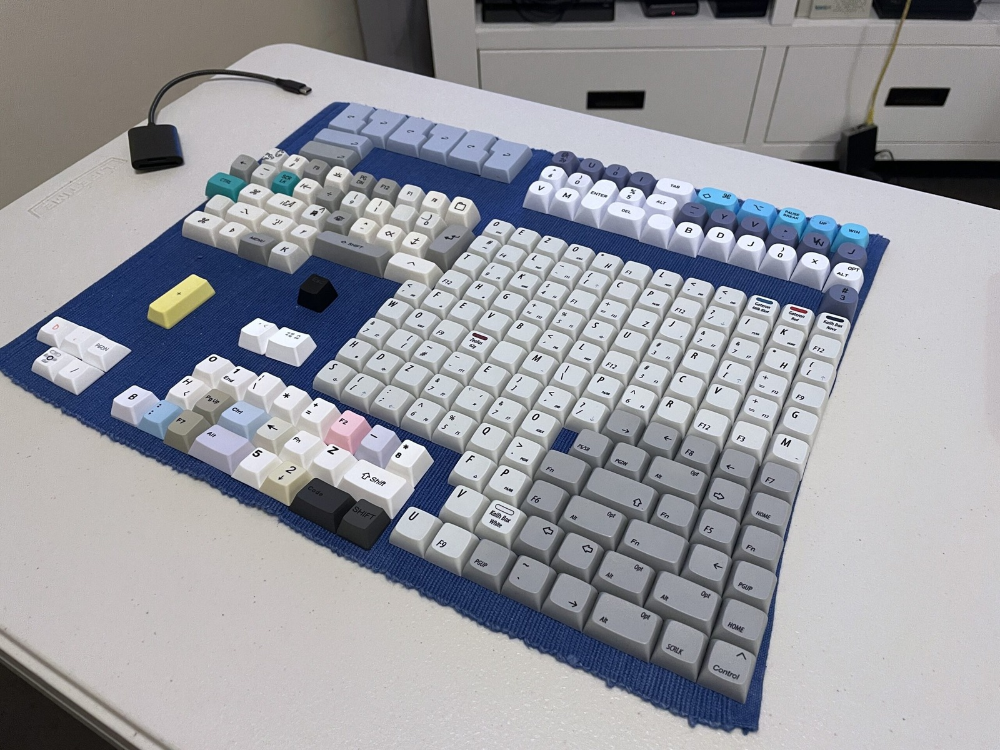

*Plasma donation number thirteen begins at the Lifeblood donor centre. The 33rd donation overall.*
{: .media-caption }

Today was plasma donation #13 and my 33rd donation overall. Nothing went wrong, as usual. I'll be getting my iron stores checked before the next whole blood donation in roughly a month. My haemoglobin was rocking 159 g/L, back where I wanted it. That's a separate measurement from iron stores, though. And what's this?

*A splash of colour from Eric Bridgeman's donor-bandage design. Much livelier than last year's black ink.*
{: .media-caption }

Ohhoooo a shiny! [Fancy coloured bandages are back in again](https://www.lifeblood.com.au/news-and-stories/vital-reads/true-colours-2021). I had Astro Boy last year, which ended up being just black ink... This year I went with brighter colours from artist Eric Bridgeman. Looks good!

*Jatz were back in the donor snacks. An upgrade worth photographing.*
{: .media-caption }

I was delighted to see Arnott's Jatz back on the menu after those terrible uncooked wheat crackers from last donation. Phew!

*666 mL on the machine, plus a spectacularly synthwave screen. Impeccable timing.*
{: .media-caption }

I not only managed to have the big clunker pause on one of the return cycles at 666 mL donated but my camera decided to capture in synthwave-esque colours instead of the expected boring blue. Awesome!

*A 1 L saline bag with a suspiciously old-school appearance. Its actual age remains a mystery.*
{: .media-caption }

Ah yes, I zapped a photo of the elusive, antique-looking 1 L isotonic saline. New old stock bought on the cheap? That was my theory from appearances, not something I knew about its age or procurement. It's just [how I remembered it](/blood-plasma-donation-12/). The anticoagulant bag was 250 mL, and I remembered the saline bags being 500 mL. Those are bag capacities, not a record of how much went into me.

*Someone took the trouble to make a very clear sign. Sorry, Mary Poppins.*
{: .media-caption }

While waiting for a bus on the return trip, I came across this sign. Did we learn nothing from Jane Darwell, born Patti Woodard, in her final film role as [The Bird Woman](https://en.wikipedia.org/wiki/Feed_the_Birds)?

We aren't feeding the birds, so they look ragged like this poor fellow. We stood around in the sun and, unfortunately for him, I didn't have any bird seed. Not that we want to encourage a pigeon boom in a metropolis like Sydney. The poor birds have it hard enough and it's all our fault. In other news...

*The Tentaku is officially an instrument of chaos. Those keycaps belong in a museum of bad decisions.*
{: .media-caption }

... look at that monstrosity. It's the [Tentaku mechanical calculator kit](/tentaku-mechanical-calculator/) from a few posts ago with keycaps from hell. It's just missing a few backward Rs and a stamp bearing a golden hammer and sickle sprinkled with a few stars.

*My grab bag of misprinted keycaps. Turns out it contained a suspicious number of F12s.*
{: .media-caption }

It all came from a "grab bag" keycap kit. Mostly misprints and a tonne of F12 keys. It has helped determine what profile would suit the upcoming [YamPAD](https://github.com/mattdibi/yampad) project. I think the lower profiles would suit better. Oh, look! You can also see the [GeoCities](/homepages/geocities) proxy server hanging by an ethernet cable in the background.

### Sources

- [Australian Red Cross Lifeblood: Haemoglobin and Iron Health](https://www.lifeblood.com.au/donors/blood-plasma-platelets/learn/iron-health)

### Related Posts

- [Blood Plasma Donation #12](/blood-plasma-donation-12/)
- [Tentaku Mechanical Calculator](/tentaku-mechanical-calculator/)