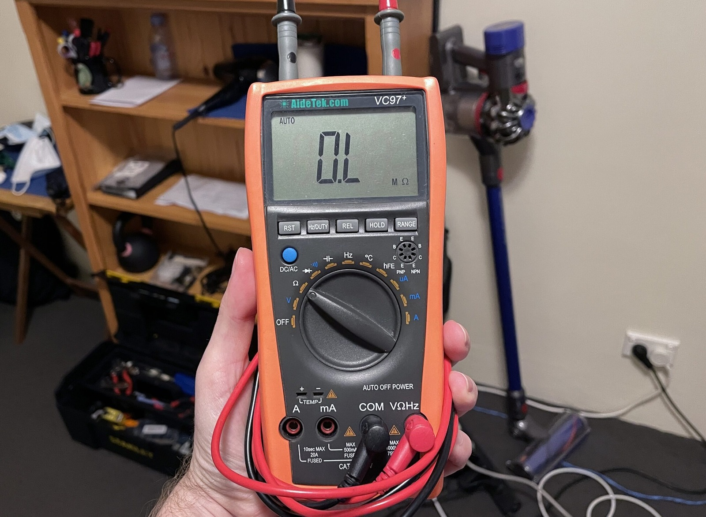
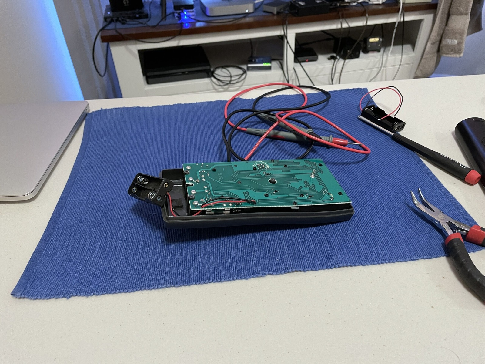
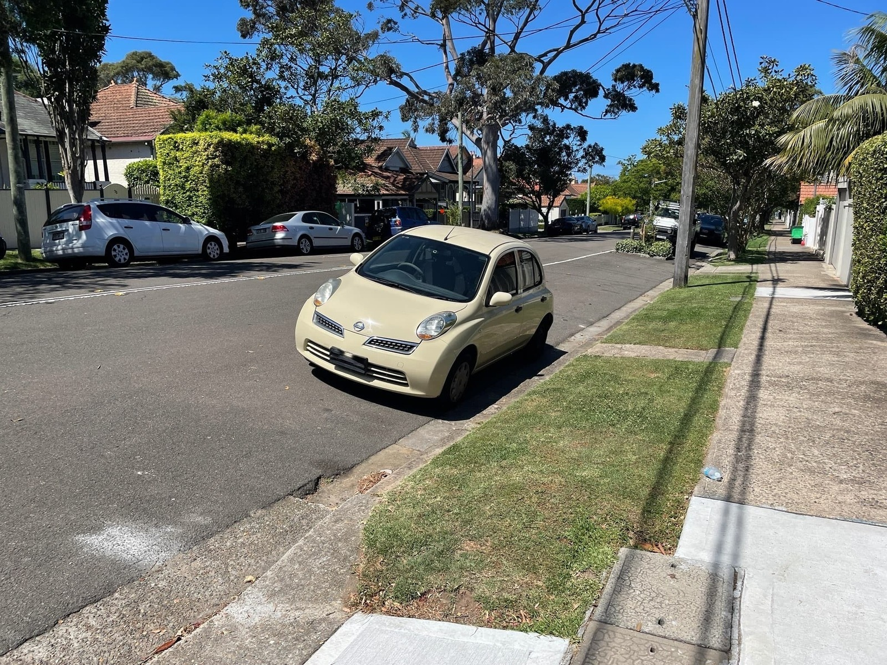

*The VC97+ is alive again! OL is the expected open-circuit reading here, not a new fault.*
{: .media-caption }

Look at what can be achieved if you believe in yourself. This multimeter was a disaster zone before and now it turns on again! That OL reading is the over-range indication, which is what I'd expect with an open circuit in resistance mode.

*Inside the VC97+, the battered battery contacts and new holder explain the repair.*
{: .media-caption }

This particular multimeter, an AideTek.com VC97+, had a few corroded Varta batteries in the battery compartment that ate away at some of the terminals. The above shows the corrosion and the new replacement battery holder to the right. It only cost a few dollars to get it back up and running.

*A cream-coloured hatchback is parked beside a sunny residential street.*
{: .media-caption }

Unfortunately, I also noticed that the stand was broken. One of the pegs had snapped. I can't be trusted with superglue. So I handed it over to [SuperNick (Nick)](/humble-beginnings-nintendo-famicom-incoming/). He fixed it up and now it is as good as new. Thanks Nick, you've been part of the McRetro family since before it even existed!

### Sources

- [AideTek VC97+ Operation Manual](https://manuals.plus/m/20261db6f58f2982cfbc964f739496b58c98aab434181407acc2d3aa8d84e9f8)
