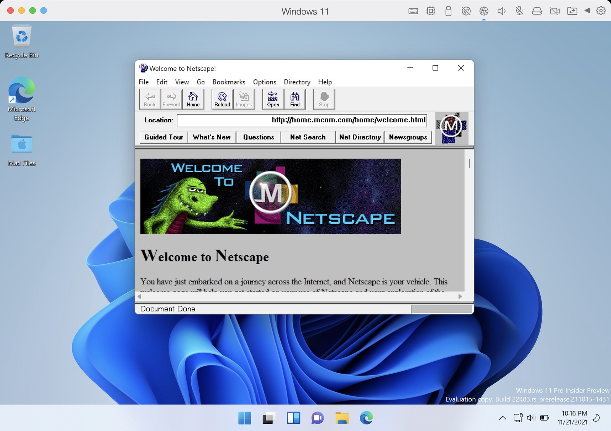
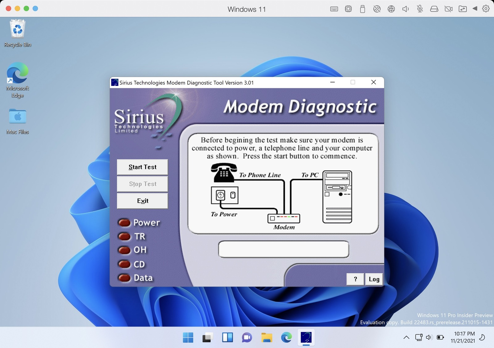

*Netscape's welcome page in Windows 11. Unexpectedly functional for a browser that predates the operating system by decades.*
{: .media-caption }

Well that was unexpected. Netscape 1.0 had made it as far as its welcome page inside my Windows 11 virtual machine. That's pretty impressive! Alright, maybe "working" is a little subjective, but good on Microsoft for keeping legacy code around forever. Not always a bad thing.

*The old Sirius modem diagnostic utility fires up in Windows 11, though the firmware outcome remains a mystery.*
{: .media-caption }

Sirius Technologies Modem Diagnostic Tool Version 3.01. Looks like I was using this software in Windows 11 to update the firmware on one of my NetComm AM56XX modems (or download it perhaps...). I'm not sure whether the firmware download succeeded. We were running in a virtual machine, so that probably added another layer of potential problems.
