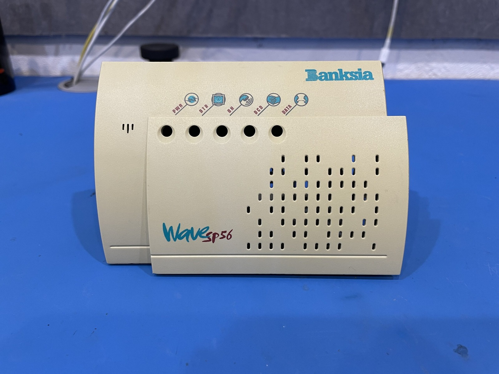
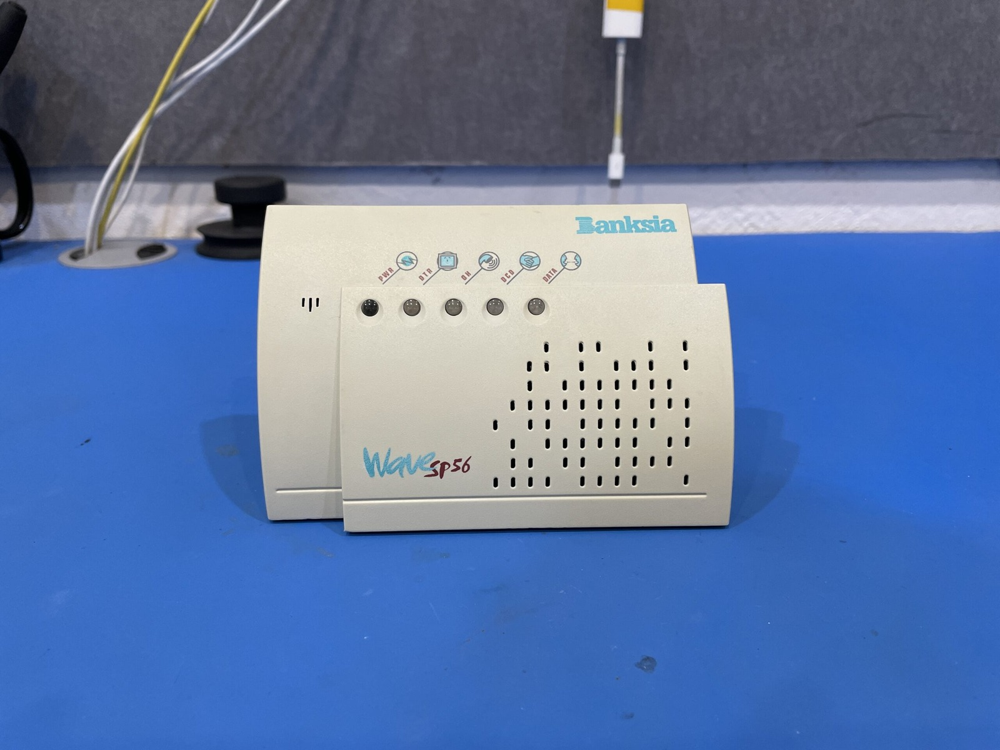
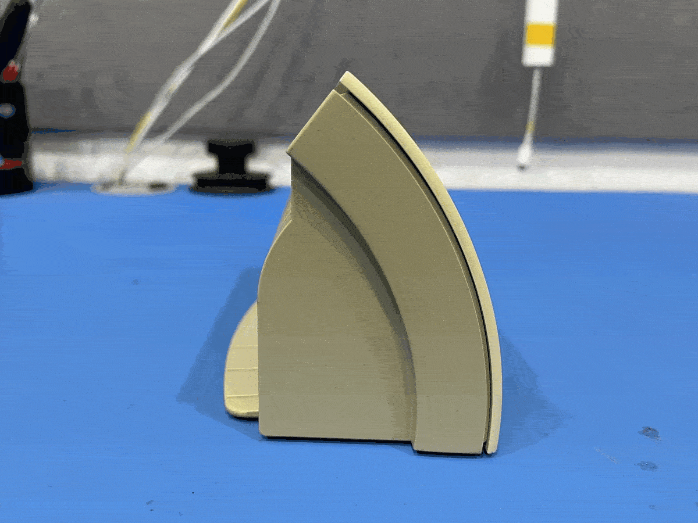

*Before Tim's retrobright treatment, the Banksia Wave SP56 was already showing its age. The blue lettering was still there, though.*
{: .media-caption }

Lots of people I know like [retrobright](https://en.wikipedia.org/wiki/Retrobright). I've never really liked it. Seems too much hassle for too little return. Above is a before shot of the modem. Note that at this stage the modem had some extensive accidental damage to the PCB, so the risk of losing this case was a non-issue.

*The Banksia after retrobrighting. A lighter shell, but the coloured lettering hasn't come out unscathed.*
{: .media-caption }

You can see more before and after shots in the [photo gallery](/goodies) under the Banksia Wave SP56 modem serial 13412650. [Tim](https://pendleton115.net/) was kind enough to give it a shot with this method-

> **Hydrogen peroxide and up**

Hmmm, that looks like an iOS-style typo or unwanted autocorrect. Probably should read UV. The results will vary depending on a few factors, concentration of hydrogen peroxide, UV exposure time, etc. It definitely lightened up the plastics. It also had a negative effect on the coloured text, which to be fair, we were expecting to happen.

*One last look around the Banksia case. Retrobright or retroblight? I'm still not convinced.*
{: .media-caption }

So is it a case of retrobright or retroblight? I've always found it better to try and collect either black or metal-based retro gear where possible.

It's one of the reasons my earlier collecting did not focus on Nintendo with their easy-to-yellow Super Nintendo. Sega did well with the Master System, Mega Drive and Saturn. Dreamcast... well you could swap the white/yellowing case for a nice translucent smokey grey.

Thanks again to [Tim](https://pendleton115.net/) for performing the retrobrighting over several days! 🦌
