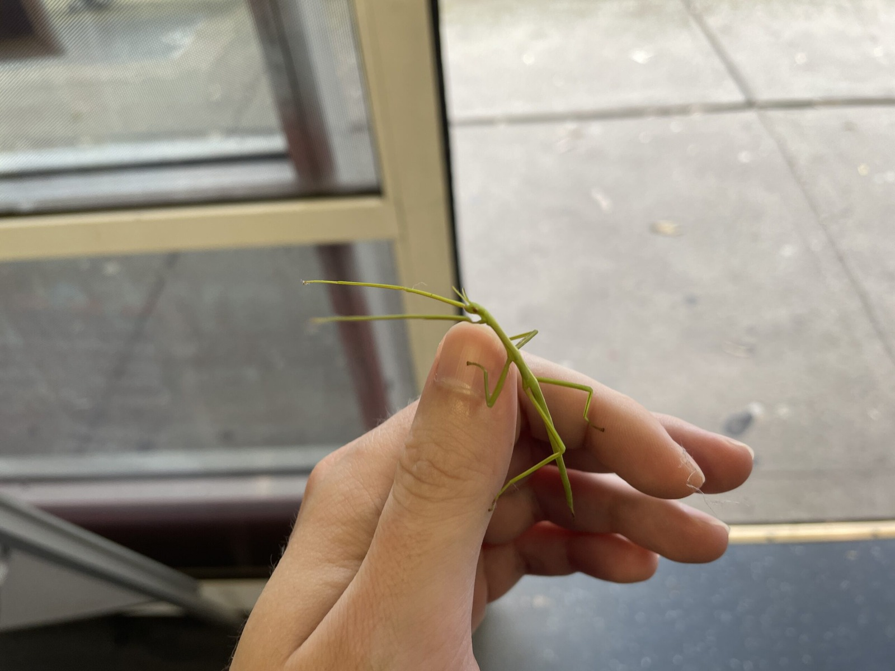
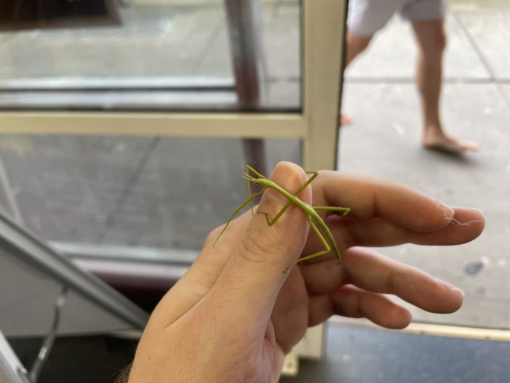
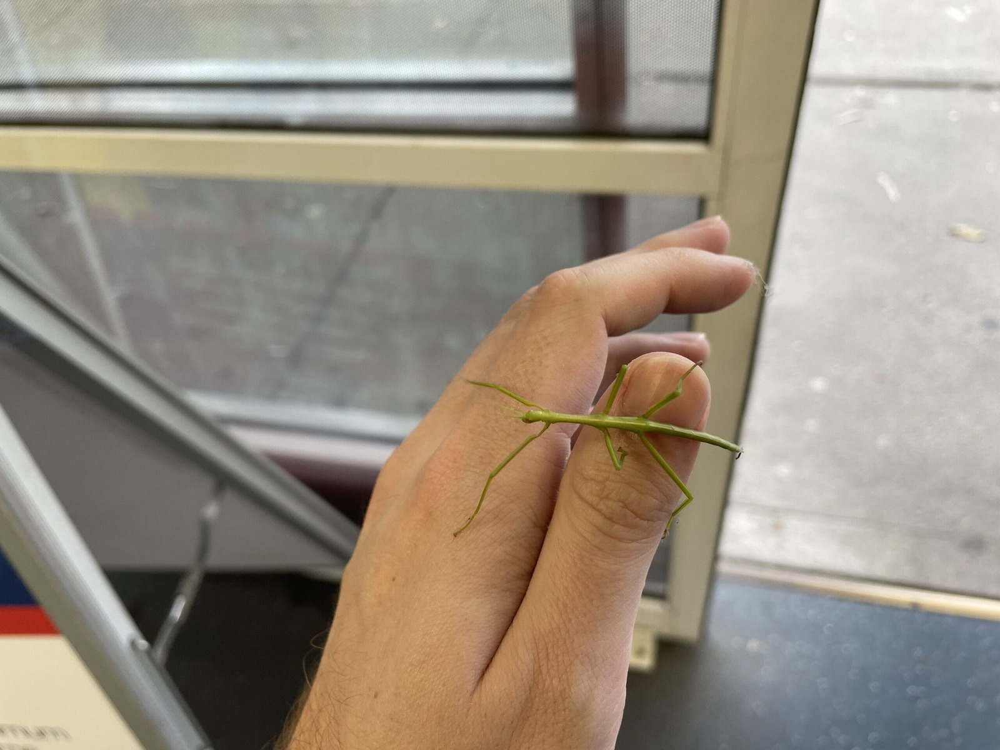
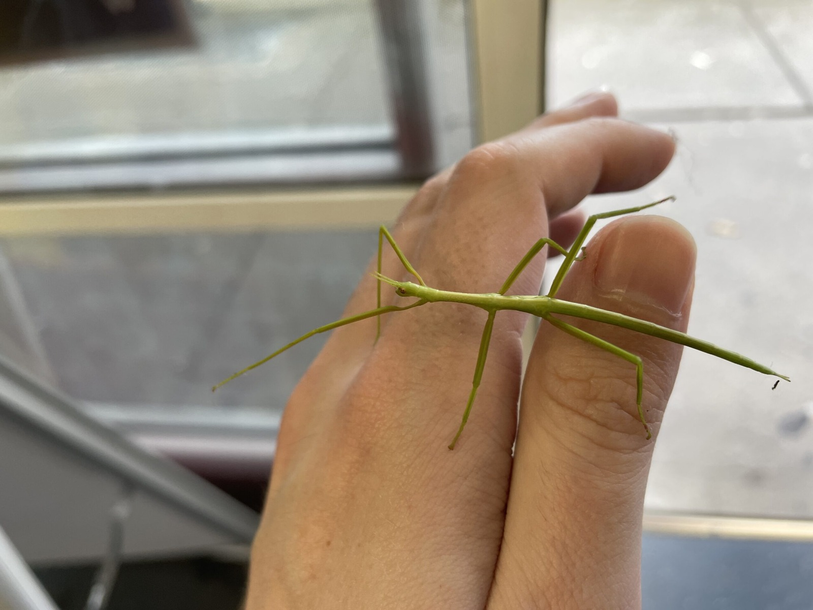
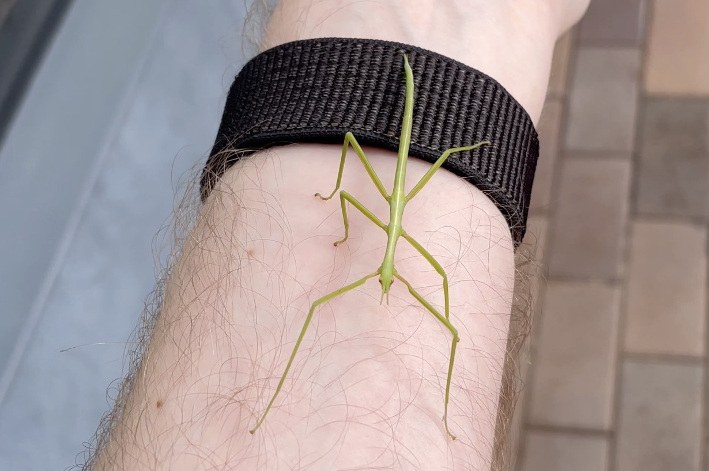
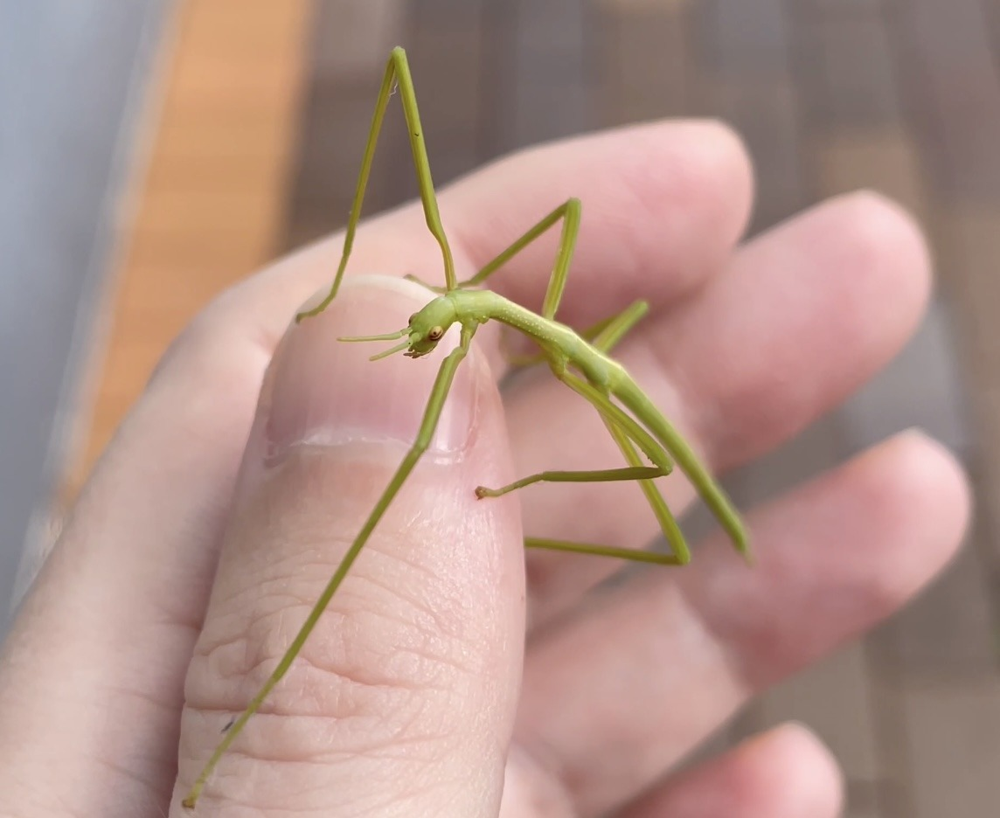
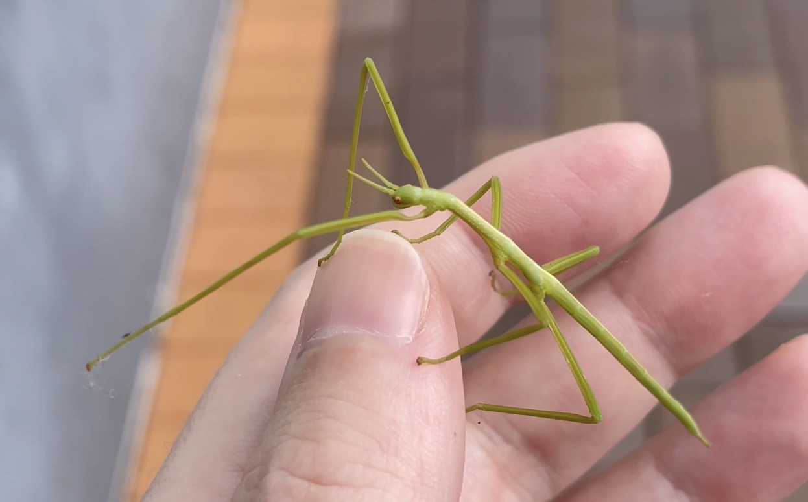



This little guy was found climbing around an Officeworks A-frame sign.

*Found a tiny green phasmid climbing an Officeworks sign. All its little legs seemed to be present.*
{: .media-caption }

Seemed to be in good condition, no missing limbs!

*Another angle of the little buggo, showing the impressively convincing twig disguise.*
{: .media-caption }

Really didn't want to put it back into nature.

*I was getting a little attached. Having a stick insect for a roommate was becoming tempting.*
{: .media-caption }

But I wasn't set up to keep this little guy.

*Just look at that magnificent twig with legs. Still not quite set up to keep one, though.*
{: .media-caption }

Well I could.

*The phasmid takes a little stroll along my arm. Very persuasive, little buggo.*
{: .media-caption }

I mean I could.

*The close-up sales pitch continues, but I'm still not keeping you. Sorry!*
{: .media-caption }

But I won't.

*One final portrait before heading back outside. Enjoy life, little buggo!*
{: .media-caption }

Enjoy life little buggo!
