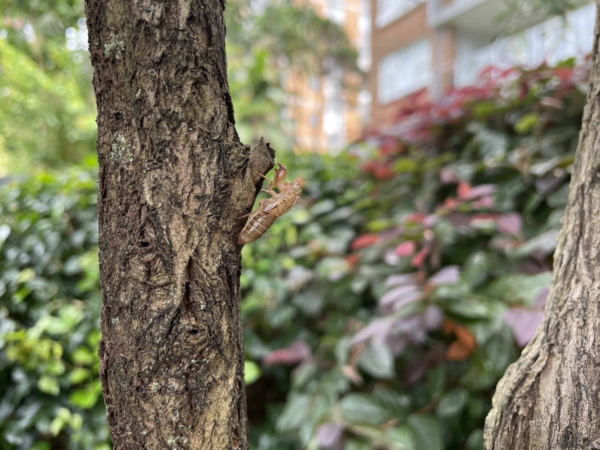



Found two of these little ones moulting in the summer heat.



A bit of a windy evening for such small cicadas.



But they'll probably be alright if they've made it this far.



The next day, there's nothing left but a shell.

Enjoy your summer little cicadas! 😄
