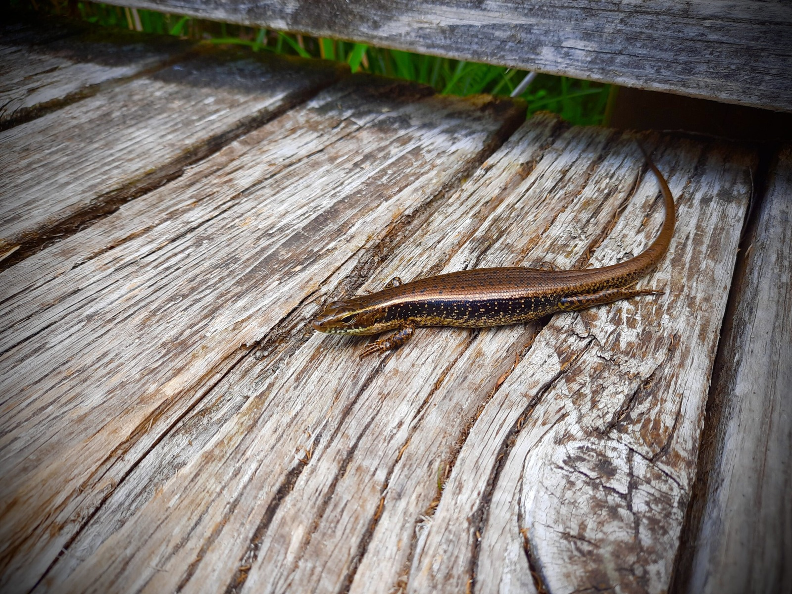
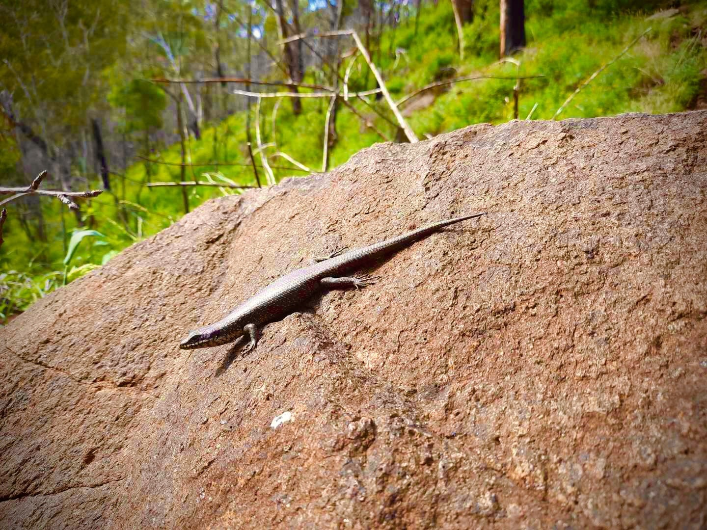
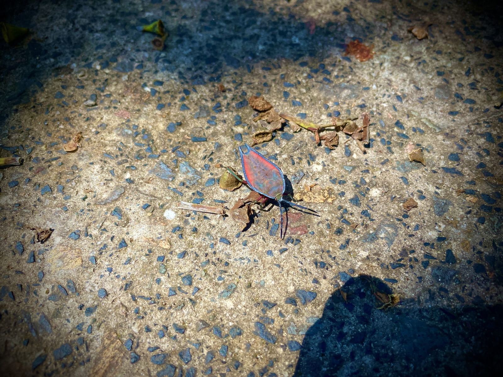

*An Eastern Water Skink with every colour dial turned up. The weathered wood makes a surprisingly good backdrop.*
{: .media-caption }

A friend who happens to be a photography enthusiast sent me through the above and below photos of some lizards he came across. Above we have the [Eastern Water Skink](https://en.wikipedia.org/wiki/Eulamprus_quoyii), Eulamprus quoyii, and below...

*A Tree Skink, also known as a Rock Skink, on an actual rock. Almost suspiciously cooperative.*
{: .media-caption }

We have the [Tree Skink](https://en.wikipedia.org/wiki/Tree-crevice_skink), Egernia striolata, unironically on a rock as it is also known as the Rock Skink. These photos have all been saturated to maximum with a vignette added. It actually makes them look quite good in the otherwise dull Australian outback. Let's see what else it might work on.

*A little Lychee Stink Bug in full oversaturated glory. Nearly stepping on it was not part of the plan.*
{: .media-caption }

I captured this photo of a little [Lychee Stink Bug](https://en.wikipedia.org/wiki/Tessaratomidae), Lyramorpha rosea, running at me to strike after I nearly stomped on him while walking up to the shops. Does maximum saturation make everything look so glorious?

*And then my Steam wishlist chimed in. Sonic Adventure DX at 85% off, a very different kind of saturated experience.*
{: .media-caption }

[I guess not.](https://store.steampowered.com/app/71250/Sonic_Adventure_DX/)
