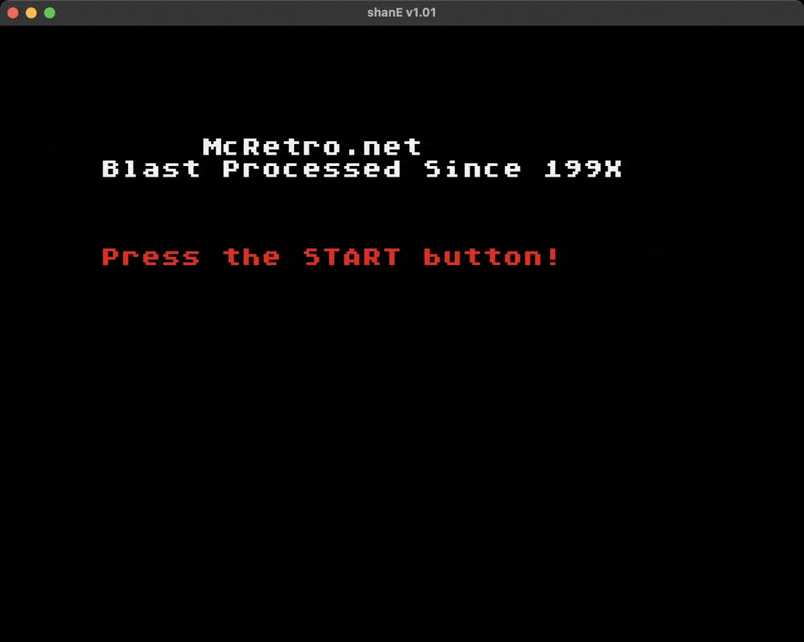
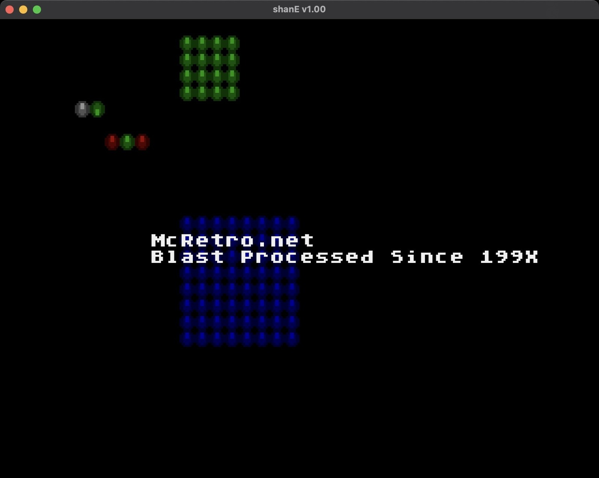

*Version 1.01 of my Mega Drive experiment, complete with a big red request to press START.*
{: .media-caption }

My Mega Drive ROM v1.01 was compiled sometime in February 2016. I was supposed to write something about this over five years ago but it apparently got away from me.

*Version 1.00 was rather simple. A few coloured blocks, a little text, and some delayed blogging.*
{: .media-caption }

I edited the sample source code and compiled the ROM under Ubuntu if I remember correctly. Here is [the source and my compiled ROMs](/assets/uploads/Nix_SRC.zip). Version 1.01 gets a little more complicated.

I can't quite remember what I compiled it with though. Wait! Ah yes, it must have been [SGDK](https://github.com/Stephane-D/SGDK) by Stephane Dallongeville. The source in the ZIP uses its `genesis.h` header and controller functions, so that looks like a pretty good clue!

They also have a [Patreon](https://www.patreon.com/SGDK) if you want to support them. I'm glad to see the project is still being worked on after all this time. Maybe I'll revisit it sometime in the future, regardless - Thanks Stephane!
