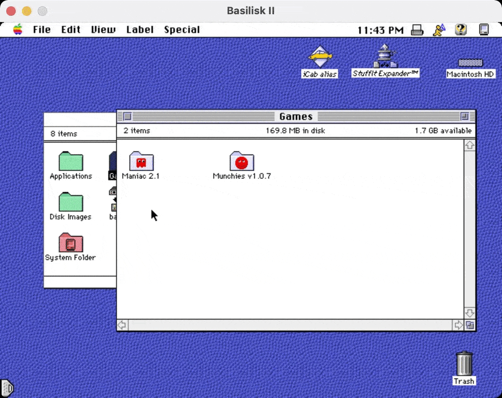
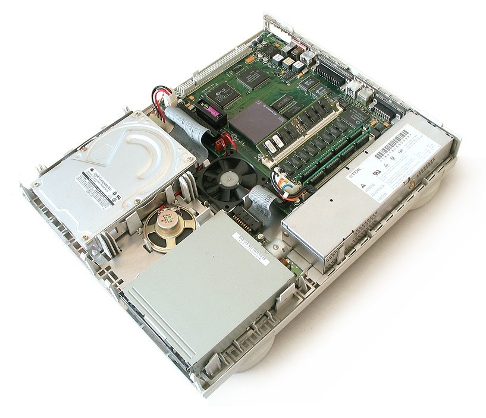
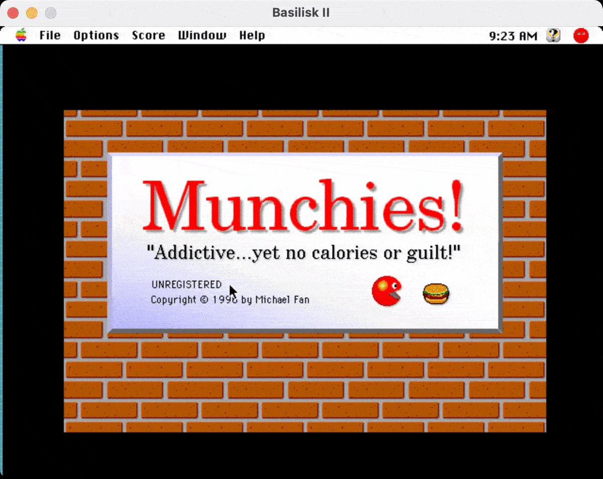
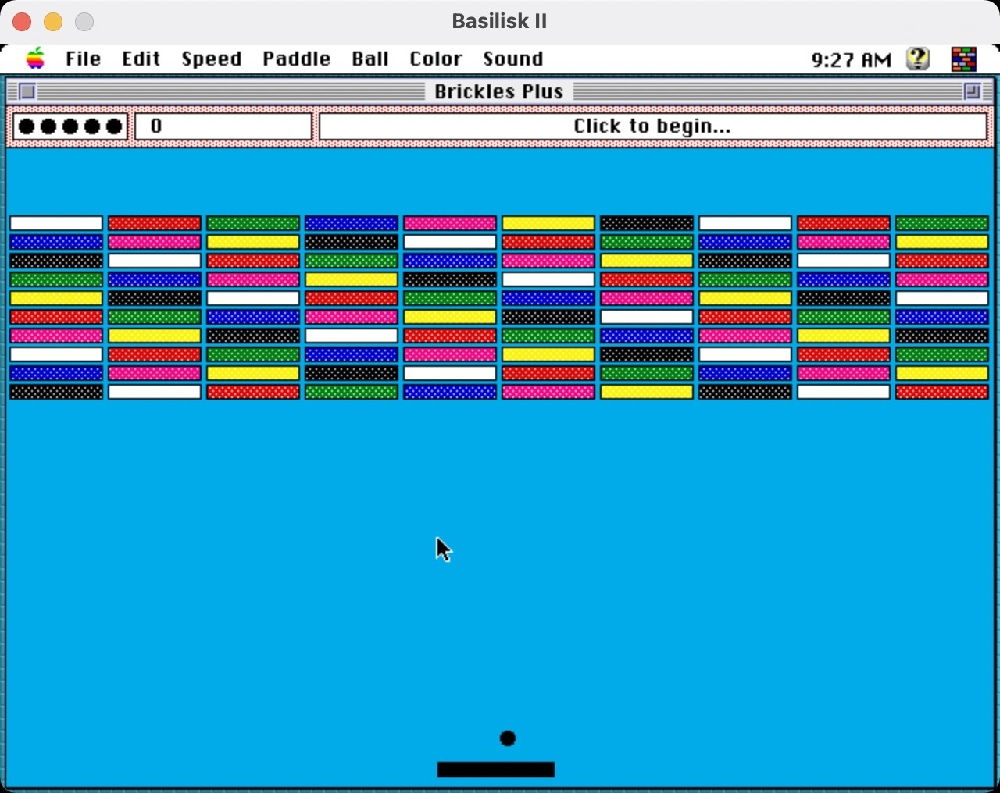
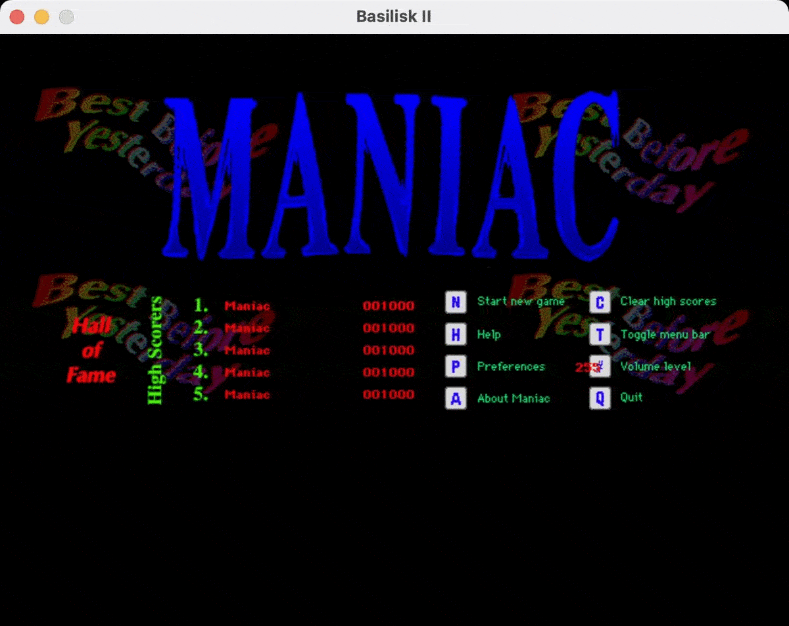
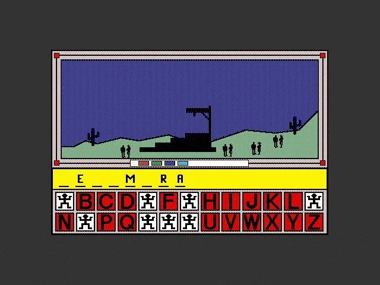
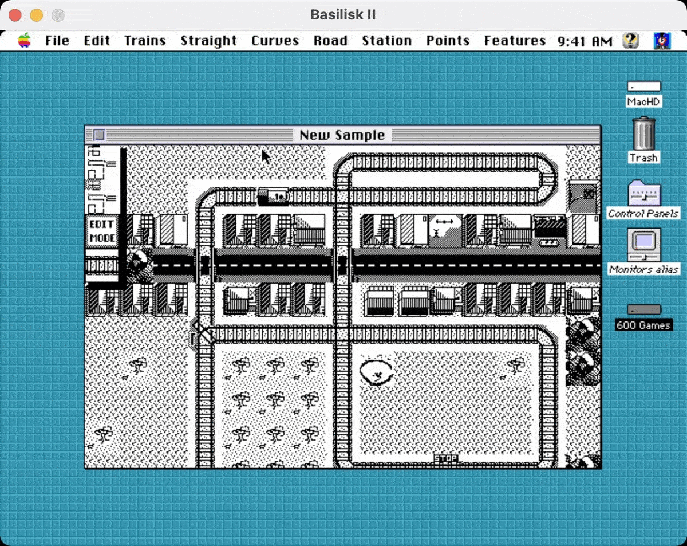
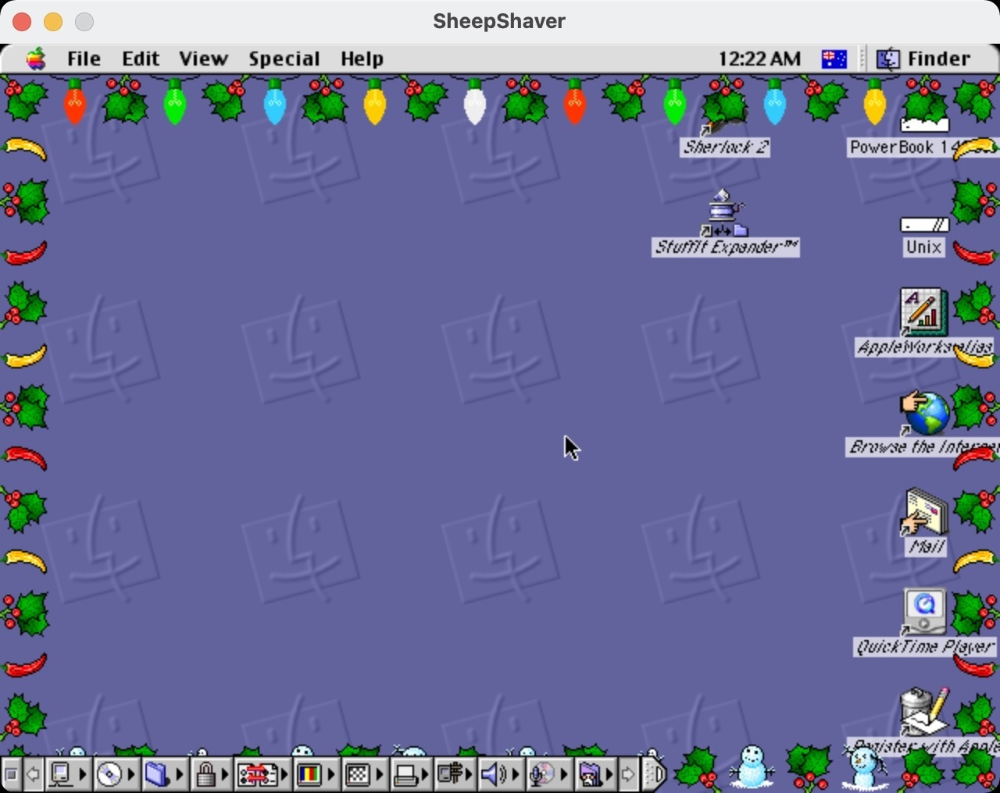

*My old LC 475 disk image comes back to life in Basilisk II. Naturally, I headed straight for the Games folder.*
{: .media-caption }

Recently I've been trying to sort all the haphazardly "organised" files on my cold storage hard drive. I came across a disk image of my LC 475 and a pack of 600 games that I'd never looked into. I'm on an M1 Mac and [Basilisk II](https://basilisk.cebix.net) **_still_** works. Incredible, I love it!

*Inside the LC 475. A wonderfully compact little Mac, even if mine wasn't exactly stock by the end.*
{: .media-caption }

For anyone not familiar with the [LC 475](https://support.apple.com/en-us/112204), it's a pizza box shaped Mac that originally shipped with a 25 MHz 68LC040 (68k) processor, 4 MB of onboard RAM and SCSI hard drives in the 80 MB to 250 MB range. Mine had already been through [some rather less stock experiments](/apple-macintosh-lc-475-modifications-overview/). There are only really three, or maybe four games I love on 68k Macs.

*Munchies! Melvin and his very serious burger-related business were a big part of my childhood Mac gaming.*
{: .media-caption }

The first is [Munchies](https://web.archive.org/web/20201112041331/https://www.macintoshrepository.org/4098-munchies) that I discovered as a child visiting my cousins up north of Sydney somewhere. Melvin is a bad ass when he's loaded with peas and covered in butter. I'm not forking around. This is serious fun. Go Melvin!

*Brickles Plus, waiting for me to click. I'm still not entirely sure whether I'm meant to identify with the paddle or the ball.*
{: .media-caption }

Next up we have [Brickles Plus](https://web.archive.org/web/20160710131308/http://www.macintoshrepository.org/3641-brickles-plus). Is the paddle a rebellious brick that fell? After thinking about that for a while I had an existential crisis about poor Brickle. My favourite part is when the bricks disappear. Very neat!

*Maniac's wonderfully chaotic title screen. I came for the gameplay and may have stayed for the MOD soundtrack.*
{: .media-caption }

[Maniac](https://web.archive.org/web/20210616231946/https://www.macintoshrepository.org/6026-maniac). What can I say? I love the gameplay and I **_love_** [the soundtrack](/assets/uploads/Maniac-Game-Music.zip). [MOD files](https://en.wikipedia.org/wiki/MOD_(file_format)) rock my world. It's possible I fell in love with Maniac due to the soundtrack, not just the very cool game mechanics. Pac-Man combined with hangman? Hangman... how could I forget!

*Hangman Plus! Another childhood favourite, complete with a rather unforgiving high-noon atmosphere.*
{: .media-caption }

[Hangman Plus!](https://web.archive.org/web/20201130053627/https://www.macintoshrepository.org/3478-hangman-plus) Another game that I was lucky enough to play at my cousins as a child as well. As they say in the game "he he he". Let's hope you don't make it to high noon! The next game is a little different.

*At long last, the mysterious train game resurfaces. Yes, it's trainset-Pro, and yes, I have history with this thing.*
{: .media-caption }

**[trainset-Pro](https://web.archive.org/web/20231014235502/https://www.macintoshrepository.org/37696-trainset).** After all these years I found the damn train game that helped ruin my childhood for all the wrong reasons.

*SheepShaver also managed to boot my old PowerBook 1400cs image. Not much treasure on that one, sadly.*
{: .media-caption }

On a brighter note, I was also able to fire up [SheepShaver](https://sheepshaver.cebix.net) and load an old PowerBook 1400cs disk image. There wasn't much on there so it was trashed. Doing that cleared up a hefty 2 GB of storage, incredible!

### Sources

- [Apple - Macintosh LC 475: Technical Specifications](https://support.apple.com/en-us/112204)
- [Apple Tech Info Library: Macintosh LC 475 Specifications (August 1995, Savage Taylor Archive)](https://savagetaylor.com/til/KB013575.html)

### Related Posts

- [Apple Macintosh LC 475: Modifications Overview](/apple-macintosh-lc-475-modifications-overview/)
- [Apple Macintosh LC 475: Overclocking to 33 MHz](/apple-macintosh-lc-475-overclocking-to-33-mhz/)
- [Apple Macintosh LC 475: Hangman Plus Game Demo](/apple-macintosh-lc-475-hangman-plus-game-demo/)
