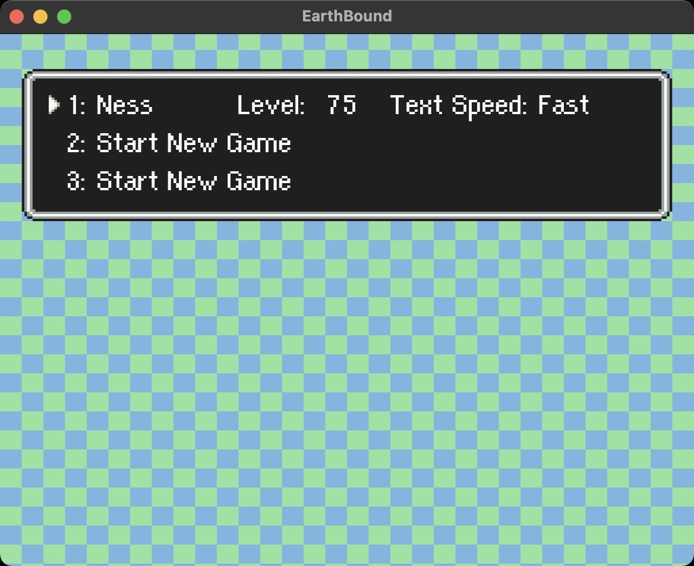
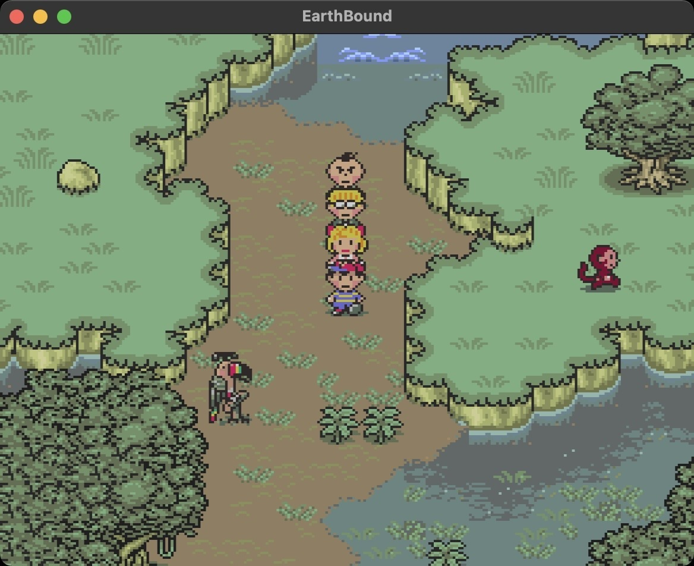
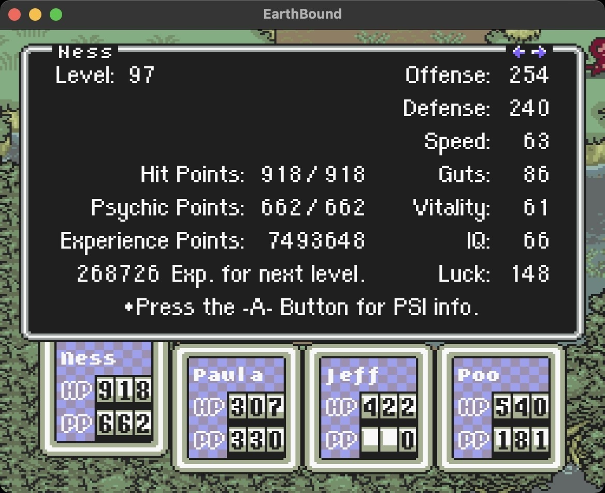
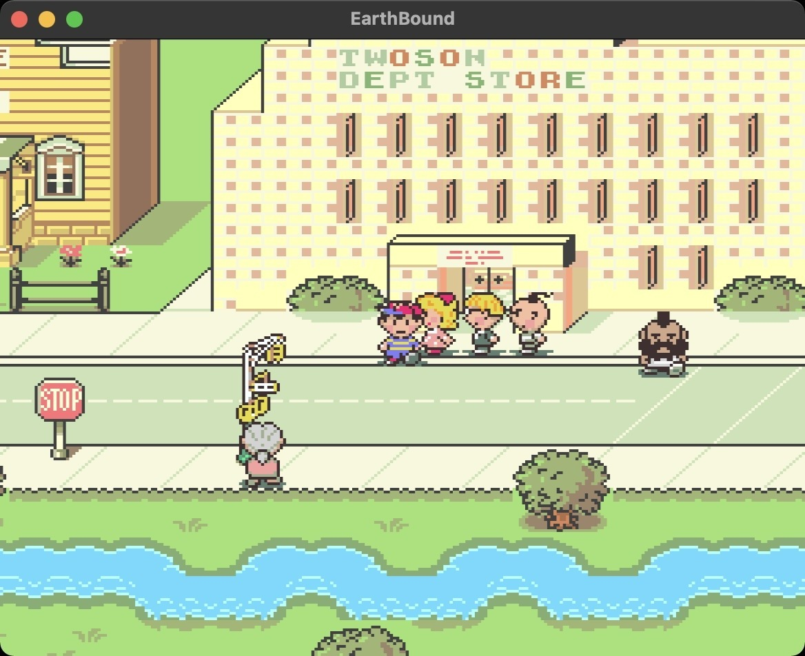
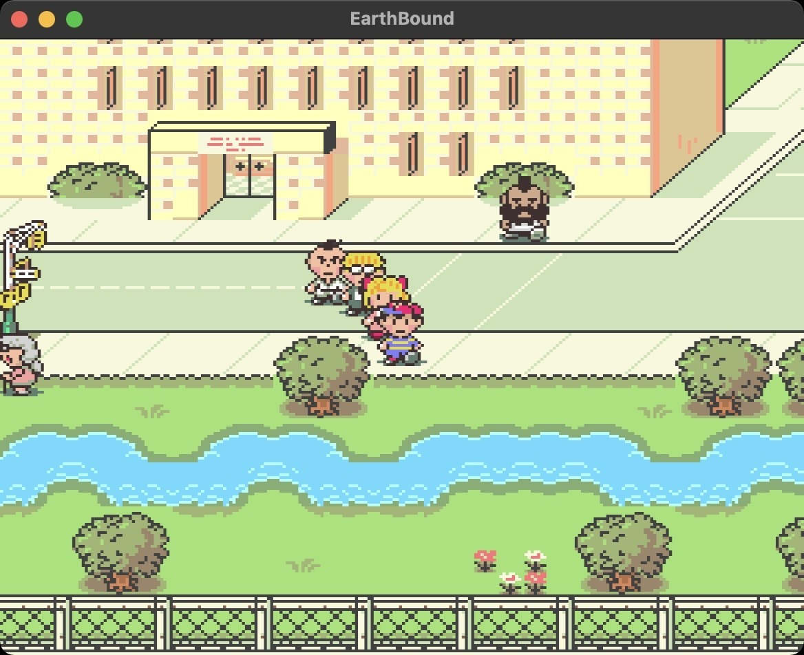

*There you are, Ness! A level 75 EarthBound save, rescued from my old collection of forgotten files.*
{: .media-caption }

Some further digging into my "to be sorted" folder has revealed some save games for EarthBound. They appear to date back to October 2013. Talk about a blast from the past!

*Ness and the gang back on the road, just as I remembered them. Lovely to see the old save running again.*
{: .media-caption }

I had two saves, one at level 75 and another at level 97. The amount of grinding involved between those two would have been massive. Well worth it though.

*Level 97, with 918 HP and 662 PP. I must have put some serious hours into EarthBound back then.*
{: .media-caption }

It looks like I had been using [SNEmulDS](https://web.archive.org/web/20190516030442/http://www.snemul.com/ds/?page_id=2). The original 0.6 releases date back to 2007, but [Coto's later fork](https://github.com/cotodevel/snemulds/tree/e9f853e942a721e69efcf297d23080f1a5936ceb) was still being worked on in January 2022. The original official site appears to be down as of 2022, so the archived page will have to do.

*Back in Twoson, loitering outside the department store. The saved adventure still feels remarkably familiar.*
{: .media-caption }

EarthBound still rates among the best games I have ever played for the Super Nintendo. But I was playing it on a DS Lite so I could take it anywhere I wanted, if I wanted to play in bed or on the couch - done!

With my original DS Lite from Japan long since sold, today I'm on a Mac and was able to fire it up in [OpenEmu](https://github.com/OpenEmu/OpenEmu) under [Snes9x 1.60](http://www.snes9x.com/). Snes9x really does go [wayback](https://web.archive.org/web/19981202225201/http://www.snes9x.com/)!

*One more look at Ness and friends before closing the emulator. Smiles and tears, smiles and tears.*
{: .media-caption }

So for now we must once again say goodbye to Ness and his friends, smiles and tears, smiles and tears...



### Sources

- [Archeide - SNEmulDS development posts and original 2007 releases](https://web.archive.org/web/20190517202404/http://www.snemul.com/ds/)
- [Coto - SNEmulDS source as it stood in January 2022](https://github.com/cotodevel/snemulds/tree/e9f853e942a721e69efcf297d23080f1a5936ceb)
- [OpenEmu - Snes9x core version at the time of this post](https://raw.githubusercontent.com/OpenEmu/SNES9x-Core/652dd3ec0a3b4f3a984bb5af0a3d009252fbe48d/Info.plist)

### Related Posts

- [EarthBound Completed on a Nintendo DS Lite with SNEmulDS](/earthbound-completed-on-nintendo-ds-lite-with-snemulds/)
