**Historical worklog:** These are my 2021-2022 working notes for the GeoCities rebuild, complete with experiments, dead ends and destructive shell commands. Some command sequences and Apache configuration examples have lost their line breaks or contain escaped characters from the old page conversion. I have preserved those damaged fragments rather than guessed how to repair them. This is not a current paste-ready deployment guide. Check the original evidence, every path and the command syntax before reusing anything.

This is the original, updated and mostly complete worklog for my GeoCities Reboot at [https://mcretro.net/homepages/geocities](/homepages/geocities).

For a bit of extra background, I was also posting updates to the [Australian Computer Museum Society forum](https://forum.acms.org.au/t/geocities-rebuild-for-older-browsers/83) as part of RetroChallenge 2021/10. There's also some extra discussion in there about the MiSTer FPGA and older browsers beyond what made it into this worklog.

* * *

**1st October 2021**

Retro computers need websites to visit. That is what this project is all about. The mass recreation of websites from the [GeoCities Archive](https://archive.org/details/archiveteam-geocities) that are compatible with older web browsers. More to follow...

* * *

**2nd October 2021**

The first thing to take care of is the ability for users to make contact in case they do not want their old GeoCities website reactivated. Enter the Digital Millennium Copyright Act (DMCA), using this we will provide a web form for copyright takedowns. **Edit:** I have also added the ability to report any illegal content that may be present.

I haven't had any forms on my website for a long time due to bots and not wanting to have Google reCAPTCHA. hCaptcha is a new one that has appeared and seems to work well. The form I am using is WPForms Lite (free) as it seems to do everything I need it to do.

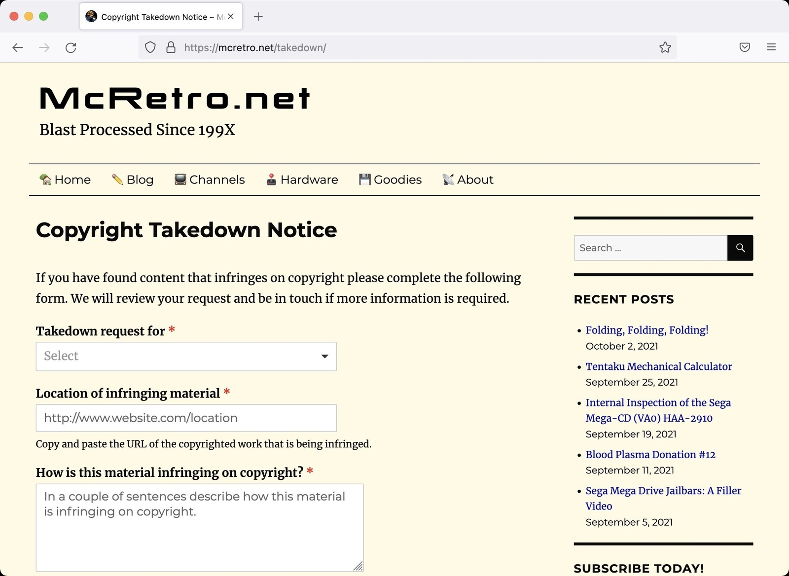

*My first job was a takedown form, in case someone wanted their old GeoCities page removed. Fair enough!*
{: .media-caption }

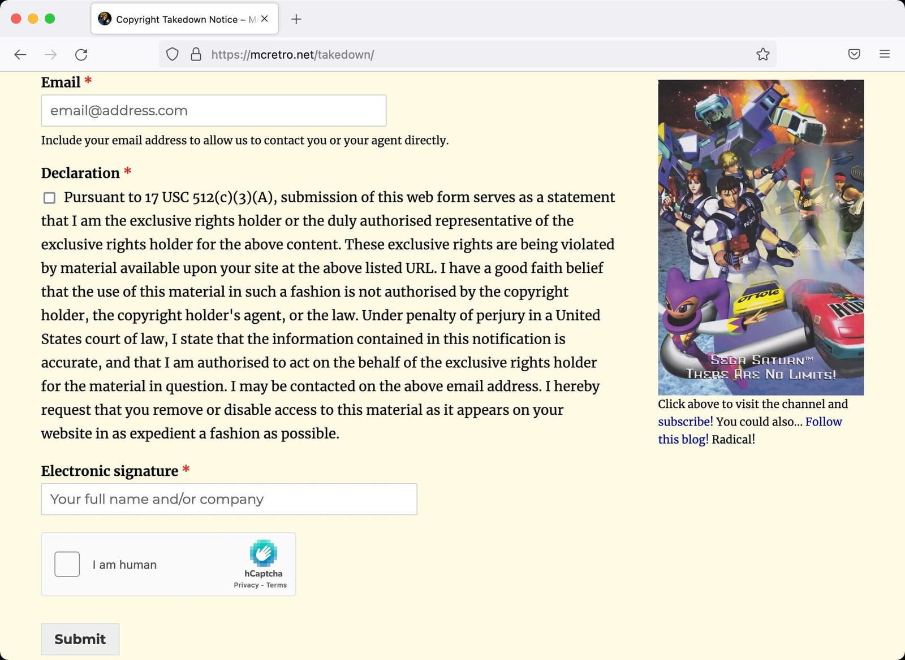

*The other half of the takedown form, complete with a declaration, signature and hCaptcha. Hopefully that kept the bots busy.*
{: .media-caption }

With that out of the way I can work on the actual content. Yahoo! acquired GeoCities mid-1999 and messed with the city's structure. This is how GeoCities was structured, for the most part, up until Yahoo!'s acquisition.

**Each neighborhood used numbered website addresses:**
http://www.geocities.com/neighborhood/XXXX

**GeoCities got too popular and needed suburbs inside those cities:**
http://www.geocities.com/neighborhood/suburb/XXXX

**After Yahoo! took over, you could use your YahooID:**
http://www.geocities.com/YahooID

**So you could have two sites serving the same content:**
http://www.geocities.com/neighborhood/suburb/XXXX
http://www.geocities.com/YahooID

Throw in case sensitivity and localisations and it gets messy. Very messy.

That's why I am only targeting the pre-Yahoo takeover sites operational at this stage. So far I have a very much incomplete staging area at http://geocities.mcretro.net. Only about six of the Athens suburbs are active.

Hardware-wise the main server, [mcretro.net](/), is a headless Raspberry Pi 4 running Ubuntu Server with a reverse proxy to the staging server, [geocities.mcretro.net](/homepages/geocities), on a Raspberry Pi 3.

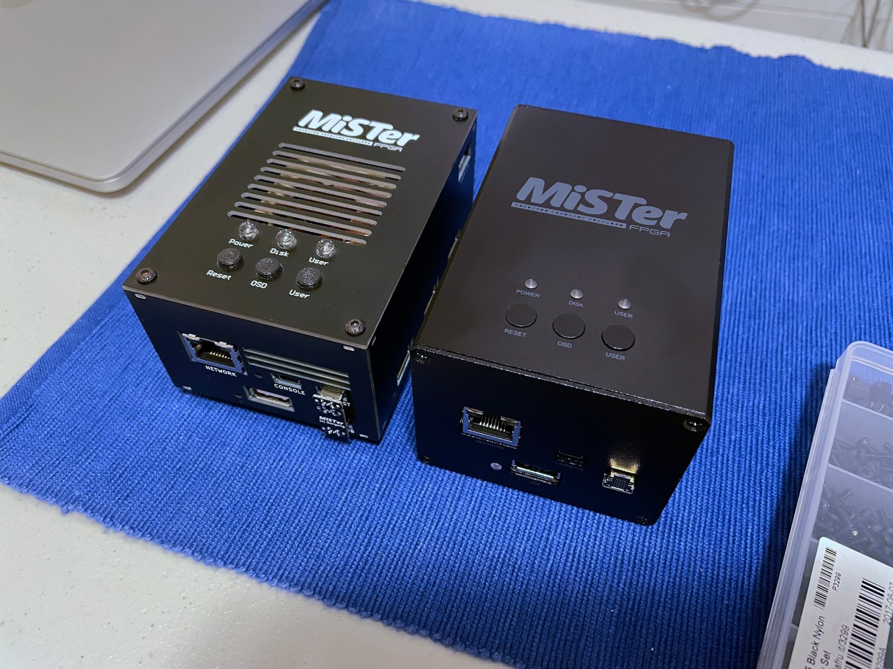

*Two MiSTer FPGA setups for testing the old web the way it was meant to be viewed, more or less.*
{: .media-caption }

All era-sensitive testing is completed on a [MiSTer FPGA](https://github.com/MiSTer-devel/Main_MiSTer/wiki) running [ao486](https://github.com/MiSTer-devel/ao486_MiSTer) running Windows 95/98. It has roughly the performance of a 486DX-33. No FPU though... so far it does not like loading the directory listing of 9999 items in Athens very much in Netscape 4.x

Then there's the modems. I've got two Banksia Wave SP56 modems. Internally the boards are marked BT134 REV B and REV F. The REV F is cold as ice when running, REV B is toasty.


*A beige Banksia Wave SP56 modem, with its indicator lights glowing, stands in front of a computer monitor.*
{: .media-caption }

We dial between two modems locally thanks to [this wonderful guide](https://dogemicrosystems.ca/wiki/Dial-up_pool). I'm using a Cisco SPA112 that I won in a raffle. This is coupled with an Asterisk server on a Raspberry Pi. All the bleeps and bloops without the cost of dialling outside my home.

Among the next steps will be working out how to migrate the data from a Mac APFS (case-sensitive) partition to a Linux ext4 (case-sensitive) partition that can be mounted with appropriate permissions for apache2 on the RPi3 web server.

* * *

**3rd October 2021**

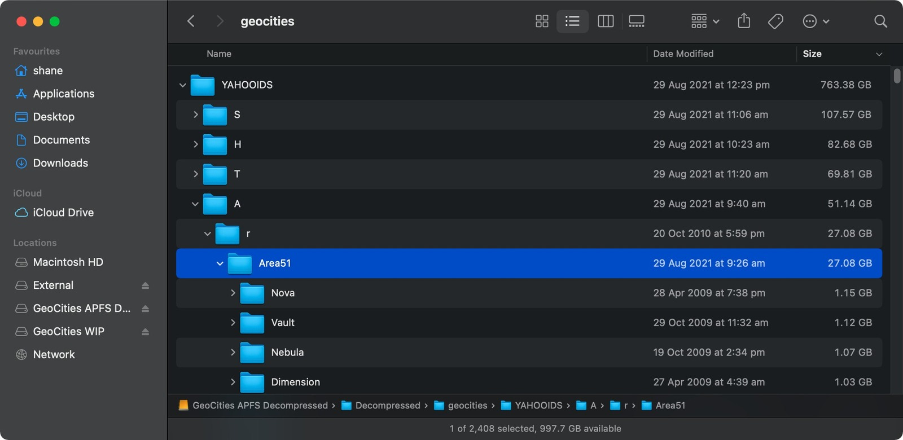

*Just Area51 was 27 GB, with suburbs of its own. This was never going to be a small project.*
{: .media-caption }

Here's the type of structure we are dealing with. Just Area51 alone has over 1,000,000 files and weighs in at a hefty 27GB. It also contains suburbs such as Nova, Vault, Nebula, Dimension. The parent directory YAHOOIDS is a bit of mess as it contains account names. That's one of the reasons I would like to see the **_easier_** neighborhoods (pre-Yahoo!) dealt with first. Then I could potentially move on to the chaos Yahoo! created.

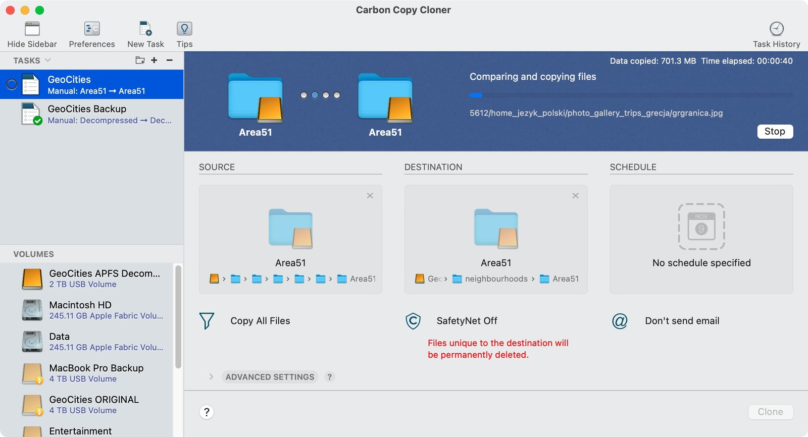

*The clone was underway. With this many tiny files, even a progress bar could become a long-term companion.*
{: .media-caption }

And the clone begins! We're going from an APFS (case-sensitive) partition to an ext4 (case-sensitive) partition. The initial clone to create a backup **_to rotational media_** took **_over 60 hours_**. There's almost 1TB of data here and so very many small files. I've since upgraded to a set of SSDs, which looks to have been a good investment.

I still need to work out the mounting parameters and whether overriding ownership for all files on a file-system (without actually modifying the file metadata stored on the filesystem) or if I should just make www-data the owner. It takes a loooong time to apply permissions though and I don't doubt I'll probably need to reclone the entire data set at some stage. Bindfs is one possible avenue, I'll have to get reading into how it all works.

This project **_shouldn't_** be completed before the end of October but we should have something to show. I had been working on the modems tying in with the MiSTer since April. Then I accidentally deleted my entire desktop in July and lost a whole heap of notes. My backup was a few weeks old, but much was lost.

While I was busy deleting my desktop, MiSTer FPGA has been progressing allowing support of FTDI's FT232RL chipset and Prolific's PL2303. This allows us to connect these serial modems over USB directly into the MiSTer.

Space has always been a premium for me unfortunately, so having a MiSTer instead of a bunch of consoles makes sense. I was also amazed by the accuracy of the SNES core. In Earth Defense Force, there are points where the SNES struggles with too many sprites on screen. The MiSTer replicated it perfectly. Incredible!

* * *

**4th October 2021 (Part 1)**


*A Doctor Who fan page back on the web, complete with stars, TARDISes and those glorious 1990s link colours.*
{: .media-caption }

It's amazing! It looks like I'll be able to clone across from my APFS formatted drive with relative ease. However, I will still have to apply the following permissions once mounted, as it is an ext4 formatted drive:

`sudo chown www-data:www-data -R \* sudo find . -type d -exec chmod 755 {} \\; sudo find . -type f -exec chmod 644 {} \\;`

I guess I'll just have to wait out the 32,000,000 files and directories! I'm using extFS for Mac by Paragon Software to copy between drives.

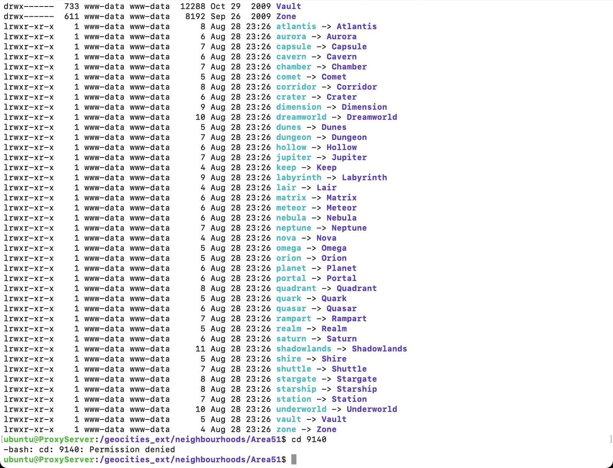

*The symlinks survived the move. The directory permissions, on the other hand, were having none of it.*
{: .media-caption }

I am very glad to see that the symlinks survived. Now it's on to trying to determine the best way to structure the drive. All the links in the table on [Area51](/homepages/geocities) should now be active - at least until I try copying more data to it.

* * *

**4th October 2021 (Part 2)**

I don't think I'll be going down the bindfs route. It seems to introduce overheads without the benefits. At least not when using ext4 as the target filesystem. So I'll mount the external hard drive straight into the /var/www/html folder with the following command:

`sudo mount /dev/sdb2 /var/www/html/geocities`

I had been considering mounting the drive as read only with:

`sudo mount -oro,noload /dev/sdb2 /var/www/html/geocities`

But then I wouldn't be able to make any changes on the fly via samba. For reference this was the bindfs command that would have been used, just in case I change my mind down the road.

`sudo bindfs -o create-with-perms=0644:a+X,force-group=www-data,force-user=www-data,create-for-user=www-data,create-for-group=www-data /media/geocities_ext/neighborhoods /var/www/html/geocities`

It looks like there's a faster way to change permissions that I wasn't aware of until today too.

`cd /var/www sudo chown www-data:www-data -R \* sudo chmod -R a=r,a+X,u+w .`

That last line is a replacement for:

`sudo find . -type d -exec chmod 755 {} \\; sudo find . -type f -exec chmod 644 {} \\;`

and then to unmount the partition and play with the data we just run:

`sudo umount /var/www/html/geocities`

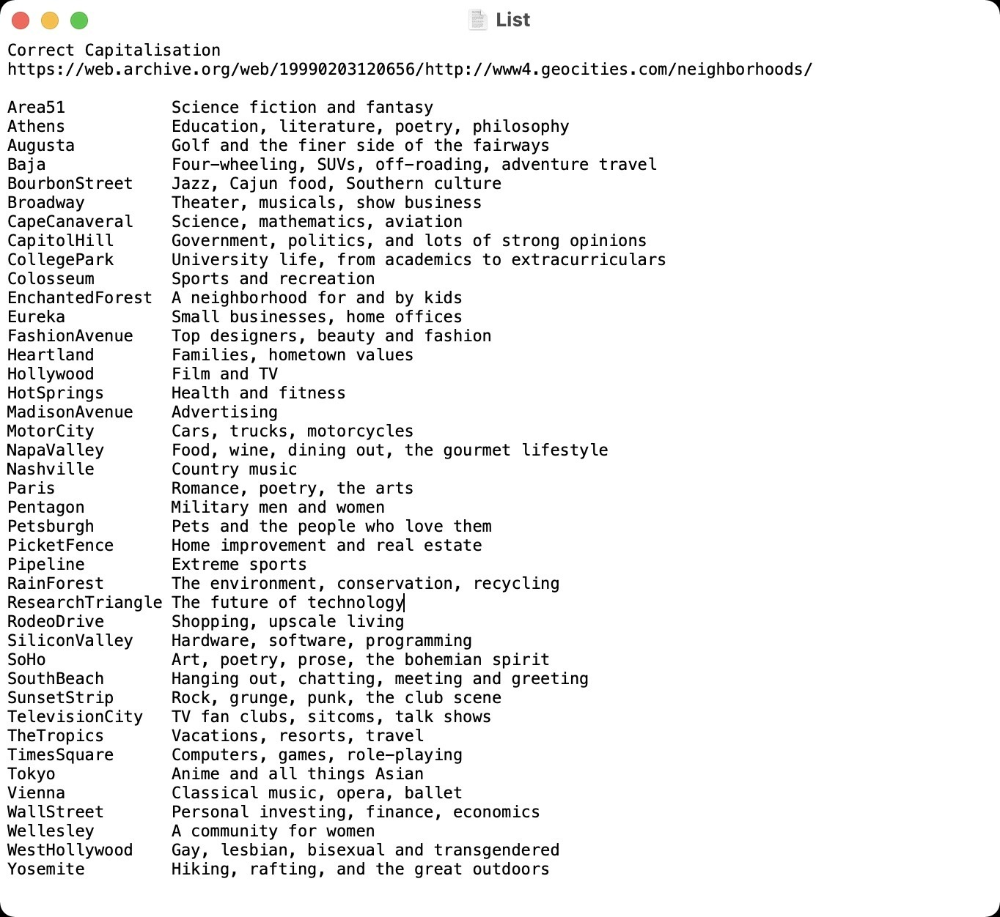

*A list of the original neighbourhood names, with the capitalisation carefully preserved. Case sensitivity was becoming a recurring character.*
{: .media-caption }

Above is the list of the primary, "core", neighborhoods. Inside these are subfolders numbered up to 9999. Then there's also "suburbs", I guess inside these. Each containing up to... you guessed it 9999 subfolders. There's around 470GB of data saved here, another ~250GB appears to be for YahooID account names. I am not touching that with the old ten-foot-pole just yet.

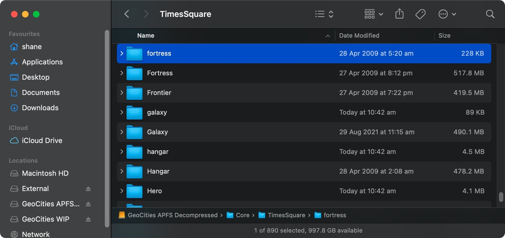

*Same suburb, different capitalisation. TimesSquare had brought its own little directory-cloning nightmare.*
{: .media-caption }

As you can see above though, there's going to be some duplication of data. I need a tool which will be able to compare and merge if identical. Interestingly I have all core folders except Broadway. I guess someone didn't like theatre!

I've been looking at **diff** for comparing based on md5sum, but it still seems too much work for little payoff. There might be an Apache2 module that helps with this, but first I'll see what tools are available that are a little more user friendly. First up, **Meld**.

* * *

**4th October 2021 (Part 3)**

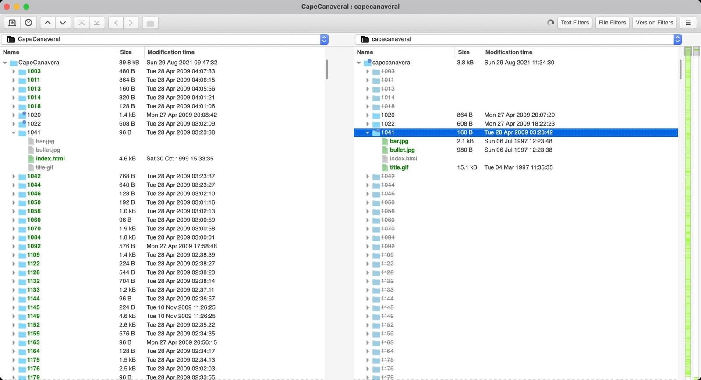

*Meld made the CapeCanaveral problem very obvious. The matching names did not necessarily contain matching files.*
{: .media-caption }

Meld wasn't too bad, but seemed to be a little clunky and I couldn't quite work out how to merge two directories including their subfolders. But it did give a great visual representation of the issues we are facing when it comes to case sensitivity.

As you can see above we have CapeCanaveral on the left and capecanaveral on the right. Left has the index.html and the right has a few images (but no index file). A great example, unfortunately the learning curve looked to be a bit too steep for what I needed to do. Meld did not like scrolling very much. It might have been because it was an Intel binary running on Apple Silicon (M1).

Then I remembered, Carbon Copy Cloner might be ideal for this. **Carbon Copy Cloner 6** seems to offer comparisons which are nice, but the SafetyNet feature didn't work as I was expecting.

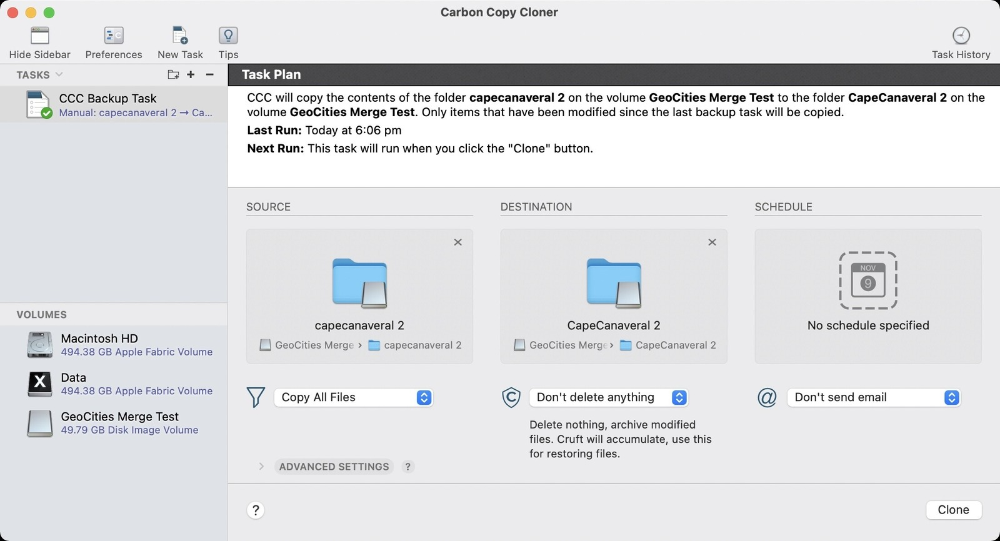

*Carbon Copy Cloner 5 with the gentler setting: don't delete anything. Exactly the sort of reassurance I wanted.*
{: .media-caption }

Downgraded to **Carbon Copy Cloner 5** and it works well enough. I don't know what changed under the hood between CCC 5 and CCC 6 as the settings all looked the eerily similar. We ended up with a "_CCC SafetyNet" which contained only the older of two files when compared side by side.

The SafetyNet appears to be the older files of duplicate data. These appear to be duplicated when CapeCanaveral/XXXX vs capecanaveral/XXXX were captured at different times at the end of GeoCities. A few hours here or a day there isn't going to make a world of difference in the grand scheme of things here. I'll hold onto these "_CCC SafetyNet" folders for now though, they don't use much space. CCC5 gets a big tick of approval.

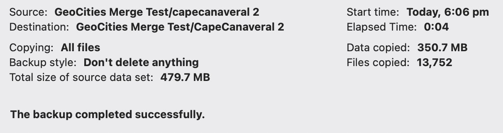

*One successful CCC merge, 13,752 files copied in four seconds according to the summary. I could get used to that.*
{: .media-caption }

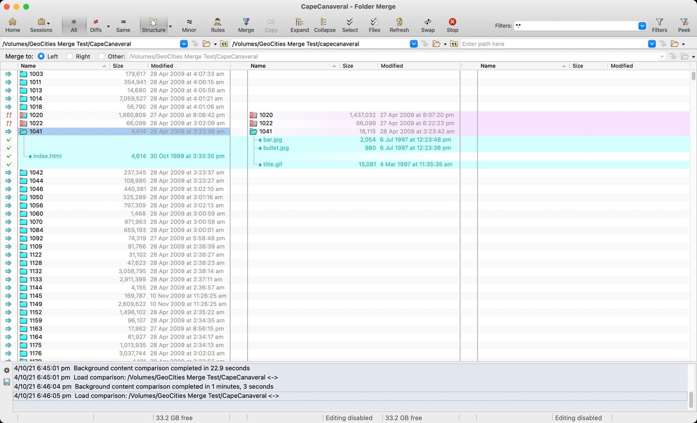

*Beyond Compare had plenty of ways to compare the two folders, and plenty of information to make my eyes cross.*
{: .media-caption }

**Beyond Compare** was another program worth mentioning, it is very similar to Meld, but feels far more responsive and well built. As you can see the above interface is quite familiar looking but a little overwhelming when trying to decode; definitely one for the power users - not me.

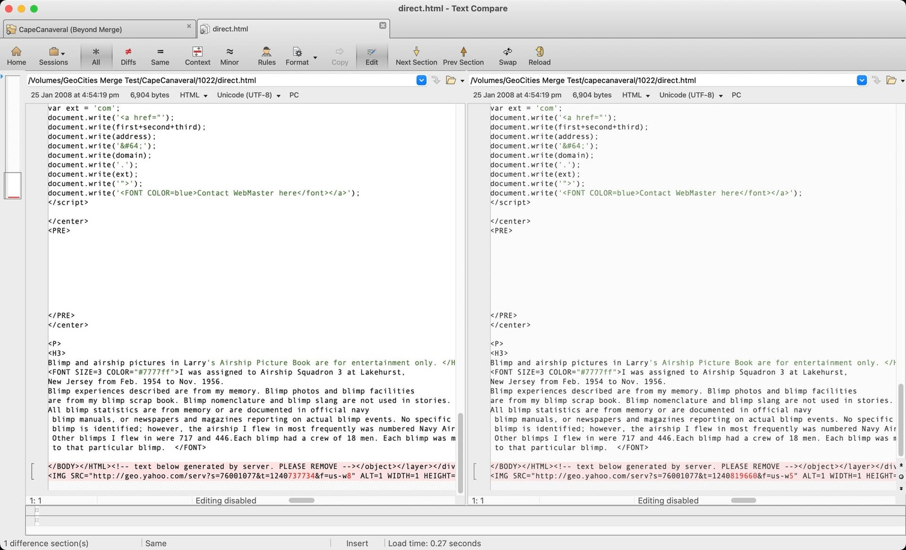

*Two nearly identical HTML files, with a tiny difference in Yahoo's generated text. Just what a tidy merge needed.*
{: .media-caption }

Above is another screenshot from inside Beyond Compare, and you can see the captured data from GeoCities varied by only a few bytes, in the red highlighted section, for some server generated text. This is why merging the case sensitive neighborhoods is such a pain. "**CapeCanaveral**" and "**capecanaveral**" both had this html file scraped at separate times. It's a miracle the [Archive Team](https://wiki.archiveteam.org/index.php/GeoCities_Project) got what they did!

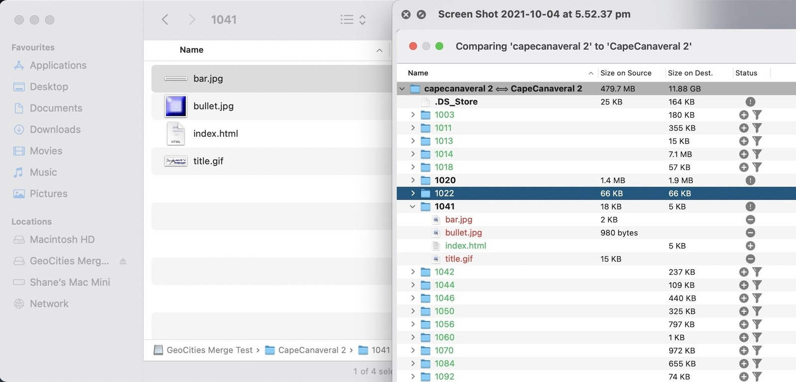

*CapeCanaveral/1041 after the CCC5 merge, with the original HTML file sitting alongside the little images.*
{: .media-caption }

As you can see above, from the example earlier, **CapeCanaveral/1041/**, has successfully merged using CCC5. We'll stick with CCC5 for merging the "core" neighborhoods. The suburbs inside the core neighborhoods will need to be sorted also. Not quite sure how to do that yet. And in the next screenshot we have **CapeCanaveral/Galaxy/1002/** now showing a full directory.

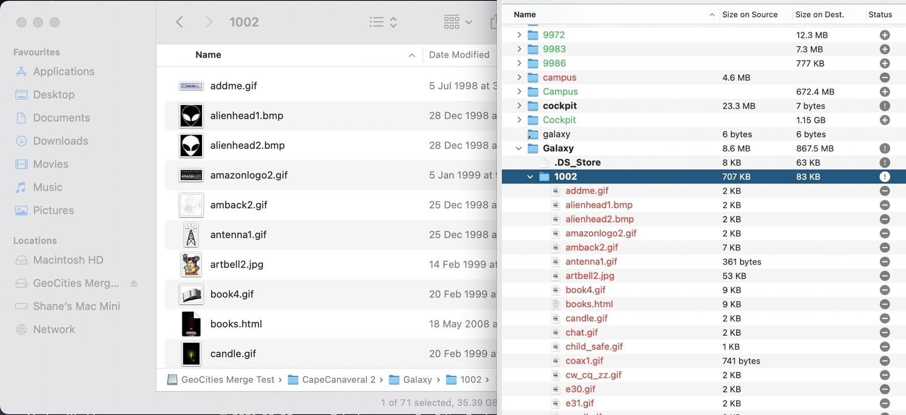

*Galaxy/1002 looking much fuller after merging the case variants. This was the sort of progress I was after.*
{: .media-caption }

Once I work out how to get all the suburbs into their correctly capitalised folders, I'll need to create symbolic (soft) links to join **capecanaveral**, **capeCanaveral**, and **Capecanaveral** to **_CapeCanaveral_**. Unless Apache has a way to help with this issue.

* * *

**4th October 2021 (Part 4)**

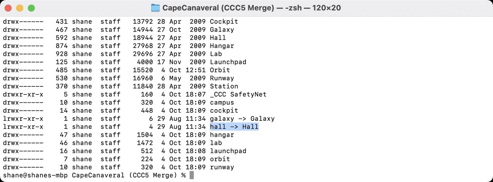

*Another look at the merged directory. The lowercase hall link was pointing to Hall, just as intended.*
{: .media-caption }

Alright, so we've had data cloning back and forth. What damage have we done to the permissions and symlinks? Thankfully the symlinks look to be intact. In the first character of the listing, `l` means a symbolic link, `d` means a directory and `-` means a regular file.


*A quick permissions cheat sheet. The difference between 755 and 644 finally made a little more sense.*
{: .media-caption }

I had no idea that this is how they worked. Setting a directory to:

`755 (drwxr-xr-x)`

and a file to:

`644 (-rw-r--r--)`

is what I was doing earlier without really knowing. My original `-rwxr--r--` example accidentally included an execute bit, so it was not actually a 0644 file mode. Neat! Anyway, **hall** redirects to **Hall** OK in the first image above. I went through and manually tidied up the "Station" folder, so there is no longer a lowercase "station" folder. I've created a symlink on my Mac using:

`ln -s Station station`

Which creates the following new symlink:

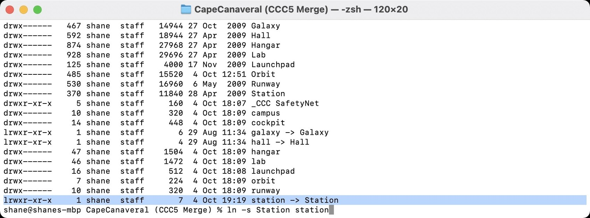

*The new station symlink pointing back to Station. At least one part of this directory puzzle was behaving.*
{: .media-caption }

Which we can then check in Finder on the Mac, and it appears to be working well.

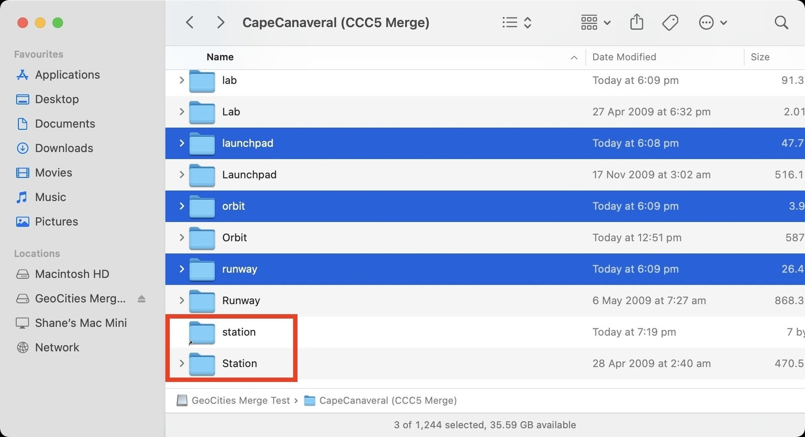

*Finder confirms station is a link, but the other differently capitalised folders are still hanging around. More sorting ahead.*
{: .media-caption }

With symlinks working, we can move onto tidying up before symlinking everything together. The image above shows that there are still multiple folders with different case. I need to unify them as one and then create symlinks in case someone has referenced **_/symlink/_** instead of **_/SymLink/_**.

* * *

**4th October 2021 (Part 5)**

Oh, yes! Apache to the rescue with the [mod_speling](https://httpd.apache.org/docs/2.4/mod/mod_speling.html) module.

`sudo a2enmod speling`

We've placed the following in VirtualHost configuration file inside Directory tags: `# Case-insensitive CheckSpelling on CheckCaseOnly on`

and a quick restart of apache2.

`sudo service apache2 restart`

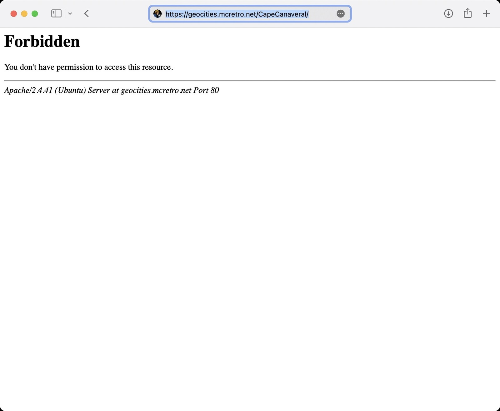

*Oops. Apache was denying access to CapeCanaveral. The browser was considerably less impressed than I was.*
{: .media-caption }

Ahh! Wrong permissions are set on the web server. We had used Carbon Copy Cloner 5 to copy back onto "GeoCities APFS Decompressed" from the temporary sparse disk image bundle to maintain the case-sensitivity. We then copied from the APFS partition back onto the ext4 partition with CCC5.


*Found it. CapeCanaveral had come across owned by 501:dialout, unlike the surrounding www-data directories.*
{: .media-caption }

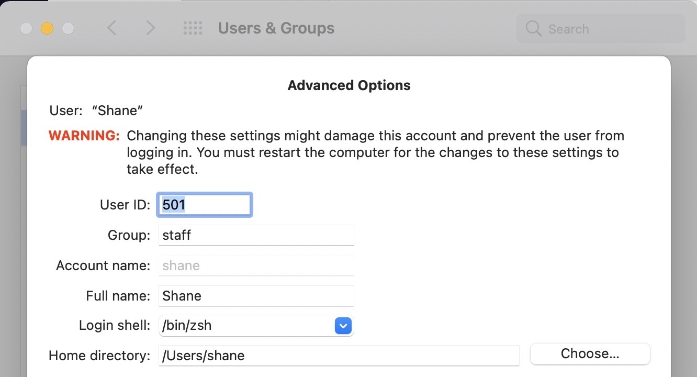

*Of course, 501 was the account's user ID on the Mac. One ownership mystery solved.*
{: .media-caption }

A quick run of the below commands fixed up the ownership and permissions issues and...

`cd /var/www sudo chown www-data:www-data -R \* sudo chmod -R a=r,a+X,u+w .`

**Apache's mod_speling allows us to have the expected, correct capitalisation:**

- https://geocities.mcretro.net/CapeCanaveral/

**As CapeCanaveral only exists by itself, trying to load the following:**

- https://geocities.mcretro.net/capecanaveral/

results in...

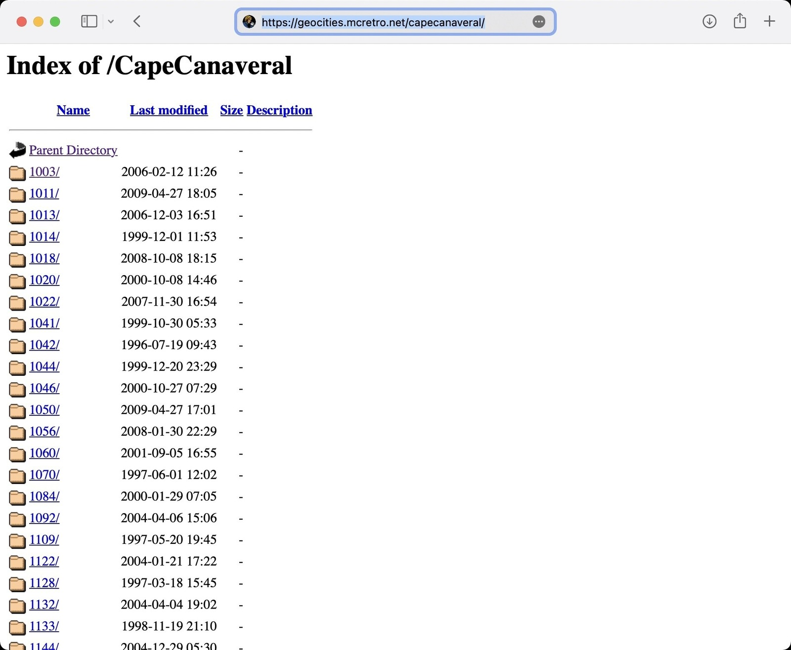

*At last, the lowercase address reached the capitalised CapeCanaveral directory. Thank you, mod_speling!*
{: .media-caption }

A redirection to **[https://geocities.mcretro.net/CapeCanaveral/](/homepages/geocities)** ... I guess I won't be needing those symlinks after all thanks to Apache's **mod_speling**.


*Symlink Free Zone! After all that mucking about, Apache's case handling made the extra links unnecessary for this setup.*
{: .media-caption }

And that's it for the weekend. Feel free to stop by [http://geocities.mcretro.net](/homepages/geocities) and test out Area51 or CapeCanaveral. Don't press anything in Athens though, it isn't working just yet!

* * *

**10th October 2021**



This weekend I've been taking it easy due to giving a blood donation on Saturday. Perfect opportunity to test out the website on as close as I have to real hardware - while live streaming. Interestingly Netscape 4 feels clunkier and slower than Internet Explorer 5. Maybe I backed the wrong horse on this one.

For now I'm going to get the [neighborhood list](https://web.archive.org/web/20211208123141/https://geocities.mcretro.net/neighborhoods/) tabled up and cross checked between a few sources and the [WayBack Machine](https://web.archive.org/web/19990203120656/http://www4.geocities.com/neighborhoods/).

* * *

**11th October 2021**

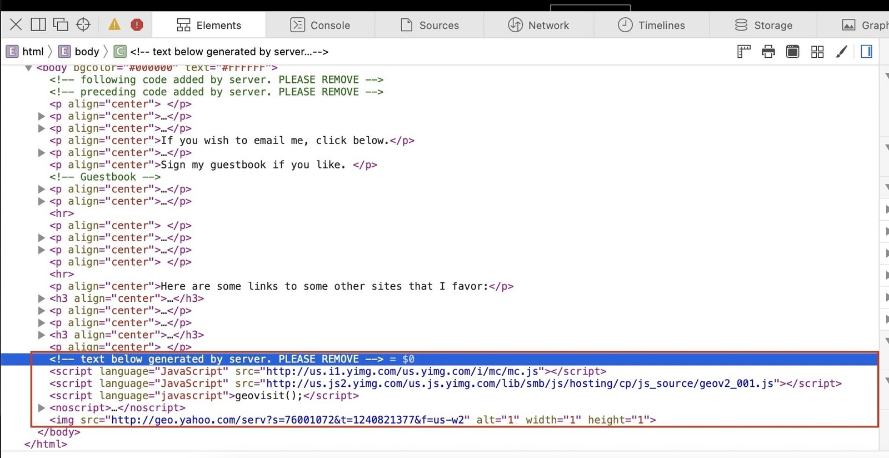

*The red box was the clue. Yahoo's extra script could be swapped out for something of my own.*
{: .media-caption }

Shower thoughts. They hit you with the greatest clarity but rarely make it out. This one survived.

For the past couple of days I have been trying to think about how to get a header to stick at the top of the page to allow "teleport" to another random page, head back to the neighborhood list, etc.

I haven't been able to use basic php as it would result in the location bar URL simply returning http://geocities.mcretro.net - useless for takedowns or knowing **_where_** you are in the archives.

I tried a few things, mostly seeing if there was a way to use javascript to rewrite the location bar URL. In hindsight, I think I may have been thinking about this back-to-front.

Late last night I was looking into the section boxed in red in the above image. It seems to be on **_almost_** every archived html page. I went to sleep.

This morning, in the middle of my shower, it hit me. Could the Yahoo! server-generated code be replaced with a new script for inserting a header? Now that I know mod_substitute exists, this might just work.

I needed something big and flashy to stand out so I made a Pickle Rick gif and added the following inside the VirtualHost tags:

```
Substitute 's|<script language="JavaScript" src="http://us.js2.yimg.com/us.js.yimg.com/lib/smb/js/hosting/cp/js_source/geov2_001.js"></script>||i'
```

And what do we have...

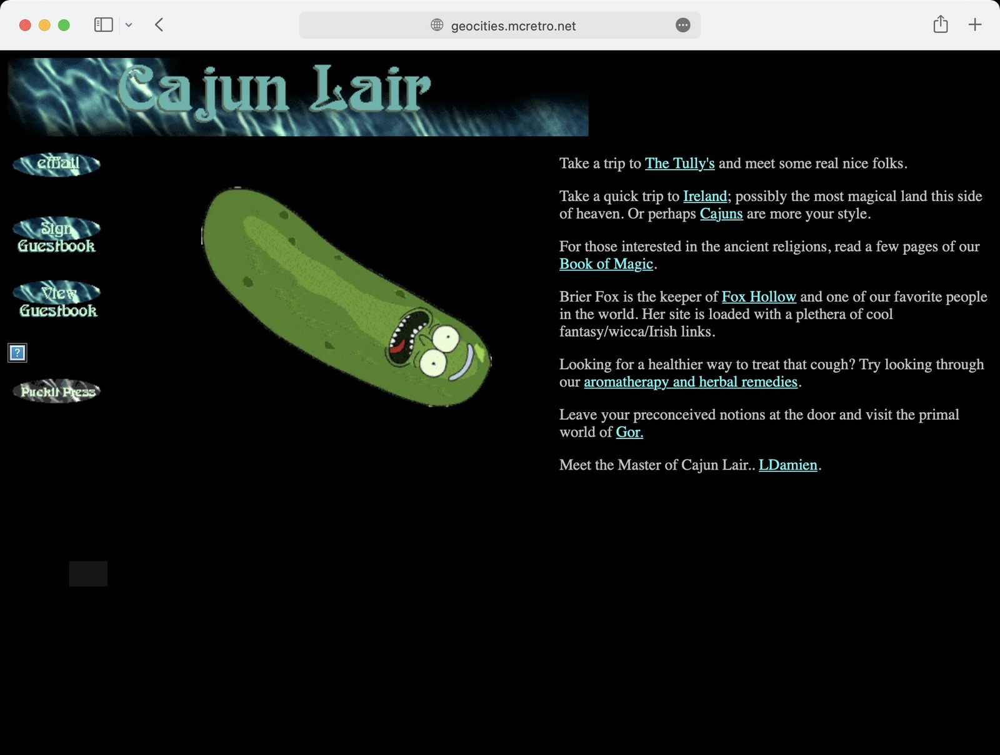

*The world's least subtle proof of concept: a huge pickle on an old GeoCities page.*
{: .media-caption }

Giant. Spinning. Pickle.

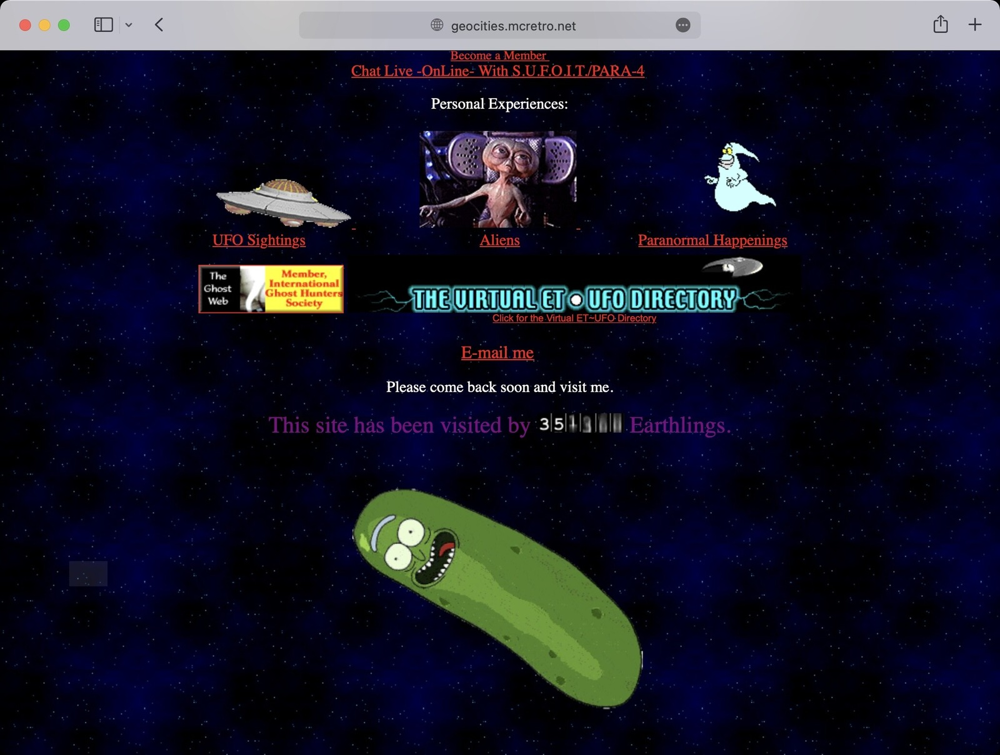

*Another page, another pickle. The substitution was spreading across the archive.*
{: .media-caption }

Yes, it's possible! And when coupled with mod_cache, the substituted result can be saved for later viewing with less strain on server resources. I could possibly use this in several ways:

- Add a navigation header by injecting javascript of my own.
- Add a navigation footer, instead of a header, by replacing the closing BODY tag in the HTML.

Back to the first image. In the red box there is also additional, possibly global, code that could be removed or replaced. I know the last image source carries a relatively unique timestamp, which means I may need to use some fancy strings to remove or replace it.

Another issue I remembered was that the pages without an index.html or index.php file that just return a file listing could possibly also use the header/footer feature of Apache2 to insert a similar header / footer.

So for now there is a spinning pickle on all the pages that are up, until a header is added. Definitely check out CapeCanaveral and Area51 to see if you can find any without spinning pickles. What a time to be alive. I better get back to creating the [neighborhood pages](https://web.archive.org/web/20211208123141/https://geocities.mcretro.net/neighborhoods/).

* * *

**12th October 2021**

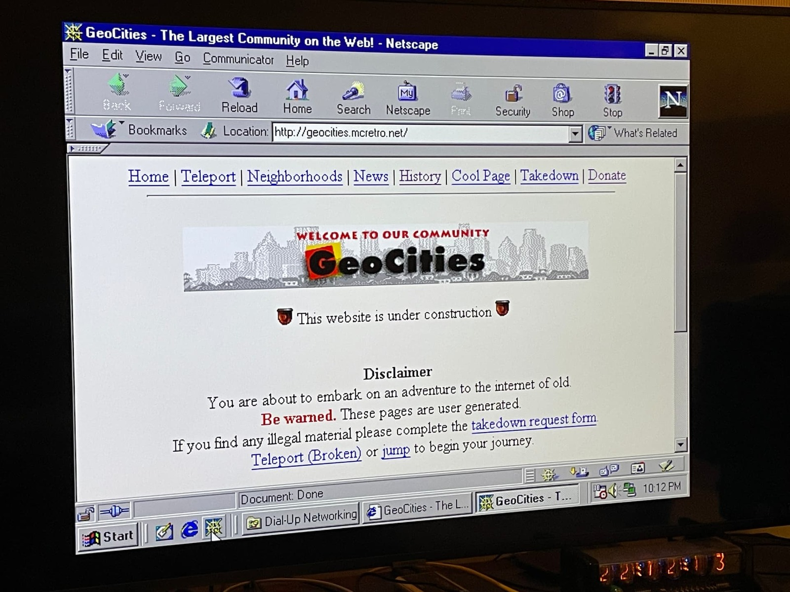

*The GeoCities front page got a makeover in Netscape, complete with the obligatory under-construction warning.*
{: .media-caption }

A quick redesign to make it a little nicer, still a work in progress - it wouldn't be a GeoCities website if it wasn't under construction after all.

Being able to teleport or jump to random sites inside the GeoCities archives is going to need a list of all available links to jump to. A sitemap.xml file should help us with that. That will be the database of available links for jumping.

To generate a sitemap we'll need a... sitemap generator. I've decided on the aptly named [Sitemap Generator CLI](https://github.com/lgraubner/sitemap-generator-cli). I decided it would be best to run it on one of the Ubuntu 20.04 servers. Installation was straightforward.

`sudo apt update sudo apt install npm sudo npm install -g sitemap-generator-cli`

Then the generation of the sitemap.xml file. Unsurprisingly, this will also serve as a sitemap for Google, Bing and others crawling the website for links. Depth of 4 seems to be sufficient to capture the majority of sites in the neighborhoods. Obviously this will not capture all links present but does capture just shy of 300,000.

`sitemap-generator http://geocities.mcretro.net --verbose --max-depth 4`

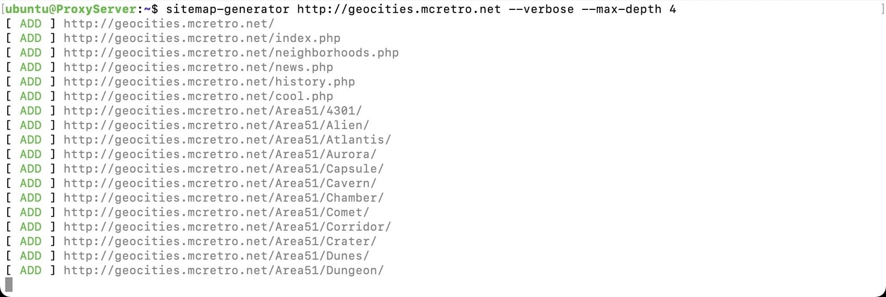

*The sitemap generator was off exploring Area51, collecting addresses for the new Jump feature.*
{: .media-caption }

After waiting what felt like a few hours, move the sitemap into the appropriate folder:

`sudo mv sitemap.xml /var/www/html/geocities/`

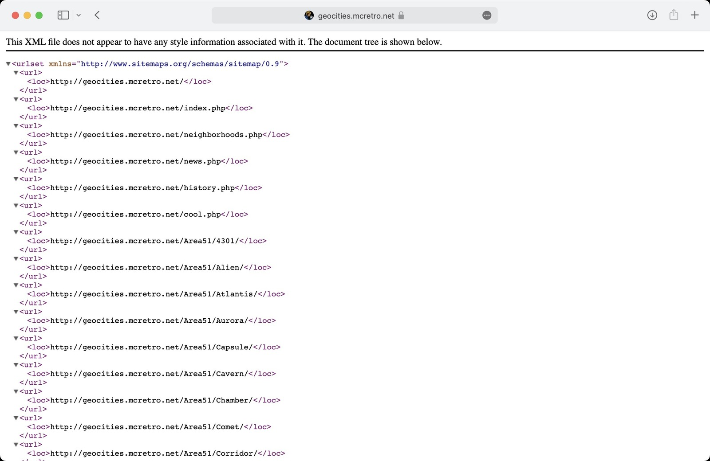

*A sitemap full of GeoCities addresses. Now to make Jump™ choose one at random.*
{: .media-caption }

We now have a [sitemap](https://web.archive.org/web/20211208130512/https://geocities.mcretro.net/sitemap.xml). Next, we need to figure out how to best implement the teleport (Jump™) feature to utilise the sitemap.

* * *

**16th October 2021**



**Jump™** implemented.

The code comes from [stackoverflow.com](https://stackoverflow.com/questions/12390522/open-random-page-from-sitemap-xml-using-php). The Jump™ code now runs a server-side script, in PHP, to randomly select a website from the sitemap.xml file. If it weren’t server-side you’d know because the file is large at 1.8MB. Downloading that over dialup is going to be very slow!

At the time, Jump™ would beam you to a random GeoCities website. The [archived jump page](https://web.archive.org/web/20230926122957/http://geocities.mcretro.net/jump/) preserves the buttons, but the archive can't run the original server-side PHP for you. We still had only Area51 and CapeCanaveral active at this point. Great for fans of X-Files fanfic, not so great for anyone else.

Now we have the code that helps us jump to random sites that is pulled from our sitemap.xml. So where to next? Finding a way to keep a "Home", "Jump", and "Report" text or buttons on the majority of sites visited. Initial tests were somewhat successful...

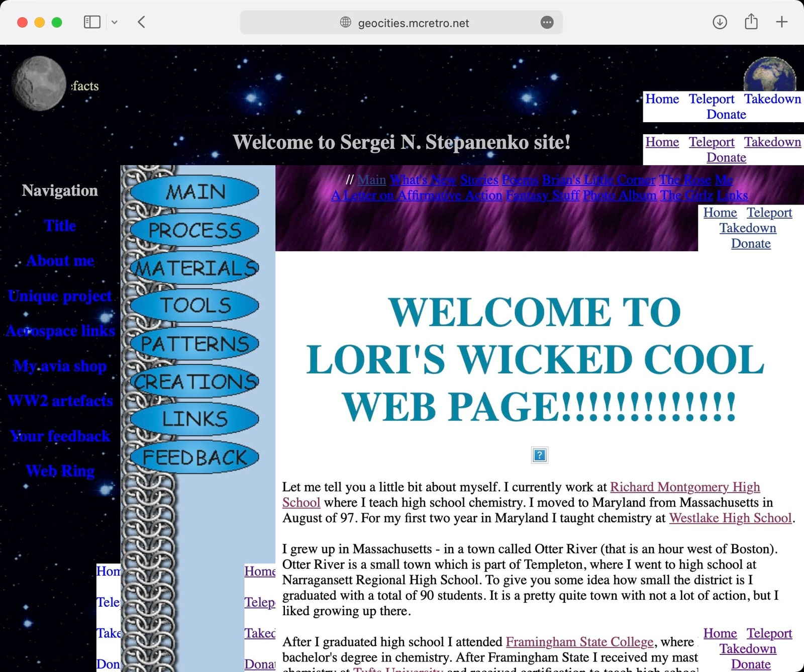

*The navigation buttons worked on some pages, but frames made a spectacular mess of their placement.*
{: .media-caption }

I rediscovered TARGET="_top" after having my test links as same window. TARGET="_top" makes links open in the topmost frame, i.e. the full browser tab and window. Lesson learnt!

The current nav buttons are embedded into the page through Apache's mod_substitute. We replace the website's `</BODY>` tag on the server, not in the client-side browser. No solution was perfect, so I went with the one that causes **the least** damage.

- Closing HEAD tag - Could cause the body tag to start prematurely, resulting in malformed content and it breaks frames.
- Opening BODY tag - Most pages have this contain most of their formatting. Injecting code into here results in a mess, often stripping formatting.
- Closing BODY tag - This only rarely causes issues.

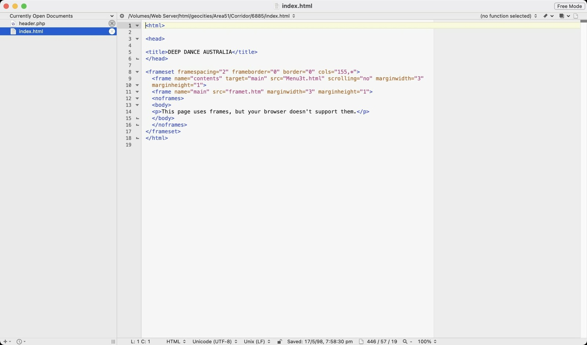

*The HTML explained the missing buttons: FRAMESET pages did not use the usual closing BODY tag.*
{: .media-caption }

The above shows issues when using BODY as a place to inject when FRAMESET is present. Substituting the `</BODY>` results in no nav buttons showing because [FRAMESET is used in place of BODY tags](https://www.w3.org/TR/html4/present/frames.html). While I could inject code into FRAMESET as well, I think it would cause more issues depending on if the FRAMESET contained body tags such as the above sample site code.

I did tinker with having JavaScript overwriting some of the code to inject a nav bar. However, it was not working on the targeted older browsers. The reason? The script always landed outside the closing BODY tag meaning it wouldn't render on the page.

Loaded the VirtualHost config:

`sudo nano /etc/apache2/sites-available/geocities.conf`

and inserted the following:

```
# Insert Home, Jump™ and Report Icons - Works without breaking too much, doesn't show on sites without a closing body tag </BODY>. Substitute 's|</body>|<BR><p align="right"><a HREF="/" target="_top" rel="noopener"></A> <a HREF="/jump" target="_top" rel="noopener"></A> <a HREF="http://mcretro.net/report" target="_blank" rel="noopener"></p></body>|i'
```

We can now jump from most pages - including directory listings (i.e. pages without an index).

In other news, I've mostly finished the [neighborhood listing](https://web.archive.org/web/20211208123141/https://geocities.mcretro.net/neighborhoods/). This means if I copy all the files across they will now load up well enough. I'm still working on directory structure though.

**Images for sites seem to come from the following pages:**
- http://geocities.com/pictures/
- http://pic.geocities.com
- http://us.yimg.com
- http://us.geo1.yimg.com/pic.geocities.com
- http://visit.geocities.yahoo.com
- http://visit.geocities.com
- and other international sites.

It's pure chaos.

I'm looking into aliasing some of the data directories for YahooIDs to prevent them flooding the root folder with random usernames. Still trying to work out the best way to achieve that though.

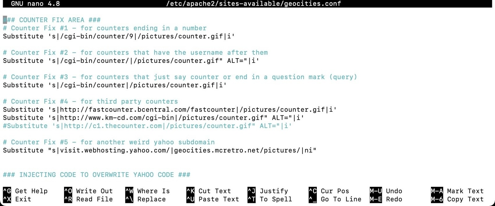

*A few more Apache substitutions to rescue the old counters and their missing graphics.*
{: .media-caption }

I've tidied up the counters and the root substitutes, I noticed a lot more backgrounds work now. Once I merge all the root pictures/images together, we'll have much better looking sites. Well, perhaps better isn't quite the right word.

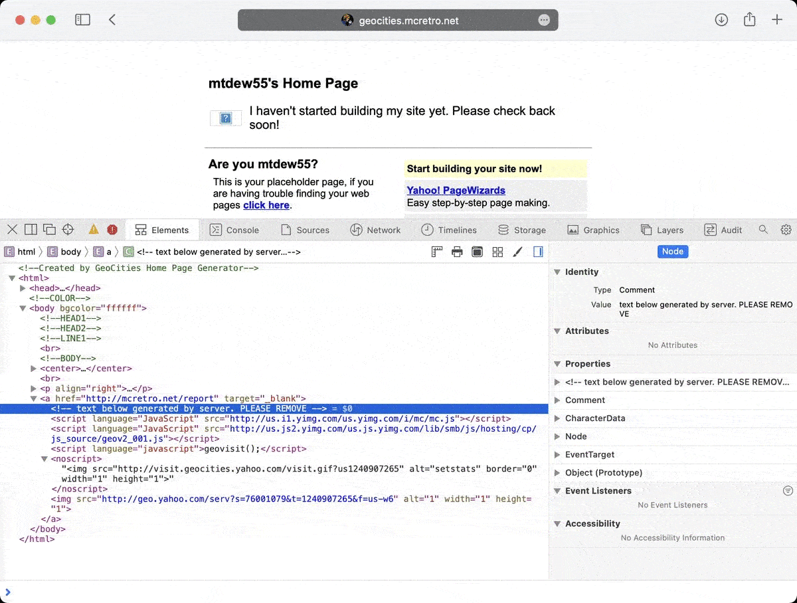

*Yahoo's old JavaScript was still hanging around. Two out of three removals wasn't bad.*
{: .media-caption }

For now I have removed some of the JavaScript hiding on almost all pages. I couldn't work out how to remove the **geovisit();** code though. Two out of three ain't bad.

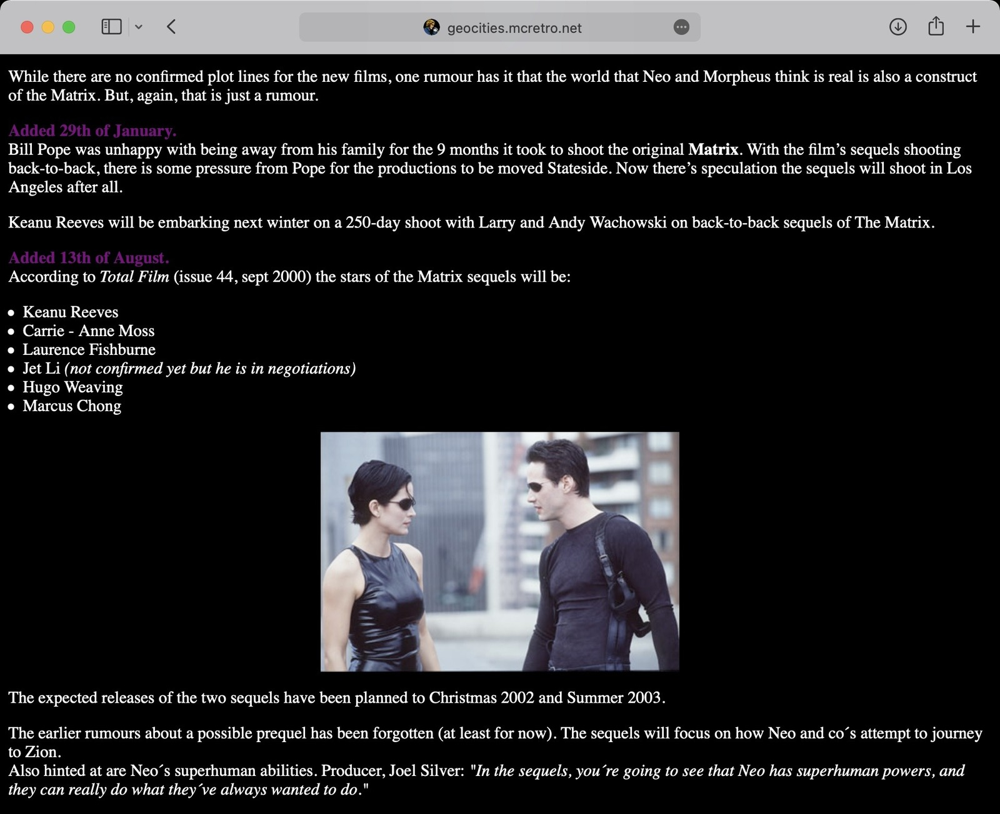

*A little detour into old Matrix sequel gossip. Another very 2000s page back on screen.*
{: .media-caption }

Not much more to report except for some insight into those new Matrix sequels. I'll keep working away on working out structure on the backend. I need to verify the structure of the neighborhoods against other sources such as [Blade's Place](https://www.bladesplace.id.au/geocities-neighborhoods-suburbs.html), [OoCities.org](https://www.oocities.org/) and [Wayback Machine](https://web.archive.org/web/19961022173245/http://www.geocities.com/).

Then I'll need to poke around the YahooIDs, Neighborhoods and pictures spanning three periods: GeoCities, the GeoCities/Yahoo transition and Yahoo. Working these ones out will help determine the best way to mount the external media.

* * *

**17th October 2021**

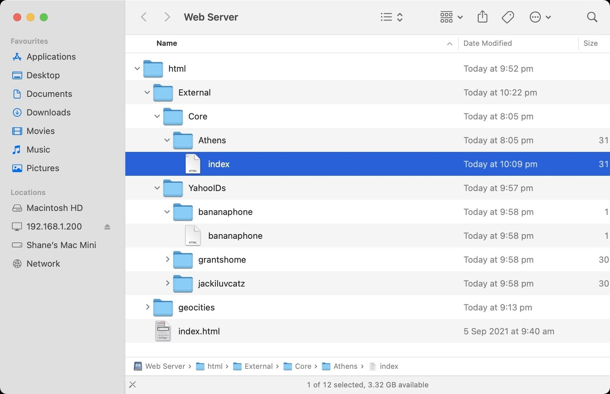

*The three pieces of the directory puzzle: Core, YahooIDs and my own GeoCities pages.*
{: .media-caption }

Here's the file structure. I want to have External be an external USB SSD to hold all the data from Core (Neighborhoods) and YahooIDs (YahooIDs). Athens is an example of a neighborhood. The YahooIDs, bananaphone, grantshome and jackiluvcatz are examples of usernames. The geocities subfolder contains the HTML I have written up in the past month or so.

There's a lot of cross over between YahooIDs and neighborhoods. It looks like if you had a page at geocities.com/Athens/4829/ you would have also had geocities.com/jackiluvcatz as a symlink. The page builders that Yahoo (and maybe GeoCities) used seem to have willy nilly used the YahooID over the neighborhood location in referencing images, and other files in your website.

So really I needed two separate locations to meet (parallel and overlapping data) under the root folder where I already had data.

My external hard drive containing all Core and YahooIDs data is currently mounted at /var/www/html/External/

I attempted to use [mod_alias](https://httpd.apache.org/docs/2.4/mod/mod_alias.html) only to find it kind of worked, but not really. Then I came across [this incredible idea](https://madbean.com/2007/two-docroots/) of having **two DocumentRoots**. My VirtualHost configuration became this:

```
DocumentRoot /var/www/html/geocities <Directory /var/www/html/geocities> Options Indexes MultiViews FollowSymLinks AllowOverride None Require all granted </Directory>

RewriteCond "/var/www/html/External/YahooIDs%{REQUEST_URI}" -f \[OR\] RewriteCond "/var/www/html/External/YahooIDs%{REQUEST_URI}" -d RewriteRule ^/?(.\*)$ /var/www/html/External/YahooIDs/$1 \[L\]

RewriteCond "/var/www/html/External/Core%{REQUEST_URI}" -f \[OR\] RewriteCond "/var/www/html/External/Core%{REQUEST_URI}" -d RewriteRule ^/?(.\*)$ /var/www/html/External/Core/$1 \[L\]
```

It worked! Almost perfectly. In this configuration I lost the ability to have "athens" corrected to "Athens" after the request had been rewritten. I treated that as `mod_speling` and `mod_rewrite` being incompatible, but that was too broad. The two modules can interact differently depending on where and how the rewrite occurs. What mattered here was simpler: my rewrite setup stopped `mod_speling` from performing the case correction I needed.

One document root (my HTML) and two rewrite rules (Neighborhoods and YahooIDs) were so close to working. Every article I read told me it wasn't possible, everyone else gave up or threads went dead. I did learn that Microsoft IIS has this issue often when migrating to a Linux host with Apache. Great.

I guess symlinks are back on the menu. I could use:

`sudo ln -s Athens athens`

This would let the lowercase athens address reach the same directory as Athens, but a symlink alone wouldn't redirect the browser to the capitalised URL. And what about SoHo, Soho and soho? Let alone the case sensitivity on YahooIDs... Plus there's a bunch of unmerged case differences. I'll merge them one day, maybe. mod_speling might negate the need to create all those links.

There are too many variations of each YahooID, e.g. bananaphone vs BANANAPHONE and every iteration in between to create symlinks for. If case correction isn't working in this setup, people can't reach the site using the second address listed:

- http://geocities.mcretro.net/bananaphone/
- http://geocities.mcretro.net/bananaPHONE/

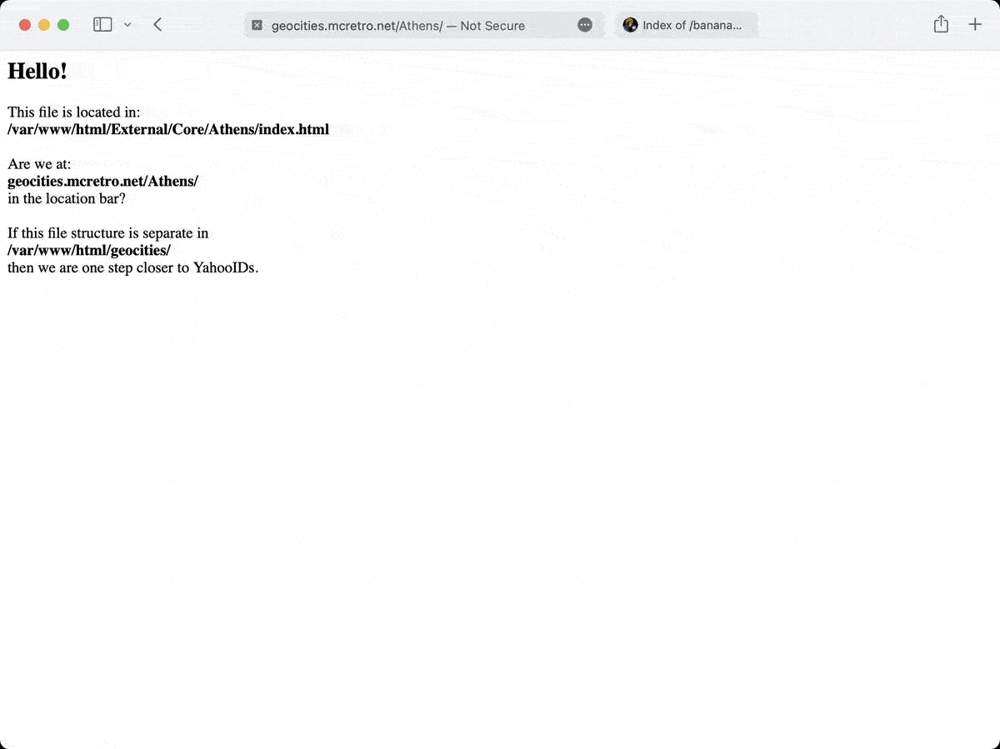

*The Athens test page found the file under External/Core, even though the browser address was much shorter.*
{: .media-caption }

It was so close to working. Just the lowercase variations were broken. I even dabbled in rewriting all files to lowercase through mod_rewrite. Nope, that didn't work at all. Hmmm. Then it hit me. Like a bus. Reverse it.


*Then it hit me: reverse the setup. A suitably dramatic way to solve a directory problem.*
{: .media-caption }

I know that my created HTML is all lowercase and doesn't require mod_speling. That means that the "geocities" folder can be run through mod_rewrite without needing case correction in that part of this setup. Great!

`# Rewrites for GeoCities (self-made) files. Allows mod_speling to function. # mod_rewrite does not allow mod_speling to modify / ignore case. # This is fine on my created files as everything is lowercase. RewriteEngine on RewriteCond "/var/www/html/geocities%{REQUEST_URI}" -f \[OR\] RewriteCond "/var/www/html/geocities%{REQUEST_URI}" -d RewriteRule ^/?(.\*)$ /var/www/html/geocities/$1 \[L\]`

With "geocities" being taken care of we move on to the contents of the "External" folders. We need their contents to show at:
- http://geocities.mcretro.net/**_YahooIDs_**
- http://geocities.mcretro.net/**_Core_**

Simple? Not really. No wonder I got stuck on this so long! The larger of the two folders is going to be YahooIDs. There's a finite amount of neighborhoods, so core will have less items. Sounds like I need to symlink **_Core_** folders into **_YahooIDs_** so they both display at root in http://geocities.mcretro.net/ - symlink activate!

`sudo ln -s /var/www/html/External/Core/\* /var/www/html/External/YahooIDs`

I could also use the following to force linking in case other symbolic links exist in the YahooID folder. I can't remember which one I used but the following would have been useful after the first run - and making sure there were no YahooIDs equal to Neighbourhoods...

`sudo ln -sf /var/www/html/External/Core/\* /var/www/html/External/YahooIDs`

`-f Force existing destination pathnames to be removed to allow the link.`

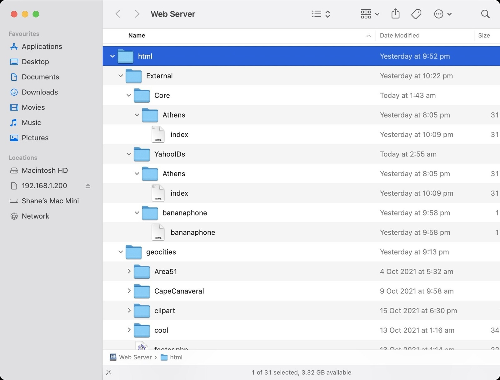

*Athens now appeared inside YahooIDs too. Those symbolic links were finally earning their keep.*
{: .media-caption }

Now we have an Athens folder inside YahooIDs. Excellent. YahooIDs is now our DocumentRoot. Core (neighborhoods) is symlinked into YahooIDs. My GeoCities HTML landing page is rewritten into / alongside the above two. Three folders feeding into one. Incredible.

I'm hoping you're starting to see why the GeoCities Archive is such a mess. The backend would have been chaos.

**These all redirect correctly:**
- http://geocities.mcretro.net/BANANAphone
- http://geocities.mcretro.net/bananaPHONE
- http://geocities.mcretro.net/athENS
- http://geocities.mcretro.net/ATHens

**Also important to check the older links are still working and have mod_speling active:**
- http://geocities.mcretro.net/area51
- http://geocities.mcretro.net/Area51

On that note, we'll need to move any neighborhoods from **_/geocities/_** to **_/External/Core/_**.

It seems that the **/geocities/Area51/** rewrite rule has priority over **/External/Core/Area51/** - interesting. Throw some case in there and it all redirects correctly though. This might not mean anything at this stage since I need to reshuffle the files around and fix permissions.

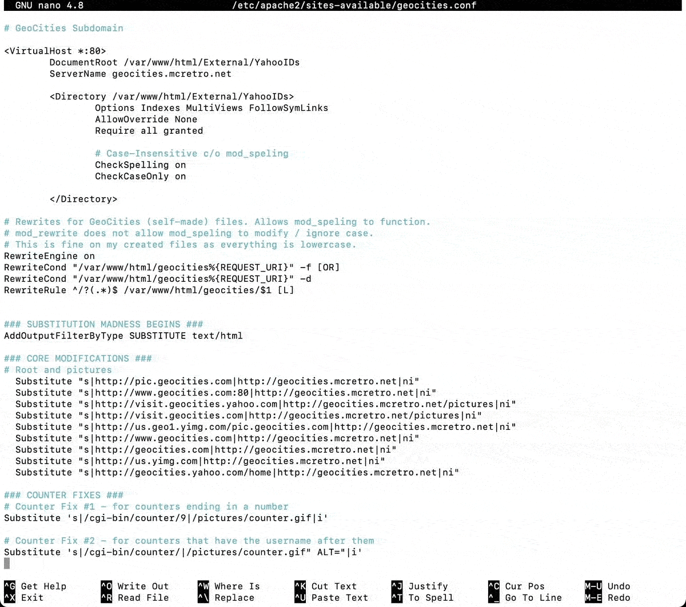

*A look inside the Apache configuration, where the redirects, rewrites and substitutions were all getting rather crowded.*
{: .media-caption }

Above is the VirtualHost configuration to date. I better get around to moving everything across into final directories for further testing.

**UPDATE 1:**
These are some other good test cases while trying to get the merging to work as some were present in lowercase and some in uppercase. Ultimately I'll need to merge all the case variants at some stage.

**Exists**
`http://geocities.mcretro.net/capecanaveral/1020/line/`

**Doesn't Exist**
`http://geocities.mcretro.net/CapeCanaveral/1020/line/`

Great links for testing this out:
- `http://geocities.mcretro.net/CapeCanaveral/1020/line/marsh.gif`
- `http://geocities.mcretro.net/capecanaveral/1020/line/marsh.gif`
- `http://geocities.mcretro.net/CapeCanaveral/1020/index.html`
- `http://geocities.mcretro.net/capecanaveral/1020/index.html`

Does mod_speling work it out? If yes, it's finding the right path through the mush of uppercase and lowercase.

**UPDATE 2:**
Copied all the neighborhoods (core) across and a few usernames (yahooids) - it looks like it might be working. I'll rebuild the sitemap.xml file tonight. It should wind up being pretty big. Then jump should teleport across any page that is available!

* * *

**19th October 2021**

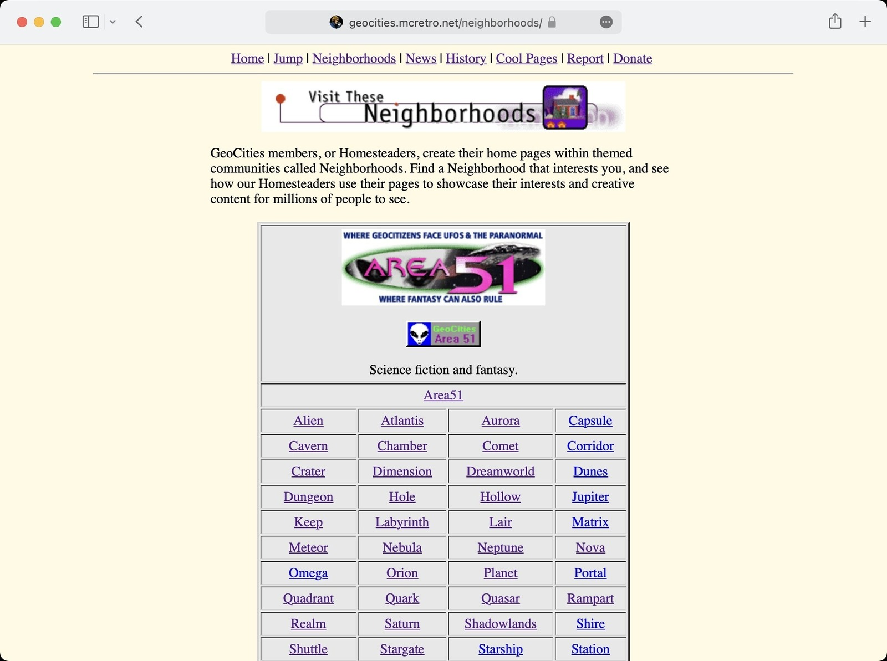

*The neighbourhood directory was coming together, with Area51 and its many suburbs ready for exploring.*
{: .media-caption }

[Jump™](/homepages/geocities) is working, however the server does not like having to parse a file that is 15MB every time the link is clicked. There's over 280,000 links indexed. Yikes! That's before I add 100,000+ user folders... That's a lot of files.

What I can possibly do to speed it up a little is to split the sitemap into multiple files. Then the jump PHP script could call on one of the sitemaps at random, and pick a random URL inside the sitemap called upon. Of course you could just pick a suburb from the neighborhood section and explore that way too.


*Apache found two similar names instead of choosing one. Case sensitivity strikes again.*
{: .media-caption }

Now that I've got everything redirecting to the root where it should be, I'm coming across some issues. This is one of them. This is mod_speling in action, trying to work out what address I was supposed to go to. I gave it capeCanaveral (invalid, non-existent) instead of CapeCanaveral (valid, exists) or capecanaveral (invalid, non-existent).

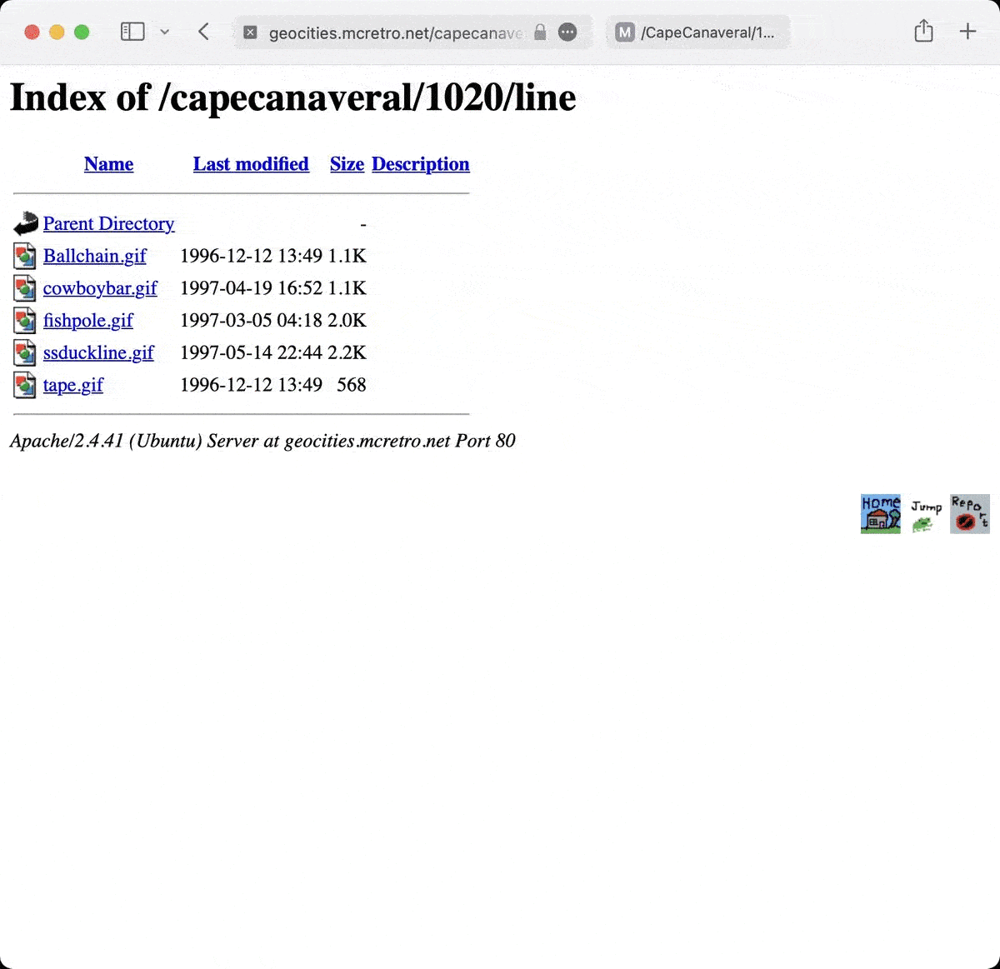

*The lowercase folder had several GIFs, but marsh.gif wasn't among them. Case correction wasn't a directory merge.*
{: .media-caption }

As you can see from the above gif, marsh.gif is present in only one directory. mod_speling can correct a requested spelling or case; it doesn't splice two directories together. The way I configured DocumentRoot and mod_rewrite may also have affected which directory was searched. I guess it doesn't matter too much for now. I will need to find a way to merge the lowercase and uppercase variations on directory names eventually.

Next steps will be capturing more core (neighborhoods) directories to merge from the YahooID folders. The data dump included a few extra sources apart from the main files, I'll need to get these into the mix.

The next step after that will be sorting out the structure of the root pictures and images folders. These are pretty important as some people hot-linked directly to the root source files which aren't all present yet.

I won't be able to work on this too much until the weekend again, but it does give some food for thought until then.

* * *

**23rd October 2021**


*The Halloween pages were resurfacing too, complete with pumpkin graphics and delightfully chaotic 1990s design.*
{: .media-caption }

I know I said I wouldn't do too much during the week but a few things did click together. In preparation for merging the neighborhood case differences with rsync (or Carbon Copy Cloner) we've made some big strides in the past week.

**Here's the more exciting things:**
1. Found and removed all index.html files from directory listings.
2. Removed 0 byte files, removed 0 byte folders (in that order).
3. Started to clean up some of the redirection looped files and folders.
4. Less than 1TB of data is present now.
5. Symlinks were all deleted (again) - we need mod_speling to work properly.
6. Sitemap has been created successfully and is now split into smaller chunks.
7. The jump script now covers all neighborhoods and is a fair bit quicker.

All these will help with the merging of the various data sources together. It's a bit like Minesweeper before you tinker with the settings to win faster.

**The best order for cleaning up the file and directory structure (#2 and #5 above) was:**
1. Delete .DS_Store files (thanks Mac OS for creating them)
2. Delete zero byte (empty) files
3. Delete empty directories
4. Delete symlinks

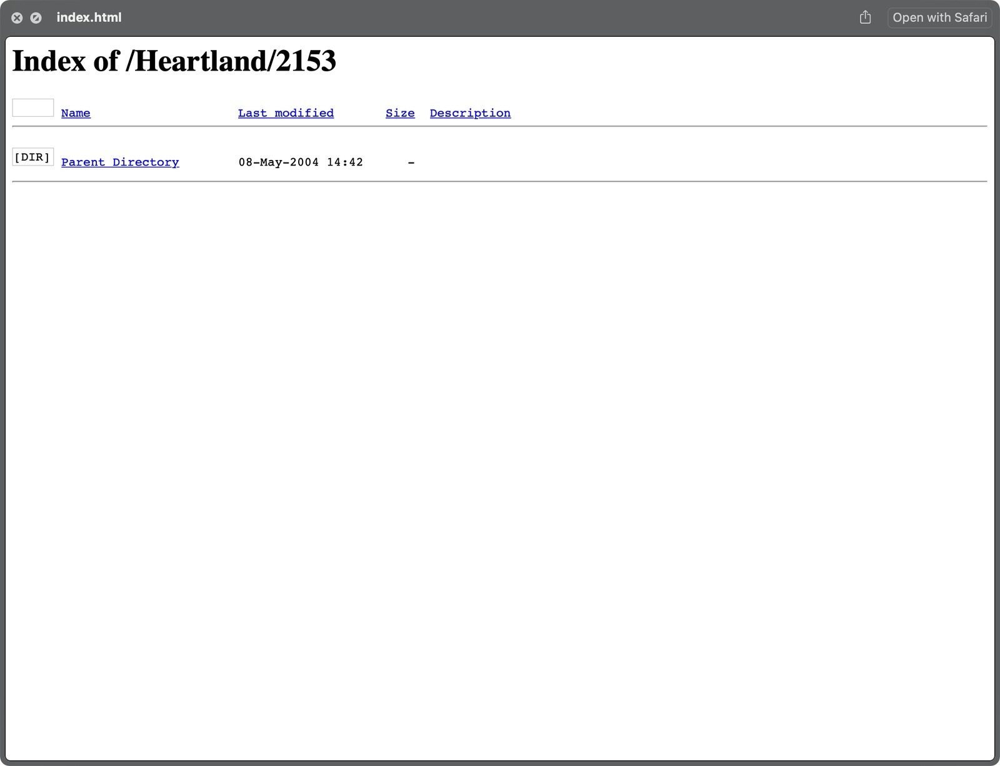

*An old generated index.html file that served little purpose beyond duplicating a directory listing.*
{: .media-caption }

The creation of hidden .DS_Store files and directory listing index.html files (see #1) were blocking directories from being deleted as they were not empty. The above image was one of the offending index.html files that were likely autogenerated by Yahoo in order to reduce server load. The cost? They aren't dynamic anymore. Deleting the index.html files was a tough feat.

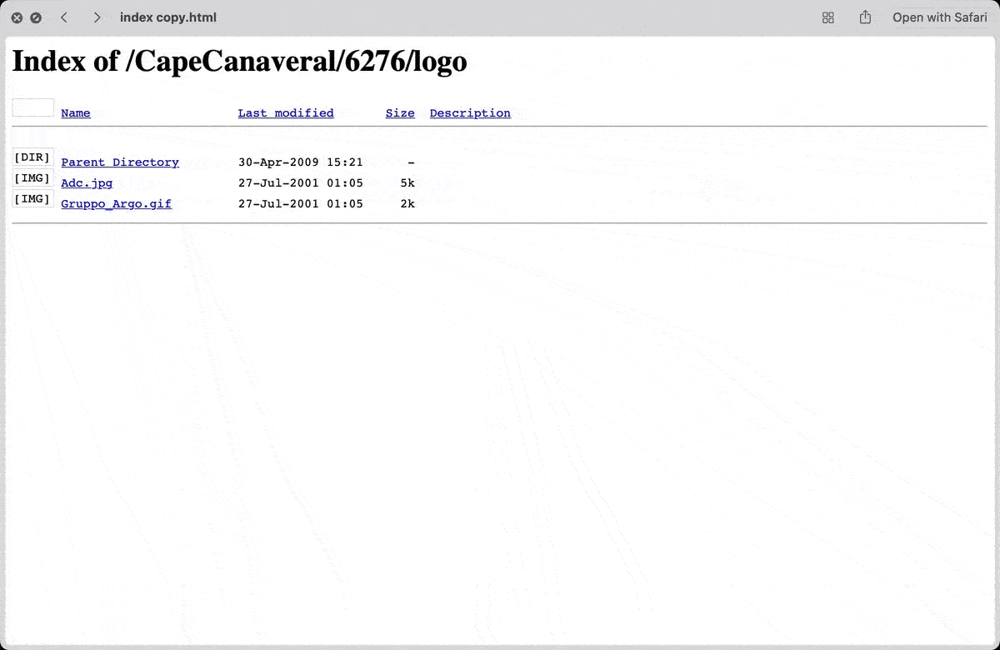

*Another static directory listing, with missing icons and very little else to offer.*
{: .media-caption }

They don't have a lot in common, but their source code shared some unique beginnings. This is one of the files:

`<!DOCTYPE HTML PUBLIC "-//W3C//DTD HTML 3.2 Final//EN"> <HTML> <HEAD> <TITLE>Index of /CapeCanaveral/6276/wreck</TITLE> </HEAD> <BODY> <H1>Index of /CapeCanaveral/6276/wreck</H1>`

From that we can steal the first part - four lines worth:

`<!DOCTYPE HTML PUBLIC "-//W3C//DTD HTML 3.2 Final//EN"> <HTML> <HEAD> <TITLE>Index of`

And that's pretty unique in itself as it narrows down HTML files that have "Index of" in their title. That's only going to be indexes of directories. Perfect. Another bonus is the !DOCTYPE declaration. HTML3.2 Final (we're up to HTML5 now). Very handy.

Next up I did some searching to find what command line tool(s) I could use. Enter grep via [this post](https://stackoverflow.com/questions/16956810/find-all-files-containing-a-specific-text-string-on-linux):

`grep --include=\\\*.{htm,html} -rnw '/path/to/somewhere/' -e "pattern"`

Grep seemed to work, but it was detecting my three lines as three searches and not stringing them together. So I'd have it return a positive for each line, I need all lines to be considered at the same time. Turns out **_grep_** wasn't good enough. I needed **_pcregrep_**.

After playing around with switches and settings and adapting the code to suit my needs. I ended up with this:

`pcregrep --buffer-size=2M --include=\\index.{htm,html} -rilM "(?s)<\\!DOCTYPE HTML PUBLIC \\"-//W3C//DTD HTML 3.2 Final//EN\\">.\*(?s)<HTML>.\*<HEAD>.\*(?s)<TITLE>Index of " '.' 2>&1 |tee ~/Desktop/blankindex.txt`

Firstly, pcregrep has a buffer limit of 20K. Not enough. It outputs errors and messes up my blankindex.txt file. Buffer size booster to 2M. Great!

We only want to include index.htm or index.html files. Decoding **\-rilM**, in order: recursive, case-insensitive, list matches show only, [search beyond line boundaries](https://stackoverflow.com/questions/152708/how-can-i-search-for-a-multiline-pattern-in-a-file). That last one is important. Followed by a bunch of regex stringing all the lines together. The **'.'** searches the current folder, so make sure you are in the correct directory when running this.

But that wasn't enough, I wanted to send it all to a text file for review. Adding **2>&1** sends errors and terminal output to my brand new text file, blankindex.txt, using **tee**. This resulted in the following:

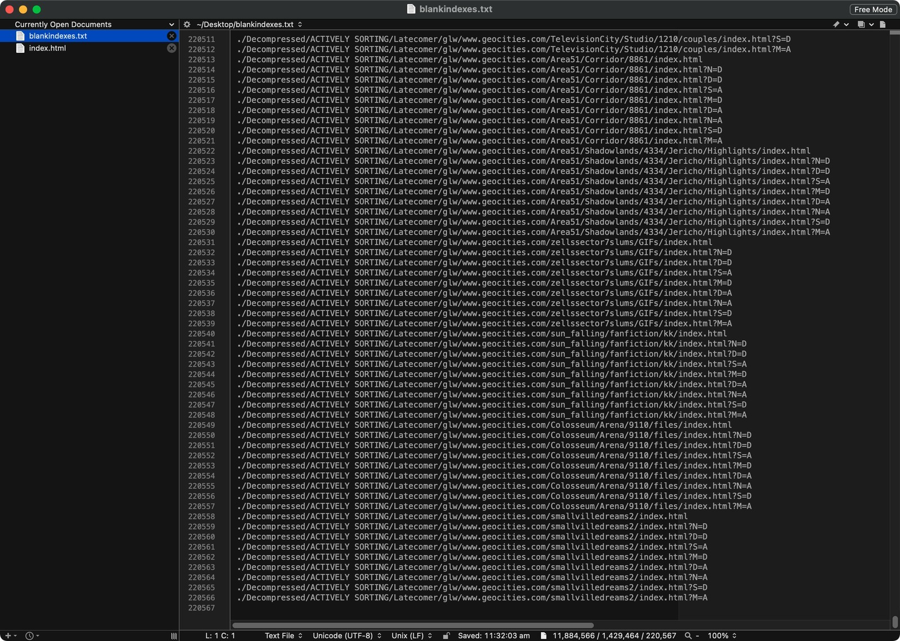

*A very long list of generated index files to sort through. The archive certainly wasn't short of them.*
{: .media-caption }

Excellent, I have a massive list of all the directory listing index.html files I don't want. 219,060 files. Now to check my work, I checked how many index.html files were present overall. How? Well let's try to dumb down our search with pcregrep. We'll look for the following in index.html files.

`<HTML> <HEAD>`

And we'll search with this code. This should yield a lot more results.

`pcregrep --buffer-size=2M --include=\\index.{htm,html} -rilM "(?s)<HTML>.\*<HEAD>" '.' 2>&1 |tee ~/Desktop/fullindex.txt`

And it did. The original was 12MB at 219,000, the new one was well over 50MB before I cancelled it. There's definitely a lot of index.html files with both HTML and HEAD tags. Past cool! :+1:

I checked some samples from the blankindex.txt file to make sure I was definitely only removing static directory listings and not user generated content. Everything checked out. Next up, xargs.

`xargs -n 1 ls -v < ~/Desktop/blankindex.txt`

Whoops. Good thing that had an **ls** in place of the **rm**. Apparently white space is not liked by xargs unless enclosed in quotes...

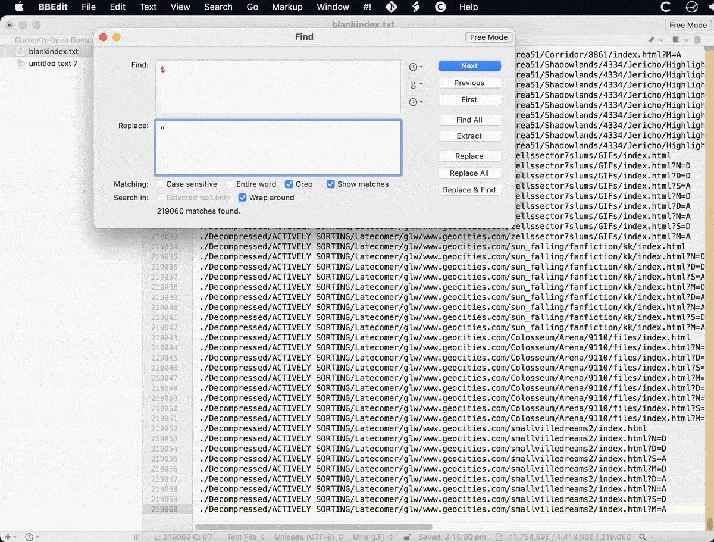

*BBEdit, grep and a little quotation-mark wrangling before feeding the list to xargs.*
{: .media-caption }

Adding quotes is quite easy using BBEdit as it has a built-in grep function. As I just happened to have the knowledge fresh in my memory, I did some grepping to add to the front of each line with the **^** (caret) symbol and to the end of each line with a **$** (dollar) symbol. Done. Now the file should be able to get parsed correctly in terminal (Mac OS).

`xargs -n 1 ls -v < ~/Desktop/blankindex.txt`

A lot of reading indicated I should have been using the `-0` (or `--null`) flag for xargs. That needs a list with each filename terminated by a NUL character, not just the same newline-separated file with a different flag. It would have saved the quoting step if I'd generated the list that way. But I didn't. I took the risk and watched it list the attributes of the files in blankindex.txt. I checked for any errors. None. We are go for the final command.

`xargs -n 1 rm -v < ~/Desktop/blankindex.txt`

It worked. Next stop, clean out some more empty files, folders and .DS_Stores:

`find . -name .DS_Store -delete find . -empty -type f -delete find . -empty -type d -delete`

We now have a much tidier directory structure for merging and a lack of empty files (or useless files) will prevent collisions when merging folders. We'll have a look at more case sensitivity, redirection loops, sitemap and jump tomorrow.

* * *

**24th October 2021**



The above video shows the **rm** command running through stripping static, server-generated index.html files away.

**Recapping yesterday:**

1. Found and removed all index.html files from directory listings ✅
2. Removed 0 byte files, removed 0 byte folders (in that order) ✅
3. Started to clean up some of the redirection looped files and folders.
4. Less than 1TB of data is present now.
5. Symlinks were all deleted (again) - we need mod_speling to work properly.
6. Sitemap has been created successfully and is now split into smaller chunks.
7. The jump script now covers all neighborhoods and is a fair bit quicker.

Onto number three in the list. Cleaning up files and folders that suffered from redirection loops when being harvested by Archive Team.

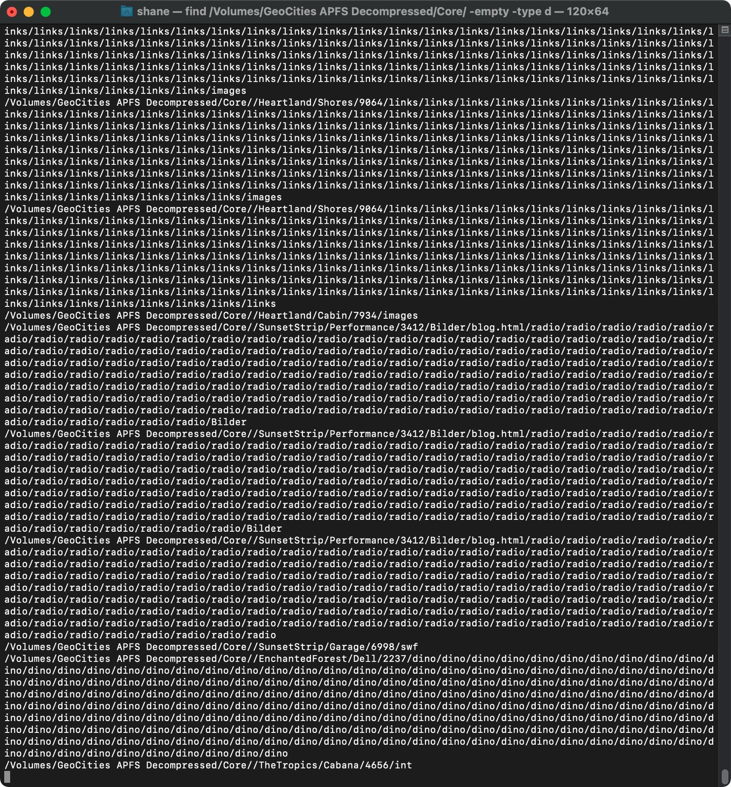

*A crawler loop turned simple paths into endless links/links/links. Just another day in the GeoCities archive.*
{: .media-caption }

While looking for empty directories, the longest of the long path lengths appeared. The above image shows an example of this output. The redirection loops (recursive loops) get a little extreme sometimes. For the purposes of this project, as long as they keep below the maximum path length, we are OK.

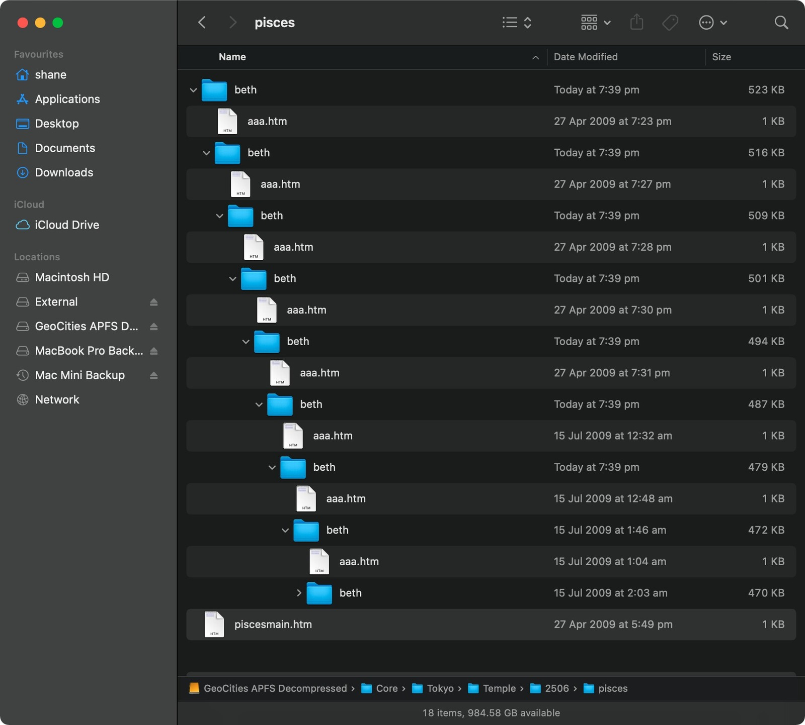

*Beth inside beth inside beth, with an aaa.htm at every level. A fine example of a crawler chasing its own tail.*
{: .media-caption }

The above image shows an example of what a typical loop would look like in Finder. At the time of writing the longest one we have is around 220 characters which is more than acceptable. The web crawler / spider would have been going a little insane finding a link within a link that was a link to itself inside a link, inside another link, linked to another link, etc., etc.

Running the following command will show the 10000 longest pathnames:

`find . | awk '{print length($0), $0}' | sort -n | tail -n 10000`

I've run this command a few times now and fixed the loops by deleting duplicated data. One interesting error I've come across is seen in the next image.

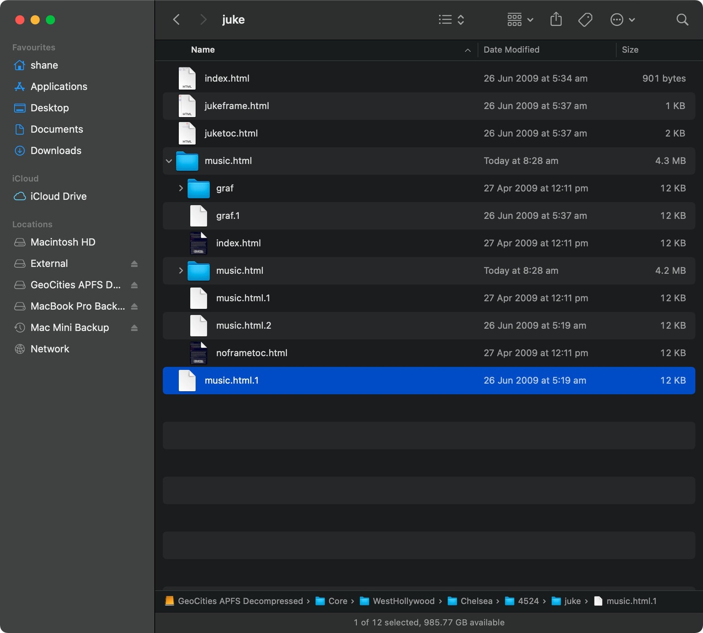

*The music.html folder was full of more music.html entries. The original file was buried among the copies.*
{: .media-caption }

In particular, take note of:

- The file name music.html.
- The variations of music.html.
- The file sizes.

The correct **music.html** is the file named **music.html.1**. However, all the files in the **music.html folder** are also the same **music.html.1 file**. It doesn't seem to happen on every recursive loop, but has happened enough for me to take note on how to fix it.

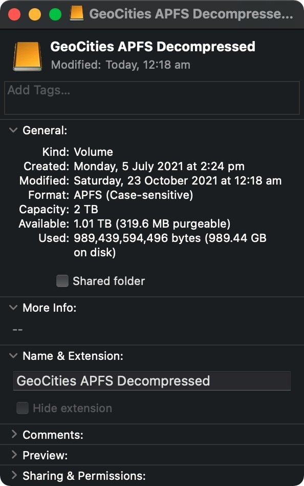

*Under a terabyte at last! Removing the recursive junk meant the archive could fit onto a 1 TB backup.*
{: .media-caption }

Deleting these has helped dip the entire decompressed data set below the 1TB mark. Some of those loops were big, causing folders to inflate to gigabytes. I should really run a search on folder size to detect any excessive utilisation of hard drive space. Low priority for now. But it does mean I can backup onto a 1TB drive/partition in full now. Lucky!

Touching on Apache's mod_speling again, symlinks have all been removed from the local drive (not the server-facing one, yet). In this setup, the case-variant symlinks were getting in the way of the redirections I wanted. It was mainly the nested directories that had issues. For example, take:

- https://geocities.mcretro.net/Athens/olympus/1043/
- https://geocities.mcretro.net/Athens/Olympus/1043/

`/Athens/olympus/` is not redirected to `/Athens/Olympus/` because the lowercase path already exists as a symlink. mod_speling normally looks for a correction when the requested path isn't found; it doesn't need to correct a path that already resolves. That was the snag here, rather than symlinks being universally incompatible with mod_speling.

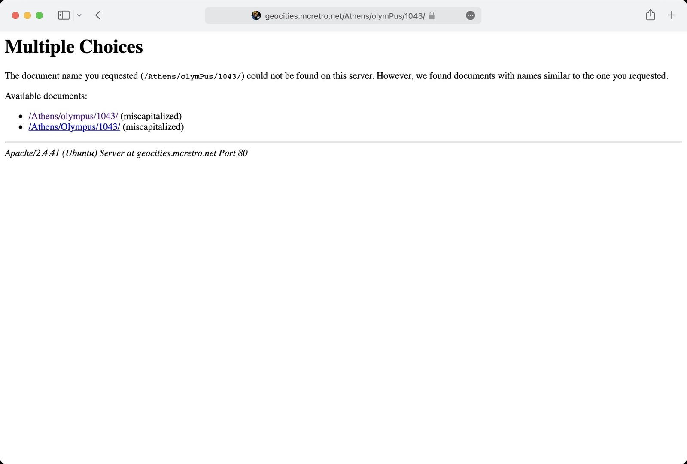

*Another capitalisation collision. Apache couldn't decide between olympus and Olympus.*
{: .media-caption }

One of the goals is to have everything in the correctly capitalised folders as GeoCities would have wanted it - Area51, SoHo, SiliconValley, etc. Any incorrect case will **_likely_** cause issues with mod_speling, breaking the ability to redirect correctly or locate source files - such as images and midis.

This means symlinks are off the menu again. They will only be used on the live server to fold the neighborhoods (/core/) into the much larger YahooIDs (/yahooids/). We need to give mod_speling the opportunity to thrive. We can always recreate symlinks if required as a last ditch effort.

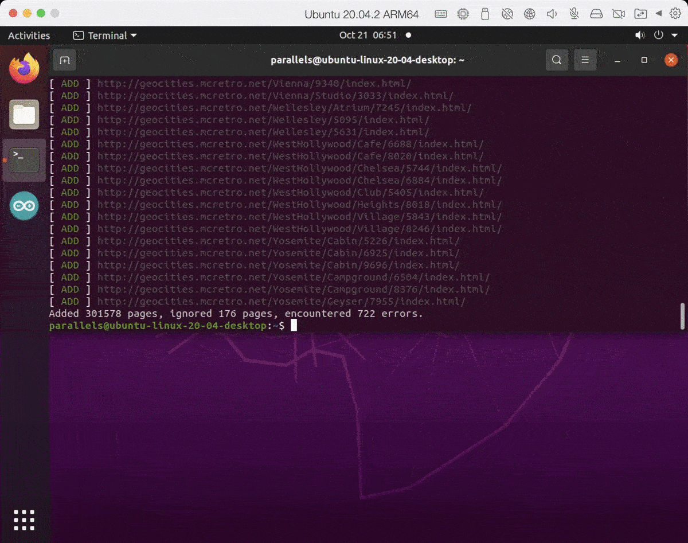

*More than 301,000 pages in the sitemap. Not bad for a little Raspberry Pi-based rebuild.*
{: .media-caption }

The sitemap is now split over seven files, with a depth flag of 4. I'm scared to think how long it would take if we did unlimited depth following every link found. I should try it one decade. Anyway, now that the sitemap is working, it's time to fix Jump™!

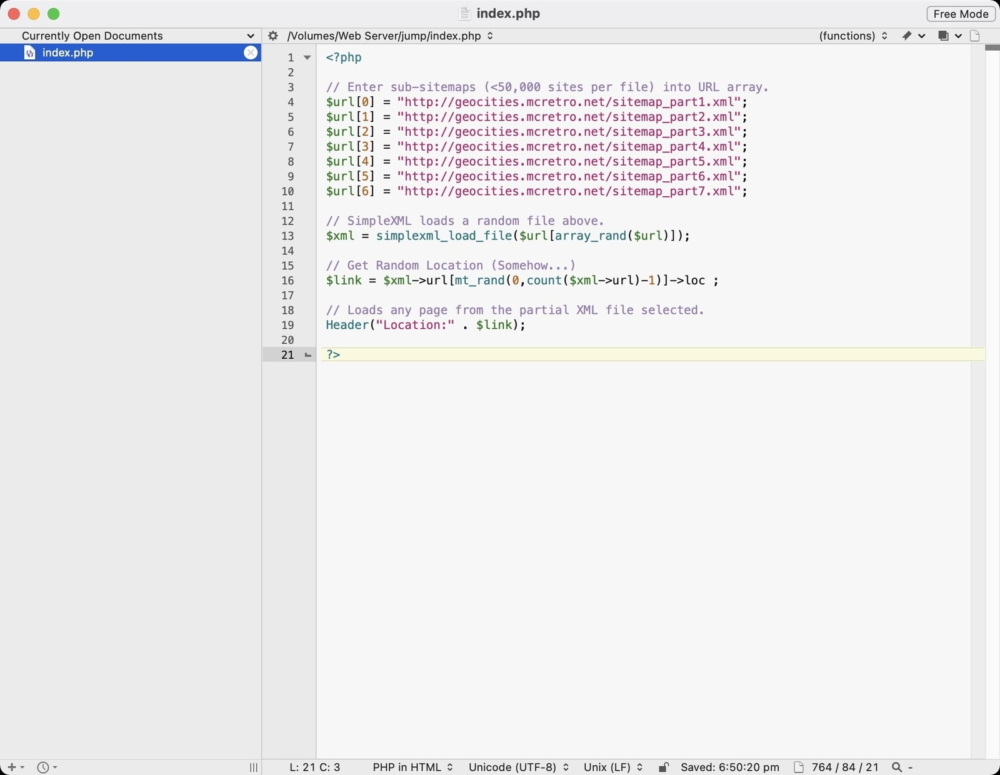

*Seven smaller sitemap files gave Jump™ less to chew through with each random visit.*
{: .media-caption }

Jump™ loads faster now and the stress on the weak Raspberry Pi 3 CPU is less when parsing the smaller sub-sitemap files. The amount of code I am running through the command line is fantastic.

I've been using **awk**, **grep** (and **pcregrep** for multiline matching), **find**, **rsync** and **xargs**. I think I am getting better at regular expressions (regex). Regex are extremely powerful provided you are using the right tool. I may have nearly wiped my desktop out... a second time... with an rm command. This time around I was quite careful with what I was doing with these backupless, work-in-progress files.

**The Future**

The next steps over the week will be to continue sorting out the pictures and images from the rest of the decompressed data. I'll be tidying up the YahooIDs to remove any core folders, such as Area51, Hollywood, etc. They can't be left in the YahooIDs folder. That would cause pretty big issues when, for example, /core/Area51/ tries to mount at the same point as /yahooids/Area51.

I also need to continue to think about the best way to serve the images. Currently there are many locations images were stored at, including international sites. I need to work out the best way to write that into Apache's mod_substitute. A sample of the website addresses is below:
- http://pic.geocities.com
- http://geocities.com/pictures/
- http://us.yimg.com

We create a simple /images folder and put the domains in our root directory and would look something like this:
- /images/pic.geocities.com/
- /images/geocities.com/pictures/
- /images/us.yimg.com/

I think this is something like what Yahoo did when they took over in mid-1999 and again after a brand refresh in the 2000s. For the immediate future though... a backup.

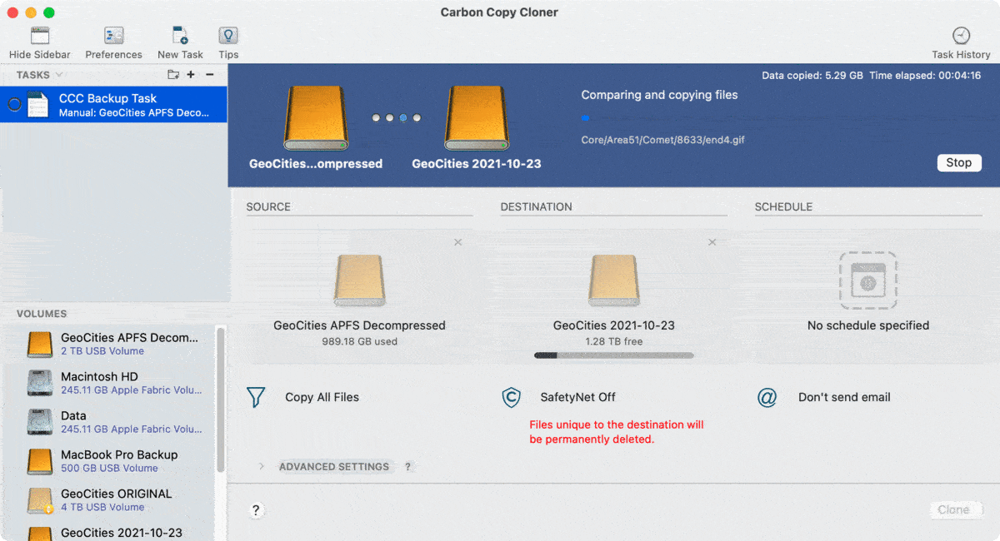

*A backup in progress before more merging experiments. Better to have another copy than another disaster.*
{: .media-caption }

Creating a snapshot of the progress so far, to rotational media, is a good idea. It should finish late tonight. I'll then be able to work on merging neighborhood (core) data together. Not making a backup at this point could easily be disastrous. One more week and we should have a clearer picture of how everything looks.

* * *

**30th October 2021 (Part 1)**


*Finder error -1407, right in the middle of merging neighbourhood folders. A little more drama for the archive.*
{: .media-caption }

For the past week, my primary goal has been to merge all the core data together, avoiding copy blocks as pictured above. I've been mostly successful at this, although I might have had to call upon the backup from last week a few times. It's very easy to enable autopilot and accidentally overwrite all of `https://geocities.mcretro.net/neighborhoods/#heartland` by replacing instead of merging. Thankfully, that's now water under the bridge and we have arrived at...


*The Core neighbourhoods finally together, with the names looking a lot more like GeoCities intended.*
{: .media-caption }

**That's right, the core has been merged**
The neighborhoods are all in one place and now have correct TitleCase (see above). **MotorCity** is no longer **motorcity** or **motorCity**. Trying to visit an incorrect title now invokes Apache's mod_speling to boot you into the right directory. Previously when we had a mish-mash of lowercase, and uppercase letters it would result in some quirky behaviour.

YahooIDs have been cleared out and contain only usernames now. YahooIDs have not had their case switched to lowercase as I haven't found the right command to do it... yet.


*Some of those old tiled backgrounds were working again. Web Inspector even showed where this one came from.*
{: .media-caption }

**The pictures are (mostly) merged**
In the image above we can see clipart tiled backgrounds making an appearance which makes text a lot easier on the eyes. I've been thinking about implementing a calibration page to help get the best 800x600 experience on modern browsers as some of the tiling tends to, well tile I guess, vertically making the page look like sloppy construction.


*Maniac World, red background, green ENTER button and metal bands everywhere. That's some proper old-web energy.*
{: .media-caption }

There's now a GeoCities favicon.ico in the title bar. It looks like the favicon standard wasn't around until the late 1990s when GeoCities rebranded, just prior to Yahoo! takeover.


*Another sitemap rebuild began, this time after the neighbourhood cleanup.*
{: .media-caption }

Since just before 7am we have been rebuilding the sitemap.xml to reflect the lack of empty folders and blank index.html files. This will likely take the rest of the day.

After this has completed, I've allocated some time to spend browsing the GeoCities via [Jump™](/homepages/geocities). I'll live stream this browsing session over one of my [YouTube channels](/channels). This will be done with the MiSTer which feels like a 486 running at 33 MHz. Armed with Windows 98 and Internet Explorer 5.0, I'll dial into the world wide web (WWW) through my two Banksia SP56 modems at ~28.8k. I've got an [MT32-pi](https://github.com/dwhinham/mt32-pi) hooked up so I'll be rocking out to any MIDIs I come across. Stay tuned! :city_sunrise:

* * *

**30th October 2021 (Part 2)**


*Sixteen hours in and the sitemap generator was still exploring SunsetStrip. No wonder it felt endless.*
{: .media-caption }

The sitemap generation is still chugging along. This will likely still be running tomorrow morning as I now have all the YahooIDs on there too. I'll probably manually delete them off the sitemap though as they are **_usually_** just storage for the neighborhood sites.

Another thought I had while beaming between sites randomly, is that the jump link might be better suited for each neighborhood. For example, to randomise a visit to a site from Area51 you could load /jump_area51.php. It would make it a little less random, but then you can focus in on what you may actually want to see. For example, I might be an X-Files fanatic, I'm unlikely to find X-Files in Heartland or MotorCity.



The above video is a live stream of me jumping between random sites and checking some of the source code. I also installed the wrong version of WinZip 6.3, 16-bit instead of 32-bit. I should get some DOS-based benchmarks to see what the MiSTer is powerful enough to do. Tomorrow should be an interesting day. ✅

* * *

**31st October 2021 (Part 1)**


*The second sitemap run finished with 299,337 pages. Almost a full day's work for the crawler.*
{: .media-caption }

It hadn't occurred to me that the users (YahooIDs) won't be visible due to the way the website is structured, which I think is a good thing. Yahoo used to offer usernames alongside a regular neighborhood address, so the two could co-exist and share resources between each other. As the goal of this project was GeoCities prior to Yahoo takeover this suits well.


*One sitemap per neighbourhood. Smaller XML files meant a much less miserable Jump™ system.*
{: .media-caption }

I noticed that since rejigging the Jump™ system pages were taking a good while longer to load. It looks like it was to do with the PHP having to parse a 4MB file each time a random jump was initiated. I've now split it into neighborhoods as shown above. Smaller files = better performance. Heartland is still a monster at a whopping 2MB, but that's still an improvement.


*Mega Jump™ picked a neighbourhood and then a page inside it. Much more manageable than one giant sitemap.*
{: .media-caption }

From this we now have a faster Mega Jump™. Mega Jump™ picks from a random neighborhood and beams you to a random page in there. If you want more precision though, we have this new feature...


*The neighbourhood Jump page came together, complete with a rainbow of old GeoCities badges.*
{: .media-caption }

Bookmark an icon to your favourites bar to be able to load all your best X-Files fanfic, or maybe some extreme sports in Pipeline. I'm impressed with how it turned out.


*Area51 got its own little random-page jumper. The same idea, just restricted to one neighbourhood.*
{: .media-caption }

Above is the script used to call on the random page, it should look familiar from a few posts back. In other news the YahooIDs are integrated quite well, see the following fish page with the highlighted code calling on the tiled jewel background. Note the location bar address. Neat!


*The Nashville page could pull a background image from a YahooID path. Two eras of GeoCities finally talking to each other.*
{: .media-caption }

This also works if websites were spliced and diced between the YahooID and the neighborhood address, as seen below, are linked inside the same page to each other. Again, note the location bar address.


*A cat called Moon Shadow, tucked away on a restored GeoCities page. This is exactly why I wanted those old sites back.*
{: .media-caption }


*The rebuilt GeoCities front page, proudly under construction and best viewed at 800x600. Naturally.*
{: .media-caption }

For now that seems to be the end of the immediate project. One thing I would do differently a second time around: merge with the command line instead of Finder in Mac OS. I could see that some files were not merging even though they didn't exist in the destination.

That was a short list. I suppose a lot did go well. Things for future consideration include:

1. Darknet compatibility via Tor, because why not. My main blog and retrosites are all darknet enabled, so it would be interesting to get GeoCities on the darknet.
2. Enabling caching for Apache to reduce server load. We're on a little Raspberry Pi 3.
3. Cloudflare CDN for the same reasons as above.


*A Babylon 5 Bester fan page, complete with Psi Corps symbols. One last bit of 1990s browsing before celebrating.*
{: .media-caption }

I'll upload a live stream for the final demonstration of how the site works a little later on this evening. But first, time to watch some Babylon 5 to celebrate.

* * *

**31st October 2021 (Part 2)**



And there it is, the incredible era that spanned the mid-late 1990s that was GeoCities. I hope you've enjoyed the progression, I know I have. You now should have some idea on how to create a similar setup using a Raspberry Pi 3 and Ubuntu 20.04.

To those of you from the future looking to do exactly that I wish you the best of luck on your journey. For everyone else, enjoy the animated gifs, midis and horrendous web design.

Try it out at [http://geocities.mcretro.net](/homepages/geocities) if you haven't already.

* * *

**14th November 2021**

I'd love to say it's as complete as it could be but there's always more work to do.

Other archives such as oocities.org and geocities.restorativland.org are great in their own respects as well. Then there's archive.org - which is just absolutely massive. They also happen to own the shoulders I have been standing on to attempt this project.

And for what it's worth, I'm still sorting through my unpublished notes trying to see what I could do differently and how I could potentially improve upon what's already been done above. It sure is a learning experience!


*A little GeoCities logo to finish the October worklog. Simple, cheerful and very much of its era.*
{: .media-caption }

* * *

**4th December 2021**


*The purple '.onion available' badge appeared. GeoCities had made it onto Tor.*
{: .media-caption }

This is something I was meaning to do a little while back - enabling darknet accessibility via a Tor v3 onion vanity address. I've been tinkering with my SSL certificates on my servers to try and get them working the way I want too.

So now if you happen to be on a modern computer running the Tor Browser (based on Firefox) and visit the HTTPS version of geocities.mcretro.net, you will notice a little purple banner in the address bar.

- .onion available


*And there it was on a memorable, or rather completely unmemorable, onion address.*
{: .media-caption }

Once clicked you end up with the very easy to remember: [http://geocitiesllczuf44da2nj45jn3fntdjpw27ercfbhkrw3mnegti7pid.onion](/homepages/geocities)

This link will not resolve in a clearnet browser, you need to use one that has Tor capabilities (or a Tor proxy service).


*A look behind the onion address. Tor had quite a few stops to make before reaching GeoCities.*
{: .media-caption }

As you can see it is travelling through quite a complicated looking circuit.


*The Jump page was appearing over Tor too, complete with the old neighbourhood buttons. The links still needed some tinkering.*
{: .media-caption }

The jump page mostly works. I noticed that on it tends to take you to the clearnet site but does provide the purple ".onion available" button again. I'm sure I'll work it out eventually as to why it is doing that. I must have a "geocities.mcretro.net" hardcoded somewhere instead of just a "/". Actually it might be because it uses the sitemap.xml files for jump. Ahhh yes. I don't think I'll change that, at least it provides darknet search indexers a bit more content.

[Grab the Tor Browser](https://www.torproject.org/download/) and have a tinker with the technology, it's quite interesting to setup. Then stop by [http://geocitiesllczuf44da2nj45jn3fntdjpw27ercfbhkrw3mnegti7pid.onion](/homepages/geocities)

* * *

**3rd January 2022**


*An old GeoCities page through its onion address, with all the 1990s nature graphics still in place.*
{: .media-caption }

**Fixed darknet jumping.**

If you visit [https://geocities.mcretro.net](/homepages/geocities) in Tor Browser, the [Onion-Location](https://community.torproject.org/onion-services/advanced/onion-location/) header activates the address-bar prompt. This won't work on the plain HTTP version, [http://geocities.mcretro.net](/homepages/geocities). The page advertising an Onion-Location header has to be served over HTTPS. That's by design, as per The Tor Project.

* * *

**8th January 2022**

Good finds! I moved the server from the Raspberry Pi 3 to the Raspberry Pi 4 this morning and in the process killed all the symlinks. This is why documenting the whole process was a great idea.


*Apache was not happy after the server move. The error log was rather clear about those broken links.*
{: .media-caption }

These are three very useful commands for debugging Apache errors:

`sudo tail -f /var/log/apache2/other_vhosts_access.log sudo tail -f /var/log/apache2/error.log sudo tail -f /var/log/apache2/access.log`


*There was the problem: Paris still pointed to the old External drive path. The maroon links gave it away.*
{: .media-caption }

They even show up maroon! How did I manage this? I had renamed the external drive from "External" to "geocities" to help differentiate it from another project I had activated in the past week or so - [The Assembler Games Archive](/the-assembler-games-archive/). All my old symlinks died as a result.


*A test run without sudo found the broken links and, thankfully, couldn't remove them yet.*
{: .media-caption }

I ran a test to make sure I wasn't going to wipe out the entire internet first - i.e. without sudo tacked on the front of the command I stole from the internet. It worked, it found all the correct symlinks to remove and then I did!


*The new symlinks pointed into core instead of the renamed external drive. Athens and Area51 were back.*
{: .media-caption }

Here's the command that brought them back to life. The neighborhoods need to be inside the yahooids subfolder for everything to work nicely.


*And the old pages were loading again. This one had a very green approach to environmental education.*
{: .media-caption }

* * *

**9th April 2022**

**Fixing a Little Apache mod_status Onion-Service Exposure**

Just when I thought everything was done and dusted, I received this message through the contact form on my website a few months back.

```
Dear Administrator，

We are researchers from INSC, Tsinghua University. In our recent research for dark web misconfiguration, we found that your website may be suffering from this security problem. Due to the Apache mod_status vulnerability, results from scanning show that at least 7 dark web domains (starting with geoc| chir| fish| pepp| retr| soni| spac|) and 2 surface web domains (http://geocities.mcretro.net | http://space.mcretro.net) are running on the same host.

This vulnerability is low risk on the Internet, but high risk on the dark web. It is recommended to fix it in time to avoid being attacked or having your information compromised.

And we are looking forward to your reply which is important to our ongoing research.

Best Regards, INSC, Tsinghua University
```

I thought, that's interesting. Naturally, I was curious as to what I had misconfigured. The underlying problem was not some mysterious flaw in Tor itself. Apache's `mod_status` was restricted to localhost on the clearnet, but the Tor service also reached Apache locally. That meant an onion-service request could reach `/server-status` and expose information I had assumed was local-only. So I visited my sitemap domain as a test `http://retrojunkie.net/server-status` and was presented with this:


*On the ordinary HTTPS site, Apache's server-status page correctly returned Forbidden.*
{: .media-caption }

That was the expected result on the clearnet: external clients couldn't see it. But in my setup Tor forwarded onion-service requests to Apache from localhost (127.0.0.1), which passed that local-only restriction. Let's try the onion version of the same site at `http://retro56qdosu3zuisr5tiuh7ihpn6owzpwjwvs7djlweiqb3mcspahyd.onion/server-status`.


*The onion address was a different story. Apache happily displayed details I didn't intend to share.*
{: .media-caption }


*Worse still, the status table listed requests and virtual hosts across multiple sites. Not exactly the privacy I had in mind.*
{: .media-caption }

Having a look around why this was happening resulted in me finding [this great site](https://www.osintcurio.us/2019/03/05/apache-mod_status-in-tor-hidden-services-destroy-anonymity/) explaining how it all works in detail. After a quick read I ran the following commands to try and solve the problem I didn’t know I had.

`sudo a2dismod status sudo a2dismod info sudo apache2ctl configtest sudo systemctl restart apache2.service`

A quick refresh of the onion site...


*After disabling the Apache status modules, the same onion URL returned my usual dead-link page. Much better.*
{: .media-caption }

And all is well... Well, not found because it isn’t supposed to be showing all the intimate server details and pages being loaded. Thanks for the heads up Institute of Network Science and Cyberspace (INSC) of Tsinghua University, most appreciated!

### Sources

- [Apache HTTP Server - mod_speling](https://httpd.apache.org/docs/2.4/mod/mod_speling.html)
- [GNU Findutils - Finding Files: safe filename handling and xargs](https://ftp.gnu.org/old-gnu/Manuals/findutils-4.1/html_mono/find.html)
- [Tor Project - Onion-Location](https://community.torproject.org/onion-services/advanced/onion-location/)
- [Apache HTTP Server - mod_status](https://httpd.apache.org/docs/2.4/mod/mod_status.html)
- [GeoCities Rebuild for Older Browsers - ACMS Forum](https://forum.acms.org.au/t/geocities-rebuild-for-older-browsers/83)

### Related Posts

- [The GeoCities Archive Rebuild Blog](/the-geocities-archive-rebuild-blog/)
- [The GeoCities Archive Rebuild Goes Live](/the-geocities-archive-rebuild-goes-live/)
- [Rebuilding GeoCities on macOS 12](/rebuilding-geocities-on-macos-12/)