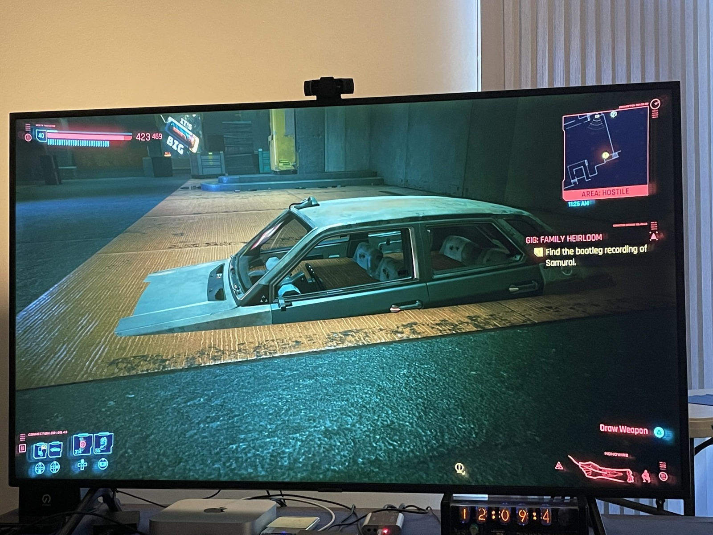

*The first sign something was a bit off: a car half buried in the road. Version 1.31 had its moments.*
{: .media-caption }

Look, I know Cyberpunk 2077 1.31 wasn't perfect on the trusty old PlayStation 4 as seen above.

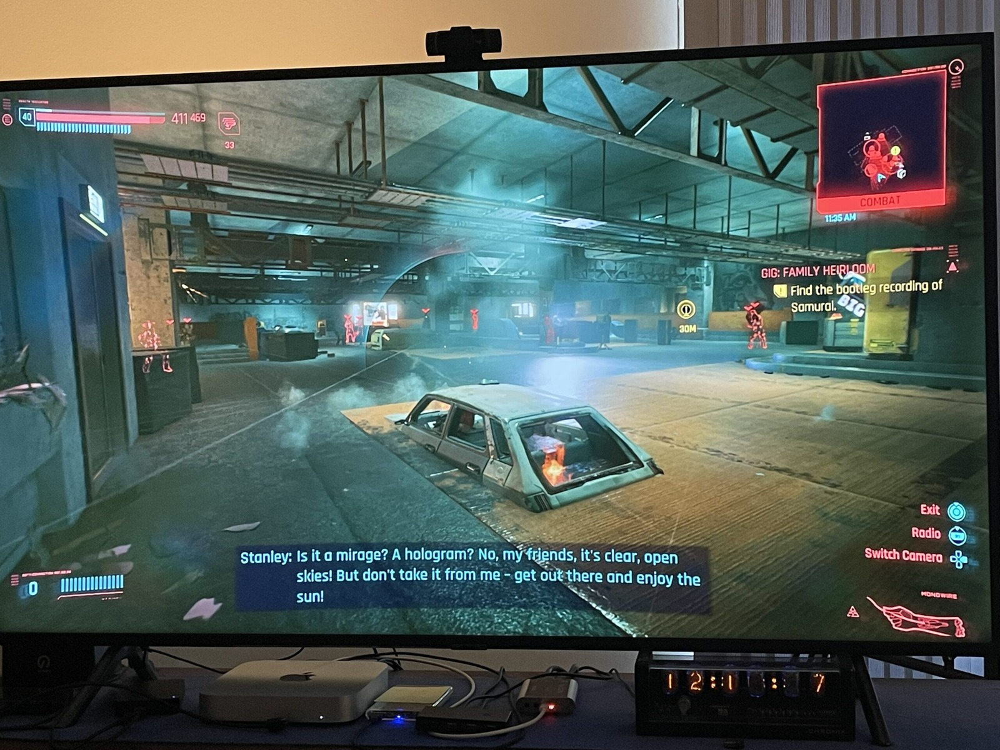

*I managed to get inside the sunken car. The enemies were still there, and I wasn't going anywhere.*
{: .media-caption }

I mean I wasn't expecting to be able to get into this car - but here I am, inside the car.

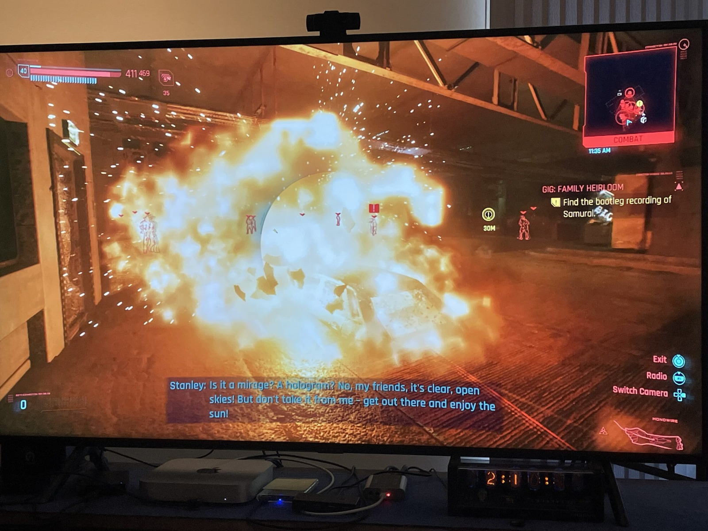

*Then the car exploded. A fairly dramatic way to finish a driving glitch.*
{: .media-caption }

Well, now the enemies can see me and I'm stuck in the car.

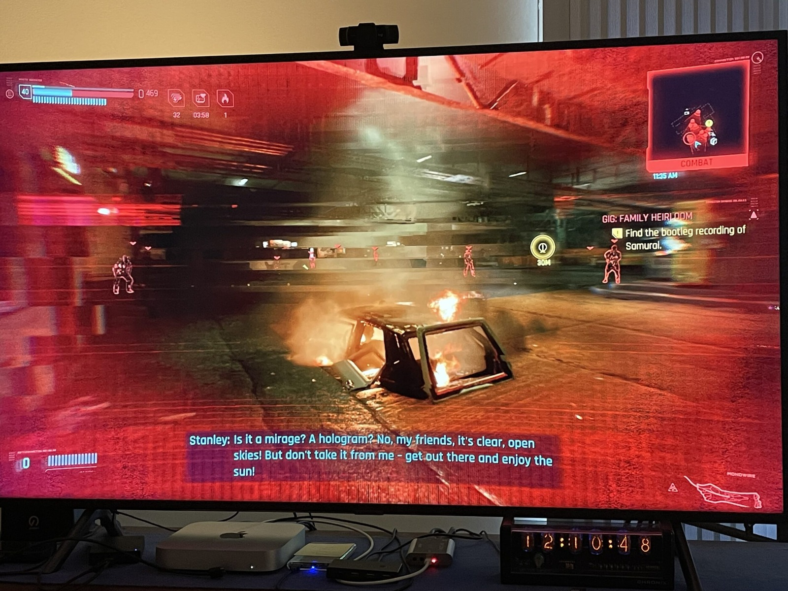

*The remains of the car were still stuck in the floor, now with added flames. At least the radio had worked for a bit.*
{: .media-caption }

At least the car radio works.

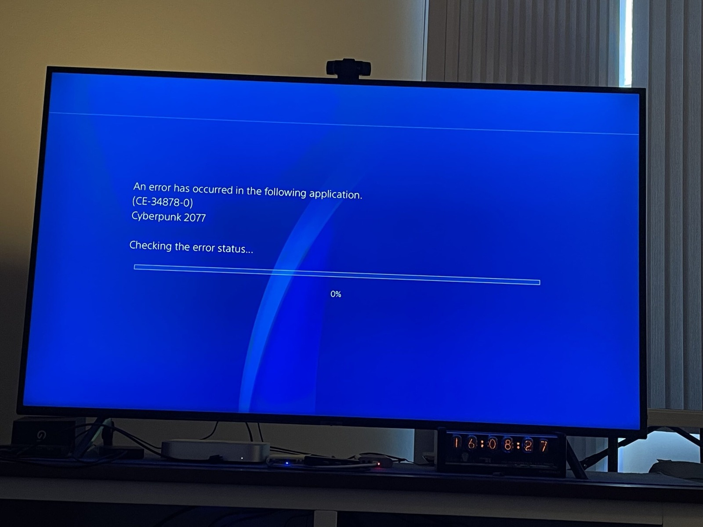

*Back to the familiar CE-34878-0 crash screen. Cyberpunk and the PS4 were getting very well acquainted.*
{: .media-caption }

Until it doesn't.

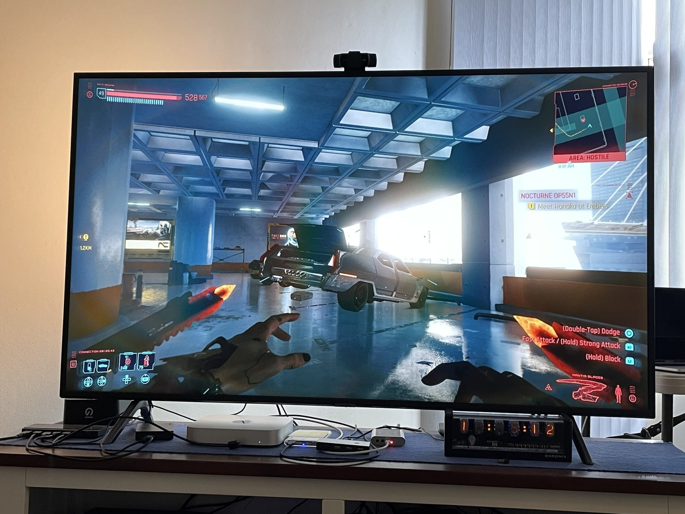

*It booted again, only to give me another car that didn't quite understand how floors work.*
{: .media-caption }

Then you boot it up again and it kind of works.

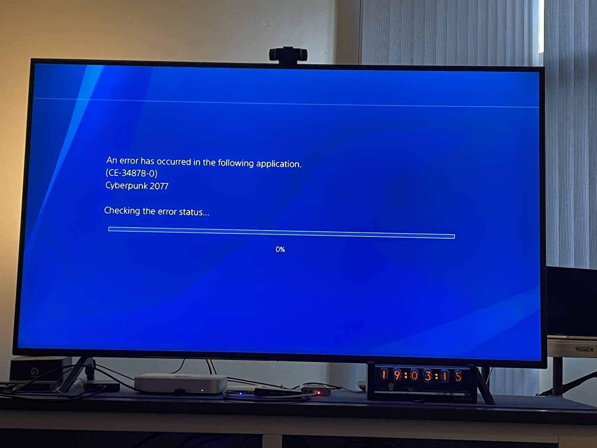

*Another boot, another crash. Back to CE-34878-0 yet again.*
{: .media-caption }

Until it doesn't, again.

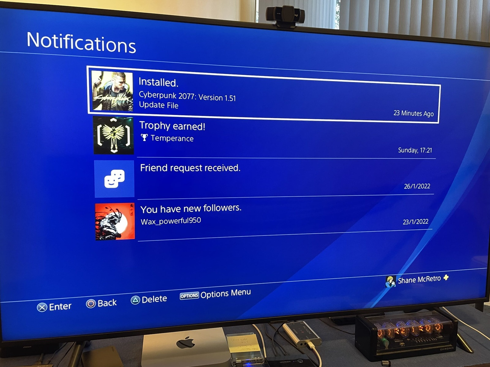

*Version 1.51 had installed successfully. That was about the last bit of good news.*
{: .media-caption }

But that pales in comparison to the latest 1.5 patch on PS4, appropriately named version 1.51. Did extra testing go in?

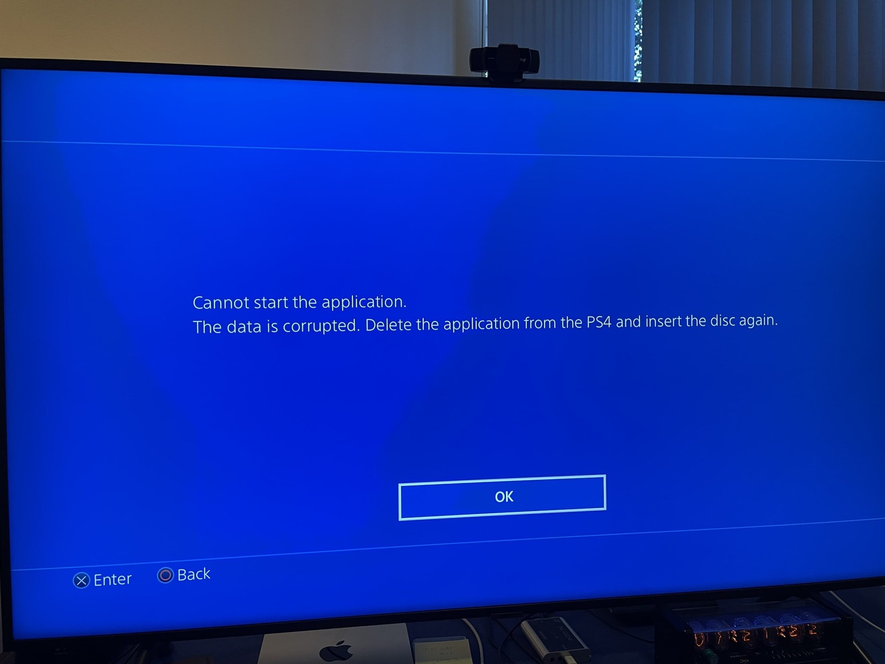

*Instead of crashing during play, Cyberpunk now refused to start at all. Nice upgrade.*
{: .media-caption }

> "Cannot start the application. The data is corrupted. Delete the application from the PS4 and insert the disc again."

Nope. Somehow they broke it even more. It doesn't boot at all. CD Projekt Red... why do you do this?

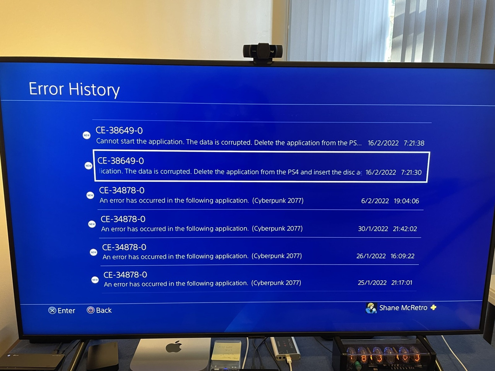

*The error history told the story: two new CE-38649-0 entries above the old CE-34878-0 crashes.*
{: .media-caption }

At least the error is different to what we normally see for in-game crashes. Change is as good as a holiday... away from my PlayStation because the game I was playing no longer boots. CD Projekt Red appears to be [working on something](https://web.archive.org/web/20220217065632/https://support.cdprojektred.com/en/cyberpunk/playstation/sp-technical/issue/2090/cannot-start-the-application-the-data-is-corrupted-error-after-updating-1). I've submitted a ticket.

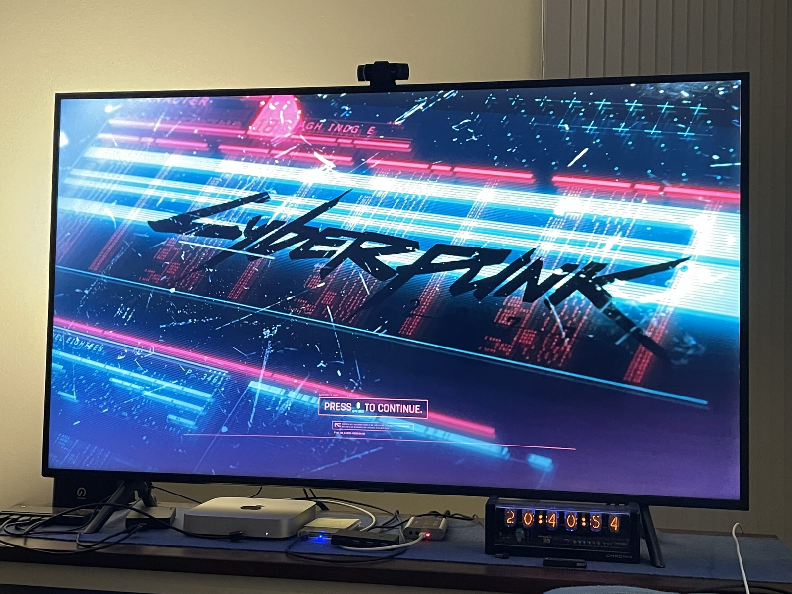

*I was beginning to miss seeing this start screen. With the 1.51 issue, even getting this far felt nostalgic.*
{: .media-caption }

I guess for now all I can do is sit here with my pre-ordered v1.00 discs and wait for the above screen to present itself once more. I sure do miss version 1.31.

### Sources

- [CD Projekt Red: Cyberpunk 2077 PS4 Corrupted-Data Launch Error (Patch 1.5/1.51, Archived 17 February 2022)](https://web.archive.org/web/20220217065632/https://support.cdprojektred.com/en/cyberpunk/playstation/sp-technical/issue/2090/cannot-start-the-application-the-data-is-corrupted-error-after-updating-1)

### Related Posts

- [Cyberpunk 2077 (2020, PS4 Live Stream, Day 1)](/cyberpunk-2077-ps4-live-stream-day-1/)
- [Cyberpunk 2077 (2020, PS4 Live Stream) - The 2022 Update](/cyberpunk-2077-the-2022-update/)
- [Cyberpunk 2077 PS4 1.51 Patch Update... Update](/cyberpunk-2077-ps4-1-51-patch-update-update/)
- [Cyberpunk 2077 PS4 Final Thoughts](/cyberpunk-2077-ps4-final-thoughts/)
