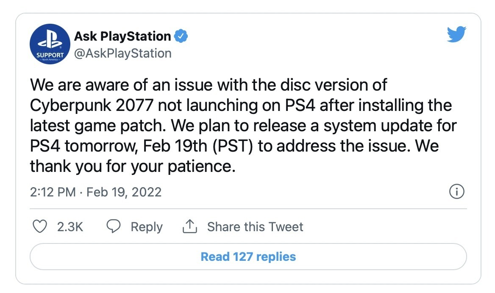
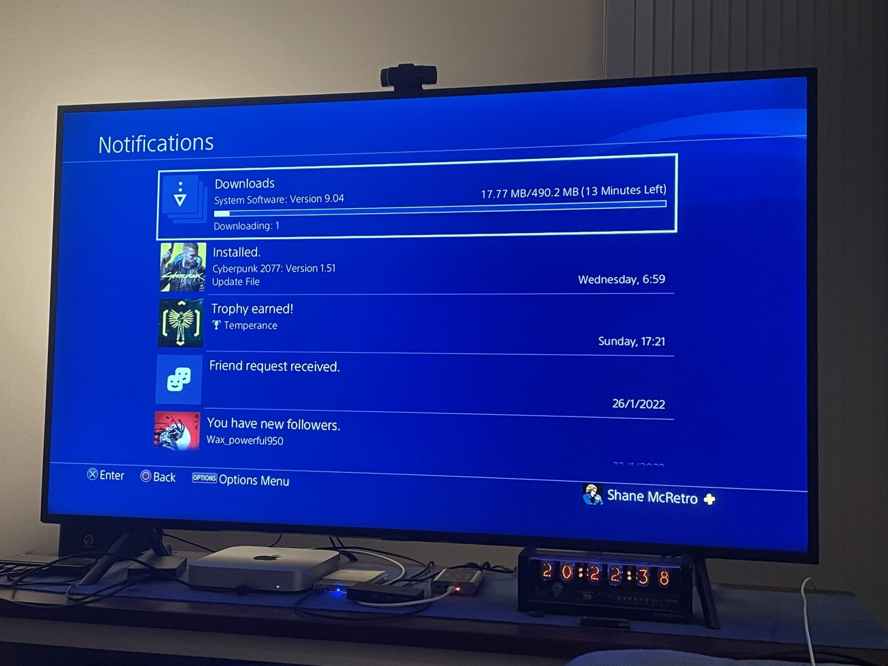
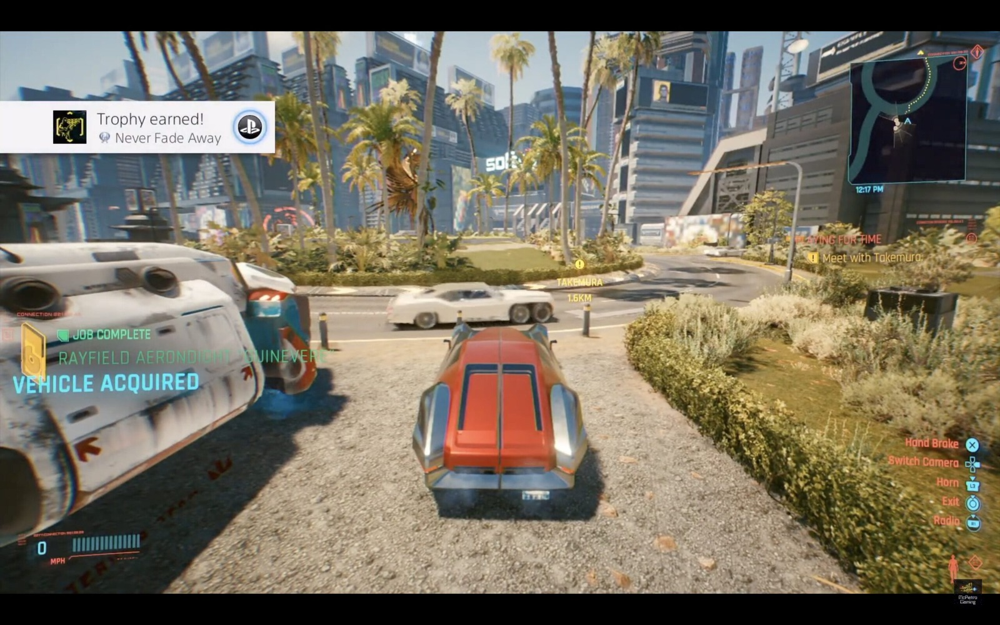
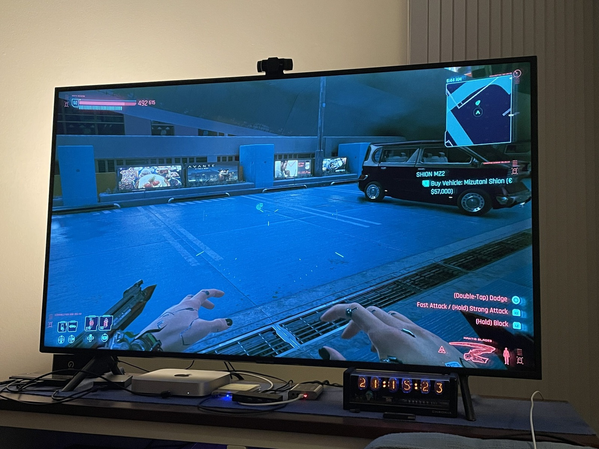
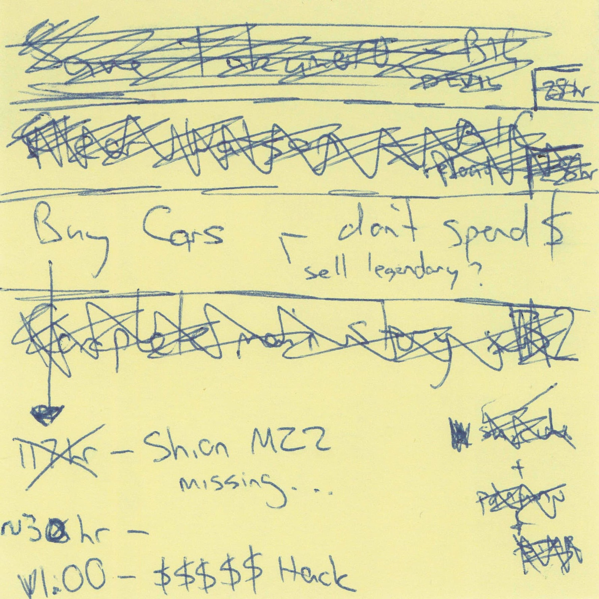
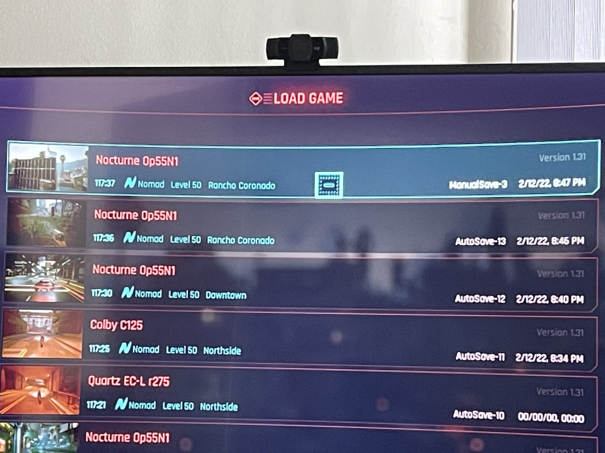
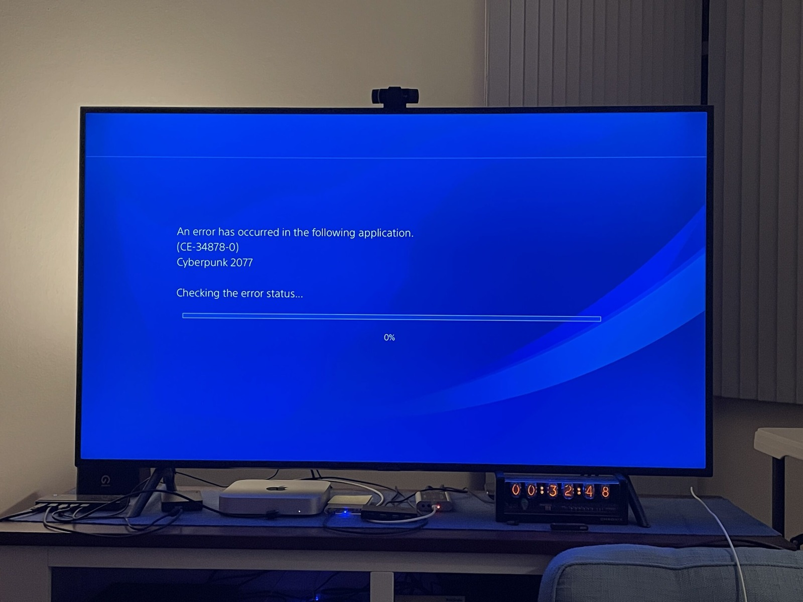

*When even the PlayStation needed an update to get Cyberpunk running again, things had gone a bit sideways.*
{: .media-caption }

How did they break the game to the point of [Sony needing to release a system patch](https://www.pushsquare.com/news/2022/02/sonys-releasing-a-ps4-system-update-to-fix-cyberpunk-2077-disc-issues) to fix it?

*System software 9.04 was downloading, with Cyberpunk 1.51 already installed. Here we go again.*
{: .media-caption }

[That's impressive](https://web.archive.org/web/20220402195154/https://support.cdprojektred.com/en/cyberpunk/playstation/sp-technical/issue/2090/ps4-system-update-addresses-cannot-start-the-application-the-data-is-corrupted-issue-occuring-after-updating-to-1-5). But you know what I think is even more impressive?

*There it is! The Never Fade Away trophy popped up, with a new car for good measure. The completionist lives on.*
{: .media-caption }

A platinum trophy in Cyberpunk 2077 on a PS4 slim. It was a struggle but the completionist in me carried on. A couple of the quests were bugged and wouldn't complete.

*Another car to buy, another dent in the wallet. The Shion MZ2 was asking for €$57,000.*
{: .media-caption }

Nothing worse than having to buy a car that is missing and therefore can't be bought. And that one Watson NCPD quest marker that was missing. I made an action plan.

*The action plan had become a sheet of crossed-out jobs, missing cars and money-making schemes. Very organised chaos.*
{: .media-caption }

Some of the things I could address by reverting my 117 hours of gameplay by roughly 87 hours, back to around hour 30. Something went wrong at some point.

*The saves were sitting at around 117 hours. Time to rewind a rather painful chunk of progress.*
{: .media-caption }

But then again, some were broken from the very beginning, and others were out of reach in my playthrough because I hadn't saved my in-game cash from the start. Autojock trophy, I'm looking at you!

*And one last blue screen for old times' sake. CE-34878-0 was still doing the rounds.*
{: .media-caption }

How do I fix something that's bugged? I had to go back to the start, right back. Maybe I learnt from the best, CD Projekt RED when they broke the PS4 version of the game...

> **“Cannot start the application. The data is corrupted. Delete the application from the PS4 and insert the disc again.”**

I followed the PS4 error's delete-and-reinstall instruction, disconnected from the internet and installed from my release-day discs loaded with v1.00. Picked up a nice money hack and started to grind, grind, grind.



The weirdest thing was that v1.00 felt **_more stable_** when driving about but was missing **_a lot_** of polish compared with patch v1.31 and even v1.51. It's almost like they traded driving stability for prettiness on the lower tier consoles.



Every time I would visit this area there'd be other people eating hot dogs. I guess life really does imitate art! Check out the [McRetro Gaming YouTube channel](https://www.youtube.com/c/McRetroGamingOnline/videos) for more videos of v1.00 gameplay.

### Sources

- [CD Projekt Red: PS4 System Update for Cyberpunk 2077 Corrupted-Data Error (Archived 2 April 2022)](https://web.archive.org/web/20220402195154/https://support.cdprojektred.com/en/cyberpunk/playstation/sp-technical/issue/2090/ps4-system-update-addresses-cannot-start-the-application-the-data-is-corrupted-issue-occuring-after-updating-to-1-5)

### Related Posts

- [Cyberpunk 2077 (2020, PS4 Live Stream, Day 1)](/cyberpunk-2077-ps4-live-stream-day-1/)
- [Cyberpunk 2077 (2020, PS4 Live Stream) - The 2022 Update](/cyberpunk-2077-the-2022-update/)
- [Cyberpunk 2077 PS4 1.51 Patch Update](/cyberpunk-2077-ps4-1-51-patch-update/)
- [Cyberpunk 2077 PS4 Final Thoughts](/cyberpunk-2077-ps4-final-thoughts/)
